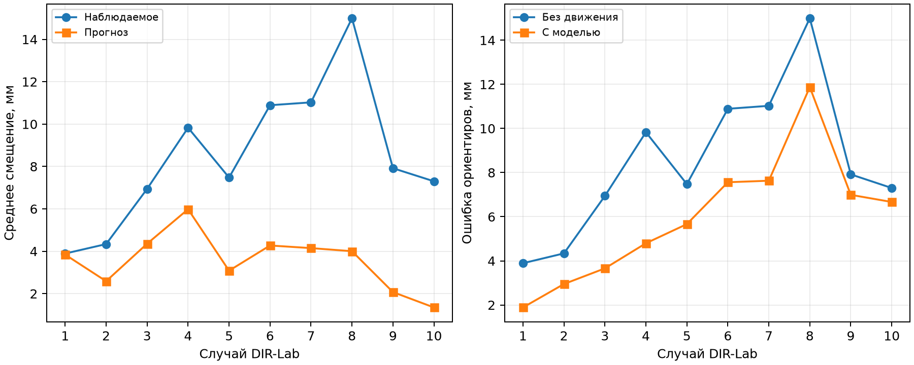

# Проверка прогноза дыхательного движения на десяти открытых 4D-КТ

**Статус:** вычислительная проверка готовой модели по экспертным ориентирам. Соглашение об обозначении дыхательных фаз сверено с первичными источниками и опубликованным кодом обучения. Независимость проверочных пациентов от обучения конкретных весов не подтверждена. Анатомический допуск для применения к КТ добровольцев и FEM не установлен. Дата расчёта: 1 октября 2026 года; повторная проверка фаз: 7 октября 2026 года.

**Исправление трактовки фаз.** В DIR-Lab и TCIA 4D-Lung начало шкалы соответствует концу вдоха, а 50 % — концу выдоха. Конвертер TCIA сохраняет процент исходной серии; опубликованный код обучения делит его на 100. Фаза `g070` служит опорой модели формы, но не переопределяет начало цикла. Подпись «конец выдоха» для неё в учебном примере MONAI противоречит описанию набора и контрольным объёмам лёгких. Поэтому привязка `T00 → 0,0`, `T50 → 0,5`, `T70 → 0,7` сохранена без сдвига. Подробная проверка и источники приведены в [отчёте о передаче фаз](mp10_phase_input_correction_report.md).

**Происхождение весов и границы проверки.** В опубликованном сценарии обучения используются TCIA 4D-Lung и исключение случая `100_HM10395` из обучения движения. В архиве скачанных весов список обучающих пациентов и отдельное описание физиологической шкалы отсутствуют. Архив добавлен к выпуску `2026.07.1` 17 сентября 2026 года; метка выпуска не устанавливает дату обучения. Поимённая независимость DIR-Lab от конкретных весов остаётся нерешённым вопросом. Ошибки характеризуют подгонку формы, готовую сеть и перенос поля в совокупности. Источники и установленные факты сохранены в [аудите фаз и обучающей выборки](mp10_phase_training_audit_2026-10-07.json).

## Данные и проверяемый вопрос

**Актуальность готовых весов, проверенный факт на 7 октября 2026 года:**
официальный загрузчик версии `2026.09.1` использует тот же архив лёгочной
модели, что и этот расчёт. Контрольная сумма скачанного архива совпадает с
текущей суммой release asset. Среди девяти публичных релизов более нового
готового лёгочного checkpoint не найдено. Поэтому устаревание весов не
подтверждено как объяснение наблюдаемого расхождения.

В открытом наборе [DIR-Lab 4DCT Университета Эмори](https://med.emory.edu/departments/radiation-oncology/research-laboratories/deformable-image-registration/downloads-and-reference-data/4dct.html) имеются десять исследований грудной клетки с дыхательными фазами `T00`–`T90`. Согласно описанию набора, `T00` соответствует максимальному вдоху, `T50` — максимальному выдоху. Для каждого исследования опубликованы 300 пар экспертных ориентиров в крайних фазах и 75 пар ориентиров для последовательности от `T00` до `T50`. Это позволяет проверить движение внутренних точек лёгкого по независимо размеченным данным, не подгоняя сеть к целевой фазе.

Вопрос проверки: предсказывает ли готовая модель MONAI Physio дыхательное смещение лучше неподвижного исходного лёгкого, если доступна только одна КТ данного человека?

## Постановка расчёта

Для каждого исследования входом служила только КТ фазы `T70`. Автоматическая сегментация TotalSegmentator v2 выделяла её доли лёгких и сердце. По маскам `T70` подгонялась опубликованная статистическая модель формы. Веса нейросети оставались неизменными; обучение на DIR-Lab не проводилось. Номер фазы `Txx` заранее переводился в параметр модели `xx/100`, а `T70` задавалась как входная стадия `0,7`. Дыхательная амплитуда или временной сдвиг по целевым КТ не подбирались.

Направления координат исходных томов определялись по `T70`. Дополнительный контроль по расположению верхних и нижних долей в этой же фазе обнаружил неверное автоматическое направление оси «верх–низ» в случаях 5 и 9. Его исправили до сравнения с экспертными ориентирами, используя только анатомию входной фазы. Для случая 9 первоначальная ориентация приводила почти к исчезновению средней доли правого лёгкого в автоматической разметке (`0,45 мл`) и к отказу построения поверхности. Первоначальный отказ и последующее исправление сохранены в [машинной сводке](mp10_dirlab_4dct_summary_2026-10-01.json). Таким образом, два случая требуют ручного контроля подготовки входа.

Выходное поле модели переносилось с поверхности на объём встроенной процедурой MONAI Physio. Для пары `T50 → T00` из расчётных полей вычитались смещения этих двух стадий. Разность оценивалась в координатах экспертных ориентиров `T50`; это приближение переноса поля, исходно рассчитанного для геометрии `T70`. **Ошибка ориентиров** — среднее евклидово расстояние между расчётным и размеченным положением точки в миллиметрах. **Неподвижный контроль** оставляет точку `T50` на месте, поэтому его ошибка равна наблюдаемому смещению. Экспертные ориентиры использовались только после построения прогноза.

## Результат по экспертным ориентирам

| Случай | Наблюдаемое среднее смещение, мм | Предсказанное среднее смещение, мм | Ошибка неподвижного контроля, мм | Ошибка прогноза, мм |
|---:|---:|---:|---:|---:|
| 1 | 3,89 | 3,84 | 3,89 | 1,89 |
| 2 | 4,34 | 2,59 | 4,34 | 2,95 |
| 3 | 6,94 | 4,36 | 6,94 | 3,66 |
| 4 | 9,83 | 5,98 | 9,83 | 4,80 |
| 5 | 7,48 | 3,08 | 7,48 | 5,66 |
| 6 | 10,89 | 4,27 | 10,89 | 7,56 |
| 7 | 11,03 | 4,15 | 11,03 | 7,63 |
| 8 | 14,99 | 4,00 | 14,99 | 11,87 |
| 9 | 7,92 | 2,07 | 7,92 | 6,99 |
| 10 | 7,30 | 1,35 | 7,30 | 6,67 |

В каждом случае оценены 300 пар ориентиров, всего 3000. Среднее по десяти случаям: ошибка неподвижного контроля `8,46 мм`, ошибка прогноза `5,97 мм`. Во всех десяти случаях прогноз уменьшил **среднюю** ошибку, однако отдельные точки могли ухудшиться. Среднее предсказанное смещение составило `3,57 мм` при наблюдаемых `8,46 мм`; отношение расчётной к наблюдаемой амплитуде, усреднённое по случаям, равно `0,47`. Разница между `3,57/8,46` и `0,47` объясняется разными способами усреднения. Таким образом, модель улавливает часть направления движения, но систематически уменьшает его амплитуду на этой выборке. Ошибки относительно `T50` для промежуточных фаз также записаны в машинной сводке; в близкой фазе `T40` результат ухудшился в шести из десяти случаев.

## Проверка формы и объёма на удержанных КТ

Дополнительно в случаях 1, 4 и 6 по КТ `T00` и `T50` независимо рассчитаны автоматические маски лёгких и сердца. Исходная поверхность извлечена из маски `T70` и перенесена рассчитанным полем; целевые маски не участвовали в подгонке. Поверхностная ошибка — среднее симметричное расстояние между вершинами поверхностей. В отличие от экспертных ориентиров, автоматические маски **не являются принятым ручным анатомическим референсом**; их ошибки могут коррелировать между фазами.

| Случай, фаза | Поверхность лёгких: без движения → прогноз, мм | Наблюдаемое изменение объёма от T70, мл | Предсказанное изменение, мл | Поверхность сердца: без движения → перенос, мм |
|---|---:|---:|---:|---:|
| 1, T50 | 1,27 → 1,27 | −57 | −32 | 1,70 → 1,71 |
| 1, T00 | 1,86 → 1,44 | +136 | +134 | 2,12 → 2,20 |
| 4, T50 | 1,41 → 2,20 | +54 | −94 | 1,83 → 1,89 |
| 4, T00 | 3,71 → 2,58 | +441 | +184 | 4,50 → 4,27 |
| 6, T50 | 2,58 → 2,85 | −197 | +25 | 1,65 → 1,66 |
| 6, T00 | 3,77 → 2,68 | +455 | +177 | 3,84 → 3,78 |

На максимальном вдохе `T00` поверхность лёгких приблизилась к контрольной маске во всех трёх случаях. Объём в случае 1 воспроизведён близко, но в случаях 4 и 6 увеличение объёма занижено более чем вдвое. На `T50` в случаях 4 и 6 знак расчётного изменения объёма не совпал с наблюдаемым, а ошибка поверхности увеличилась. Это показывает, почему снижение ошибки ориентиров само по себе не подтверждает прогноз формы и объёма.

Сердце переносилось тем же лёгочным полем; отдельной обученной модели дыхательного движения сердца здесь нет. На трёх случаях результат по поверхности сердца неоднороден и не даёт основания применять его для количественного расчёта. Кости, жир и остальные мягкие ткани этой моделью не прогнозировались и в данную проверку не входили.

## Ограничения и решение для методики

Исследование показывает полезный, но неполный прогноз перемещения лёгочных точек на открытых данных. **Для восстановления дыхательной геометрии по одной КТ в FEM текущая модель не допущена:** величина движения и изменение объёма ненадёжны, а сердце и другие ткани отдельно не валидированы. Установка стадии `Txx → xx/100` соответствует проверенному соглашению об обозначении фаз; одинаковые проценты цикла разных исследований не гарантируют одинакового объёма вдоха. Контрольные маски получены автоматической сегментацией. Состав обучающего набора опубликованных весов сети поимённо не сверен, поэтому независимость самих пациентов от обучения не доказана; независимыми в данном расчёте являются экспертные контрольные ориентиры относительно подгонки конкретного случая.

Практическое продолжение: проверить ошибку формы относительно принятой анатомической разметки и отдельно установить соответствие глубокого вдоха добровольцев стадии модели. При отсутствии такого соответствия расчётные стадии могут служить исследовательской визуализацией, но не физически подтверждёнными выдохом и вдохом конкретного человека.

## Воспроизводимость

Обезличенные численные результаты, контрольные суммы входного архива каждого случая, модели и расчётных отчётов указаны в [сводке JSON](mp10_dirlab_4dct_summary_2026-10-01.json). Подготовка томов, сегментация, проверка ориентации, подгонка формы, расчёт поля и оценка выполняются соответственно скриптами `mp10_prepare_dirlab_4dct.py`, `mp10_segment_dirlab_4dct.py`, `mp10_qc_dirlab_source_anatomy.py`, `mp10_fit_lung_to_ct.py`, `mp10_lung_heart_scenarios.py`, `mp10_evaluate_dirlab_4dct.py` и `mp10_evaluate_dirlab_masks.py`; агрегат создаёт `mp10_summarize_dirlab_4dct.py`. Исходные тома, маски, поля и поверхности сохранены только в локальном исключённом из Git каталоге `runs/dirlab_4dct/`. Пути к внешним медицинским данным не встроены в переносимые файлы проекта.
