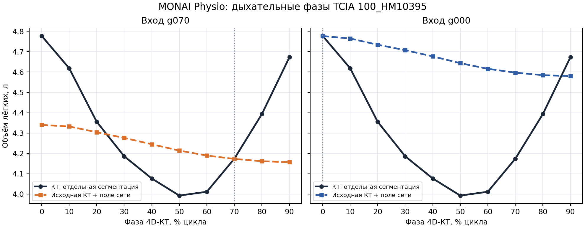

# Прогноз дыхательного изменения анатомии по одной КТ

**Статус на 1 октября 2026 года:** готовая модель проверена на десяти
дыхательных фазах одного открытого случая TCIA с известными метками кадров.
При входе из фазы большого объёма лёгких перенос исходного контура полем сети
слегка уменьшил среднюю ошибку поверхности в восьми из девяти целевых фаз,
но сильно занизил изменение объёма лёгких и смещение сердца. В опорной фазе
модели улучшение получено только в двух из девяти фаз. Проверка пока не даёт
оснований использовать результат как количественную дыхательную геометрию
Ника или вход в FEM. Предыдущий опыт на Нике и трёх парах Learn2Reg сохранён
ниже как история ошибочной привязки вдоха к опорной стадии сети.

## Исходное состояние КТ и проверяемый вопрос

По прямому уточнению автора КТ добровольцев с псевдонимами **Ник, Георг, Адам
и Ярослав** были получены **на глубоком вдохе с задержкой дыхания**. Это
сведение о протоколе съёмки, сообщённое автором; оно не выведено из меток
сердечных фаз или автоматически распознано по DICOM. Для каждой выбранной серии
надо отдельно установить её связь с этим протоколом, поле зрения и положение
тела. Фазы кардиосинхронизированной КТ не следует считать фазами дыхания.

Вопрос исследования: насколько хорошо по одной КТ глубокого вдоха можно
предсказать изменение **формы и положения** пяти взаимно согласованных областей
грудной клетки — лёгких, сердца, костей, жира и остальных мягких тканей — при
изменении дыхательного состояния? Готовая модель MONAI Physio непосредственно
выдаёт смещения поверхности лёгких. Смещение сердца в дыхательном опыте
получается при распространении рассчитанного лёгочного поля на область сердца.
Движение костей, жира и прочих тканей этим не становится отдельно обученным
прогнозом.

Неизвестную конкретную геометрию выдоха нельзя однозначно восстановить из
одного тома вдоха. Выход рассматривается как **условный сценарий**, для которого
должны быть указаны стадия модели, исходное дыхательное состояние, алгоритм
распространения поля и неопределённость.

## Данные, доступные для постановки и контроля

| Источник | Установленное свойство | Роль и ограничение |
|---|---|---|
| КТ четырёх добровольцев | Состояние глубокого вдоха с задержкой подтверждено автором для исходных исследований | Индивидуальная исходная анатомия; отдельного подтверждённого выдоха у этих же людей пока нет |
| Полноохватная КТ Ника | В серии грудной клетки найдены 241 срез и продольный охват 300 мм; сердечная серия 307 имеет 12×256 кадров и охват около 159 мм | Первую использовать как кандидат полного входа для лёгких; сегментация с ограниченной сердечной серии не заменяет сегментацию на полном поле зрения |
| Исторический каталог `OLD` | По [статусу Breath Geometry](../../breath%20geometry/docs/PROJECT_STATUS.md) в большинстве девяти кардиологических исследований есть две задержки дыхания | Кандидаты на внутрисессионную проверку; вдох и выдох каждой серии требуют подтверждения, наружная грудная стенка и часть лёгких обрезаны |
| Скачанные открытые пары Breath Geometry | В локальном реестре описаны 10 пар DIR-Lab COPDgene и 30 пар Learn2Reg LungCT; имеются также 10 случаев DIR-Lab 4DCT | Независимая проверка движения лёгких и ориентиров; наличие пары не означает наличия точных масок сердца, жира и костей |

Сведения реестра открытых данных берутся из
[текущего статуса Breath Geometry](../../breath%20geometry/docs/PROJECT_STATUS.md)
и его [описания наборов](../../breath%20geometry/docs/OPEN_DATASETS.md).
Историческая ветка Breath Geometry не возобновляется и её отрицательные
результаты регистрации не заменяются автоматически этим опытом. Используются
существующие данные и протоколы контроля. Набор NLST2023 не является
размеченной выборкой вдох–выдох; неоднородные поднаборы Lung250M-4B нельзя
объединять без проверки происхождения пар.

## Модели и происхождение каждого движения

1. **Лёгкие.** Подогнать официальную PCA-модель лёгкого MONAI Physio к
   сегментации одного исходного тома. Готовый `PhysicsNeMo-MGN-Lung-Motion`
   принимает коэффициенты формы и числовую стадию дыхательного цикла, выдаёт
   смещение вершин. Используются опубликованные веса без обучения или
   дообучения на наших данных. Сеть обучена относительно собственной опорной
   стадии `g070`; КТ глубокого вдоха нельзя молча объявить этой стадией.
2. **Сердце при дыхании.** Фиксировать сердечную фазу и переносить её исходную
   поверхность дыхательным полем лёгких с явным правилом затухания за границей
   органа. Это прогноз *положения, обусловленного выбранным полем*, а не
   отдельный сетевой прогноз дыхательной кинематики сердца. Проверять смещение
   центра, поверхности и изменения формы отдельно.
3. **Сердечные сокращения.** Для иллюстрации, аналогичной официальному
   [совместному сценарию](https://project-monai.github.io/monai-physio/tutorials.html#tutorial-13-breathe-and-beat-a-static-clinical-ct),
   можно наложить ранее проверенную историческую сердечную сеть как вторую,
   независимую временную ось. На Нике она не дала убедительного выигрыша над
   неподвижной подогнанной модельной формой по существующей метрике. Поэтому
   суммарная анимация не служит доказательством точности ни дыхания, ни
   сокращения сердца.
4. **Кости, жир и оставшиеся мягкие ткани.** В первичном опыте сохранять
   исходные маски и показывать их перенос тем же пространственным полем как
   исследовательскую визуализацию. До количественного использования требуется
   отдельный контроль: кости не должны неправдоподобно деформироваться, области
   не должны пересекаться или оставлять искусственные пустоты. Готовых
   органоспецифических весов для этих трёх классов в выбранном сценарии нет.

Готовый [односнимочный пример лёгкого](https://project-monai.github.io/monai-physio/tutorials.html#tutorial-00-lung-demo)
и совместный пример задают технический путь, но сами по себе не подтверждают
его точность на наших добровольцах. В примере поле лёгкого сглаживается и вне
лёгкого сохраняет главным образом нормальную составляющую с заданным
затуханием. Поэтому результат для сердца и грудной стенки зависит от этих
настроек; их следует сохранять в манифесте каждого запуска.

## Сравнение, критерии и научное решение

**До вычисления** зафиксировать серию, исходные маски, физическую систему
координат, разрешение, происхождение весов, опорную стадию, сетку стадий,
параметры распространения поля и границы допустимых деформаций. Для первого
опыта сердце рассматривается при одной фиксированной стадии сокращения:
тогда изменение между кадрами относится только к расчётному дыхательному полю.
Отдельная анимация двух ритмов создаётся после этого контроля.

На удержанной реальной дыхательной фазе сравнивать прогноз с **неподвижной
исходной геометрией** и, где доступно, с простым геометрическим переносом.
Отдельно оценивать для лёгких и сердца объём, смещение центра и расстояния
поверхностей; для открытых наборов с независимыми ориентирами — ошибку
положения этих ориентиров. Dice маски не измеряет соответствие анатомических
точек. Для костей проверять сохранение формы каждой кости, а для всей
классификации — перекрытия, пустоты, выход за поле зрения и определитель
якобиана на сетке. Не объединять эти ошибки одним числом.

Пока подтверждённой парной КТ вдох–выдох у наших четырёх добровольцев нет,
индивидуальную точность дыхательного прогноза для них установить нельзя.
Открытые пары позволяют проверить перенос на других людях, но не дают
индивидуальную ошибку Ника, Георга, Адама или Ярослава. Передача геометрии в
FEM допустима лишь как явно обозначенный сценарий чувствительности; для
утверждения о правильном дыхательном электрическом ответе дополнительно нужны
сопоставимые свойства тканей, контакты и проверка на измерениях.

## Выполненный расчёт и источники входов

Для Ника использована серия 301 полной грудной КТ, а не укороченная сердечная
серия 307. Исходные DICOM только прочитаны. Переведённый в NIfTI том и
автоматические маски пяти долей лёгких и сердца, полученные TotalSegmentator v2,
сохранены локально вне Git. Маски лежат на одной физической сетке с томом и не
касаются его границ. Они остаются автоматическими и не являются принятыми
ручными контурами. Поверхность готовой лёгочной модели подогнана к объединению
масок с помощью аффинного ICP и шести коэффициентов PCA. Дополнительный этап
деформируемой регистрации ICON не выполнен: требуемые для него отдельные веса
отсутствовали локально, а запрос библиотеки на их загрузку не прошёл.
В официальном примере исходные лёгкие сегментирует NV-Segment; здесь по решению
проекта применён TotalSegmentator v2. Различия их границ и состава меток могут
влиять на подгонку и являются отдельным ограничением переноса модели.

Для лёгких запущена готовая сеть `PhysicsNeMo-MGN-Lung-Motion`; её веса не
обучались на КТ проекта. Поле смещения распространено на сердце по правилу
официального примера: сглаживание `15 мм`, переход к нормальной составляющей
через `3–8 мм` за границей лёгкого, затухание до нуля на расстоянии `15 мм`.
Кардиосокращение в этом опыте фиксировано. На вход сети подавались шесть
коэффициентов формы, полученных подгонкой модели к **одной КТ**, и числовая
стадия цикла. Сеть не получала отдельную КТ для каждого кадра и не определяла
стадию исходной КТ автоматически. Рассчитанная поверхность на стадии `t`
получена прибавлением к подогнанной исходной поверхности разности сетевых
смещений `d(t) − d(0,7)`.

**Обнаруженное несоответствие постановки.** Обучающий конвейер подгоняет
исходную лёгочную форму к фазе `g070` набора TCIA-4DLung. [Официальное описание
Tutorial 3](https://project-monai.github.io/monai-physio/tutorials.html#tutorial-3-reconstruct-high-resolution-4d-ct)
называет её концом выдоха; другой комментарий в исходниках Tutorial 1
описывает положение около 70 % иначе. При такой неопределённости нельзя
приравнивать КТ Ника на подтверждённом глубоком вдохе или вдох открытой пары к
`g070`. Мы сделали именно это и затем условно назвали стадию `0,0` выдохом.
Физиологическое соответствие этих стадий **не было установлено**. Отдельной
обученной модели дыхательного движения сердца здесь нет: сердце перенесено
рассчитанным полем лёгких.

| Вход/результат | Происхождение и статус |
|---|---|
| КТ Ника | Измеренный одиночный том на глубоком вдохе с задержкой по сообщению автора |
| Маски Ника | Автоматический TotalSegmentator v2 на этом же томе; независимой ручной приёмки нет |
| Подогнанная поверхность | Результат аффинного ICP и PCA; без ICON, без целевой фазы дыхания |
| Дыхательное поле | Опубликованные веса MONAI Physio; условная заданная стадия |
| Сердце на других стадиях | Перенос поверхности, извлечённой из исходной маски, полем лёгких; самостоятельной дыхательной сети сердца нет |
| Три открытые пары `LungCT_0001–0003` | Вдох (`0001`) каждого случая подан на вход и ошибочно приравнен к опорной стадии `0,7`; выдох (`0000`) удержан для сравнения, но стадия `0,0` не доказана как соответствующий ему выход; маски лёгких предоставлены набором, сердце сегментировано автоматически |

## Результат для КТ Ника

Среднее расстояние до ближайшей вершины в обоих направлениях между
подогнанной и целевой лёгочными поверхностями при выборе каждой восьмой
вершины равно `8,15 мм`.
Это внутренний контроль подгонки, зависящий от дискретизации; он не измеряет
дыхательное движение. Поверхность модели имеет `18` открытых рёбер, поэтому
её `VTK`-объём нельзя использовать как физиологический объём лёгких.

| Стадия модели относительно 0,7 | Среднее смещение вершин лёгких, мм | Среднее смещение поверхности сердца, мм | Смещение центра поверхности сердца, мм |
|---|---:|---:|---:|
| 0,0 | 1,66 | 0,64 | 0,62 |
| 0,5 | 0,68 | 0,25 | 0,25 |
| 0,7 | 0 | 0 | 0 |
| 0,9 | 0,80 | 0,29 | 0,28 |

Все числа в таблице — **результаты модели**, а не измеренное дыхание Ника.
Поскольку подтверждённого тома выдоха Ника нет, ошибка прогноза для него
неизвестна. При `t = 0,7` разность `d(t) − d(0,7)` равна нулю: отсутствие
движения в опорном кадре задано формулой и не подтверждает совпадение формы с
КТ. Средняя внутренняя ошибка подгонки этой формы уже составляет `8,15 мм`.
Текущая подгонка и неверно приписанная стадия не допускают
передачу этих поверхностей как анатомически проверенной геометрии в FEM.

## Проверка на трёх открытых парах вдох–выдох

В локально сохранённом архиве Learn2Reg LungCT у случаев `LungCT_0001–0003`
есть парные анатомические ориентиры: `81`, `100` и `100` соответственно.
Метаданные архива определяют том `0001` каждого случая как вдох, `0000` —
как выдох. Оба тома каждой пары лежат на общей физической сетке. Вдох
использован для автоматической сегментации и подгонки модели; выдох и его
ориентиры удержаны для проверки. Предоставленные маски лёгких автоматические;
для сердца на обоих томах использован TotalSegmentator v2.

Во всех трёх случаях подгонка проведена на сетке `1,75 × 2,50 × 1,75 мм`.
Каждая выходная лёгочная поверхность имеет `18` открытых рёбер: её объём
не оценивается. Объёмы в таблице ниже рассчитаны только по предоставленным
маскам КТ. Все смещения модели относятся к **необоснованной** привязке
`вдох = 0,7`, `выдох = 0,0`. Эта привязка противоречит описанию опорной фазы
в Tutorial 3; сравнение ниже не является проверкой корректно заданного прогноза.

| Случай | Ориентиры | Объём лёгких: вдох → выдох, л | Среднее смещение вершин лёгких, мм | Средняя ошибка ориентиров: неподвижно → модель, мм | Центр сердца: по двум маскам → модель, мм |
|---|---:|---:|---:|---:|---:|
| 0001 | 81 | 5,80 → 3,21 | 1,74 | 20,18 → 20,42 | 28,94 → 0,44 |
| 0002 | 100 | 5,88 → 4,93 | 2,31 | 15,60 → 14,98 | 18,70 → 0,94 |
| 0003 | 100 | 4,64 → 3,61 | 4,94 | 8,14 → 11,18 | 16,35 → 1,48 |

Средняя ошибка, взвешенная по числу ориентиров, выросла с `14,27` до
`15,20 мм` (`+0,93 мм`) **только в указанной ошибочно привязанной постановке**.
По этим числам нельзя оценить качество сети при правильном исходном состоянии.
Подгонка исходной лёгочной поверхности дала внутренние
расстояния `7,14`, `4,73` и `5,79 мм` соответственно: часть ошибки присутствует
ещё до применения сети движения. В случае 0002 модель уменьшила ошибку
ориентиров на `0,62 мм`; в случаях 0001 и 0003 увеличила на `0,24` и
`3,04 мм`. Стабильного улучшения в этой постановке нет.

Разница центров автоматических масок сердца между КТ во всех трёх случаях
значительно больше смещения, переданного лёгочным полем. Этот контроль
ограничен точностью масок и межсканным положением пациента; он не доказывает
истинную траекторию сердца. Ошибка ориентиров тоже включает возможное общее
смещение пациента между двумя томами: здесь проверяется абсолютное положение
анатомии в координатах пары, без предварительного совмещения выдоха с вдохом.
Не установлено также, какие стадии сети соответствуют глубокому вдоху и
выдоху этих пар. Выбор наиболее выгодной стадии по удержанному выдоху
был бы подгонкой по результату, а не прогнозом из одной КТ. Сводка с точными
числами и хэшами локальных отчётов сохранена в
[`mp10_open_three_pairs_2026-10-01.json`](mp10_open_three_pairs_2026-10-01.json).

**Решение:** полученные поверхности не допускаются как геометрия глубокого
выдоха или вход для основной FEM-постановки. Оценка прогностической точности
готовой сети по этим трём парам **отозвана из-за неверной привязки исходной
стадии**. Исправленный опыт должен брать КТ в подтверждённой опорной фазе,
сначала проверять подгонку её поверхности, затем подавать в сеть стадии
действительно снятых целевых фаз и сравнивать прогноз с отдельными масками и
ориентирами этих фаз. После такой проверки можно обсуждать перенос на
одиночную КТ глубокого вдоха; без подходящей опорной модели и парной КТ Ника
её выдох остаётся непроверяемым.

## Проверка на десяти фазах дыхательной КТ

**Исходные данные и производные маски.** Использован открытый случай `100_HM10395` из фазового
набора TCIA 4D-Lung, поставляемого вместе с учебным примером MONAI Physio
`2026.07.1`. Все десять томов `g000–g090` относятся к одному человеку;
пространственный шаг КТ равен `0,9766 × 0,9766 × 3,0 мм`. Для каждого тома
отдельно получены автоматические маски пяти долей лёгких и сердца с помощью
TotalSegmentator v2. Целевые фазы не участвовали в подгонке входной анатомии.
Доля цикла из имени кадра непосредственно передавалась в готовую сеть:
`g000 → 0,0`, `g050 → 0,5`, `g070 → 0,7` и так далее. Стадия не выбиралась
по сходству с удержанной КТ. Объём лёгких по маскам имеет минимум `3,99 л`
в `g050` и максимум `4,78 л` в `g000`; поэтому обозначение `g070` следует
понимать прежде всего как опорную стадию опубликованной модели, а не как
точный момент максимального выдоха в этом случае.

**Модель и сравнение.** Выполнены два опыта с единственной входной КТ:
от опубликованной опоры `g070` и от кадра с большим объёмом лёгких `g000`.
Последний опыт проверяет пригодность готовой сети к входу со вдоха, что
выходит за протокол её исходной подгонки. Из входной маски аффинным ICP и
шестью компонентами модели формы получены параметры лёгких. Сеть получила
эти параметры и числовую стадию; она не получала целевую КТ. Поле сети
перенесено на **исходную поверхность по КТ**, чтобы сохранить индивидуальную
анатомию. Сердце перенесено тем же распространённым полем; отдельная сеть
движения сердца в опыте не применялась.

Основной показатель формы — среднее симметричное расстояние до ближайшей
точки между прогнозной и отдельно сегментированной целевой поверхностью,
в миллиметрах. Для одинаковой вычислительной нагрузки в обеих сравниваемых
поверхностях использована каждая четвёртая вершина. Контроль повторяет
исходную маску без движения. Объём целевых лёгких измерен подсчётом вокселей,
а объём прогноза — по перенесённой замкнутой поверхности исходной КТ.
Смещения центров масок сердца сравниваются в одной физической системе LPS.
Ни одна из этих метрик не является ошибкой анатомических ориентиров.

| Вход | Целевых фаз | Поверхность лёгких: без движения → сеть, мм | Улучшенных фаз | Поверхность сердца: без движения → поле лёгких, мм | Центр сердца: без движения → поле лёгких, мм |
|---|---:|---:|---:|---:|---:|
| `g070`, опора модели | 9 | 2,27 → 2,34 | 2/9 | 2,37 → 2,35 | 3,32 → 3,15 |
| `g000`, фаза большого объёма | 9 | 3,18 → 2,95 | 8/9 | 2,80 → 2,75 | 4,91 → 4,58 |

Средние значения приведены **по фазам одного случая**, поэтому девять кадров
не образуют девять независимых добровольцев. При входе `g000` улучшение
поверхности в `g010` составляет лишь `0,02 мм`, а в `g090` ошибка возрастает
на `1,11 мм`. Даже там, где контур становится ближе к целевой КТ, амплитуда
объёмного движения остаётся недостаточной:

| Переход | Изменение объёма по КТ, мл | Изменение объёма по прогнозу, мл | Ошибка объёма в целевой фазе, мл | Центр сердца: наблюдаемое → рассчитанное смещение, мм |
|---|---:|---:|---:|---:|
| `g070 → g000` | +604 | +167 | −438 | 6,83 → 0,65 |
| `g000 → g050` | −785 | −134 | +651 | 6,41 → 0,55 |
| `g000 → g070` | −604 | −181 | +423 | 6,83 → 0,67 |

**Ограничение доказательности.** В учебном коде случай 100 исключён из
обучения сети движения, но его опорный кадр `g070` не исключён из построения
модели формы лёгких. Состав обучающего набора опубликованного checkpoint не
проверен независимо. Контуры целевых фаз автоматические; принятой ручной
разметки лёгких и сердца для этой проверки нет. Подгонка поверхности на
исходной фазе имеет внутреннюю среднюю ошибку `5,48 мм` для `g070` и
`5,57 мм` для `g000`. Сама подогнанная сетка открыта по 18 рёбрам, поэтому
её объём не использован: объёмные показатели относятся только к замкнутой
поверхности исходной КТ, перенесённой полем. Опыт с `g000` не доказывает
переносимость на глубокий вдох с задержкой у Ника. У Ника нет независимо
подтверждённой парной КТ выдоха для расчёта ошибки его индивидуального
прогноза.

**Вывод для текущей методики:** готовая сеть показывает слабую полезную
составляющую движения контура при некоторых фазах, но в этом опыте не
воспроизводит фактическую амплитуду изменения объёма лёгких и положения
сердца. Полученную дыхательную геометрию нельзя считать проверенным входом
для FEM или источником количественной поправки к ТТРКГ. Следующая проверка
готовой модели должна охватить другие независимо снятые фазовые случаи и
ручной контроль анатомии; обучение собственной сети в этот этап не входит.
Полная численная сводка всех десяти фаз содержится в
[`mp10_tcia_phase_validation_2026-10-01.json`](mp10_tcia_phase_validation_2026-10-01.json).

Два самостоятельных интерактивных вида сопоставляют реальные контуры лёгких
и сердца с расчётными для всех десяти фаз:
[вход `g000`](runs/tcia_validation/g000_input_prediction_vs_ct_3d.html) и
[вход `g070`](runs/tcia_validation/g070_prediction_vs_ct_3d.html).
Ползунок и воспроизведение переключают только измеренные дискретные кадры;
межфазовая интерполяция в изображении отсутствует. После поворота модели
камера сохраняет ракурс при переключении и воспроизведении, что проверено в
локальном браузере. Эти HTML содержат геометрию открытого пациента и
хранятся в локальном каталоге вне Git.

## Интерактивная трёхмерная визуализация

Следующая ячейка ноутбука показывает сохранённые поверхности лёгких и сердца
Ника в четырёх рассчитанных стадиях. Серым фоном показана исходная поверхность,
извлечённая из автоматической маски лёгких этой КТ; голубым — подогнанная
модель. Высота исходной поверхности составляет около `238 мм`, а поверхности
модели в опорной стадии — около `210 мм`. Таким образом, модель у Ника
короче примерно на `28 мм` по этой оси. При этом по двум поперечным осям
модель шире исходной поверхности (`295 против 269 мм` и `198 против 175 мм`).
Следовательно, расхождение формы нельзя объяснить единым изменением масштаба.
Серая поверхность также получена
после уменьшения сетки и сглаживания, поэтому сравнение служит визуальным
контролем подгонки, а не проверкой по принятой ручной разметке.

Модель можно вращать и увеличивать;
ползунок выбирает стадию, кнопка запускает последовательность кадров. Оси
показывают координаты LPS в миллиметрах. Выбранный ракурс и масштаб должны
сохраняться при переключении стадий и воспроизведении. Ради скорости сетки
упрощаются одинаковым способом во всех кадрах; численные метрики выше
рассчитаны по исходным поверхностям.

Эта последовательность **не является видеозаписью дыхания Ника**: кадры
соответствуют стадиям модели, а интервалы воспроизведения не имеют измеренной
длительности. Для сердца показан перенос лёгочным полем. Кости, жир и остальные
мягкие ткани здесь не показаны, поскольку их дыхательные поверхности ещё не
были рассчитаны и проверены. Ячейка сохраняет самостоятельный интерактивный
HTML только в локальном каталоге опыта. Он содержит индивидуальную геометрию
и поэтому не включается в Git или общий HTML-экспорт ноутбука.

## Воспроизведение и дальнейшая проверка

Скрипты `mp10_prepare_ct_series.py`, `mp10_fit_lung_to_ct.py`,
`mp10_lung_heart_scenarios.py`, `mp10_evaluate_open_pair.py`,
`mp10_aggregate_open_pairs.py`, `mp10_lung_model_smoke.py`,
`mp10_render_3d.py` и `mp10_build_notebook.py` выполняют подготовку одиночной
серии, подгонку, условный перенос, оценку по удержанным парам, сводку
результатов, локальную
трёхмерную визуализацию и формирование ноутбука. Локальные отчёты JSON содержат
хэши входов, сетку, параметры поля и отдельные метрики; пути к медицинским
данным и сами изображения не включаются в Git. Ноутбук `21.22` связывает
  протокол с таблицами результатов и кодом их чтения. Для повторного чтения
  исторических локальных отчётов нужно задать три переменные окружения:
`MONAI_PHYSIO_MP10_NIX_DIR` указывает на папку с `fit_lung/` и `scenarios/`,
`MONAI_PHYSIO_MP10_L2R_DIR` — на папку первого открытого случая с
`fit_lung_inhale/`, `scenarios/` и `evaluation.json`, а
`MONAI_PHYSIO_MP10_L2R_BATCH_DIR` — на папку отчётов случаев 0002 и 0003.
  Без этих переменных ноутбук всё равно показывает новую сводку десятифазного
  опыта. Адреса исходных КТ, масок и весов передаются скриптам аргументами
  командной строки и не записаны в ноутбуке.

Исправленный десятифазный опыт воспроизводится скриптами
`mp10_segment_tcia_phases.py`, `mp10_fit_lung_to_ct.py`,
`mp10_lung_heart_scenarios.py`, `mp10_evaluate_tcia_phases.py`,
`mp10_summarize_tcia.py`, `mp10_plot_tcia_summary.py` и
`mp10_visualize_tcia_phases.py`. Они последовательно сегментируют все
фазы, подгоняют одну входную КТ, рассчитывают сеть по заранее заданным
стадиям, переносят исходные контуры и сравнивают их с удержанными КТ.
Новая аналитическая ячейка ноутбука читает обезличенную сводку из этой папки;
для показа локального 3D нужно задать
`MONAI_PHYSIO_MP10_TCIA_RUN_DIR` как путь к `runs/tcia_validation`.
Индивидуальные тома, маски, поля и поверхности остаются в исключённой из Git
рабочей папке.

Следующий проверочный шаг — проверить готовую сеть на других случаях с
известными дыхательными фазами и оценить чувствительность результата к
автоматической сегментации. Для применения к Нику необходимо установить
соответствие его задержки глубокого вдоха входной стадии модели и получить
независимый контроль целевой анатомии. До этих проверок сценарии для Георга,
Адама и Ярослава остаются иллюстрациями, а не расчётной геометрией для FEM.

## Технический статус модели на дату записи

Официальный архив готовых лёгочных весов выпуска `2026.07.1` размером
58 923 868 байт локально получен во временное хранилище. Его SHA-256 —
`365d575e20e2fb03cd4940670816aaabc51c837779f61e48ff01977682283cdc`;
архив ZIP прошёл проверку целостности. Внутри есть checkpoint, PCA-модель и
опорная поверхность. Контрольный вывод сети на средней модельной форме с
нулевыми коэффициентами PCA успешно выполнен для стадий `0,0`, `0,5`, `0,7`
и `0,9`: средние модули смещения составили соответственно `2,874`, `1,778`,
`0,297` и `3,144 мм`. Этот тест подтверждает работоспособность загруженных
весов и близость `0,7` к их опорной стадии; он **не использует КТ добровольца**
и не измеряет прогностическую точность. Ранее используемые сердечные веса
находятся отдельно в исключённом каталоге `runs/`. Производные КТ, маски и
поверхности сохранены во временной локальной рабочей области; исходные
медицинские данные не перемещались и в Git не добавлялись.
