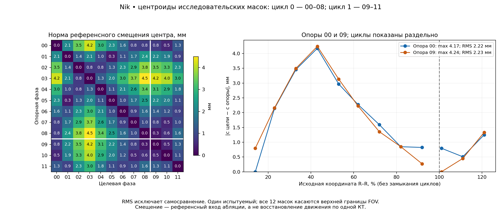
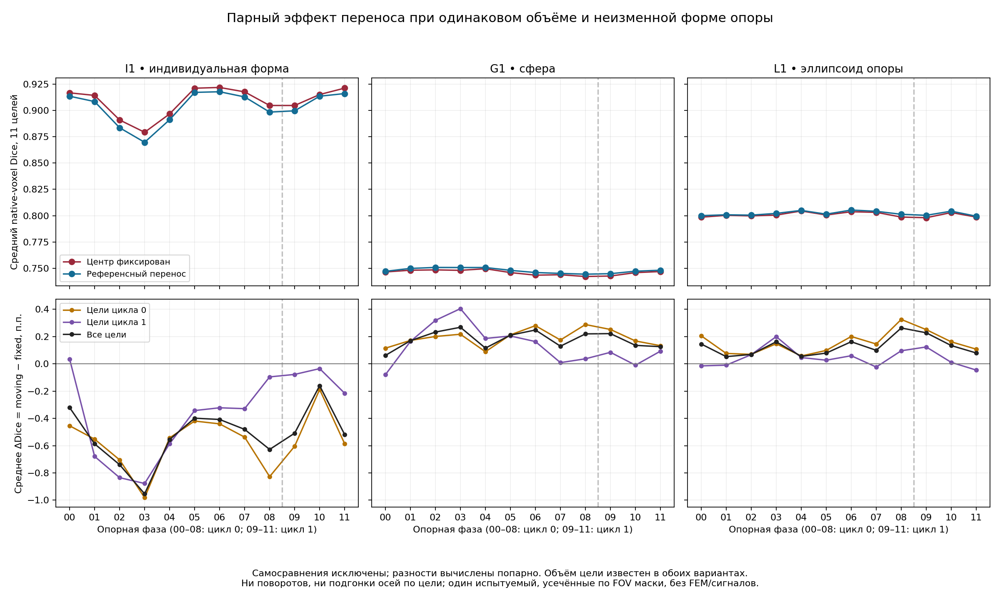
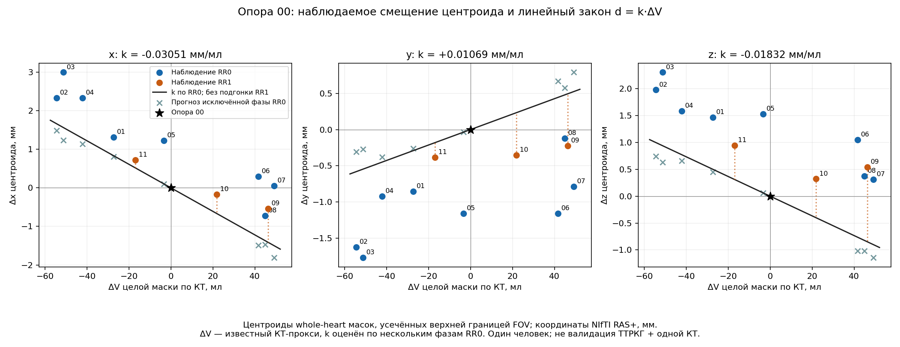
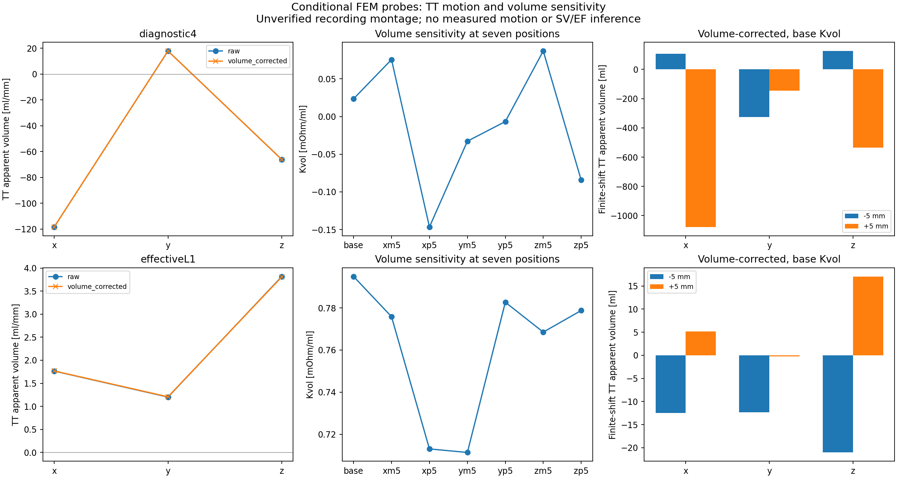
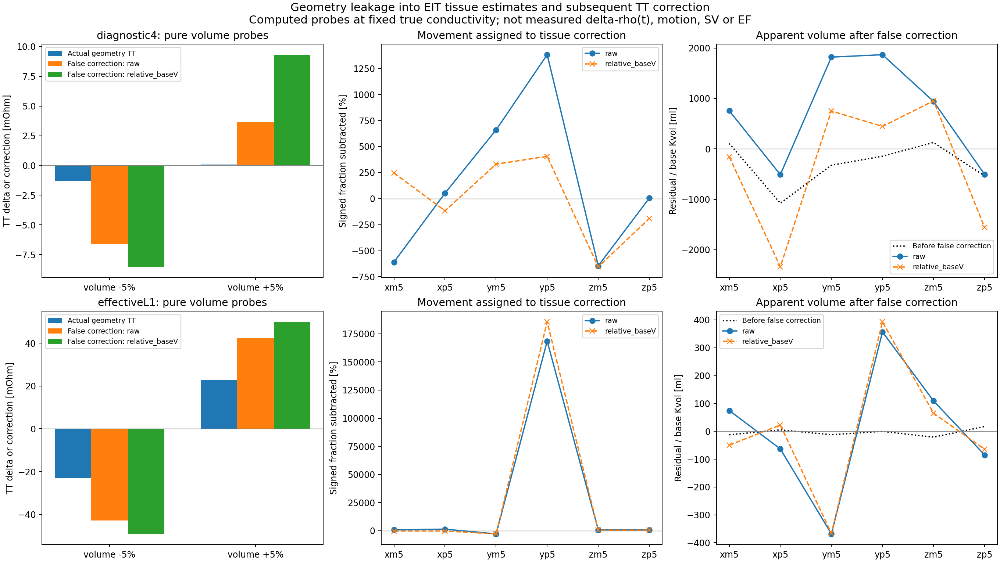
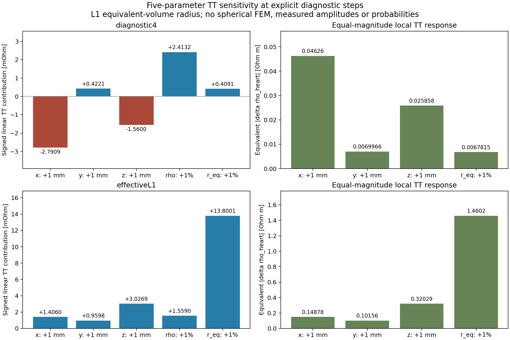

## 16. Одна КТ-опора: перемещение сердца и ошибка восстановления объёма

### 16.1. Постановка без фазовой КТ при применении

**Условие применения, уточнённое автором.** При реальном исследовании
нет 4D-КТ. Доступна одна статическая КТ-фаза, электрические записи,
ЭКГ и сведения о монтаже и дыхательном режиме. Следовательно,
критерий разработки состоит в восстановлении параметров по этим входам.
Автор отдельно подтвердил, что в будущем исследовании PulmoVista и
ТТРКГ будут записываться одновременно. Это условие проектируемого
протокола; текущие записи разных сессий не становятся синхронными.
Последнее уточнение автора задаёт роли приборов: **из PulmoVista
получать только базовые ρ и синхронные Δρ тканей; геометрические
параметры эквивалентного сердца и функции рассчитывать из ТТРКГ
с этими поправками и одной КТ**. Общая временная шкала и ЭКГ
объединяют оба потока. Прежняя трактовка агента о полном исключении
PulmoVista была ошибочной и исправлена. Сложность привязки пояса
мотивирует отказ от прямой ЭИТ-реконструкции движения в текущей
ветке, но неопределённость положения пояса по-прежнему может влиять
на оценки тканевых параметров и должна передаваться в итоговую ошибку.
Подстановка известных по проверочной КТ центров и объёмов каждой фазы
допустима только в отдельном вычислительном опыте. Результаты раздела 15
характеризуют качество геометрического представления при таких известных
параметрах; они не завершают проверку сокращённого протокола.

Под универсальной постановкой здесь понимается одно правило построения
и оценки параметров, применимое при наличии и отсутствии движения.
Начальная индивидуальная анатомия может различаться. Универсальный для
разных людей численный закон движения на данных одного Ника не установлен.
Необходимо раздельно проверить перенос между фазами одного человека,
выбор исходного снимка и последующую переносимость между людьми.

Представление опорной области H₀ задаётся как

\[
H(t)=\{\mathbf c_0+\mathbf d(t)+s(t)(\mathbf x-\mathbf c_0):
\mathbf x\in H_0\},\qquad V(t)=s(t)^3V_0.
\tag{16.1}
\]

Здесь c₀ и V₀ определяются по одному снимку, d(t) — изменение положения,
s(t) — единый масштаб. H₀ может быть индивидуальной поверхностью,
сферой либо эллипсоидом. В последнем случае отношения полуосей и
ориентация определяются по опорному снимку и фиксируются в рассматриваемой
редуцированной постановке. Их пофазное уточнение из проверочной КТ
создало бы дополнительные недоступные входы. Поворот и неоднородная
деформация пока входят в расхождение этой постановки с анатомией;
их отдельное включение требует проверки различимости новых параметров.

Сравниваются вложенные варианты: **M₀** с d(t)=0 и **M₁** с
неизвестным d(t). Обозначения вариантов не следует смешивать с опорной
анатомической областью H₀ в (16.1). Оба варианта используют одинаковые
тканевые параметры, электроды, частоту и критерии ошибки. Контроль с
движением, известным из 4D-КТ, показывает потенциальную пользу учёта
движения, но не является операционным M₁: в нём d(t) ещё предстоит
получить из измерений.

### 16.2. Как движение превращается в ошибку объёма

В окрестности выбранного состояния линеаризация прямой электрической
задачи имеет вид

\[
\Delta\mathbf u(t)=\mathbf j_V\Delta V(t)
 +J_d\mathbf d(t)+J_b\Delta\boldsymbol\sigma_b(t)
 +\mathbf j_h\Delta\sigma_h(t)+\boldsymbol\varepsilon(t).
\tag{16.2}
\]

Вектор u содержит электрические измерения, jV — производную по
объёму в В/мл, Jd — три производные по положению в В/мм,
Jb — производные по проводимости мягкого фона и единого лёгкого,
jh — производную по эффективной проводимости сердца. Последнее
слагаемое вводится как отдельная проверка материальной неоднозначности.
При связанном законе состава его нельзя одновременно учитывать как
независимую свободную переменную и как часть объёмной производной.
ε включает шум, ошибку линеаризации и расхождение физической постановки
с экспериментом; её величина не считается известной по одной невязке.

В текущей целевой схеме из ЭИТ в задачу ТТРКГ передаются только
материальные оценки. Их неопределённость и зависимость от положения
пояса сохраняются. Пульсовое кровенаполнение мягких тканей и единого
лёгочного компартмента учитывается как поправка; задержка дыхания
не является основанием её обнулить. Для передачи параметров между
приборами понадобятся проверка задержек трактов и частотного переноса.
Текущие разновременные записи не дают проверки этой синхронной цепочки.

Если ЭИТ-инверсия при фиксированной геометрии объясняет реальное
изменение объёма или движение через Δρ, последующая поправка ТТРКГ
может удалить часть искомого геометрического сигнала. Поэтому пригодность
материальных поправок должна включать проверку такой утечки.
Диагностика совместной матрицы ЭИТ/ТТРКГ может выявлять смешение
параметров, но её нельзя выдавать за выбранный операционный алгоритм
прямого восстановления геометрии по ЭИТ.

Для одного отведения ТТРКГ аналогичная запись в омах после заданной
фоновой коррекции содержит KᵥΔV+Kₓdₓ+Kᵧdᵧ+K𝓏d𝓏. При Kᵥ≠0
расчёт, запрещающий движение, приписывает ему ложный объём

\[
\Delta V_{\mathrm{ложн}}=
\frac{K_xd_x+K_yd_y+K_zd_z}{K_V}.
\tag{16.3}
\]

Если Kᵥ близок к нулю, даже небольшой вклад движения вызывает большое
изменение расчётного объёма. Знак и величина эффекта зависят от формы,
материалов и монтажа. Уравнение (16.3) характеризует локальную
чувствительность, а не гарантирует применимость линейной формулы на
всём физиологическом диапазоне.

В многоканальной ЭИТ необходимо учитывать одновременную оценку фона.
Пусть D — диагональная матрица множителей строк принятой метрики,
a=DjV, B=DJb и P=I−BB⁺. Тогда при достаточном ненулевом
aᵀPa смещение объёмной оценки от исключённого движения равно

\[
\Delta V_{\mathrm{ложн}}=
\frac{\mathbf a^\mathsf{T}P\,D J_d\mathbf d}
{\mathbf a^\mathsf{T}P\mathbf a}.
\tag{16.4}
\]

Матрица B может включать и сердечную проводимость в соответствующем
материальном сценарии. Формула получается из линейного метода
наименьших квадратов после исключения фоновых столбцов. Она показывает,
какая часть движения не отличима от изменения объёма в выбранной
измерительной геометрии. Близкий к нулю знаменатель указывает, что
объёмный столбец почти объясняется фоновыми изменениями; устойчивую
точечную оценку объёма в таком случае нельзя принимать без дополнительных
данных или проверенных ограничений.

ЭКГ позволяет определять временные признаки и группировать сокращения.
Она сама по себе не задаёт три координаты d(t). Для одного скалярного
импеданса произвольные ΔV(t), dₓ(t), dᵧ(t), d𝓏(t) не определяются
однозначно из (16.2). Добавление большого числа временных отсчётов
не устраняет эту неоднозначность, если на каждом отсчёте допускаются
новые независимые значения всех четырёх величин. Связь движения с
объёмом или фазой может сократить число неизвестных, но такая связь
является отдельной гипотезой и должна проверяться на исключённых
фазах, а затем на других участниках.

### 16.3. Разделение геометрической и электрической проверок

Геометрический опыт использует все 12 вариантов единственной опоры
Ника. Для каждой опоры задаются индивидуальная форма I1, сфера G1
и равновеликий эллипсоид L1. Затем при одинаковом известном объёме
целевой фазы сравниваются фиксированный центр и референсное перемещение.
Отношения полуосей и ориентация эллипсоида берутся только из опоры.
Разность показателей этих вариантов оценивает эффект трансляции при
данном масштабе. Поскольку масштаб всё ещё задан целевой КТ, это
вычислительное разделение вкладов, а не восстановление по одному снимку.

Электрический опыт использует существующие материальные карты L1
в статической FEM-модели Ника. Сравниваются исходное положение и
смещения ±5 мм вдоль трёх осей LPS. На каждом положении рассматриваются
геометрические объёмы 0,95V₀, V₀ и 1,05V₀. Шаг 5 мм —
заданный вычислительный диапазон, не измеренное движение или доверительный
интервал. Преобразование реальной 4D-траектории в статическую FEM-модель
без проверенной межсерийной регистрации не выполняется.

Использованы две материальные опоры: сохранённый диагностический сценарий
с ρ сердца 4 Ом·м и ранее полученная условная подгонка собственных
параметров L1. Во второй опоре меняются также мягкий фон и лёгкое;
сопоставление не изолирует влияние одного лишь сердечного ρ. Для
каждой опоры сохраняется вся пятитканевая постановка, включая кость
и жир. Лёгкие остаются единым компартментом. Пульсовые изменения
мягкого фона и лёгкого входят в анализ чувствительностей, даже когда
дыхательное состояние рассматривается как задержка на глубоком вдохе.

Семь положений, три объёма и две материальные опоры дают 42
прямых решения. Для каждого сохраняются вектор 208 напряжений
ЭИТ, производные по проводимостям и отклик расчётного отведения
ТТРКГ. Применены существующий решатель, сетка и CEM-контакты.
Подготовка новой конфигурации не создаёт другой физический оператор
и не изменяет исходные материальные карты. Дискретизация q64
унаследована; глобальная сходимость FEM-сетки не считается доказанной.

Смена положения может немного изменять интегрированный объём материала
из-за численного представления. Поэтому для производных по объёму
используется фактическая разность интегрированных объёмов; при оценке
двигательного вклада сохраняются исходный результат и явно обозначенная
линейная поправка на это численное изменение объёма. Сравнение
односторонних и центральных разностей оценивает локальную нелинейность.

Расчётное ТТРКГ-отведение содержит четыре конечных диска по 5 мм
на модельных руках с расстоянием 100 мм между токовым и измерительным
контактами каждой стороны. Фактическое соответствие отдельной
экспериментальной записи не подтверждено. Его результаты являются
условной проверкой механизма смешения объёма и движения. Внешняя
частота 79,505 кГц и ток 7,234 мА относятся к этой постановке.
Покадровая синхронизация разных сессий не вводится.

### 16.4. Критерии практического выбора

Вариант без движения можно принять только после оценки ошибки,
которую движение вносит в искомый объём и последующие функции.
Небольшое расстояние в миллиметрах само по себе не является таким
критерием. Нужны ошибка в миллилитрах, её зависимость от направления,
материалов и исходной формы, а также устойчивость на проверочных данных.

Вариант с движением требует оценки различимости столбцов (16.2),
устойчивости к шуму и выигрыша на данных, не использованных для
подбора. Уменьшение невязки на тех же измерениях при добавлении
трёх неизвестных не доказывает правильности найденной траектории.
Если движение существенно, но не определяется, следует сохранять
диапазон допустимых объёмов при явно заданных ограничениях движения,
а не выбирать одну произвольную траекторию.

Даже после фиксации положения фоновая пульсовая составляющая не
исчезает. Она должна быть определена проверенной процедурой,
описана ограниченной физической зависимостью либо включена в
неопределённость объёма. Использование только участка задержки дыхания
не разрешает считать весь пульсовый сигнал сердечным. Поэтому
исключение движения и исключение мягкотканной поправки являются
разными упрощениями и должны проверяться раздельно.

Проверка конечной сокращённой методики должна скрывать от расчёта
все проверочные фазовые объёмы, центры и моменты. По одной опоре
и электрическим данным рассчитывается кривая Vэкв(t), после чего
она сопоставляется с доступным референсом. Связь этой кривой с
камерами и ошибки УО/ФВ проверяются следующим отдельным звеном.
Допустимая конечная погрешность пока не задана; текущие вычислительные
сравнения должны дать зависимость ошибки от принятых упрощений.

### 16.5. Гипотеза связи движения с объёмом для ТТРКГ с тканевой поправкой

Для сокращения числа геометрических неизвестных рассматривается
простейшая детерминированная гипотеза

\[
\mathbf d(t)=\mathbf k\,[V(t)-V_0]+\mathbf r(t),\qquad
K_{\mathrm{эфф}}=K_V+\mathbf K_d\mathbf k.
\tag{16.5}
\]

Вектор k имеет размерность мм/мл; r — движение, которое не
объясняется изменением объёма. При заданном k электрический расчёт
содержит одну геометрическую неизвестную ΔV. Оставшийся вклад
Kdr входит в ошибку. Вариант без движения соответствует k=0
и сохраняет весь двигательный вклад в остатке. Формула не утверждает,
что реальная траектория однозначно определяется объёмом: разные
положения при одинаковом объёме означают ограничение этой гипотезы.

На этапе разработки k оценивается обычным методом наименьших
квадратов без свободного смещения:

\[
\widehat{\mathbf k}=
\frac{\sum_{t\in\mathcal T}(V_t-V_0)(\mathbf c_t-\mathbf c_0)}
{\sum_{t\in\mathcal T}(V_t-V_0)^2}.
\tag{16.6}
\]

Опорная фаза фиксирует нулевое перемещение. Проверяемая фаза исключается
из множества T; сравниваются ошибка предсказанного положения и ошибка
варианта с постоянным центром. Дополнительно коэффициент, полученный
на первом наблюдаемом R–R, переносится на три доступные фазы
следующего интервала. Это проверка заданной математической аппроксимации,
без обучения ИИ и без поиска многопараметрического предиктора.

Объём проверяемой фазы в данном опыте известен из КТ и выступает
управляющим входом. Поэтому успешное предсказание перемещения ещё
не означает успешного обратного расчёта объёма из ТТРКГ. Кроме того,
k определяется по динамике одного человека: доступность такого k
для нового человека с одним снимком не доказана. Нужны либо
проверенная переносимость коэффициентов, либо правило определения
по доступным статическим и электрическим входам. Уменьшение ошибки
на текущем участнике само по себе не даёт универсального закона.

### 16.6. Выполненное геометрическое сравнение с движением и без него

**Результат вычислительного опыта.** Завершены 864 сопоставления:
12 опор × 12 целевых фаз × три формы × два варианта центра.
Для I1 с переносом повторно использованы 144 ранее рассчитанные записи
после проверки контрольных сумм, аффинных преобразований и моментов;
пять из них дополнительно пересчитаны для контроля. Остальные 720
оценок Dice рассчитаны заново. Получены 432 парные разности,
из которых 396 относятся к несовпадающим опорным и целевым фазам.

Максимальное расстояние между центроидами любых двух входных масок
составляет 4,501 мм. Относительно опоры 00 максимум равен
4,173 мм, RMS по 11 остальным фазам — 2,222 мм; для
опоры 09 — 4,242 и 2,234 мм соответственно. Это динамика
центроидов доступных масок, включающая возможное влияние реконструкции,
сегментации и усечения поля зрения. Она не доказывает чистую
трансляцию анатомического сердца как жёсткого тела.

Таблица 16.1. Изменение перекрытия при добавлении референсного переноса

| Группа опор и целей | Форма | Пар без самосравнения | Dice, фиксированный центр | Dice, перенос | Средняя разность Dice, процентные пункты |
|---|---|---:|---:|---:|---:|
| Обе фазы внутри R–R 0 | I1 | 72 | 0,90574 | 0,89967 | −0,607 |
| Обе фазы внутри R–R 0 | G1 | 72 | 0,74203 | 0,74398 | +0,195 |
| Обе фазы внутри R–R 0 | L1 | 72 | 0,79925 | 0,80073 | +0,148 |
| Обе фазы внутри R–R 1 | I1 | 6 | 0,92620 | 0,92511 | −0,109 |
| Обе фазы внутри R–R 1 | G1 | 6 | 0,75808 | 0,75864 | +0,056 |
| Обе фазы внутри R–R 1 | L1 | 6 | 0,80663 | 0,80693 | +0,030 |
| Все 12 опор и целей, описательная сводка | I1 | 132 | 0,90881 | 0,90360 | −0,521 |
| Все 12 опор и целей, описательная сводка | G1 | 132 | 0,74586 | 0,74764 | +0,179 |
| Все 12 опор и целей, описательная сводка | L1 | 132 | 0,80077 | 0,80204 | +0,128 |

Объём целевой маски известен в обоих вариантах. Опоры и цели зависимы;
число пар не является числом независимых наблюдений. Последняя группа
включает межинтервальные пары и не объединяет два неполных R–R
в один полный цикл. Опорная форма, ориентация и отношения полуосей
не подгоняются по целевой фазе.

Для индивидуальной формы добавление переноса по центроиду в среднем
не улучшает перекрытие. Во всех несовпадающих парах Dice уменьшается
в 109 случаях, увеличивается в 21 и не меняется в двух. Для
сферы и эллипсоида среднее изменение положительно, но составляет
только 0,179 и 0,128 процентного пункта. Указанные различия
не являются оценками электрической значимости движения.

Сохранение центроида и максимальное перекрытие — разные критерии.
Когда форма деформируется, её центроид может меняться вследствие
неравномерного изменения отдельных участков; перенос всей опорной
поверхности на такую величину не обязан улучшать совпадение границ.
Поэтому наблюдаемый результат не означает, что сердце неподвижно,
и не позволяет назначить центроид единственной физически правильной
координатой эквивалентной формы. Он обосновывает сохранение варианта
с фиксированным центром в дальнейшем электрическом сравнении.

Максимальная ошибка аналитического объёма составляет 7,96·10⁻¹³ мл;
ошибка центра в варианте с референсным переносом равна нулю.
Оба числа проверяют конструкцию преобразования. Дискретно занятый
объём отличается от аналитического не более чем на 1,858% в
этом массиве; такая дискретизация сохранена отдельно и не названа
ошибкой измеренного объёма. Исходные файлы не изменились по SHA-256.
Полные пары, проверки и ограничения приведены в
[локальной сводке](../../../cardiac_4d_segmentation/results/nik_whole_heart_20261028/exploratory/full_geometry_v1/motion_geometry_v1/SUMMARY_RU.txt)
и [проверках расчёта](../../../cardiac_4d_segmentation/results/nik_whole_heart_20261028/exploratory/full_geometry_v1/motion_geometry_v1/checks.json).

### 16.7. Проверка линейной связи перемещения и объёма

**Результат вычислительного опыта.** Для каждой из девяти опор первого
R–R выполнено восемь прогнозов с исключением проверяемой фазы из
оценки k. Дополнительно коэффициент, полученный на всех остальных
восьми фазах первого интервала, использован на трёх фазах второго.
Получены 72 исключённых прогноза и 27 межинтервальных прогнозов.
Опора не выбиралась по минимальной проверочной ошибке. Независимая
сверка линейного расчёта через решение наименьших квадратов подтвердила
все 99 прогнозов; проверяемая фаза отсутствует в списке её подгонки.

Таблица 16.2. RMS ошибки положения при постоянном центре и линейном законе, мм

| Опора | Постоянный центр, исключённые фазы R–R 0 | Линейный закон, исключённые фазы R–R 0 | Постоянный центр, перенос на R–R 1 | Линейный закон, перенос на R–R 1 |
|---|---:|---:|---:|---:|
| 00 | 2,5464 | 2,3161 | 0,9048 | 1,2682 |
| 01 | 1,6626 | 1,0948 | 1,7579 | 0,5448 |
| 02 | 2,3632 | 1,0271 | 3,0543 | 0,8157 |
| 03 | 2,9848 | 1,2010 | 3,7804 | 1,0374 |
| 04 | 2,1280 | 1,0454 | 2,6632 | 0,7654 |
| 05 | 1,6805 | 1,0692 | 1,8426 | 1,1849 |
| 06 | 1,8422 | 1,1915 | 1,1577 | 1,3608 |
| 07 | 2,1679 | 1,0307 | 0,8116 | 1,0399 |
| 08 | 2,7877 | 1,0264 | 0,9861 | 0,6164 |

В столбцах R–R 0 на каждую опору приходится восемь зависимых
проверяемых фаз; в столбцах R–R 1 — три. Объём цели известен
из КТ во всех случаях. Три фазы следующего интервала не образуют
полный независимый кардиоцикл.

На исключённых фазах первого интервала RMS уменьшается у всех
девяти опор. На следующем фрагменте улучшение сохраняется у шести
опор, а у 00, 06 и 07 ошибка возрастает. Например, для
опоры 00 снижение 2,5464 → 2,3161 мм внутри первого
интервала сопровождается ухудшением 0,9048 → 1,2682 мм
при переносе. Таким образом, линейная зависимость не обеспечивает
выигрыш для произвольного исходного снимка даже в пределах этого
одного участника и короткой последовательности.

Для опоры 00 коэффициент, рассчитанный по первому интервалу,
равен k=(−0,030513; 0,010687; −0,018317) мм/мл в
координатах RAS+. Этот конкретный коэффициент не переносился
в статическую LPS-модель FEM: межсерийная регистрация не подтверждена.
На рисунке 16.3 показаны координатные остатки и различие подгонки
по первому интервалу с прогнозами исключённых фаз. Они объясняют,
почему одного коэффициента корреляции недостаточно для принятия закона.

Гипотеза сохраняется как проверяемое сокращение числа неизвестных,
но не принимается за универсальное правило движения. Более сложная
функция не вводилась ради улучшения этой небольшой выборки.
При дальнейшем сравнении нужно проверить электрически взвешенный
остаток Kdr и изменение объёмной чувствительности Kэфф,
а затем оценить ошибки объёма. Нынешняя ошибка координат в мм
ещё не определяет ошибку объёма в мл. Данные, коэффициенты и
списки исключённых фаз приведены в
[сводке линейного закона](../../../cardiac_4d_segmentation/results/nik_whole_heart_20261028/exploratory/full_geometry_v1/motion_law_v1/SUMMARY_RU.txt)
и [протоколе проверок](../../../cardiac_4d_segmentation/results/nik_whole_heart_20261028/exploratory/full_geometry_v1/motion_law_v1/checks.json).

### 16.8. Передача тканевых параметров из ЭИТ в ТТРКГ

В соответствии с последним уточнением автора из PulmoVista в
геометрическую задачу передаются базовые ρⱼ,₀ и Δρⱼ(t) каждого
используемого компартмента, их происхождение и неопределённость.
Переход к проводимости задаётся точно:

\[
\sigma_{j,0}=\frac{1}{\rho_{j,0}},\qquad
\Delta\sigma_j(t)=\frac{1}{\rho_{j,0}+\Delta\rho_j(t)}-
\frac{1}{\rho_{j,0}}.
\tag{16.7}
\]

При малых относительных изменениях Δσⱼ≈−Δρⱼ/ρⱼ,₀².
Линейная запись кандидата геометрической части ТТРКГ имеет вид

\[
\Delta Z_{\mathrm{корр}}(t)=\Delta Z_{\mathrm{ТТРКГ}}(t)
-\sum_j K_{\sigma_j}\Delta\sigma_j(t)
\simeq K_V\Delta V(t)+\mathbf K_d\mathbf d(t)+\varepsilon_Z(t).
\tag{16.8}
\]

Эффективный сердечный компартмент включается в материальную поправку
только при согласованном определении его ρ и отделении этой величины
от геометрического изменения. Значение эффективного ρ целого сердца
не тождественно сопротивлению чистого миокарда или крови. Ошибки
ρ, Δρ, частотного переноса и коэффициентов K переходят в εZ.
В полной нелинейной проверке прямую задачу следует рассчитывать с
текущими материальными значениями и проверять остаток: линейная
формула не отменяет перекрёстные эффекты объёма и проводимости.

Для проверки возможной утечки геометрии в тканевые Δρ используются
те же рассчитанные пробы, в которых истинные проводимости внутри
одного сценария постоянны. Изменения ЭИТ-напряжений в них вызваны
только заданной геометрией и её численным представлением. Если
задача с фиксированной геометрией и свободными проводимостями мягкого
фона, лёгкого и сердца объясняет эти напряжения ненулевыми Δσ,
полученные величины являются ложными тканевыми поправками в этом
контрольном опыте. Их проекция через Kσ в ТТРКГ показывает,
какую часть геометрического сигнала способно удалить вычитание (16.8).

Этот тест использует рассчитанные напряжения. Он не заменяет обработку
реальной синхронной записи и не создаёт измеренные Δρ. Для малых
Δσ сравнивается линейная Δρ; точное обращение σ₀+Δσ допустимо
только при положительной проводимости. Неположительные оценки должны
отмечаться как выход за физическую область линейной задачи.

### 16.9. Электрический вклад движения в двух материальных состояниях

**Завершённый вычислительный результат.** Получены все 42 прямых решения
описанного в §16.3 опыта. В первом решении проверены совпадение с прямым
оператором EIDORS и взаимность с относительным порогом 10⁻⁸. Анализатор
проверяет хэши конфигурации, моделей, материальных карт и сохранённых
решений. Эти проверки подтверждают вычислительную согласованность;
сеточная сходимость и соответствие монтажа реальной записи ими не доказаны.
Частота постановки составляет 79 505 Гц, ток — 7,234 мА. Расчётное
отведение ТТРКГ использует конечные контакты диаметром 5 мм на моделях рук
с расстоянием ток–напряжение 100 мм; его соответствие фактическому монтажу
конкретной записи не принято.

Объёмная производная получена центральной разностью при уровнях 0,95V₀
и 1,05V₀ с фактически интегрированной разностью объёмов. При вычислении
осевых производных сохранены исходный результат и результат с вычитанием
KᵥΔV численной невязки материала. Такая линейная поправка не заменяет
контроля дискретизации. В таблице 16.3 приведён исправленный вариант.

Таблица 16.3. Условная чувствительность ТТРКГ к объёму и движению

| Материальная опора | Kᵥ, мОм/мл | ‖Kд‖ / abs(Kᵥ), мл/мм | Наибольший модуль кажущегося ΔV среди осевых сдвигов ±5 мм | Проба |
|---|---:|---:|---:|---|
| diagnostic4 | 0,023567 | 136,849 | 1077,816 мл | x +5 мм |
| effectiveL1 | 0,794904 | 4,369 | 21,034 мл | z −5 мм |

Кажущийся объём — отношение расчётного отклика движения к исходной
объёмной производной, а не изменение анатомического объёма. Норма
‖Kд‖ / |Kᵥ| даёт локальную линейную границу для заданной нормы сдвига;
она не ограничивает конечный нелинейный остаток. Большое число в первой
строке обусловлено в том числе малым знаменателем Kᵥ и не означает
физического изменения сердца на литр.

В опоре diagnostic4 объёмная чувствительность при изменении положения
проходит через нуль и меняет знак. Поэтому единый коэффициент перевода
«Ом → мл» здесь неустойчив к положению. В effectiveL1 объёмная
чувствительность во всех семи проверенных положениях остаётся положительной,
но вклад движения не исчезает. Разница между опорами не может быть
приписана только ρ сердца: во второй менялись также сопротивления
мягкого фона и лёгкого. Это основание для раздельного анализа частных
производных, а не выбор одной опоры как установленной физиологической истины.

### 16.10. Геометрические изменения, ошибочно отнесённые к тканевым параметрам

**Результат контрольного расчёта при постоянных истинных проводимостях.**
Для каждого рассчитанного геометрического возмущения решена линейная
обратная задача только по проводимостям мягкого фона, единого лёгкого
и сердца при фиксированной исходной геометрии. Проверены две метрики:
равные веса напряжений и относительные веса по базовому напряжению.
Последние являются выбором метрики, а не измеренной моделью шума.
Ложная тканевая поправка спроецирована через соответствующие производные
в отведение ТТРКГ. Истинное Δρ в этом опыте равно нулю по построению.

Таблица 16.4. Отношение ложной тканевой поправки к геометрическому отклику ТТРКГ

| Опора | Метрика ЭИТ | Объём −5% | Объём +5% |
|---|---|---:|---:|
| diagnostic4 | Равные веса напряжений | 5,101 | 52,926 |
| diagnostic4 | Относительные веса | 6,585 | 134,372 |
| effectiveL1 | Равные веса напряжений | 1,850 | 1,851 |
| effectiveL1 | Относительные веса | 2,119 | 2,183 |

Отношение знаковое, безразмерное. Значение больше единицы означает,
что вычисленная материальная поправка превышает исходный геометрический
отклик и её вычитание меняет знак остатка. Это не доля измеренного
пульсового сигнала. При почти нулевом знаменателе отношение неустойчиво;
в исходной таблице сохранены абсолютные величины в омах.

Например, при effectiveL1, сдвиге y +5 мм и относительных весах
геометрический отклик ТТРКГ составляет −0,1684 мОм, а ложная тканевая
поправка — −312,80 мОм. После её вычитания остаётся +312,63 мОм,
что при исходном Kᵥ соответствует кажущемуся +393,29 мл. При этом
относительная невязка ЭИТ-подгонки равна 0,7169: тканевое объяснение
не является точным даже в своей целевой метрике. Оценённое изменение
сердечной проводимости составляет около 24,2% от опоры, поэтому
линейную проекцию нельзя выдавать за подтверждённый конечный нелинейный
отклик. Точное алгебраическое обращение положительной проводимости
в ρ не устраняет это ограничение.

Расчёт выявляет конкретный риск выбранной последовательности: свободная
оценка Δρ на неподвижной геометрии может поглотить часть изменения
формы или положения, а последующая поправка ТТРКГ — удалить либо
исказить искомый геометрический компонент. Он не доказывает невозможность
использования PulmoVista как источника тканевых параметров. Требуется
проверить различимость материальных и геометрических направлений,
ограничения материальной оценки и перенос её неопределённости.
Прямая совместная инверсия геометрии ЭИТ и ТТРКГ не подставляется
вместо целевой последовательности автора.

Исходники текущего опыта:
[подготовка конфигурации](../../../../MATLAB_TRKG4_real_subjects/tools/heart_motion_prepare.py)
и [анализ электрических проб](../../../../MATLAB_TRKG4_real_subjects/tools/heart_motion_electrical_analysis.py).
Полные результаты, осевые производные, проверка одно- и двусторонних
разностей, ложные поправки и происхождение входов сохранены в
[локальном протоколе](../../pulmovista_check_20261028/local/motion_electrical_analysis_v1/analysis.local.json).
Индивидуальные MAT-файлы и конфигурации остаются локальными.

### 16.11. Раздельная и совместная чувствительность пяти параметров сердца

**Уточнение программы исследования автором.** Изменение сердца является
многопараметрическим. До выбора закона восстановления нужно отдельно
проверить три координаты, размер и эффективное удельное сопротивление,
а затем их совместное действие для рассматриваемых отведений ТТРКГ.
Само по себе наличие чувствительности не означает, что параметр можно
различить на фоне остальных. Поэтому сравнение фиксированного и
подвижного центра является частью этой более полной постановки.

Для первого приближения вводится вектор
q=(x,y,z,rэкв,ρсердца). Радиус rэкв=(3V/(4π))^(1/3) задаёт
размер сферы равного объёма; для эллипсоида или индивидуальной формы
он параметризует равномерное масштабирование при сохранённых отношениях
осей и ориентации. Перепараметризация L1 через rэкв не превращает
эллипсоидную FEM-задачу в сферическую. Для каждого монтажа m

\[
\Delta Z_m=J_{x,m}\Delta x+J_{y,m}\Delta y+J_{z,m}\Delta z
+J_{r,m}\Delta r+J_{\rho,m}\Delta\rho_{\mathrm{сердца}}
+\Delta Z_{\mathrm{фон},m}+R_m.
\tag{16.9}
\]

ΔZфон содержит мягкотканный и лёгочный пульсовые вклады; их оценка
по ЭИТ сопровождается неопределённостью и проверкой §16.10. Rm
включает нелинейность, неописанные деформации, ошибки геометрии и
измерений. Независимые изменения q в вычислительных пробах нужны
для разделения причин отклика. Они не означают, что радиус и
эффективное ρ физиологически независимы в реальном сокращении.
В рабочем законе их связь должна быть обоснована отдельно, чтобы
один и тот же эффект изменения состава не учитывался дважды.

Сохранённые производные позволяют без новых прямых решений вычислить

\[
J_r=K_V\frac{3V}{r_{\mathrm{экв}}},\qquad
J_\rho=-\frac{K_{\sigma,\mathrm{сердца}}}{\rho_{\mathrm{сердца}}^2}.
\tag{16.10}
\]

При V в мл, r в мм и Kᵥ в Ом/мл первая производная выражается
в Ом/мм; вторая — в Ом/(Ом·м). Для V в мл и r в мм
формула радиуса содержит множитель 1000 под кубическим корнем.
Числа с разными размерностями напрямую ранжировать нельзя.
Для диагностического сравнения применяется отклик Jᵢaᵢ на явно
заданный шаг: 1 мм по каждой координате, 1% исходного радиуса,
1% исходного ρ. Это сравнение заданных воздействий, не измеренные
амплитуды пульса и не утверждение о доминирующем физиологическом
механизме. В дальнейшем шаги положения и размера заменяются диапазонами
принятых КТ-проб, а диапазон Δρ — обоснованными тканевыми оценками
и их неопределённостью.

Для одновременных изменений следует проверять не только сумму модулей,
но и знаковую компенсацию. Если известна ковариационная матрица Cq,
линейная дисперсия геометрического и сердечного материального вклада
равна

\[
\operatorname{Var}(\Delta Z_m)=\mathbf J_m C_q\mathbf J_m^{\mathsf T}.
\tag{16.11}
\]

Недиагональные элементы Cq описывают совместные изменения. Их нельзя
молча обнулить и назвать полученные квадраты «процентами вклада».
Если статистика неизвестна, сохраняются сценарные диапазоны и
совместные прямые пробы. Для каждого такого состояния проверяется
остаток между полным решением и суммой отдельных линейных откликов,
причём абсолютная ошибка в мОм сохраняется и при почти нулевом
суммарном отклике, когда относительная ошибка неустойчива.

Один скалярный канал ТТРКГ имеет матрицу локальной чувствительности
размером 1×5 и ранг не выше единицы. Поэтому пять свободных
мгновенных параметров нельзя независимо восстановить только из него.
Переданные из ЭИТ материальные оценки и проверенные связи параметров
могут сократить число неизвестных, но не считаются точными по умолчанию.
Несколько отведений нужно сравнивать по чувствительности, шуму и
различимости столбцов общей матрицы, а не только по большой амплитуде
отклика сердца. Перебор монтажей в вычислительной модели не создаёт
дополнительных одновременно зарегистрированных каналов в эксперименте.

Следующий расчёт должен сохранять одинаковую анатомию и материальную
опору при сравнении электродов. Сначала проверяются пять отдельных
направлений и устойчивость производной к уменьшению шага, затем
перекрёстные эффекты положения, размера и ρ. Для эллипсоида изменение
отношений осей и поворот остаются отдельным расширением после этой
пятикомпонентной проверки. Выбор упрощённого закона проводится по
ошибке электрического отклика и восстановленного объёма при исключении
каждого фактора; наибольший отдельный отклик ещё не определяет
минимально достаточное описание сердца.

### 16.12. Первое численное сравнение пяти параметров

**Вычислено по сохранённым 42 пробам и материальным производным.**
Интегрированный объём L1 в исходном положении равен 578,689 мл,
радиус равновеликой сферы — 51,695 мм. Шаг 1% радиуса равен
0,517 мм и соответствует линейному изменению объёма 17,361 мл;
точное геометрическое изменение при таком масштабировании равно
17,535 мл. Оба значения относятся к целому сердечному компартменту,
а не к ударному объёму желудочка.

Таблица 16.5. Производные по отдельным параметрам и отклики на диагностические шаги

| Параметр | Единица производной | Производная diagnostic4 | Производная effectiveL1 | Положительный шаг | ΔZ diagnostic4, мОм | ΔZ effectiveL1, мОм |
|---|---|---:|---:|---|---:|---:|
| x | мОм/мм | −2,79093 | +1,40602 | 1 мм | −2,79093 | +1,40602 |
| y | мОм/мм | +0,42211 | +0,95979 | 1 мм | +0,42211 | +0,95979 |
| z | мОм/мм | −1,56002 | +3,02690 | 1 мм | −1,56002 | +3,02690 |
| rэкв | мОм/мм | +0,79143 | +26,69493 | 1% = 0,517 мм | +0,40913 | +13,80006 |
| ρ сердца | мОм/(Ом·м) | +60,33096 | +9,45053 | 1% исходного ρ | +2,41324 | +1,55897 |

Исходное ρ сердца: 4 Ом·м для diagnostic4 и 16,49615 Ом·м
для effectiveL1. Это условные опоры, а не установленные сопротивления
миокарда. В каждой частной производной прочие параметры фиксированы;
между опорами меняются также фон и лёгкое. Координаты относятся к LPS.

При этих конкретных шагах в effectiveL1 наибольший отдельный линейный
отклик даёт размер, далее следуют z, ρ, x и y. В diagnostic4
порядок другой: x, ρ, z, y, размер. Следовательно, назвать изменение
объёма либо движение универсально главным механизмом по одному состоянию
нельзя. Неизвестная амплитуда реального Δρ и принятый масштаб сдвига
могут изменить порядок даже при неизменной материальной опоре.

Таблица 16.6. Изменение ρ сердца с тем же модулем линейного отклика, Ом·м

| Геометрическое воздействие | diagnostic4 | effectiveL1 |
|---|---:|---:|
| x: 1 мм | 0,046260 | 0,148777 |
| y: 1 мм | 0,006997 | 0,101559 |
| z: 1 мм | 0,025858 | 0,320288 |
| rэкв: 1% | 0,006781 | 1,460242 |

Значения равны abs(Jᵢaᵢ)/abs(Jρ). Это условные пороги равного
электрического отклика, не оценки реального тканевого пульса и не
допустимая погрешность, установленная экспериментом. Знак для имитации
или компенсации выбирается отдельно по знаковым производным.

При одновременных положительных диагностических шагах линейная сумма
в diagnostic4 равна −1,106 мОм при сумме модулей 7,595 мОм:
вклады существенно компенсируются. Для effectiveL1 все пять производных
положительны и сумма равна +20,752 мОм. Эти суммы ещё не являются
результатами совместного нелинейного FEM-возмущения. Для этих проб
геометрические производные остаются центральными разностями по ±5 мм
и ±5% объёма; показанный отклик на 1 мм или 1% радиуса — их
линейная проекция, а не отдельный прямой расчёт с меньшим шагом.
Чувствительность по ρ получена аналитическим преобразованием сохранённой
производной по проводимости. Проверка взаимного обращения ρ и σ
на трёх шагах и проверка единиц мл/мм прошли, но не заменяют
конечных FEM-проб по ρ и проверки смешанных производных.

Таким образом, уточнение автора приводит к конкретному изменению
последовательности работы: прежде чем принимать постоянный центр или
закон d(V), сравниваются все пять факторов и возможность их различения
при разных монтажах. После этого выбирается сокращённый физический
закон и проверяется потеря точности при исключении каждого фактора.
Результаты и восемь проверок преобразований сохранены в
[таблице пяти параметров](../../pulmovista_check_20261028/local/motion_electrical_analysis_v1/five_parameter_sensitivity.csv)
и [протоколе происхождения](../../pulmovista_check_20261028/local/motion_electrical_analysis_v1/five_parameter_sensitivity.local.json).

### 16.13. Что уже исследовалось и что требуется объединить

**Аудит сохранённого кода и результатов, без повторного запуска старых
расчётов.** Указание автора на прежние исследования подтвердилось.
Однако проверка параметров сердца и сравнение электродов находились
в нескольких постановках, и результаты не образуют готового единого
пятикомпонентного анализа на нынешней модели.

В [историческом аналитическом прототипе](../../../archive/legacy/70.90_Объединённый_прототип_РЕО32.ipynb)
сохранены методы Morris, Sobol и FAST для r, h, x, y при фиксированных
сопротивлениях. Дистанции до источников содержат (r+h)², то есть
глубина центра z=r+h. Поэтому изменение r при постоянном h одновременно
изменяет размер и положение. По правилу дифференцирования сложной функции

\[
\left.\frac{\partial Z}{\partial r}\right|_h=
\left.\frac{\partial Z}{\partial r}\right|_z+
\left.\frac{\partial Z}{\partial z}\right|_r.
\tag{16.12}
\]

Это допустимая связанная параметризация, но её радиусный эффект нельзя
считать чистым изменением размера при неподвижном центре. Прототип
использует идеальную сферу, полупространство и точечные электроды;
его коэффициенты не переносятся в индивидуальную CEM-задачу.
Индексы глобальной чувствительности также зависят от заданных диапазонов
и распределений параметров. Нынешний файл 70.05 является описательным
каркасом; вычисления и сохранённые выводы находятся именно в архиве.
Этот архив относится к истории метода и не включается в текущий
экспериментальный корпус отчёта.

[Исследование 40.05](../../../40.05_Чувствительность_ТТРКГ_к_проводимости_тканей.ipynb)
содержит 432 состояния: 16 монтажей и 27 наборов проводимостей при
неподвижной сердечной области. Сравнивались четыре пары расстояний
20/80, 20/100, 40/80 и 40/100 мм и четыре типа контактов.
По [реализации монтажа](../../../../MATLAB_TRKG4_real_subjects/src/trkg4_arm_montage_spec.m)
первое расстояние отсчитывается от соединения модельной руки с туловищем
до внутреннего электрода, второе — от внутреннего до наружного.
Например, 20/80 означает наружный электрод в 100 мм от соединения.
В [сохранённой опорной таблице](../../../../MATLAB_TRKG4_real_subjects/output/exploratory/arm_sigma_20260908/baseline_sensitivity.csv)
для 20/80 передаточный импеданс равен 191,993105 Ом при дисках
и 189,241705 Ом при кольцах. Это расчёт на прежней геометрии и
материалах при 50 кГц; сравнение с нынешними 79,505 кГц не изолирует
влияние монтажа. Сердце в этой серии не перемещалось, производные
относятся к проводимостям тканей.

Ветка форм целого сердца включает
[геометрические пробы x/y/z и объёма](../../../../MATLAB_TRKG4_real_subjects/tools/heart_geometry_perturbation_audit.py),
но их [сохранённый результат](../../../../MATLAB_TRKG4_real_subjects/output/exploratory/heart_geometry_perturbations_20260915/results.json)
явно имеет статус `FEM_solved: false`. Отдельный
[электрический пилот замены формы](../../../../MATLAB_TRKG4_real_subjects/output/exploratory/heart_replacement_electrical_20260915/summary.csv)
сравнивает три формы на шести прекардиальных монтажах. Это полезные
исходники и результаты, однако наличие геометрических проб рядом
с электрическим пилотом не подтверждает выполнение полного совместного
анализа. Исторические COMSOL-скрипты радиусных проб и электродных
сравнений также найдены; они не являются действующим расчётным
оператором и не заменяют нынешнюю проверку.

**Принятое продолжение.** Переиспользуются определения монтажей,
алгоритмы чувствительности, дробные материальные карты и контроль
производных. В новой сопоставимой серии пять параметров задаются
независимо: при изменении радиуса центр фиксирован, при изменении
положения фиксированы размер и ρ, при изменении ρ фиксирована геометрия.
Сначала сравниваются положения электродов при одинаковых дисках 5 мм
и общих тканевых условиях; изменение площади контакта рассматривается
отдельно. Сохраняется нынешний монтаж как опорный. Затем проверяются
совместные возмущения и уменьшение шага. Старые числа используются
для прослеживаемости, а не подставляются в новую чувствительность.
Завершённой общей матрицы пяти параметров для нескольких согласованных
монтажей пока нет; это следующий расчётный этап перед выбором
сокращённого закона объёма и переходом к функциям камер.
