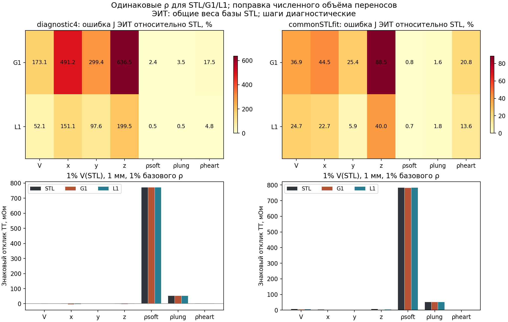
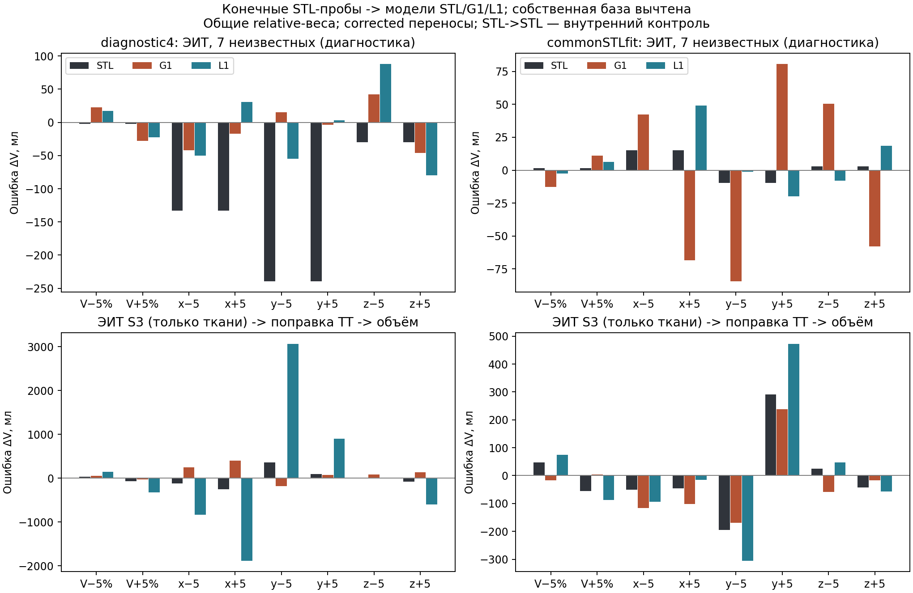
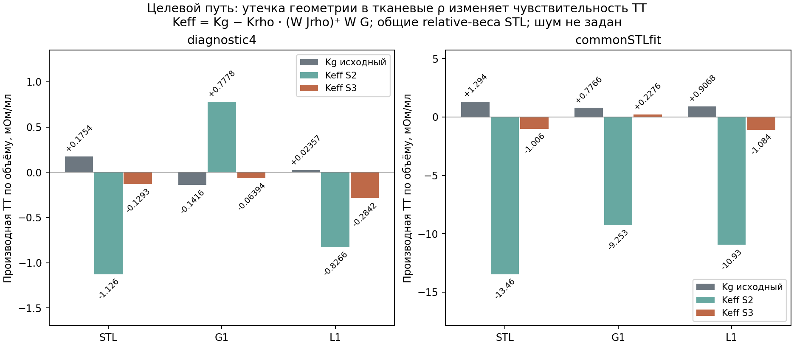

## 17. Электрическая эквивалентность формы и различимость объёма, положения и тканевых свойств

### 17.1. Проверяемый переход от анатомии к эквивалентной форме

Геометрическое сходство само по себе не устанавливает электрическую
эквивалентность. Две области одинакового объёма могут занимать разные
участки поля чувствительности и замещать различные фоновые ткани.
Поэтому после геометрического сравнения выполненных ранее способов
следующий этап сопоставляет не только исходный импеданс, но и его
изменения при одинаковых воздействиях на анатомическую и упрощённую
формы. Отдельно проверяется, можно ли отличить геометрическое изменение
от изменения электрических свойств.

В эту проверку включены исходная STL целого сердца, равновеликая
сфера G1 и равновеликий моментный эллипсоид L1. Их номинальный объём
равен 578,720801 мл. Исходная STL является геометрическим референсом
этого вычислительного опыта, но её независимая анатомическая точность
не установлена. Она происходит из автоматической сегментации статической
КТ. Проверенные на 4D-КТ семейства аппроксимаций применяются к этой
статической области заново; фазовые координаты и объёмы другой серии
не переносятся без межсерийной регистрации.

Изменение объёма задаётся равномерным масштабированием относительно
фиксированного центра; перемещение — переносом при фиксированном
аналитическом объёме. Масштабирование исходной STL сохраняет её
индивидуальную форму и соответствует проверке выбранного закона
преобразования. Оно не воспроизводит измеренную деформацию каждой
фазы сердечного цикла. Исследуются уровни 0,95V₀, V₀ и 1,05V₀,
а также шесть осевых сдвигов ±5 мм при V₀. Это вычислительные
воздействия, не принятые физиологические амплитуды.

### 17.2. Согласованные материальные опоры и неизменный фон

Для каждой формы используются два набора сопротивлений, общих для
всех трёх форм внутри соответствующего сравнения. Первый наследует
диагностическое ρ сердца 4 Ом·м; второй переносит условную подгонку
тканевых свойств исходной STL. Второй набор также является гипотезой,
а не независимо измеренными сопротивлениями. Сопоставление форм при
общих параметрах отделено от прежней подгонки собственного ρ каждой
формы: такая подгонка способна компенсировать геометрическое различие.

Таблица 17.1. Общие материальные опоры сравнения, Ом·м

| Опора | Мягкий фон | Единое лёгкое | Кость | Целое сердце | Жир |
|---|---:|---:|---:|---:|---:|
| diagnostic4 | 2,853969 | 18,468929 | 19,147705 | 4,000000 | 23,063216 |
| commonSTLfit | 2,888793 | 17,997668 | 19,147705 | 23,468976 | 23,063216 |

Различия между строками не являются чистым изменением сердечного ρ:
меняются также мягкий фон и лёгкое. В каждой строке все формы
сравниваются при строго одинаковых свойствах. Параметры сердца
характеризуют эффективную область целиком, а не чистый миокард.

Сохраняются одна КТ-сетка, CEM-контакты, частота 79 505 Гц и ток
7,234 мА. Поясная ЭИТ и отведение ТТРКГ используют собственные
электродные модели на одной сетке. Монтаж ТТРКГ — прежние четыре
конечных диска диаметром 5 мм на цилиндрических продолжениях рук,
с расстоянием ток–напряжение 100 мм на каждой стороне. Это расчётный
монтаж; его совпадение с фактическими координатами конкретной записи
не подтверждено. Взаимодействие одновременно установленных электродных
систем в этом опыте не исследуется. Сравнение других монтажей также
не подменяется результатом одного отведения.

При смене сердечной области используется неизменный тканевый фон:
участок исходного сердца заменён мягким материалом, а текущая сердечная
форма имеет приоритет над фоном в своей области. Лёгкие остаются
одним компартментом. Этот способ не моделирует механическое перемещение
окружающих органов; неизвестная анатомия под исходным сердцем не
восстанавливается. Пульсовые производные мягкого фона и лёгкого
сохраняются в анализе, включая задержку на глубоком вдохе.

При подготовке проб выявлена техническая необходимость расширить
область проверки сердца для сдвинутой STL. Простое расширение области
тканевой квадратуры изменило бы фон одновременно с сердцем. Поэтому
в прежней области оставлено прежнее интегрирование q64, а вне неё
сохранён исходный материал по центроиду элемента. Новая сердечная
область проверяется и за этой границей, но фон не пересэмплируется.
Три повторно подготовленные базовые карты STL/G1/L1 используются
для обязательной проверки полного равенства массивов прежним картам.
Это проверка согласованности фона, а не доказательство сходимости q64.

### 17.3. Ошибка электрического отклика и производных

Для одинаковой материальной опоры обозначим вектор 208 базовых
напряжений исходной анатомии как u₀ᴬ, а аппроксимации — u₀ᴳ.
Отдельно сохраняется скалярный передаточный импеданс ТТРКГ Z₀.
Базовое электрическое различие оценивается как

\[
e_{U,0}=\frac{\|\mathbf u_0^G-\mathbf u_0^A\|_2}
{\|\mathbf u_0^A\|_2},\qquad
\Delta Z_0=Z_0^G-Z_0^A.
\tag{17.1}
\]

Малая относительная ошибка большого базового импеданса не означает
малой ошибки пульсового отклика. Поэтому сравниваются также знаковые
объёмные, координатные и тканевые производные. Объёмная производная
использует фактически интегрированную разность объёмов, а сдвиги
анализируются как в исходном виде, так и после линейной поправки
численной невязки объёма, описанной в разделе 16.

Для каждого направления i рассчитываются норма ошибки и косинус
между электрическими откликами:

\[
e_{J,i}=\frac{\|\mathbf J_i^G-\mathbf J_i^A\|_2}
{\|\mathbf J_i^A\|_2},\qquad
c_i=\frac{(\mathbf J_i^G)^{\mathsf T}\mathbf J_i^A}
{\|\mathbf J_i^G\|_2\|\mathbf J_i^A\|_2}.
\tag{17.2}
\]

Косинус вычисляется без вычитания среднего по каналам: постоянная
пространственная составляющая отклика также несёт физическую информацию.
Большой косинус при неправильном масштабе ещё не подтверждает эквивалентность.
При почти нулевой производной относительная ошибка неустойчива, поэтому
сохраняются исходные нормы, абсолютные различия и знаки отклика ТТРКГ.

Производные по удельному сопротивлению вычисляются из производных
по проводимости при фиксированной геометрии:

\[
\mathbf J_{\rho_j}=-\frac{\mathbf J_{\sigma_j}}{\rho_j^2}.
\tag{17.3}
\]

Объём и эффективное ρ сердца рассматриваются как разные направления
контрольного опыта. Это не утверждение об их независимости в реальном
кардиоцикле. Связь состава и геометрии должна проверяться отдельно,
чтобы не приписать одному изменению два независимых объяснения.

Для записи через эквивалентный радиус используется
r₀ = (3000V₀/(4π))¹ᐟ³ при V₀ в мл и r₀ в мм. Тогда
Kᵣ = (3V₀/r₀)Kᵥ. Это замена координаты масштаба той же формы,
а не восьмой независимый параметр. У эллипсоида в этой проверке
отношения полуосей фиксированы; изменение вытянутости или ориентации
потребовало бы дополнительных направлений чувствительности.

### 17.4. Проверка различимости и зависимости от ошибок измерений

Для каждого представления составляется матрица

\[
\mathbf J=
[\mathbf J_V,\mathbf J_x,\mathbf J_y,\mathbf J_z,
\mathbf J_{\rho_S},\mathbf J_{\rho_L},\mathbf J_{\rho_H}].
\tag{17.4}
\]

Здесь S — мягкий фон, L — единое лёгкое, H — целое сердце;
кость и жир фиксированы в этой диагностике. При известных тканевых
поправках остаются четыре геометрических направления. При свободных
тканевых поправках добавляются три потенциально смешивающихся направления.
Простое наличие 208 измерительных чисел не означает, что все эти
параметры различимы: важны направление, масштаб и зависимость столбцов.

Рассматриваются равные веса напряжений и относительные веса по базовым
напряжениям исходной STL. Внутри сравнения форм веса общие, чтобы
геометрическая ошибка не меняла критерий оценки. Относительные веса
не объявляются измеренной обратной дисперсией шума. Для сравнения
коллинеарности столбцы нормируются по длине, после чего вычисляются
сингулярные числа, ранг, обусловленность и попарные косинусы.

Доля электрического направления, которую не воспроизводят остальные
параметры, определяется через ортогональную проекцию:

\[
\eta_i=\frac{\|(I-P_{-i})W\mathbf J_i\|_2}
{\|W\mathbf J_i\|_2}.
\tag{17.5}
\]

P₋ᵢ проецирует на пространство остальных взвешенных столбцов. Малое
ηᵢ означает, что почти весь отклик соответствующего фактора может
быть объяснён другими факторами. Ранг при машинном допуске показывает
лишь алгебраическую различимость. Практическая оценка требует сравнить
остаточное направление с ошибками измерений, монтажа, анатомии и материалов.

Для оценки усиления возмущений отдельно используются явные масштабы
параметров: 1% исходного объёма, 1 мм по каждой оси и 1% исходного
ρ соответствующей ткани. Эти масштабы не являются распределением
физиологической изменчивости. Без измеренной модели шума не назначаются
доверительные интервалы или клиническая погрешность УО/ФВ.

У одного скалярного отведения ТТРКГ ранг матрицы чувствительности
не выше единицы. Поэтому свободное одновременное восстановление четырёх
геометрических параметров остаётся неоднозначным даже при заданных
тканевых поправках. Проверка многоканальной ЭИТ здесь отвечает на
диагностический вопрос о смешении физических эффектов. Она не меняет
целевую последовательность автора: ЭИТ даёт ρ и Δρ, а геометрия
восстанавливается из ТТРКГ с этими поправками и одной КТ-опорой.

### 17.5. Перенос анатомического возмущения в упрощённую обратную задачу

Контрольный вход создаётся прямой физической задачей на исходной STL:
это разность между возмущённым и исходным электрическими состояниями.
Она не является новой экспериментальной записью или синтетической
заменой клинических данных. На этой разности проверяется, какие
изменения параметров потребовались бы упрощённой форме:

\[
\widehat{\Delta\mathbf q}_G=
\mathop{\arg\min}_{\Delta\mathbf q}
\|W(\Delta\mathbf u_A-\mathbf J_G\Delta\mathbf q)\|_2^2.
\tag{17.6}
\]

При построении Δuᴬ вычитается собственная база анатомической модели,
поэтому этот тест оценивает перенос динамического отклика отдельно
от базового различия (17.1). Оценки по самой STL образуют контроль
линеаризации; оценки по G1/L1 дополнительно включают ошибку формы.
Сохраняются ошибки объёма и координат, ложные изменения ρ при
истинно постоянных свойствах и остаточная электрическая невязка.
Малая невязка при неправильных параметрах не считается успешным
восстановлением. Такие ошибки являются результатом вычислительного
переноса, а не установленной погрешностью методики на добровольцах.

### 17.6. Проверка целевой цепочки «тканевые параметры → поправка ТТРКГ»

Прямая инверсия всех семи параметров по ЭИТ используется только как
диагностика доступной информации. Для целевой методики отдельно
рассматривается восстановление тканевых изменений при фиксированной
геометрии ЭИТ с последующим вычитанием их расчётного вклада из ТТРКГ.
Обозначим геометрическую часть матрицы (17.4) как G, тканевую — S,
а соответствующие строки чувствительности ТТРКГ — Kг и Kρ.
При истинно постоянных свойствах геометрический сигнал GΔg может
дать ложную оценку тканевых изменений:

\[
\widehat{\Delta\boldsymbol\rho}_{\mathrm{ложн}}
=(WS)^+WG\Delta\mathbf g,\qquad
K_{\mathrm{ост}}=K_g-K_\rho(WS)^+WG.
\tag{17.7}
\]

Знак «+» в верхнем индексе означает псевдообратную матрицу.
Kост характеризует геометрический отклик, оставшийся после такой
поправки. Если исходный и оставшийся коэффициенты объёма сильно
различаются, уменьшение тканевой невязки ЭИТ ещё не означает
корректного выделения сердечной геометрии в ТТРКГ. Для почти нулевого
исходного коэффициента приводятся абсолютные значения, поскольку
отношение неустойчиво.

Проверяются варианты с тремя свободными тканевыми параметрами
(мягкий фон, лёгкое, сердце) и с двумя при фиксированном сердечном ρ.
Фиксация сердечного параметра является контрольным ограничением;
его известность по эксперименту этим не утверждается. Дополнительно
конечные возмущения исходной STL проходят тканевую инверсию каждой
формы; найденная поправка вычитается из исходного расчётного отклика
ТТРКГ. Сохраняются истинное геометрическое воздействие, ложные Δρ,
абсолютная поправка, остаток и кажущийся объём. Выход линейной оценки
за исследованный геометрический диапазон или в неположительные ρ
помечается явно и не устраняется обрезанием значений.

Наличие смешения не означает, что всякая тканевая оценка по ЭИТ
ошибочна. Этот опыт проверяет конкретную обратную задачу, которая
разрешает тканевым параметрам объяснять геометрические изменения.
Для сохранения целевой последовательности нужно либо ограничить это
смешение проверенным законом, либо оценивать его как дополнительную
неопределённость и учитывать её при восстановлении объёма.

### 17.7. Базовые отклики и раздельная чувствительность

Все 54 состояния прошли проверку входов. Для каждой формы рассчитаны
геометрические разности и тканевые производные, причём материалы,
электроды и веса сопоставления одинаковы внутри сценария. Базовые
различия оказались значительно меньше различий динамического отклика.

Таблица 17.2. База и объёмная чувствительность при общих ρ

| Опора | Форма | ΔZ₀ относительно STL, Ом | Ошибка нормы базовых напряжений ЭИТ, % | Kᵥ ТТРКГ, мОм/мл |
|---|---|---:|---:|---:|
| diagnostic4 | STL | 0 | 0 | +0,175416 |
| diagnostic4 | G1 | −0,040034 | 1,3559 | −0,141640 |
| diagnostic4 | L1 | −0,017596 | 0,2765 | +0,023567 |
| commonSTLfit | STL | 0 | 0 | +1,294387 |
| commonSTLfit | G1 | −0,042417 | 0,8206 | +0,776577 |
| commonSTLfit | L1 | −0,045926 | 1,1491 | +0,906762 |

Ошибка ЭИТ — отношение евклидовых норм в вольтах, без относительных
поканальных весов. Базовые импедансы STL равны 93,135970 и
94,303026 Ом соответственно. Kᵥ получен по двум конечным состояниям
±5% объёма, с использованием интегрированной разности объёмов.

Во втором сценарии базовые ошибки ТТРКГ составляют −0,0450%
для сферы и −0,0487% для эллипсоида. Однако чувствительность к объёму
у них примерно на 40,0% и 29,9% меньше, чем у исходной STL.
При diagnostic4 отклик сферы имеет другой знак, а объёмный отклик
эллипсоида мал. Положительный знак сферы во втором сценарии подтверждает,
что знак при одном фиксированном ρ не является самостоятельным
критерием исключения формы. При этом значение 23,468976 Ом·м
не принимается за доказанное сопротивление целого сердца: изменение
знака в условном сценарии не подтверждает физиологическую правдоподобность
самого сценария.

Равенство номинального объёма не даёт абсолютно одинаковых интегральных
объёмов на конечной квадратуре: в базе получены 578,525391 мл для STL,
578,722445 мл для G1 и 578,688995 мл для L1. Поэтому дополнительно
сохранено линейное приведение базы к интегральному объёму STL.
Максимальная численная добавка объёма в пробах переноса составляет
0,25547 мл. Приведение базы и поправка сдвигов — диагностические
поправки первого порядка; точное перевычисление сетки для совпадения
интегральных объёмов не выполнялось.

При общих относительных весах ошибка геометрических производных ЭИТ
остаётся значительной. В commonSTLfit для G1 ошибки направлений
V/x/y/z равны 36,9/44,5/25,4/88,5%, для L1 —
24,7/22,7/5,9/40,0%. Для diagnostic4 они достигают
173,1/491,2/299,4/636,5% у G1 и 52,1/151,1/97,6/199,5%
у L1. Это ошибки векторных откликов, а не погрешности соответствующих
координат. Эллипсоид лучше сферы сохраняет эти четыре направления
в рассматриваемых условиях, но не становится электрически эквивалентным
анатомической области.

Для ранжирования вкладов следует задать масштаб каждого воздействия.
Следующая таблица показывает расчёт для 1% V₀ = 5,787208 мл,
1 мм по каждой оси и 1% базового ρ соответствующей ткани.

Таблица 17.3. Знаковые линейные отклики ТТРКГ в commonSTLfit, мОм

| Форма | +1% V₀ | +1 мм x | +1 мм y | +1 мм z | +1% ρ мягкого фона | +1% ρ лёгкого | +1% ρ сердца |
|---|---:|---:|---:|---:|---:|---:|---:|
| STL | +7,491 | +3,917 | +0,882 | +6,239 | +782,618 | +51,188 | +1,385 |
| G1 | +4,494 | +1,592 | +0,342 | +2,857 | +782,097 | +51,562 | +1,294 |
| L1 | +5,248 | +2,291 | +0,828 | +3,614 | +782,285 | +51,437 | +1,160 |

Координатные значения получены линейным масштабированием центральной
разности между ±5 мм после поправки численного объёма; отдельных
FEM-проб ±1 мм в этой серии нет. Значения не являются измеренными
амплитудами сердечного цикла.

При выбранных равных относительных шагах наиболее велик отклик мягкого
фона. Однако 1% всего мягкотканного компартмента — однородное изменение
его свойства, а не установленный пространственный рисунок пульсового
кровенаполнения. Поэтому таблица обосновывает необходимость учитывать
мягкотканную поправку, но не доказывает её фактическое преобладание
в зарегистрированном сердечном сигнале. Порядок вкладов может измениться
при других амплитудах и пространственном распределении изменений.

*Рисунок 17.1. Верхние панели сравнивают производные аппроксимаций с STL;
нижние — линейные отклики на одинаково определённые шаги. Общая шкала
нижних панелей подчёркивает масштаб мягкотканного коэффициента;
геометрические значения второго сценария раскрыты в таблице 17.3.*

### 17.8. Алгебраическая различимость и смешение объёма с ρ

Для всех шести сочетаний формы и материальной опоры матрица ЭИТ
имеет численный ранг 7 при машинном допуске. Но значительная часть
направления объёма объясняется остальными столбцами. В таблице
показаны обусловленность матрицы с нормированными столбцами и доли
остаточной нормы η по (17.5). Значения через косую черту относятся
к равным вольтовым весам и общим относительным весам STL.

Таблица 17.4. Различимость семи параметров в 208 каналах ЭИТ

| Опора, форма | Число обусловленности, raw / relative | η объёма, % | η сердечного ρ, % | Косинус V и ρ сердца |
|---|---:|---:|---:|---:|
| diagnostic4, STL | 45,02 / 21,45 | 5,46 / 12,15 | 8,96 / 13,30 | +0,9843 / +0,9874 |
| diagnostic4, G1 | 56,33 / 20,89 | 5,61 / 15,75 | 16,49 / 25,89 | −0,9128 / −0,5799 |
| diagnostic4, L1 | 25,39 / 18,69 | 9,80 / 15,62 | 10,76 / 15,88 | +0,9410 / +0,9220 |
| commonSTLfit, STL | 41,41 / 27,15 | 6,48 / 9,60 | 9,78 / 11,08 | +0,9888 / +0,9885 |
| commonSTLfit, G1 | 44,32 / 31,43 | 6,05 / 8,28 | 6,68 / 8,76 | +0,9944 / +0,9875 |
| commonSTLfit, L1 | 29,27 / 22,65 | 10,26 / 11,39 | 14,08 / 12,70 | +0,9849 / +0,9876 |

Косинусы не центрированы. η — отношение норм, не доля дисперсии,
не вероятность правильного распознавания и не доля физиологического
сигнала. Ранг относится к исследованной матрице конечных разностей
геометрии и локальных тканевых производных.

В commonSTLfit при относительных весах после исключения остальных
направлений остаётся лишь 8,28–11,39% нормы объёмного направления.
Объём и сердечное ρ имеют косинус около 0,988. Следовательно,
направления не совпадают точно, но сильное смешение делает остаточную
информацию чувствительной к ошибкам геометрии и прямой задачи.
Полный ранг допускает единственное решение точной линейной задачи;
достаточная точность на реальных данных из него не следует.

Условные оценки по объединению ЭИТ и ТТРКГ также сохранены в локальных
таблицах. Добавление одного отведения не превращается здесь в отдельную
проверку практической точности и не меняет выбранного назначения ЭИТ.
ТТРКГ сам по себе во всех случаях имеет ранг 1; свободно разделить
семь направлений по одному скалярному отсчёту невозможно.

### 17.9. Перенос конечных откликов исходной STL

Для каждой опоры использованы восемь конечных STL-проб: уменьшение
и увеличение объёма на 5% и переносы ±5 мм по трём осям.
В таблице приведены максимальные абсолютные ошибки ΔV в диагностической
семипараметрической инверсии ЭИТ с общими относительными весами
и поправкой численного объёма переносов. Возмущения ρ во входе
равны нулю; найденные ненулевые Δρ являются ложным объяснением
геометрического сигнала в данном тесте.

Таблица 17.5. Ошибки линейного восстановления по конечным STL-пробам

| Опора | Представление обратной задачи | Максимальная абсолютная ошибка ΔV, мл | Проба максимума | Относительная невязка ЭИТ в этой пробе, % | Пробы с выходом за исследованный диапазон или неположительным ρ |
|---|---|---:|---|---:|---:|
| diagnostic4 | STL, внутренний контроль | 239,28 | y = −5 мм | 17,49 | 7 из 8 |
| diagnostic4 | G1 | 46,12 | z = +5 мм | 25,24 | 4 из 8 |
| diagnostic4 | L1 | 88,01 | z = −5 мм | 28,94 | 6 из 8 |
| commonSTLfit | STL, внутренний контроль | 15,03 | x = −5 мм | 9,25 | 4 из 8 |
| commonSTLfit | G1 | 84,31 | y = −5 мм | 26,99 | 8 из 8 |
| commonSTLfit | L1 | 49,01 | x = +5 мм | 16,99 | 4 из 8 |

Флаг учитывает не только объём, но и выход любой координаты за ±5 мм
или неположительную итоговую тканевую величину. Максимальная ошибка
объёма и флаг могут относиться к разным пробам. Оценки сохранены
без обрезания по границам. Максимум — характеристика этих восьми
вычислительных воздействий, не СКО УО и не популяционная статистика.

Ненулевая ошибка STL→STL показывает, что замена формы — не единственный
источник ошибки. При diagnostic4 различие односторонних координатных
производных исходной STL составляет 5,76–9,30 нормы центральной
производной ЭИТ; для объёма — 0,263. При commonSTLfit соответствующий
диапазон координат равен 0,478–0,880, для объёма — 0,0498.
Сдвиги ±5 мм местами выходят за область точного линейного описания.
Это может включать геометрическую нелинейность и ошибку дискретизации;
их разделение требует уменьшения шага и уточнения квадратуры.

Поэтому большой внутренний максимум 239,28 мл нельзя приписать
аппроксимации, а меньшую ошибку G1 в том же сценарии — считать
доказательством её большей анатомической точности. По этим результатам
не устанавливается невозможность нелинейной обратной задачи.
Установлено ограничение именно исследованного линейного восстановления
на заданных конечных воздействиях. Во втором сценарии добавочная ошибка
замены формы остаётся заметной: максимумы G1/L1 превышают внутренний
контроль, а восстановление одновременно создаёт ложные тканевые изменения.

Во всём расширенном массиве, включающем разные источники формы,
веса, поправки и сочетания каналов, флаги получили 716 из 1152
инверсий. Эти расчёты зависимы и не являются 1152 независимыми
экспериментами или оценкой вероятности отказа у пациентов.

*Рисунок 17.2. Вверху — диагностическая инверсия семи параметров по ЭИТ;
внизу — тканевая инверсия ЭИТ с последующей поправкой ТТРКГ.
Масштабы осей различаются. Большие выходы линейных оценок показываются
как отказ интерпретации, а не как физиологическое изменение объёма.*

### 17.10. Геометрический сигнал в тканевой поправке

При фиксированной геометрии свободная тканевая инверсия ЭИТ способна
частично объяснить геометрическое изменение ложными Δρ. Для оценки
этого эффекта вычислены Kост по (17.7) при S3 — трёх свободных
тканевых параметрах — и S2, где сердечное ρ фиксировано.

Таблица 17.6. Объёмный коэффициент ТТРКГ до и после ложной тканевой поправки, мОм/мл

| Опора | Форма | Исходный Kᵥ | Kост, S3 | Kост, S2 |
|---|---|---:|---:|---:|
| diagnostic4 | STL | +0,175416 | −0,129348 | −1,125556 |
| diagnostic4 | G1 | −0,141640 | −0,063944 | +0,777780 |
| diagnostic4 | L1 | +0,023567 | −0,284175 | −0,826592 |
| commonSTLfit | STL | +1,294387 | −1,005816 | −13,459414 |
| commonSTLfit | G1 | +0,776577 | +0,227571 | −9,252966 |
| commonSTLfit | L1 | +0,906762 | −1,083965 | −10,934691 |

Общие относительные веса STL; поправка численного объёма переносов.
Входные тканевые изменения отсутствуют. Kост описывает искажение
геометрического отклика вследствие конкретной ложной тканевой инверсии,
а не действие правильно известных тканевых поправок.

Для исходной STL в commonSTLfit исходный объёмный коэффициент
+1,294387 мОм/мл после S3 становится −1,005816 мОм/мл:
такая последовательность операций способна даже изменить знак
оставшегося объёмного отклика. Фиксация сердечного ρ в S2 не устраняет
проблему — геометрия перераспределяется на мягкий фон и лёгкое,
и остаточный коэффициент становится −13,459414 мОм/мл.
Это отрицательный результат для простой схемы «любые найденные Δρ
вычесть как истинно тканевые», а не отказ от поясной ЭИТ в целом.

*Рисунок 17.3. Исходный объёмный коэффициент и коэффициент после S2/S3.
Большие относительные изменения при малом исходном коэффициенте
эллипсоида в diagnostic4 следует читать вместе с абсолютной шкалой.*

Конечная проба STL с y = +5 мм в commonSTLfit показывает механизм
на конкретных числах. После поправки численного объёма исходное
изменение ТТРКГ равно −0,0106283 Ом. Инверсия S3 на исходной же
STL при фиксированной геометрии даёт ложные изменения мягкого фона,
лёгкого и сердца −0,024794, +1,1976 и −9,5926 Ом·м.
Их расчётный вклад в ТТРКГ равен −0,387688 Ом. После вычитания
остаётся +0,377060 Ом, что при делении на исходный Kᵥ даёт
кажущийся объём +291,30 мл вместо нулевого изменения объёма
в скорректированной пробе переноса. Это выход за исследованный диапазон,
а не восстановленная физиология. Остаточная невязка тканевой ЭИТ
в этой пробе составляет 66,73%, поэтому она также не проходит
как точное тканевое объяснение исходного сигнала.

Максимумы абсолютной ошибки после S3 среди восьми STL-проб равны
362,19/400,00/3069,69 мл для STL/G1/L1 в diagnostic4 и
291,30/238,39/473,14 мл в commonSTLfit. Значение 3069,69 мл
возникает при делении остатка на очень малый коэффициент L1;
его следует трактовать как отказ объёмной интерпретации. Нельзя
переносить эти максимумы на погрешность реального исследования.

Таким образом, для целевой методики необходимо не только оценить ρ,
но и проверить, какая часть их пульсового изменения вызвана геометрией
в принятой обратной постановке. Простая тканевая инверсия на неподвижном
сердце с последующим безусловным вычитанием её результата сейчас
не подтверждена. Объёмную интерпретацию следует ограничивать до
проверки этого смешения и достаточности геометрических ограничений.

### 17.11. Условия перехода к восстановлению объёма

Даже при точно известных тканевых поправках один отсчёт ТТРКГ
оставляет одну линейную связь между четырьмя геометрическими
изменениями:

\[
\Delta Z_{\mathrm{геом}}=
K_V\Delta V+K_x\Delta x+K_y\Delta y+K_z\Delta z.
\tag{17.8}
\]

При Kᵥ ≠ 0 изменение Δx можно компенсировать изменением
ΔV = −(Kₓ/Kᵥ)Δx, сохранив тот же отсчёт. Аналогичная неоднозначность
существует для остальных координат. При почти нулевом Kᵥ переход
к объёму дополнительно неустойчив. Последовательность отсчётов сама
по себе этого не устраняет, если четыре неизвестные временные функции
свободны в каждом отсчёте. ЭКГ задаёт временную привязку, но не
измеряет пространственное смещение.

Следовательно, сокращённая методика должна явно определить, какая
геометрическая информация известна или ограничена. Возможны проверенный
закон связи движения с объёмом, доказанно малый вклад движения в выбранном
отведении либо дополнительные независимые электрические отведения.
Это альтернативные условия замыкания обратной задачи; их пригодность
не устанавливается одним полным рангом диагностической матрицы ЭИТ.
Прямой перенос фазовых координат 4D-КТ в применение с одной КТ
искусственно устранил бы неизвестные и потому здесь не допускается.

Для объёмного расчёта, игнорирующего движение, линейная составляющая
ошибки выражается через уже вычисленные коэффициенты:

\[
\widehat{\Delta V}-\Delta V
=\sum_{a\in\{x,y,z\}}\frac{K_a}{K_V}\Delta a
+\sum_{j\in\{S,L,H\}}\frac{K_{\rho_j}}{K_V}
\varepsilon_{\rho_j}
+\frac{\varepsilon_Z}{K_V}.
\tag{17.9}
\]

Здесь ερⱼ = Δρⱼ − Δρ̂ⱼ — ошибка тканевой поправки со знаком
«истинное изменение минус принятое», а εZ объединяет остаток измерения
и прямой задачи в единицах импеданса. Формула не предполагает
независимости этих ошибок. Например, геометрическое смешение (17.7)
создаёт зависимость ερ от тех же ΔV и Δa. Поэтому их нельзя
автоматически складывать квадратично как независимые СКО.

Если будут отдельно обоснованы границы |Δa| ≤ Aₐ,
а также |ερⱼ| ≤ Bⱼ и |εZ| ≤ C, треугольное неравенство даёт верхнюю
границу линейной ошибки: Σ|Kₐ/Kᵥ|Aₐ + Σ|Kρⱼ/Kᵥ|Bⱼ + C/|Kᵥ|.
Это условная граница линейной части, не проверка совместной нелинейной
геометрии. Амплитуды ±5 мм настоящего опыта не принимаются за доказанные
границы движения, а отсутствие измеренной ошибки не заменяется нулём.

После выбора ограничений требуется проверка комбинированных изменений
и их остатка относительно суммы отдельных вкладов. Затем объём
эквивалентной формы сопоставляется с независимыми фазовыми объёмами
целого сердца, а переход к желудочкам проверяется как отдельное звено.
Размах наружного объёма целого сердца не подставляется непосредственно
в формулы ударного объёма и фракции выброса желудочка.

### 17.12. Воспроизведение и границы выполненной проверки

Подготовку выполняет
[`heart_shape_study_prepare.py`](../../../../MATLAB_TRKG4_real_subjects/tools/heart_shape_study_prepare.py),
материальные карты —
[`heart_stl_materials.py`](../../../../MATLAB_TRKG4_real_subjects/tools/heart_stl_materials.py).
Прямые решения получаются через действующий профиль
`run_pipeline('Profile','heart_stl_electrical_check',...)`.
Анализ выполняет
[`heart_shape_electrical_comparison.py`](../../../../MATLAB_TRKG4_real_subjects/tools/heart_shape_electrical_comparison.py);
порядок команд приведён в
[документации pipeline](../../../../MATLAB_TRKG4_real_subjects/docs/PIPELINE_FOR_NOTEBOOKS.md).
Новые решатели или обучаемые модели не вводились.

Локальный манифест `shape_electrical_study_v1.local.json` связывает
54 состояния с конфигурациями, материальными картами и контрольными
суммами. Из них 42 рассчитаны заново, 12 переиспользуются после проверки
физических условий и происхождения. Три STL-состояния второй материальной
опоры пересчитаны прямым решателем из-за несовпадения версии прежнего
производителя подгонки; повторные напряжения, импеданс и тканевые
производные совпали с прежними точно. Это численная воспроизводимость,
а не независимое подтверждение найденного эффективного ρ.

Для первого нового состояния `diagnostic4_STL_xm5_v100_q64`
относительное различие ТТРКГ с обычным `fwd_solve` составило
9,89·10⁻¹⁵, ошибка взаимности — 9,06·10⁻¹⁵ при установленном
пороге 10⁻⁸. Этот контроль выполнен на первом состоянии нового
прогона; он не заменяет сеточную сходимость всех производных.

В `shape_electrical_comparison_v1` сохраняются таблицы базовых ошибок,
производных, различимости, переноса конечных возмущений и тканевого
смешения, общий JSON с исходными хэшами и рисунки. Геометрия, MAT,
исходные медицинские данные и локальные конфигурации остаются вне Git.
В отчёт передаются только агрегированные результаты и изображения.

Внутренняя проверка линейной алгебры и независимое сопоставление
обратных преобразований подтверждают реализацию формул; они не
проверяют анатомическую точность сегментации, контактные параметры,
пространственную сходимость FEM, физиологические ρ или погрешность
расчёта функций сердца. Проверка конечных разностей относится к шагам
данного опыта. Устойчивость к их уменьшению и совместным нелинейным
изменениям остаётся отдельной задачей.

Конечная версия анализатора прошла восемь групп алгебраических
самопроверок. Дополнительное независимое решение через `lstsq`
для 48 конечных STL-проб в двух материальных опорах и трёх
обратных представлениях согласовалось по объёму с сохранённым
результатом в пределах 3,41·10⁻¹³ мл; различие коэффициентов Kост
не превысило 8,33·10⁻¹⁷ в соответствующих единицах производной.
Контрольные суммы 115 источников совпали до и после основного анализа.
Три рисунка просмотрены, а их копии в отчёте сверены по SHA-256.
