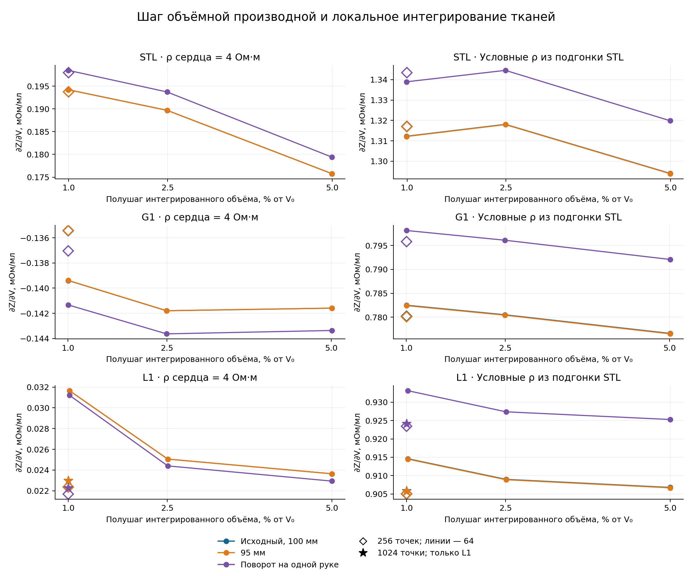
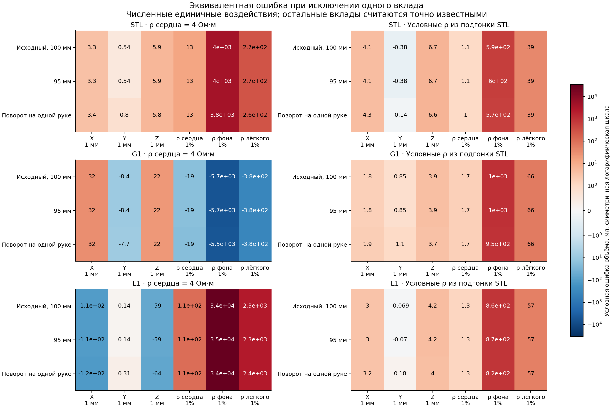
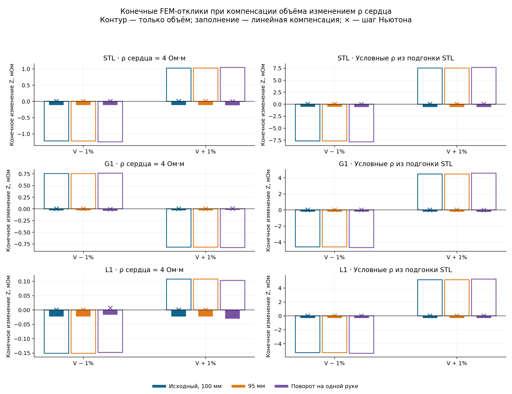

# Результаты проверки чувствительности и различимости параметров сердца

Сохранены результаты условного FEM-исследования одной КТ-геометрии на глубоком вдохе: 720 состояний основной серии, 18 дополнительных состояний для уточнения объёмной производной эллипсоида и две серии по 36 состояний для проверки компенсации объёмного отклика изменением удельного сопротивления сердца. Всего — 810 расчётных состояний, включая 54 повторно использованных состояния с проверенными хэшами. Число состояний не является числом независимых измерений или добровольцев.

Постановка, формулы и ограничения приведены в [главе 18](../../chapters/18_montage_parameter_reduction.md), состав вычислений — в [протоколе](../../../../../MATLAB_TRKG4_real_subjects/docs/HEART_MONTAGE_SENSITIVITY.md). Здесь сохранены численные результаты и их читательское представление. Исходные КТ, индивидуальные сетки, MAT-файлы и локальные конфигурации остаются во внешнем расчётном наборе.

## Условия расчёта

STL обозначает исходную анатомическую поверхность целого сердца; G1 — равновеликую сферу; L1 — равновеликий моментный эллипсоид. Во всех вариантах лёгкие образуют один компартмент. Фон неподвижен; материал сердца имеет приоритет в занимаемой им области. Механическое перемещение соседних органов не моделируется. Для каждого монтажа применяются четыре дисковых контакта диаметром 5 мм и полная электродная модель; частота составляет 79 505 Гц, ток — 0,007234 А.

Три монтажа — исходный с промежутком ток–напряжение 100 мм, вариант 95 мм и вариант с поворотом контактов на одной руке на 180°. Это альтернативные расчётные конфигурации. Их объединение в матрицу не означает наличия трёх одновременно зарегистрированных каналов.

В наборе `diagnostic4` удельное сопротивление целого сердца задано равным 4 Ом·м. В `commonSTLfit` использованы условные параметры из предшествующей подгонки STL; сопротивление сердца составляет около 23,47 Ом·м. Между наборами меняются также параметры мягкого фона и лёгкого. Эти значения не являются установленными тканевыми параметрами; эффективное сопротивление целого сердца не тождественно сопротивлению миокарда.

Обозначения q64, q256 и q1024 относятся к численному интегрированию тканевых долей. Изменение q не является сгущением конечноэлементной сетки. Перемещения X/Y/Z заданы относительно исходного центра каждой формы в системе LPS, в миллиметрах; объём выражен в мл, импеданс — в Ом, удельное сопротивление — в Ом·м. Масштабы 1 мм и 1% служат диагностическими возмущениями и не задают физиологическую неопределённость параметров.

## Численные результаты

Все семь сводных таблиц находятся в [tables.md](tables.md). Нумерация 18.2–18.8 продолжает главу 18. Таблицы CSV сохраняют исходную численную точность, а читательские таблицы содержат округлённые значения.

В исходном монтаже при `diagnostic4` и q256 объёмные чувствительности STL, G1 и L1 составляют соответственно 0,1938, −0,1354 и 0,02237 мОм/мл. Для L1 уточнение до q1024 даёт 0,02297 мОм/мл. Различие между последними двумя оценками составляет около 2,64% относительно q1024. Это результат локальной проверки интегрирования; общей сходимости или допустимости ошибки он не устанавливает.

Для сферы в том же условном наборе исключение смещения на +1 мм по X, Y или Z даёт линейную эквивалентную ошибку объёма соответственно +31,75, −8,36 и +22,38 мл. Исключение изменения сопротивления сердца на +1% даёт −18,67 мл. Эти величины показывают смешение вкладов при условии точного знания остальных параметров. Они не являются измеренным СКО методики.

Большие эквивалентные ошибки для мягкого фона и лёгкого получены делением соответствующего линейного электрического вклада на малую объёмную чувствительность сердца. Они характеризуют обусловленность такого преобразования. Значения в тысячи мл не следует интерпретировать как реально восстановленные объёмы или физиологические изменения тканей. В таблице 18.4 бюджет 5 мл используется только для иллюстрации изолированных ограничений; суммарный бюджет ошибки не установлен.

Для всех шести пар «форма — набор сопротивлений» матрица трёх монтажей при q256 имеет численный ранг 3. При свободных V, X, Y, Z и ρ сердца изменение V не определяется однозначно. Даже после задания XYZ число обусловленности двухпараметрической матрицы V–ρ сердца составляет примерно от 708 до 26 680 при принятых масштабах параметров. Эти оценки зависят от масштабирования; порог обнаружения по экспериментальному шуму пока отсутствует.

Конечные FEM-пробы подтверждают возможность компенсации. После одного шага Ньютона специально подобранное изменение ρ сердца почти погашает отклик изменения объёма порядка ±1%. Для G1 и `diagnostic4` максимальное по двум знакам изменение объёма составляет 5,856 мл, изменение ρ сердца — 0,3195%, а максимальный остаток в исходном монтаже — 0,000001871 мОм. В других двух монтажах максимальный остаток для этой пары равен 0,008729 мОм. Параметр ρ подбирался по исходному монтажу: опыт строит пример неоднозначности и не служит независимой проверкой восстановления объёма. В варианте STL с `commonSTLfit` уточнённое изменение ρ достигает 5,924%, выходя за ранее исследованную пробу ±5%; этот выход сохранён в таблицах.

Таблица 18.8 отдельно проверяет перенос объёмной чувствительности формы на электрические пробы STL. При `commonSTLfit` максимальная по двум знакам ошибка в исходном монтаже составляет 4,061 мл для G1 и 2,704 мл для L1. При `diagnostic4` соответствующие ошибки достигают 14,73 и 48,44 мл. Остальные параметры в этом сравнении известны точно; проверены только локальные объёмные пробы ±1%. Такой результат не позволяет выбрать универсальную форму по одной лишь этой таблице.

## Состав численного набора

- [electrical_states.csv](tables/electrical_states.csv): 720 строк основных состояний — форма, монтаж, параметры пробы, объём, импеданс, сопротивления, тканевые производные и хэши происхождения. Одна строка соответствует одному состоянию одного монтажа.
- [derivatives.csv](tables/derivatives.csv), [step_changes.csv](tables/step_changes.csv), [rho_checks.csv](tables/rho_checks.csv): производные, зависимость от шага и сравнение аналитической производной по ρ с конечными разностями.
- [quadrature_comparison.csv](tables/quadrature_comparison.csv), [quadrature_derivatives.csv](tables/quadrature_derivatives.csv), [volume_refinement.csv](tables/volume_refinement.csv): сравнение интегрирования и дополнительная проверка L1.
- [joint_decomposition.csv](tables/joint_decomposition.csv), [joint_components.csv](tables/joint_components.csv): совместные изменения, сумма отдельных вкладов и остатки. Поправка на фактически интегрированный объём учитывается отдельно, поэтому остаток взаимодействия не всегда равен простой разности двух показанных откликов.
- [identifiability.csv](tables/identifiability.csv), [restrictions.csv](tables/restrictions.csv), [restriction_finite_errors.csv](tables/restriction_finite_errors.csv): различимость и последствия условного сокращения числа параметров.
- [omission_units.csv](tables/omission_units.csv), [finite_volume_errors.csv](tables/finite_volume_errors.csv), [exclusion_error_budgets.csv](tables/exclusion_error_budgets.csv): ошибки исключения вкладов и иллюстративные ограничения.
- [finite_compensation_initial.csv](tables/finite_compensation_initial.csv), [finite_compensation_newton.csv](tables/finite_compensation_newton.csv): по 36 конечных проб до и после одного уточнения ρ.
- [anatomy_volume_transfer.csv](tables/anatomy_volume_transfer.csv): перенос коэффициентов чувствительности на объёмные пробы STL.

В CSV `raw` обозначает исходную производную, а поправка на изменение интегрированного объёма при перемещении применяется в скорректированных оценках. Знак ошибки сохраняется. Пустое значение означает отсутствие установленной оценки, а не нулевую ошибку. Точные определения полей и формулы доступны в коде `heart_montage_analysis.py` и `heart_montage_saved_analysis.py`, связанном с протоколом.

## Проверки и воспроизведение

Полная обработка выполнена функциями `heart_montage_saved_analysis.py`, `heart_montage_compensation.py analyze` и `heart_montage_volume_refinement.py analyze`. Проверены полнота серий, соответствие сохранённых входов и хэшей, согласованность условий и результатов электрического расчёта. Скрипты `heart_montage_figures.py` и `heart_montage_report_tables.py` успешно сформировали представленные графики и таблицы. Три графика просмотрены; таблицы проверены на сохранение числа столбцов.

[manifest.json](manifest.json) содержит число состояний, контрольные суммы экспортированных файлов, хэши кода и обезличенные относительные обозначения локальных источников. Поле `source_commit` задаёт исходный коммит экспорта; точную версию скриптов фиксируют их хэши. Публикуемые CSV скопированы из сводной обработки без изменения чисел. `electrical_states.csv` представляет выбранные численные поля локального набора, развёрнутые по монтажам; пути к индивидуальным исходникам исключены. Для повторного FEM-расчёта требуется исходный локальный набор: опубликованные таблицы не заменяют сетки и конфигурации.

Эти результаты дают вычислительные основания для дальнейшего ограничения параметров. Не определены экспериментальный шум, ошибка контактов, расхождение геометрии с анатомией и точность тканевых поправок. Не доказана общая сеточная сходимость. Закон связи движения, объёма и ρ по независимым данным не принят. УО, ФВ и их общий СКО по экспериментальным сигналам в этой серии не рассчитаны.
