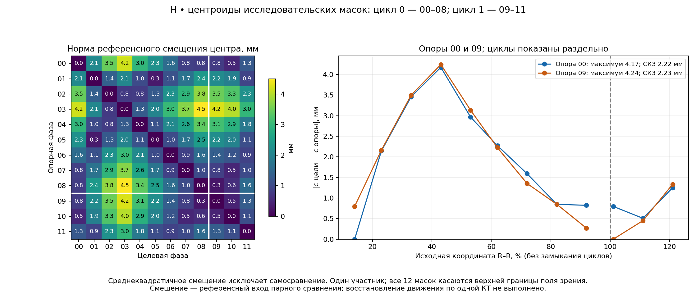

# 6 Анатомическая модель и аппроксимации сердца

## 6.1 Назначение анатомической опоры и происхождение сегментаций

В трансторакальном отведении «рука–рука» (ТТРКГ) отклик зависит от формы и положения сердца относительно тканей и электродов. Замена сердца простой фигурой требует совместной проверки геометрии и электрического отклика: одного совпадения объёма недостаточно.

При применении предполагается одна индивидуальная компьютерная томография (КТ). Динамическая 4D-КТ служит референсом разработки: её целевые объёмы, центры, повороты и полуоси не передаются в операционный расчёт. Электроимпедансная томография (ЭИТ) отдельно оценивает тканевые параметры и их изменения; конечноэлементная модель (FEM) переносит их вклад в ТТРКГ. Геометрия и функции сердца далее восстанавливаются по ТТРКГ с этими поправками и временными признаками электрокардиограммы (ЭКГ). Эта цепочка остаётся предметом разработки.

**Подтверждённое происхождение.** Первичная сегментация КТ добровольцев выполнена автором вручную в Inobitec. Однако канонические статические STL, выбранные 26.10.2026, получены автоматической сегментацией TotalSegmentator 2.18.0. Для Н, Г и Я сохранены поверхности тела, лёгких, костей, сердца и жира с отдельными паспортами; независимая анатомическая валидация не выполнена [1, 2]. Ручные модели, автоматические статические поверхности и автоматические маски 4D-КТ имеют разное происхождение. Точность одной версии не переносится на другую.

КТ получены на глубоком вдохе с задержкой дыхания. Кардиофазы внутри задержки не являются фазами дыхания, а протокол КТ не задаёт границы режимов электрической записи другой сессии. Исторический геометрический корпус содержит 39 фаз: 15 у Г, 12 у Н и 12 у А. Участник А не заменяет Я из экспериментальной тройки; соответствующая динамическая последовательность Я в этом корпусе отсутствует. Подробное сравнение ниже относится к Н и не устанавливает межсубъектную применимость [3–5].

## 6.2 Координаты, объёмы и технический контроль поверхности

Связь индексов вокселя $(i,j,k)$ с физическими координатами задаётся аффинной матрицей $A$:

$$
\begin{pmatrix}\mathbf x_{RAS}\\1\end{pmatrix}
=A\begin{pmatrix}i\\j\\k\\1\end{pmatrix},\qquad
\begin{pmatrix}\mathbf x_{LPS}\\1\end{pmatrix}
=\operatorname{diag}(-1,-1,1,1)
\begin{pmatrix}\mathbf x_{RAS}\\1\end{pmatrix}.
\tag{6.1}
$$

Координаты $\mathbf x$ выражены в мм. Положительные направления RAS — вправо, вперёд, вверх; LPS — влево, назад, вверх. Матрица $A$ включает шаг, ориентацию и начало отсчёта. Преобразование RAS–LPS не заменяет регистрацию разных КТ-серий. В электрическом расчёте длины согласованно переводятся в метры [2]. Для бинарной маски сердца $M_H$ объём равен

$$
V_H=\frac{|\det A_{3\times3}|}{1000}
\sum_{i,j,k}M_H(i,j,k).
\tag{6.2}
$$

Определитель имеет размерность мм³, $V_H$ выражен в мл; $1\ \text{мл}=1000\ \text{мм}^3$. Для замкнутой ориентированной поверхности STL — треугольного представления границы — используется сумма ориентированных тетраэдров:

$$
V_{STL}=\frac{1}{6000}
\left|\sum_f\mathbf a_f\cdot
(\mathbf b_f\times\mathbf c_f)\right|.
\tag{6.3}
$$

Вершины $\mathbf a_f,\mathbf b_f,\mathbf c_f$ грани $f$ заданы в мм; результат — мл. Знаки внутренних поверхностей сохраняются, модуль берётся после суммирования. Отверстия и несогласованная ориентация нарушают предпосылки формулы; замкнутость не исключает самопересечений и анатомических ошибок.

Канонический экспорт выполнен на исходной сетке маски при уровне изоповерхности 0,49, без морфологических изменений, обрезания, добавления рук и электродов. Компоненты поверхности и внутренние интерфейсы сохранены. Паспортные показатели приведены в таблице 6.1 [1].

Таблица 6.1 — Объёмы и топологические признаки канонических статических поверхностей сердца

| Участник | Объём маски, мл | Ориентированный объём поверхности, мл | Треугольников | Компонент поверхности | Замкнутость и согласованная ориентация |
|---|---:|---:|---:|---:|---|
| Н | 578,4382 | 578,7208 | 187 576 | 4 | Подтверждены технической проверкой |
| Г | 650,4594 | 650,7781 | 171 988 | 1 | Подтверждены технической проверкой |
| Я | 602,9579 | 603,2471 | 164 048 | 1 | Подтверждены технической проверкой |

Значения относятся к автоматической статической сегментации выбранных томов. Это объёмы соответствующих областей, без назначения им статуса конечного диастолического или конечного систолического объёма.

Согласованность объёмов характеризует экспорт, а не точность сегментации. Повторный расчёт по сохранённой STL Н дал 578,720801 мл против паспортных 578,720828 мл. Сердце и окружающая расчётная область показаны на рисунке 6.1.

Рисунок 6.1 — Статическая модель Н: сердце бордовое, лёгкие голубые, наружная область серая, контакты ЭИТ жёлтые. Номера 1–16 обозначают контакты; L, P, S — направления влево, назад, вверх. Единицы модели — мм; масштабной линейки нет. Продолжения рук и положение пояса заданы алгоритмически.

Сфера равного объёма займёт иные участки рядом с лёгкими. Это объясняет необходимость электрического сравнения. Изображённые руки и пояс относятся к расчётной модели [6].

## 6.3 Охват сердечной области и фазовый референс

Название «целое сердце» не доказывает полноту охвата камер, миокарда и сосудов. В паспорте статической STL Н охват камер и миокарда оставлен неподтверждённым; четыре компоненты поверхности не являются четырьмя камерами [6]. Автоматические маски целого сердца и камер также не образуют по определению точного разбиения. Для целой области $H$ и четырёх камерных масок крови $B_j$ следует различать объединение крови и его пересечение с $H$:

$$
B=\bigcup_{j=1}^{4}B_j,\qquad
V_{B\cap H}=|B\cap H|,\qquad
V_{\mathrm{ост}}=|H|-|B\cap H|.
\tag{6.4}
$$

Знак $|\cdot|$ здесь обозначает объём, далее в мл. При пересечениях сумма отдельных камерных объёмов отличается от объёма объединения. Остаток $V_{\mathrm{ост}}$ включает последствия несовпадения границ и не является валидированной маской миокарда.

В сохранённом учёте 12 фаз Н доля крови внутри целого сердца составляет 0,6802–0,7129, остаток — 164,890–209,391 мл. При фиксации остатка по первой опоре RMSE на восьми других фазах первого R–R равно 18,749 мл, максимум ошибки по модулю — 32,007 мл. Это отрицательный результат проверки постоянного остатка на данных масках; он не отделяет сегментационную вариабельность от физических изменений [7]. Визуальная определённость камерных границ показана на рисунке 6.2.

Рисунок 6.2 — КТ Н, фаза 09: аксиальное, фронтальное и сагиттальное сечения до наложения и после наложения камерных контуров. Левый желудочек обозначен синим, правый красным, левое предсердие голубым, правое оранжевым. Окно отображения: уровень 60 и ширина 160 единиц Хаунсфилда (HU). Числа у сечений являются индексами отображаемой сетки RAS, а не расстояниями в миллиметрах. Это предварительный просмотр автоматической сегментации без экспертного принятия всех границ.

Контуры требуют проверки по исходным сечениям: наличие окрашенной области не подтверждает её анатомическую правильность. Ранее попытка нового ручного камерного референса была остановлена из-за недостаточного контрастирования; автоматические маски не заменяют эту отсутствующую проверку [3].

В исследуемой серии Н девять фаз первого R–R имеют координаты 14–92%, три второго — 1–21%; длительности интервалов около 822 и 787 мс. Это два неполных фрагмента. Временное разрешение около 140 мс не равно шагу центров реконструированных кадров. Все 12 масок достигают верхней границы поля зрения; вычислительное замыкание поверхности не восстанавливает ткань за пределами тома [5, 8].

Объём динамической целой маски составляет 569,852–673,371 мл, размах — 103,520 мл. Он не равен ударному объёму (УО) желудочка. Статические 578,721 мл также нельзя приписывать установленной фазе динамической серии без регистрации и фазового обоснования.

## 6.4 Определения сферы, эллипсоида и индивидуальной формы

Для области $H$ задаются объём $\mathcal V$ в мм³, объёмный центроид $\mathbf c$ в мм и матрица центральных моментов $C$ в мм²:

$$
\mathcal V=\int_H d\mathcal V,\qquad
\mathbf c=\frac{1}{\mathcal V}\int_H\mathbf x\,d\mathcal V,\qquad
C=\frac{1}{\mathcal V}\int_H
(\mathbf x-\mathbf c)(\mathbf x-\mathbf c)^{\mathsf T}d\mathcal V.
\tag{6.5}
$$

Для STL используются моменты заключённого внутри объёма. Ковариация вершин не эквивалентна (6.5), поскольку зависит от плотности триангуляции. **Равновеликая сфера G1** помещается в центроид и имеет радиус

$$
r_V=\left(\frac{3\mathcal V}{4\pi}\right)^{1/3}
=\left(\frac{3\cdot1000V_H}{4\pi}\right)^{1/3},\qquad
G_1=\{\mathbf x:\|\mathbf x-\mathbf c\|\le r_V\}.
\tag{6.6}
$$

Радиус $r_V$ выражен в мм при $V_H$ в мл. **Сфера G2 по второму моменту** имеет другой радиус:

$$
r_C=\sqrt{\frac{5}{3}\operatorname{tr}C}.
\tag{6.7}
$$

У однородного шара $\operatorname{tr}C=3r^2/5$; следовательно, G2 сохраняет этот момент, но её объём $4\pi r_C^3/3$ в мм³ обычно отличается от $\mathcal V$.

Главные направления и полуоси моментного эллипсоида L2 определяются разложением

$$
C=U\operatorname{diag}(\lambda_1,\lambda_2,\lambda_3)U^{\mathsf T},
\qquad \widetilde a_i=\sqrt{5\lambda_i},\qquad
\widetilde{\mathcal V}=\frac{4\pi}{3}
\widetilde a_1\widetilde a_2\widetilde a_3.
\tag{6.8}
$$

Собственные значения $\lambda_i$ имеют размерность мм², полуоси $\widetilde a_i$ — мм, столбцы ортогональной матрицы $U$ задают направления. **Равновеликий эллипсоид L1** дополнительно нормируется:

$$
a_i=\alpha\widetilde a_i,\qquad
\alpha=\left(\frac{\mathcal V}{\widetilde{\mathcal V}}\right)^{1/3},\qquad
\sum_{i=1}^{3}\frac{[U^{\mathsf T}(\mathbf x-\mathbf c)]_i^2}{a_i^2}\le1.
\tag{6.9}
$$

Безразмерный коэффициент $\alpha$ сохраняет отношения полуосей и ориентацию, но меняет абсолютные вторые моменты. Для статической STL Н радиус G1 равен 51,696 мм, полуоси L1 — 66,644; 51,082; 40,583 мм. Это параметры целой области, а не размеры камеры [6].

Индивидуальная форма преобразует опорную область $H_0$:

$$
\mathbf x_t=\mathbf c_t+F_t(\mathbf x_0-\mathbf c_0),\qquad
\mathcal V_t=|\det F_t|\mathcal V_0.
\tag{6.10}
$$

Матрица $F_t$ безразмерна. В I1 она равна $s_tI$, где $I$ — единичная матрица, $s_t=(\mathcal V_t/\mathcal V_0)^{1/3}$. В I2 добавляется поворот:

$$
F_t=s_tQ_t,\qquad Q_t^{\mathsf T}Q_t=I,\quad\det Q_t=1,
\qquad Q_t=U_tDU_0^{\mathsf T}.
\tag{6.11}
$$

$Q_t$ — матрица собственного вращения; $D$ согласует знаки и соответствие главных осей. I3 вводит раздельные масштабы по главным направлениям с нормированием определителя до отношения объёмов. Эти преобразования описывают области, а не отслеживают материальные точки. При близких собственных значениях ориентация неустойчива; поворот сферы вовсе не меняет область.

Другие варианты подбираются по поверхности либо перекрытию [4, 5]. G3a/G3b — поверхностные сферы с фиксированным/свободным центром. Аналогично L3a/L3b — эллипсоиды со свободным объёмом, L3c/L3d дополнительно сохраняют объём. G4a/L4a максимизируют дискретное перекрытие при сохранённом объёме, G4b/L4b освобождают его. Библиотечные M1 и M8 обозначают соответственно реализацию BOOK и свободную подгонку эллипсоида. Эти обозначения нужны для чтения сохранённых графиков.

## 6.5 Геометрическое сравнение

Ошибка объёма и коэффициент перекрытия Dice определяются как

$$
e_V=\widehat V-V_H,\qquad
e_{V,\%}=100\frac{\widehat V-V_H}{V_H},\qquad
\operatorname{Dice}(H,G)=\frac{2|H\cap G|}{|H|+|G|}.
\tag{6.12}
$$

Здесь $\widehat V$ — объём аппроксимации, $e_V$ измеряется в мл, $e_{V,\%}$ — в процентах исходного объёма; Dice безразмерен. Одностороннее расстояние от поверхности сердца к поверхности фигуры $G$ имеет вид

$$
d_{\mathrm{RMS}}=\sqrt{
\frac{\sum_j w_jd(\mathbf p_j,\partial G)^2}{\sum_jw_j}},
\qquad \mathbf p_j\in\partial H.
\tag{6.13}
$$

$\mathbf p_j$ — точки исходной поверхности, $w_j$ — площадочные веса, $d$ — ближайшее евклидово расстояние; $d_{\mathrm{RMS}}$ выражено в мм. Это не симметричное расстояние Хаусдорфа. В статическом сравнении Dice оценён по общей выборке Sobol, поверхностная метрика — по площадочно выбранным точкам. Сходимость к непрерывным метрикам не установлена. Результаты приведены в таблице 6.2 [6].

Таблица 6.2 — Геометрические показатели аппроксимаций статической STL Н

| Представление | Объём, мл | Ошибка объёма, % | Одностороннее RMS поверхности, мм | Приближённый Dice |
|---|---:|---:|---:|---:|
| Исходная STL | 578,721 | 0 | 0 | 1 |
| G1, сфера равного объёма | 578,721 | 0 по построению | 13,628 | 0,73275 |
| G2, сфера по второму моменту | 855,613 | +47,845 | 13,958 | 0,70261 |
| G3a, поверхность, фиксированный центр | 686,736 | +18,664 | 13,302 | 0,72716 |
| G3b, поверхность, свободный центр | 676,605 | +16,914 | 13,126 | 0,71251 |
| L1, равновеликий моментный эллипсоид | 578,721 | 0 по построению | 10,478 | 0,78857 |
| L2, моментный эллипсоид | 757,218 | +30,843 | 10,828 | 0,78815 |

L1 лучше G1 воспроизводит перекрытие и поверхность при том же объёме. У G3b уменьшение поверхностного RMS сопровождается завышением объёма на 16,914%; почти одинаковый Dice L1 и L2 сочетается с завышением объёма L2 на 30,843%. Поэтому отдельная метрика не определяет анатомическую пригодность объёма. I1 при единичном масштабе тождественна STL; её проверка начинается на других фазах. Сфера сохраняется как кандидат для электрической задачи.

## 6.6 Фазовые изменения и точность заданных ограничений

При опоре $t_0$ ошибка изменения объёма отличается от ошибки его уровня:

$$
e_{\Delta V}(t;t_0)=
(\widehat V_t-\widehat V_{t_0})-(V_t-V_{t_0}),\qquad
\operatorname{RMSE}(e)=\sqrt{\frac1n\sum_{t\in\mathcal T}e_t^2}.
\tag{6.14}
$$

$\mathcal T$ — набор из $n$ оцениваемых фаз; RMSE — корень средней квадратичной ошибки, для объёма в мл. Для центра различаются положение и перемещение:

$$
e_c(t)=\|\widehat{\mathbf c}_t-\mathbf c_t\|,
\qquad
e_{\Delta c}(t;t_0)=
\|(\widehat{\mathbf c}_t-\widehat{\mathbf c}_{t_0})
-(\mathbf c_t-\mathbf c_{t_0})\|.
\tag{6.15}
$$

Обе ошибки измеряются в мм. Постоянное смещение центра может сочетаться с правильным изменением координат.

Полное сравнение содержит 19 способов проекта, девять библиотечных реализаций и исходную маску T0: 348 записей на 12 фазах. В таблице 6.3 исключены первые доступные опоры обоих R–R; объединены восемь и две неопорные фазы. Первые кадры не объявляются концом диастолы [5].

Таблица 6.3 — Аппроксимация целого сердца Н на десяти неопорных фазах при известных параметрах целевой КТ

| Способ | Средний Dice | RMSE объёма, мл | RMSE изменения объёма, мл | RMS ошибки перемещения центра, мм | Среднее RMS поверхности, мм |
|---|---:|---:|---:|---:|---:|
| I1, индивидуальная форма и единый масштаб | 0,9059 | 0* | 0* | 0* | 2,627 |
| I2, масштаб и поворот | 0,8848 | 0* | 0* | 0* | 3,180 |
| I3, анизотропное преобразование | 0,8821 | 0* | 0* | 0* | 3,264 |
| G1, равновеликая сфера | 0,7438 | 0* | 0* | 0* | 13,505 |
| G4b, свободная сфера по перекрытию | 0,7492 | 50,492 | 49,237 | 3,904 | 13,748 |
| L1, равновеликий моментный эллипсоид | 0,8038 | 0* | 0* | 0* | 10,669 |
| L3b, свободный поверхностный эллипсоид | 0,7470 | 40,985 | 15,600 | 2,280 | 9,609 |
| L4a, равновеликий эллипсоид по перекрытию | 0,8299 | 0* | 0* | 1,118 | 12,244 |
| L4b, свободный эллипсоид по перекрытию | 0,8298 | 8,126 | 10,728 | 1,182 | 12,209 |
| M8, библиотечный свободный эллипсоид | 0,7763 | 57,483 | 4,186 | 0,943 | 9,884 |

\* Величина задана построением из параметров целевой маски; ноль не является оценкой точности восстановления по электрическому сигналу. Последний столбец — среднее по фазам от одностороннего RMS, вычисленного на общей выборке 32 768 точек каждой целевой поверхности. Фазы и межфазные разности зависимы.

При заданных объёме и центре I1 лучше описывает маски, чем проверенные сферы и эллипсоиды. Поворот и анизотропия I2/I3 ухудшают среднее перекрытие; это не доказывает отсутствия реальных вращений или неоднородных деформаций. На рисунке 6.3 видна разница между точным выполнением ограничений и совпадением областей.

Рисунок 6.3 — Первый R–R Н: объём и изменение от опоры, мл; ошибка перемещения центра, мм; безразмерный Dice. Горизонтальная ось — фаза R–R, %. T0 — исходная маска, I1–I3 — индивидуальные формы, G1/G2/G3a — сферы (§6.4); цвета заданы легендой. Красный крест предусмотрен для неподтверждённой сходимости. Линии соединяют только доступные отсчёты.

Объёмные кривые T0, I1–I3 и G1 накладываются по построению, хотя Dice различается. Нулевая ошибка движения заданных центроидов также не является восстановлением координат по ЭКГ. Сфера G2 заметно завышает объём.

Для эллипсоидов более высокий Dice L4a по сравнению с L1 сопровождается худшим поверхностным расстоянием. У M8 RMSE абсолютного объёма составляет 57,483 мл, а его изменения — 4,186 мл. Различия по фазам для группы поверхностных и перекрывающих подгонок показаны на рисунке 6.4.

Рисунок 6.4 — Первый R–R Н: показатели T0, поверхностных эллипсоидов L3a–L3d, эллипсоидов по перекрытию L4a/L4b и библиотечного M1. Верхние панели: объём и изменение объёма от опоры, мл; нижние: ошибка перемещения, мм, и Dice. Горизонтальная ось — фаза R–R, %. Синим показан T0, прочие цвета заданы легендой. Сохранение объёма или центра в отдельных способах является условием их построения.

Свободная поверхностная подгонка не сохраняет объёмную кривую; близкий объём L4b тоже не гарантирует точного изменения от опоры. Одну постоянную составляющую смещения можно устранить известной опорой:

$$
\widetilde V_t=\widehat V_t+(V_{t_0}-\widehat V_{t_0}),\qquad
\widetilde V_t-V_t=e_{\Delta V}(t;t_0).
\tag{6.16}
$$

Однако $\widehat V_t$ здесь получено из КТ каждой цели. Малая ошибка изменения M8 характеризует геометрическую подгонку при полной фазовой информации и не устанавливает точность схемы «сигнал и один снимок».

## 6.7 Численная устойчивость и выбор опорной фазы

Первоначальный поиск L4a/L4b исчерпал лимит 900 вычислений во всех 24 сочетаниях; повторный поиск с бюджетом 9000 завершился успешно. Успех локального алгоритма не доказывает глобальный минимум или сходимость по дискретизации [5, 9]. В таблице 6.4 приведены сохранённые сопоставления численных настроек.

Таблица 6.4 — Чувствительность подгонки к дискретизации и числу точек

| Способ | Изменение настройки | Максимум изменения объёма по модулю, мл | Максимум изменения Dice по модулю | Максимум изменения исходного поверхностного RMS, мм |
|---|---|---:|---:|---:|
| G4b | Решётка перекрытия 3 → 2 мм; одновременно увеличен бюджет поиска | 35,865 | 0,000744 | 0,458 |
| L4b | Решётка перекрытия 3 → 2 мм при бюджете 9000 | 11,510 | 0,001393 | 0,274 |
| L3a | Точки подгонки 1024 → 4096 | 26,694 | 0,013350 | 0,043 |
| L3b | Точки подгонки 1024 → 4096 | 28,613 | 0,007487 | 0,049 |

Для каждого способа сопоставлены 12 фаз. У G4b результат характеризует совместное изменение настроек, без выделения изолированного эффекта шага решётки.

У G4b почти неизменный Dice сочетается с изменением объёма до 35,865 мл; у L3a/L3b изменения поверхностного RMS менее 0,05 мм сопровождаются различием объёмов на десятки миллилитров. Устойчивость критерия не обеспечивает устойчивости искомого параметра.

При использовании каждой из 12 фаз как единственной опоры для остальных средний Dice I1 составляет 0,8698–0,9179, I2 — 0,8521–0,9027, I3 — 0,8496–0,9002. I1 имеет наибольшее среднее среди трёх вариантов для всех опор; худшая пара даёт 0,8226. В 432 сочетаниях параметры преобразования цели всё ещё известны из её КТ [10]. Это проверка пригодности опорной формы, а не восстановления неизвестной динамики.

Контурная 2D-проверка дала ещё один отрицательный результат: 61 из 72 оптимизаций достигла верхней границы радиуса 60 мм, включая все 36 фронтальных подгонок. Постоянство радиуса отражает ограничение поиска. Проекционная окружность также не определяет глубину и объём трёхмерного сердца [11].

## 6.8 Фиксированный центр и референсное перемещение

Единую опору можно использовать при фиксированном либо перемещающемся центре:

$$
H(t)=\{\mathbf c_0+\mathbf d(t)+s(t)(\mathbf x-\mathbf c_0):
\mathbf x\in H_0\},\qquad V(t)=s(t)^3V_0.
\tag{6.17}
$$

$\mathbf d(t)$ — перенос в мм, $s(t)$ — безразмерный масштаб; неподвижный вариант задаётся $\mathbf d(t)=0$. Для эллипсоида в этом опыте ориентация и отношения полуосей фиксированы по опоре. Рисунок 6.5 показывает различие движений центров исходной области и подогнанных фигур.

Рисунок 6.5 — Изменения координат центров T0 и группы L3/L4/M1 относительно собственных значений опорной фазы первого R–R Н. Оси $\Delta x$, $\Delta y$, $\Delta z$ заданы в мм в системе RAS. Цвета и обозначения соответствуют рисунку 6.4. Соединены дискретные фазовые оценки; отдельного измерения непрерывных траекторий материальных точек нет.

Свободный центр может улучшать поверхностную подгонку, одновременно меняя траекторию. Её нельзя автоматически считать движением сердца как жёсткого тела. Максимальное расстояние между центроидами масок Н составляет 4,501 мм; относительно опоры 00 максимум — 4,173 мм, RMS по 11 другим фазам — 2,222 мм. Зависимость от опоры показана на рисунке 6.6.

Рисунок 6.6 — Расстояния между центроидами Н, мм. Слева — матрица опорных и целевых фаз; справа — расстояния от опор 00 (синий) и 09 (оранжевый). Горизонтальная шкала развёрнутого R–R, %, разделяет интервалы: продолжение за 100% не замыкает первый. RMS исключает самосравнение. Перемещения получены из масок.

Парный опыт включает 12 опор, 12 целей, три формы и два варианта центра — 864 записи. Объём цели задан из КТ, а ориентация и отношения полуосей берутся только из опоры. Описательная сводка без самосравнений приведена в таблице 6.5 [8].

Таблица 6.5 — Эффект добавления известного переноса при одинаковом заданном объёме

| Форма | Средний Dice, фиксированный центр | Средний Dice, перенос по центроиду | Изменение Dice, доля | Число пар |
|---|---:|---:|---:|---:|
| I1 | 0,90881 | 0,90360 | −0,00521 | 132 |
| G1 | 0,74586 | 0,74764 | +0,00179 | 132 |
| L1 | 0,80077 | 0,80204 | +0,00128 | 132 |

Все пары относятся к одному участнику; сводка включает межинтервальные сопоставления и не создаёт полного независимого цикла.

У I1 известный перенос уменьшает Dice в 109 парах, увеличивает в 21, не меняет в двух. Изменение центроида деформируемой области не эквивалентно переносу всей формы. Вариант с фиксированным центром поэтому сохраняется, но электрическая незначимость движения не установлена.

Гипотеза $\mathbf d=\mathbf k(V-V_0)$, где $\mathbf k$ измеряется в мм/мл, уменьшила RMS координат при исключении проверяемых фаз первого R–R для всех девяти опор. На трёх фазах следующего R–R улучшение осталось у шести; у трёх ошибка возросла. Для опоры 00 она изменилась с 0,9048 до 1,2682 мм. Целевой объём был известен: универсальный закон движения по одному снимку не получен [12].

## 6.9 Электрическая эквивалентность и роль тканевых параметров

Пусть $F(H,\boldsymbol\rho,\mathcal E)$ — оператор передаточного импеданса $Z$ в Ом; $\boldsymbol\rho$ — сопротивления материалов в Ом·м, $\mathcal E$ — электроды и контакты. При одинаковых свойствах тканей сравниваются

$$
\delta Z_0=F(G,\boldsymbol\rho,\mathcal E)
-F(H,\boldsymbol\rho,\mathcal E),\qquad
K_V=\frac{Z(V_+)-Z(V_-)}{V_+-V_-}.
\tag{6.18}
$$

$\delta Z_0$ измеряется в Ом, $K_V$ — в Ом/мл при объёмах $V_\pm$ в мл. Малое базовое различие не гарантирует близости объёмных чувствительностей. Сравнение при общих $\rho$ проверяет формы в заданном материальном окружении. Подбор собственных эффективных параметров каждой формы проверяет уже пару «геометрия и свойства» и требует независимого контроля объёма и динамического закона.

Сохранённое исследование STL, G1 и L1 содержит 54 состояния: три формы, два материальных сценария, три объёма 0,95/1,00/1,05 от исходного и шесть осевых сдвигов ±5 мм. Номинальный объём — 578,720801 мл. Использованы общая сетка, частота 79 505 Гц, ток 7,234 мА и отведение «рука–рука»: четыре дисковых контакта диаметром 5 мм, расстояние токового и измерительного контакта с каждой стороны 100 мм. Это модельная установка, не подтверждённые координаты конкретной записи [13]. Материальные условия приведены в таблице 6.6.

Таблица 6.6 — Материальные условия электрического сравнения форм, Ом·м

| Сценарий | Мягкотканный фон | Лёгочный компартмент | Кость | Целое сердце | Жир |
|---|---:|---:|---:|---:|---:|
| Диагностический, сердце 4 Ом·м | 2,853969 | 18,468929 | 19,147705 | 4,000000 | 23,063216 |
| Общая условная опора по подгонке STL | 2,888793 | 17,997668 | 19,147705 | 23,468976 | 23,063216 |

Оба набора имеют сценарный статус. Сердечное сопротивление относится к эффективной области целиком и не является независимо измеренным сопротивлением миокарда или крови.

Прежняя сердечная область при замене заполняется мягким материалом, новая форма получает приоритет внутри своей области; фон между вариантами сохранён. Это определённое правило замещения, без механического вытеснения соседних органов. Таблица 6.7 сопоставляет базовый отклик и изменение при заданном объёмном воздействии.

Таблица 6.7 — Базовый импеданс и объёмная чувствительность ТТРКГ при общих свойствах тканей

| Сценарий | Форма | Разность базового импеданса относительно STL, Ом | Объёмная чувствительность, мОм/мл |
|---|---|---:|---:|
| Сердце 4 Ом·м | STL | 0 | +0,175416 |
| Сердце 4 Ом·м | G1 | −0,040034 | −0,141640 |
| Сердце 4 Ом·м | L1 | −0,017596 | +0,023567 |
| Общая опора по STL | STL | 0 | +1,294387 |
| Общая опора по STL | G1 | −0,042417 | +0,776577 |
| Общая опора по STL | L1 | −0,045926 | +0,906762 |

Базовые импедансы STL равны соответственно 93,135970 и 94,303026 Ом. Производная получена по состояниям ±5% объёма с интегрированной разностью объёмов в знаменателе. Таблица содержит исходное базовое сравнение без дополнительного линейного приведения объёмов.

При 4 Ом·м сфера имеет противоположный STL знак объёмного отклика; при второй общей опоре знак положителен. Поэтому один фиксированный сценарий не позволяет отвергнуть сферу. Второй набор также не становится физиологически подтверждённым: изменены сопротивления не только сердца, но и фона и лёгкого.

Во второй опоре базовые ошибки G1 и L1 составляют около −0,0450 и −0,0487%, тогда как объёмная чувствительность меньше STL на 40,0 и 29,9%. Это контрпример эквивалентности по одному импедансу. Интегральные базовые объёмы на конечной квадратуре также различаются: 578,525391; 578,722445; 578,688995 мл для STL, G1, L1. Аналитическое равенство объёмов не устраняет дискретизацию границы.

Условный вычислительный анализ завершён для сохранённых 54 состояний; он не является полной валидацией обратной задачи. В целевой схеме единый лёгочный компартмент и мягкие ткани сохраняют пульсовой вклад, в том числе на задержке дыхания. Оцениваемые ЭИТ изменения $\Delta\rho$ требуют проверки: они могут поглотить геометрическое движение, и тогда тканевая поправка удалит часть искомого сигнала ТТРКГ. Изменение эффективной проводимости нельзя вторично учитывать как независимый эффект, если оно уже включено в объёмный закон состава.

После тканевых поправок локальная связь геометрии и сигнала имеет вид

$$
\Delta Z_{\mathrm{геом}}\simeq K_V\Delta V
+K_xd_x+K_yd_y+K_zd_z,\qquad
\widehat{\Delta V}-\Delta V\simeq
\frac{K_xd_x+K_yd_y+K_zd_z}{K_V},\quad K_V\ne0.
\tag{6.19}
$$

$K_x,K_y,K_z$ имеют единицы Ом/мм, $d_x,d_y,d_z$ — мм; ошибка объёма справа выражена в мл. Она описывает только игнорируемое движение; ошибки поправки, измерения и прямой модели добавляются отдельно. Один скалярный канал не разделяет четыре свободных геометрических параметра, а ЭКГ задаёт время, не пространственное перемещение. Требуются проверяемый закон динамики и ограничения различимости; их обратная постановка развивается в главе 9.

## 6.10 Границы использования анатомической модели

Индивидуальная форма лучше рассматриваемых сфер и эллипсоидов описывает фазовые маски Н при известных преобразованиях. Сфера остаётся допустимой редуцированной моделью; пригодность определяется совместно геометрией, электрическим откликом и устойчивостью параметров. Ни добавление поворота или переноса, ни свободная подгонка не гарантируют улучшения всех критериев.

Переход от объёма эквивалентного сердца к камерным функциям требует отдельного обоснования. Для выбранного желудочка

$$
SV=V_{ED}-V_{ES},\qquad EF=\frac{SV}{V_{ED}}.
\tag{6.20}
$$

$SV$ — УО в мл; $V_{ED}$ и $V_{ES}$ — конечные диастолический и систолический объёмы одного выделенного сокращения в мл. $EF$ — доля, $100EF$ — проценты; ошибка процентной ФВ выражается в процентных пунктах. Объём целого сердца и его размах не заменяют камерные величины. Эта проверка относится к главе 10. Точность полной цепочки «одна КТ — тканевые поправки — ТТРКГ — функции сердца» пока не установлена.

## Источники к главе 6

Использованы паспорта и сохранённые результаты проекта; подробное происхождение и проверки приведены в рецензии главы.

1. [Канонический реестр статических STL, решение от 26.10.2026](../../../../../configs/scorpion_canonical_stl.json). Связанные паспорта сегментации Н, Г, Я и контрольные суммы поверхностей.
2. [Единый стандарт подготовки индивидуальной КТ-модели](../../../../../docs/CT_FEM_PREPARATION_STANDARD.md). Редакция от 26.10.2026.
3. [Паспорт проверенного КТ-референса](../../../execution_20261026/ct/ct_reference.json) и [историческое геометрическое сравнение](../../../../cardiac_4d_segmentation/results/reduced_heart_geometry_20260914/exploratory/comparison_02/geometry_comparison.jsonl).
4. [Реестр методов аппроксимации сердца](../../../../40.15_Реестр_методов_аппроксимации_сердца.md).
5. [Пофазные результаты полного сравнения Н](../../../../cardiac_4d_segmentation/results/nik_whole_heart_20261028/exploratory/full_geometry_v1/summary/final/phase_metrics.csv).
6. [Паспорт статической STL и её аппроксимаций](../../../pulmovista_check_20261028/local/stl_approximation/provenance.json).
7. [Учёт крови внутри целой маски и остаточного объёма](../../../pulmovista_check_20261028/local/heart_composition_check/composition_check.local.json).
8. [Парные сравнения с переносом и фиксированным центром](../../../../cardiac_4d_segmentation/results/nik_whole_heart_20261028/exploratory/full_geometry_v1/motion_geometry_v1/motion_effect_stats.csv).
9. [Изменение результатов при уточнении численных настроек](../../../../cardiac_4d_segmentation/results/nik_whole_heart_20261028/exploratory/full_geometry_v1/refinement_comparison/summary.csv).
10. [Проверка выбора единственной опоры](../../../../cardiac_4d_segmentation/results/nik_whole_heart_20261028/exploratory/full_geometry_v1/anchor_sensitivity_v2/anchor_summary.csv).
11. [Протокол двумерных контурных сравнений](../../../../cardiac_4d_segmentation/results/nik_whole_heart_20261028/exploratory/full_geometry_v1/contour_control/README.md).
12. [Ошибки линейного закона связи перемещения с объёмом](../../../../cardiac_4d_segmentation/results/nik_whole_heart_20261028/exploratory/full_geometry_v1/motion_law_v1/anchor_error_summary.csv).
13. [Паспорт электрического сравнения трёх форм](../../../pulmovista_check_20261028/local/shape_electrical_study_v1.local.json), [итоговый протокол анализа](../../../pulmovista_check_20261028/local/shape_electrical_comparison_v1/analysis.local.json).

