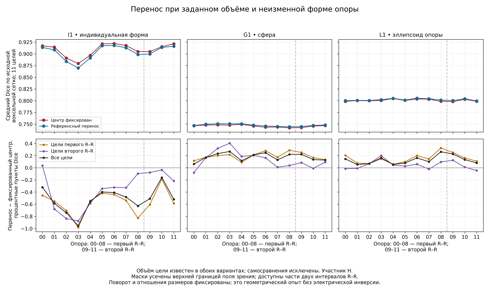
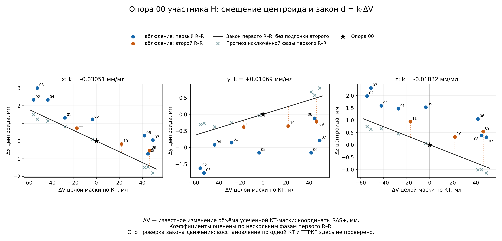
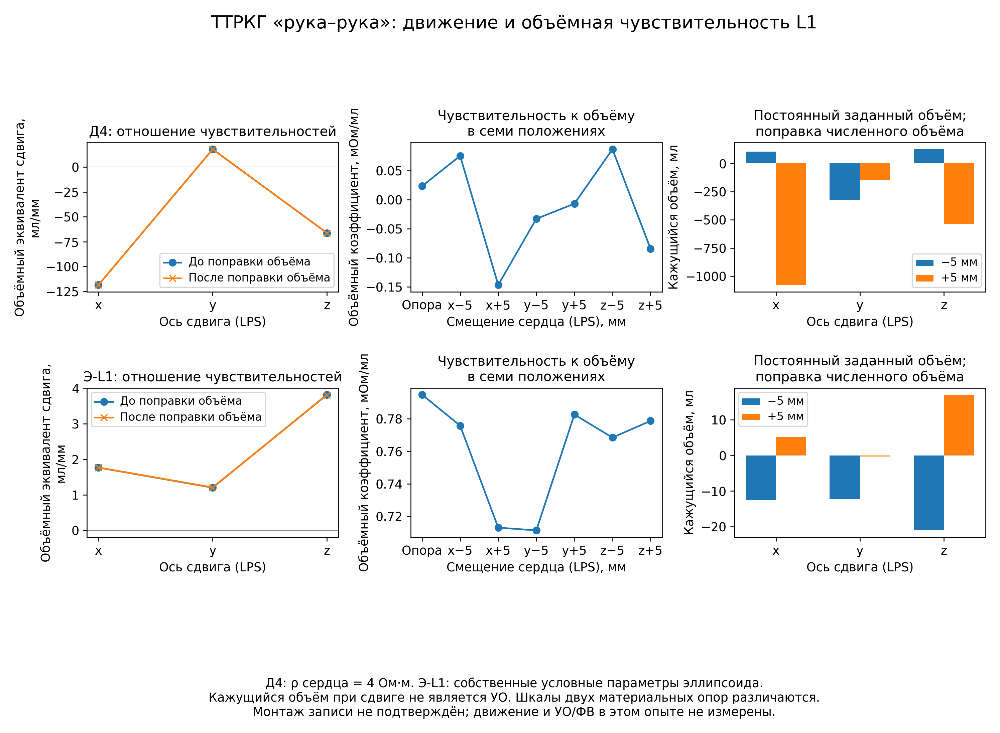
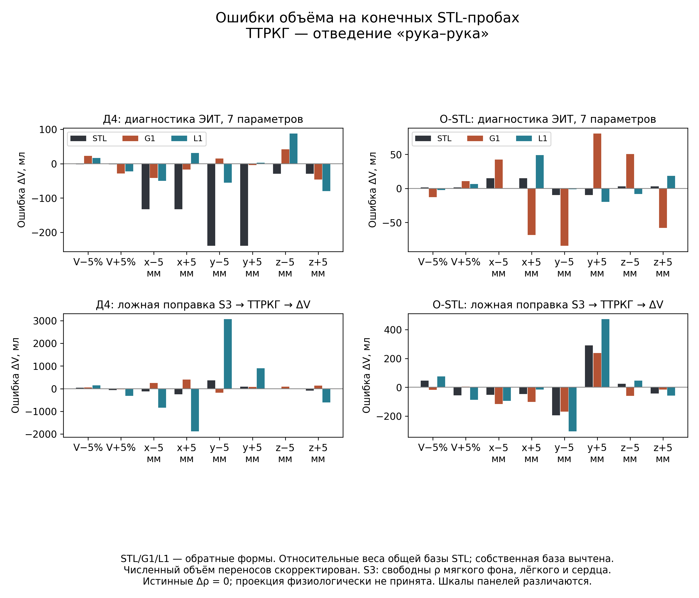
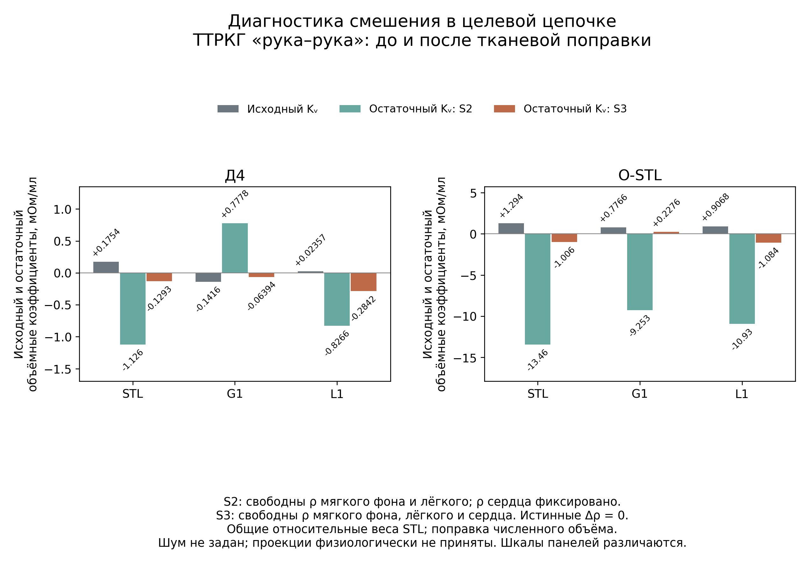

# 9 Восстановление динамики целого сердца

## 9.1 Оцениваемая величина и границы имеющихся данных

Задача этапа — восстановить объём, положение и форму целого сердца по электрическому сигналу с учётом тканевых влияний. Объём выделенной сердечной области не равен объёму крови левого желудочка. Переход к камерным объёмам, ударному объёму (УО) и фракции выброса (ФВ) рассмотрен в главе 10.

Операционный вход — одна индивидуальная КТ-опора. Электроимпедансная томография (ЭИТ) оценивает базовые тканевые параметры и их синхронные изменения; конечно-элементная модель (FEM) переводит их в вклад в трансторакальное отведение «рука–рука» — ТТРКГ. Затем по ТТРКГ с временными признаками ЭКГ исследуется геометрическая динамика. Тканевой этап изложен в главе 8. Его существенное ограничение: при фиксированной геометрии оценка тканевого сопротивления может поглотить часть геометрического сигнала.

Первое исследуемое состояние — глубокий вдох с задержкой, соответствующий протоколу КТ. Пульсовые вклады мягких тканей и единого лёгочного компартмента сохраняются. Статус участка электрической записи определяется его разметкой. Будущая одновременная регистрация ЭИТ и ТТРКГ подтверждена; имеющиеся разновременные записи не позволяют проверить покадровую коррекцию.

Результаты относятся к участнику Н и срезу от 28.10.2026 [1–5]: геометрическим и электрическим пробам, локальным инверсиям и диагностике реальных ЭИТ-окон. Это разработка методики; завершённый архивный срез не равнозначен валидации цепочки.

Статическая STL-поверхность электрических проб получена автоматической сегментацией; её объём — 578,720801 мл. Происхождение сверено с каноническим манифестом, полнота охвата камер и миокарда независимо не установлена. Отдельный 4D-референс содержит девять масок первого R–R и три следующего, не образующих два полных цикла. Маски достигают верхней границы поля зрения; замкнутые поверхности включают вычислительную крышку. Перенос их динамики в статическую FEM-модель требует межсерийной регистрации.

## 9.2 Объём, положение, форма и эффективное сопротивление

Пусть \(H_0\) — сердечная область единственной опоры, \(V_0\) — её объём в мл, \(\mathbf c_0\) — центр в мм. Для исходной индивидуальной формы, равновеликой сферы и эллипсоида сначала рассматривается один закон преобразования:

$$
H(t)=\left\{\mathbf c_0+\mathbf d(t)+s(t)(\mathbf X-\mathbf c_0):
\mathbf X\in H_0\right\},\qquad
V(t)=s(t)^3V_0,\qquad
s(t)=\left[\frac{V(t)}{V_0}\right]^{1/3}.
\tag{9.1}
$$

Вектор \(\mathbf d=(d_x,d_y,d_z)^{\mathsf T}\) задаёт перенос в мм, \(s>0\) — безразмерный масштаб. Отношения размеров и ориентация сохраняются. Это закон вычислительных проб, не измеренная деформация. Фиксированное положение задаётся условием \(\mathbf d(t)=0\); в подвижном варианте перенос неизвестен. В обоих случаях объём восстанавливается по сигналу.

Отношения полуосей и поворот эллипсоида задаются параметрами формы \(\boldsymbol\alpha(t)\). Здесь они фиксированы по опоре: размерность сокращена, ошибка приближения границы сохраняется.

Удобная координата размера — радиус сферы равного объёма:

$$
r_{\mathrm{экв}}=\left(\frac{3000V}{4\pi}\right)^{1/3},\qquad
V=\frac{4\pi}{3000}r_{\mathrm{экв}}^3,\qquad
\frac{dV}{dr_{\mathrm{экв}}}=\frac{3V}{r_{\mathrm{экв}}}.
\tag{9.2}
$$

Здесь \(r_{\mathrm{экв}}\) выражен в мм, \(V\) — в мл; 1000 учитывает перевод мм³ в мл. Для индивидуальной формы и эллипсоида это замена координаты масштаба: исходная FEM-форма сохраняется, новой независимой неизвестной нет.

Эффективное сопротивление \(\rho_H\), Ом·м, характеризует целую сердечную область и не равно по определению сопротивлению крови или миокарда; \(\sigma_H=1/\rho_H\), См/м. Геометрический и материальный эффекты разделяются частными производными. При связанном законе \(\rho_H=\rho_H(V,\phi)\), где \(\phi\) — фаза цикла,

$$
\left.\frac{dZ}{dV}\right|_{\phi}
=\left.\frac{\partial Z}{\partial V}\right|_{\rho_H,\phi}
+\frac{\partial Z}{\partial\rho_H}
\left.\frac{\partial\rho_H}{\partial V}\right|_{\phi}.
\tag{9.3}
$$

Обе части имеют единицу Ом/мл: первая описывает изменение границы, вторая — свойств вдоль закона состава. Второй вклад нельзя одновременно включать в полную производную и оценивать как независимое изменение. Сведение состава к функции одного наружного объёма требует проверки.

В пробах исходное сердце заменяется мягким фоном, затем накладывается выбранная форма. При расширении формы замещают разные доли окружающих тканей, поэтому равенство объёмов не обеспечивает равенства откликов. Механическое вытеснение органов не моделируется.

## 9.3 Нелинейная обратная задача и её линеаризация

Прямой оператор \(F_m\) главы 7 возвращает передаточный импеданс в отведении \(m\) при заданных геометрии, тканевых свойствах и контактах. Обозначим геометрические неизвестные через \(\mathbf g=(V,\mathbf d,\boldsymbol\alpha)\), вектор сопротивлений через \(\boldsymbol\rho\), а фиксированные условия частоты, электродов и контактов через \(\mathcal A\). Модель разностного наблюдения имеет вид

$$
\Delta Z_m^{\mathrm{изм}}(t)=
F_m\!\left(\mathbf g(t),\boldsymbol\rho(t);\mathcal A\right)
-F_m\!\left(\mathbf g_0,\boldsymbol\rho_0;\mathcal A\right)
+\varepsilon_m(t).
\tag{9.4}
$$

Остаток \(\varepsilon_m\), Ом, включает измерительную, анатомическую, контактную и численную ошибки и неописанную динамику; его статистика неизвестна. Тканевые оценки входят в прямую модель с условиями применимости. Вычитание заранее рассчитанного линейного вклада приближает нелинейную модель только около выбранной опоры.

Для цикла задаётся конечномерный закон \(\mathbf g(t;\boldsymbol\theta)\), включающий амплитуды, параметры движения и задержки относительно ЭКГ. Регуляризованная задача имеет вид

$$
\widehat{\boldsymbol\theta}=
\mathop{\arg\min}_{\boldsymbol\theta\in\mathcal C}
\left\{
\left\|W\left[\Delta\mathbf Z^{\mathrm{изм}}
-\mathbf f(\boldsymbol\theta;\widehat{\boldsymbol\rho},\mathcal A)\right]\right\|_2^2
+\lambda^2
\left\|L S_\theta^{-1}(\boldsymbol\theta-\boldsymbol\theta_0)\right\|_2^2
\right\}.
\tag{9.5}
$$

Векторы объединяют отсчёты и доступные отведения; \(\mathbf f\) — разности (9.4). Диагональная \(S_\theta\) задаёт физические масштабы, переводящие штраф в безразмерные координаты. Матрица \(L\) ограничивает отклонение от опоры или изменчивость траектории; \(\lambda\) задаёт вес ограничения. Область \(\mathcal C\) обеспечивает положительность объёма и сопротивлений и допустимую геометрию. Формула систематизирует постановку; полный нелинейный алгоритм по ТТРКГ пока не проверен.

При известной ковариации \(\Sigma\) выбирают \(W\Sigma W^{\mathsf T}=I\); иначе веса задают метрику, не модель шума. Единственный регуляризованный минимум не устраняет недостатка информации. Проверяются зависимость от \(\lambda\), границ и старта, альтернативные минимумы. Универсальные \(\lambda\) и допуск ошибки объёма не приняты.

Связь отсчётов во времени можно задать функциями фазы. Для безразмерного геометрического приращения относительно КТ-опоры рассматривается запись

$$
\widetilde{\mathbf g}(\phi)=\widetilde{\mathbf g}_{\mathrm{sess}}+
\sum_{k=1}^{K}a_k\!
\left[\mathbf b_k(\phi-\delta_k)-\mathbf b_k(\phi_0-\delta_k)\right].
\tag{9.6}
$$

Физические приращения получаются умножением на заданные масштабы. \(\mathbf b_k\) — функции аппроксимации, \(a_k\) — амплитуды, \(\delta_k\) — задержки в долях цикла. Нормировку и знак базиса фиксируют. \(\widetilde{\mathbf g}_{\mathrm{sess}}\) описывает межсессионное отличие от КТ; его обнуление — допущение. Проверенный базис для нового человека пока не получен; его собственная 4D-траектория не является операционным входом.

\(\phi_0\) — фаза статической КТ относительно начала кардиоцикла. Если она не установлена по данным съёмки, это дополнительная неизвестная либо источник неопределённости. Её включают в \(\boldsymbol\theta\) или варьируют в допустимом диапазоне, оценивая влияние на объём и движение. Проверяется совместная различимость \(\phi_0\), задержек \(\delta_k\) и межсессионного смещения. Нельзя незаметно фиксировать фазу или считать КТ конечной диастолой. ЭКГ новой сессии сама по себе не устанавливает фазу прежней КТ.

Локальный анализ получается разложением (9.4) около одного состояния. При фиксированных отношениях размеров и ориентации

$$
\Delta Z=
K_V\Delta V+
\mathbf K_d\mathbf d+
K_{\rho_H}\Delta\rho_H+
K_{\rho_S}\Delta\rho_S+
K_{\rho_L}\Delta\rho_L+R.
\tag{9.7}
$$

Здесь \(S\) обозначает мягкий фон, \(L\) — единый лёгочный компартмент; \(\mathbf K_d=(K_x,K_y,K_z)\). Единицы \(K_V\) — Ом/мл, \(K_a\) — Ом/мм, \(K_{\rho_j}\) — Ом/(Ом·м), а \(R\) — Ом. При свободной форме добавились бы соответствующие столбцы. Кость и жир фиксированы именно в рассматриваемой диагностике, а не объявлены точно известными тканями.

Производные рассчитываются по конечным прямым пробам:

$$
K_V\simeq
\frac{Z(V_+)-Z(V_-)}{V_+^{\mathrm{инт}}-V_-^{\mathrm{инт}}},
\qquad
K_a\simeq
\frac{Z(d_a=+h)-Z(d_a=-h)}{2h},
\qquad
K_{\rho_j}=-\frac{K_{\sigma_j}}{\rho_j^2}.
\tag{9.8}
$$

Знаменатель использует интегрированные объёмы материала. При переносе дискретизация слегка изменяет объём; отдельно сохраняется отклик после вычитания \(K_V\Delta V^{\mathrm{числ}}\). Эта линейная поправка не заменяет точного геометрического решения. Основные шаги: \(V_\pm=V_0(1\pm0{,}05)\), \(h=5\) мм; применимость к другим диапазонам не установлена.

Для физического вектора параметров \(\mathbf q\) обозначим разность наблюдений через \(\mathbf y\), якобиан через \(J\), безразмерное приращение через \(\boldsymbol\xi=S_q^{-1}\Delta\mathbf q\), где \(S_q\) задаёт масштабы. Тогда

$$
\widehat{\boldsymbol\xi}
=\mathop{\arg\min}_{\boldsymbol\xi}
\left\{\|W\mathbf y-A\boldsymbol\xi\|_2^2+
\lambda^2\|L\boldsymbol\xi\|_2^2\right\},
\quad A=WJS_q,
\quad
(A^{\mathsf T}A+\lambda^2L^{\mathsf T}L)\widehat{\boldsymbol\xi}
=A^{\mathsf T}W\mathbf y.
\tag{9.9}
$$

Нормальные уравнения относятся к решению без активных границ. При \(\lambda=0\) псевдообращение выбирает минимальную норму, сохраняя неоднозначность вдоль нульпространства. Штраф подавляет усиление ошибок малыми сингулярными числами ценой зависимости от ограничения.

Нормирование \(\Delta Z/Z_0\) требует того же преобразования всех столбцов и ковариации:

$$
\mathbf y_{\mathrm{rel}}=D^{-1}\mathbf y,\qquad
J_{\mathrm{rel}}=D^{-1}J,\qquad
\Sigma_{\mathrm{rel}}=D^{-1}\Sigma D^{-\mathsf T},
\tag{9.10}
$$

где \(D\) содержит ненулевые знаковые базовые импедансы. Согласованная замена сохраняет оценку; изменение только данных или части якобиана создаёт другую задачу. Физическая неопределённость опоры сохраняется.

## 9.4 Различимость и ошибка при исключении движения

Даже при точно заданной тканевой поправке один отсчёт ТТРКГ оставляет одну связь для четырёх геометрических неизвестных:

$$
\Delta Z_{\mathrm{геом}}
=K_V\Delta V+K_xd_x+K_yd_y+K_zd_z,\qquad
\operatorname{rank}[K_V,K_x,K_y,K_z]\leq1.
\tag{9.11}
$$

У ненулевой строки нульпространство трёхмерно. При \(K_V\ne0\) добавление \(a\) к \(d_x\) компенсируется изменением объёма на \(-K_xa/K_V\), сохраняя отсчёт. Свободное \(\Delta\rho_H\) увеличивает число неизвестных до пяти. ЭКГ задаёт время, не пространственное перемещение.

Увеличение числа отсчётов не устраняет четыре свободные функции в каждом из них. Закон (9.6) может обеспечить различимость при независимых временных чувствительностях. Тогда проверяют якобиан всего цикла и перенос закона на исключённые данные; усреднения по ЭКГ недостаточно.

Для многопараметрической диагностики используются сингулярные числа масштабированного якобиана и остаточная часть каждого его направления:

$$
\eta_i=
\frac{\|(I-P_{-i})W\mathbf J_i\|_2}
{\|W\mathbf J_i\|_2},
\tag{9.12}
$$

где \(P_{-i}\) проецирует на пространство остальных взвешенных столбцов. Малое безразмерное \(\eta_i\) означает возможность объяснить отклик другими параметрами. Это доля нормы, не дисперсии или физиологического сигнала. Полный машинный ранг не обеспечивает различимости на фоне физических ошибок.

Для целевого функционала \(g(\mathbf q)\) может быть достаточно более слабого условия, чем определимость всех параметров:

$$
\nabla g(\mathbf q_0)^{\mathsf T}\mathbf n=0
\quad\text{для всех }\mathbf n\in\ker J.
\tag{9.13}
$$

Условие означает неизменность функционала вдоль неразличимых направлений. Для объёма оно нарушается при компенсации движением (9.11). В нелинейной задаче нужен также профиль невязки по объёму: локальный анализ не исключает других минимумов.

Если движение запрещено, а весь остаток после тканевой коррекции делится на \(K_V\), ошибка объёма первого порядка равна

$$
\widehat{\Delta V}-\Delta V=
\sum_{a\in\{x,y,z\}}\frac{K_a}{K_V}d_a+
\sum_{j\in\{S,L,H\}}\frac{K_{\rho_j}}{K_V}\varepsilon_{\rho_j}
+\frac{\varepsilon_Z}{K_V},
\qquad
\varepsilon_{\rho_j}=\Delta\rho_j-\widehat{\Delta\rho_j}.
\tag{9.14}
$$

Здесь \(\varepsilon_Z\), Ом, — оставшаяся ошибка наблюдения и модели; \(\varepsilon_{\rho_j}\), Ом·м, имеет знак «истинное минус принятое». При законе (9.3) сердечный материальный вклад включают в полную объёмную чувствительность, оставляя ошибку закона. Независимость слагаемых не предполагается: тканевая ошибка может зависеть от того же движения.

При отдельно обоснованных границах \(|d_a|\leq A_a\), \(|\varepsilon_{\rho_j}|\leq B_j\), \(|\varepsilon_Z|\leq C\) следует условная верхняя граница:

$$
|\widehat{\Delta V}-\Delta V|
\leq
\sum_a\left|\frac{K_a}{K_V}\right|A_a+
\sum_j\left|\frac{K_{\rho_j}}{K_V}\right|B_j+
\frac{C}{|K_V|}.
\tag{9.15}
$$

Правая часть выражена в мл. Это условная линейная граница, не доверительный интервал. Она не охватывает конечную нелинейность; ±5 мм не являются измеренными границами движения. При малом \(K_V\) огромный «кажущийся объём» означает отказ интерпретации.

## 9.5 Фиксированная опора и движение, заданное из 4D-КТ

В геометрическом опыте [2] для каждой из 12 опор построены индивидуальная форма I1, сфера G1 и равновеликий моментный эллипсоид L1. Масштаб задан известным КТ-объёмом цели. Сравниваются фиксированный центр и известный перенос центроида при опорных ориентации и отношениях полуосей. Получены 864 сопоставления и 432 парные разности, из них 396 без самосравнений.

Перекрытие оценивается коэффициентом Dice, положение — среднеквадратической нормой ошибки:

$$
D(H,M)=\frac{2\,\operatorname{Vol}(H\cap M)}
{\operatorname{Vol}(H)+\operatorname{Vol}(M)},\qquad
\mathrm{RMS}_{c}=
\sqrt{\frac1n\sum_{i=1}^{n}
\|\widehat{\mathbf c}_i-\mathbf c_i\|_2^2}.
\tag{9.16}
$$

Dice безразмерен; \(\mathrm{RMS}_{c}\), мм, включает смещение. Усредняются зависимые пары или исключённые фазы одного участника. Разность \(100(D_{\mathrm{перенос}}-D_{\mathrm{фикс}})\) выражена в процентных пунктах. Таблица 9.1 показывает влияние известного переноса.

Таблица 9.1 — Перекрытие при одинаковом заданном объёме и двух вариантах положения

| Группа опор и целей | Форма | Число пар без самосравнений | Средний Dice, центр фиксирован | Средний Dice, референсный перенос | Разность, п.п. |
|---|---|---:|---:|---:|---:|
| Первый R–R | I1 | 72 | 0,90574 | 0,89967 | −0,607 |
| Первый R–R | G1 | 72 | 0,74203 | 0,74398 | +0,195 |
| Первый R–R | L1 | 72 | 0,79925 | 0,80073 | +0,148 |
| Второй R–R, три доступные фазы | I1 | 6 | 0,92620 | 0,92511 | −0,109 |
| Второй R–R, три доступные фазы | G1 | 6 | 0,75808 | 0,75864 | +0,056 |
| Второй R–R, три доступные фазы | L1 | 6 | 0,80663 | 0,80693 | +0,030 |
| Все опоры и цели, описательная сводка | I1 | 132 | 0,90881 | 0,90360 | −0,521 |
| Все опоры и цели, описательная сводка | G1 | 132 | 0,74586 | 0,74764 | +0,179 |
| Все опоры и цели, описательная сводка | L1 | 132 | 0,80077 | 0,80204 | +0,128 |

Последняя группа включает межинтервальные пары. Объёмы и центры целей известны из 4D-КТ; таблица не оценивает восстановление по электрическому сигналу.

Для I1 перенос ухудшил Dice в 109 из 132 пар, улучшил в 21, не изменил в двух. У G1 и L1 средний выигрыш мал. Максимальное расстояние между центроидами масок — 4,501 мм; оно включает деформацию и влияние реконструкции, сегментации и усечения поля зрения.

Рисунок 9.1 раскрывает разнонаправленные изменения, скрытые средними значениями.

Рисунок 9.1 — Геометрический эффект переноса у участника Н. Вверху: средний Dice по 11 целям; красная линия — фиксированный центр, синяя — перенос. Внизу: разность в процентных пунктах; оранжевая линия — первый R–R, фиолетовая — второй, чёрная — все цели. Панели: I1, G1, L1. Номера 00–11 — опоры, пунктир разделяет интервалы. Целевые объёмы известны; самосравнения исключены.

Перенос центроида не максимизирует перекрытие деформируемой области. Фиксированный центр сохраняется для сравнения; электрическая незначимость движения этим не доказана.

Для сокращения неизвестных проверена гипотеза линейной связи движения с объёмом:

$$
\mathbf d(t)=\mathbf k[V(t)-V_0]+\mathbf r(t),\qquad
\widehat{\mathbf k}=
\frac{\sum_{i\in\mathcal T}(V_i-V_0)(\mathbf c_i-\mathbf c_0)}
{\sum_{i\in\mathcal T}(V_i-V_0)^2},\qquad
K_{V,\mathrm{дв}}=K_V+\mathbf K_d\mathbf k.
\tag{9.17}
$$

Единицы \(\mathbf k\) — мм/мл, \(\mathbf r\) — мм, \(K_{V,\mathrm{дв}}\) — Ом/мл. Опора фиксирует нулевое перемещение. Проверяемая фаза исключается из \(\mathcal T\); закон первого интервала затем переносится на три отсчёта второго. Объём цели всегда известен из КТ, поэтому проверяется прогноз положения, не восстановление объёма из ТТРКГ.

В таблице 9.2 сохранены все девять опор: 72 прогноза исключённых фаз и 27 межинтервальных прогнозов. Выбора опоры по проверочной ошибке нет.

Таблица 9.2 — RMS ошибки положения при постоянном центре и линейном законе, мм

| Опора | Постоянный центр, исключённые фазы первого R–R | Линейный закон, исключённые фазы первого R–R | Постоянный центр, второй R–R | Линейный закон, второй R–R |
|---|---:|---:|---:|---:|
| 00 | 2,5464 | 2,3161 | 0,9048 | 1,2682 |
| 01 | 1,6626 | 1,0948 | 1,7579 | 0,5448 |
| 02 | 2,3632 | 1,0271 | 3,0543 | 0,8157 |
| 03 | 2,9848 | 1,2010 | 3,7804 | 1,0374 |
| 04 | 2,1280 | 1,0454 | 2,6632 | 0,7654 |
| 05 | 1,6805 | 1,0692 | 1,8426 | 1,1849 |
| 06 | 1,8422 | 1,1915 | 1,1577 | 1,3608 |
| 07 | 2,1679 | 1,0307 | 0,8116 | 1,0399 |
| 08 | 2,7877 | 1,0264 | 0,9861 | 0,6164 |

На каждую опору приходится восемь исключённых фаз первого интервала и три цели второго; участник один. Пропущенные части циклов не восстанавливались для заполнения таблицы.

В первом интервале RMS уменьшается для всех опор. При переносе улучшение сохраняется у шести; для 00, 06 и 07 ошибка возрастает. Закон не обеспечивает выигрыш при произвольной опоре. Координатные остатки показаны на рисунке 9.2.

Рисунок 9.2 — Перемещение центроида и известное изменение объёма, опора 00 участника Н. Абсцисса — изменение объёма маски, мл; ординаты — координат, мм, в RAS+. Синие точки — первый R–R, оранжевые — второй; кресты — прогнозы исключённых фаз, чёрная линия — закон первого интервала, звезда — опора. Цифры — номера масок; пунктир — остатки переноса закона.

Точки близкого объёма на рисунке 9.2 имеют разные положения. Для опоры 00 \(\mathbf k=(-0,030513;\ 0,010687;\ -0,018317)\) мм/мл в RAS+. Его не переносили в статическую LPS-модель без регистрации. Для применения (9.17) требуется проверить остаток \(\mathbf K_d\mathbf r\) и способ получения закона у нового человека по разрешённым входам.

## 9.6 Электрическое сравнение при общих и собственных свойствах форм

Сравнение 54 состояний [3] охватывает исходную STL, сферу G1 и эллипсоид L1 одинакового номинального объёма: по три объёмных состояния и шесть осевых переносов в двух материальных опорах. Внутри опоры свойства одинаковы для всех форм. В «Д4» сопротивления мягкого фона, лёгкого и сердца равны 2,853969; 18,468929 и 4,000000 Ом·м. В «О-STL» они взяты из условной подгонки исходной формы: 2,888793; 17,997668 и 23,468976 Ом·м. Кость и жир в обеих опорах имеют 19,147705 и 23,063216 Ом·м. Между опорами меняется не только сердечное свойство.

Использованы согласованные сетка и контакты: частота 79 505 Гц, ток 7,234 мА; отведение «рука–рука» содержит четыре диска диаметром 5 мм на цилиндрических продолжениях рук с расстоянием ток–напряжение 100 мм на каждой стороне. Соответствие фактической установке записи не подтверждено. Взаимодействие контактных систем ЭИТ и ТТРКГ не исследуется.

В таблице 9.3 ошибка ЭИТ — отношение евклидовых норм разности базовых напряжений и базового вектора STL, то есть различие моделей.

Таблица 9.3 — Базовые отклики и объёмная чувствительность при общих свойствах

| Опора | Форма | Разность базового ТТРКГ относительно STL, Ом | Ошибка базового вектора ЭИТ, % | \(K_V\), мОм/мл |
|---|---|---:|---:|---:|
| Д4 | STL | 0 | 0 | +0,175416 |
| Д4 | G1 | −0,040034 | 1,3559 | −0,141640 |
| Д4 | L1 | −0,017596 | 0,2765 | +0,023567 |
| О-STL | STL | 0 | 0 | +1,294387 |
| О-STL | G1 | −0,042417 | 0,8205 | +0,776577 |
| О-STL | L1 | −0,045926 | 1,1491 | +0,906762 |

Базовые импедансы STL: 93,135970 Ом для Д4 и 94,303026 Ом для О-STL. \(K_V\) рассчитан по ±5% с интегрированной разностью объёмов.

В О-STL базовые различия ТТРКГ равны −0,0450 и −0,0487%, но объёмные чувствительности G1 и L1 ниже STL на 40,0 и 29,9%. В Д4 знак сферы противоположен, отклик эллипсоида мал. Смена знака G1 показывает, почему нельзя отвергать сферу по одному \(\rho_H=4\) Ом·м; физиологический статус О-STL остаётся условным.

При отдельной подгонке каждой формы к одному измеренному вектору ЭИТ [4] определялись проводимости мягкого фона, единого лёгкого и сердца; геометрия, кость и жир фиксировались. Минимизировалась сумма квадратов поканальных относительных остатков с расчётным напряжением в знаменателе. Эта метрика отличается от отношения норм в таблице 9.4; их уменьшение на каждом шаге не обязано совпадать.

Таблица 9.4 — Собственные условные параметры форм и чувствительность при этих параметрах

| Форма | \(\rho_S\), Ом·м | \(\rho_L\), Ом·м | \(\rho_H\), Ом·м | Невязка базового вектора относительно измерения, % | \(K_V\), мОм/мл | \(\Delta Z\) при +5% объёма, мОм |
|---|---:|---:|---:|---:|---:|---:|
| STL | 2,88879 | 17,99767 | 23,46898 | 32,69854 | 1,29439 | +38,41691 |
| G1 | 2,85121 | 18,74683 | 34,27721 | 32,61836 | 0,88311 | +25,14012 |
| L1 | 2,97975 | 17,24903 | 16,49615 | 33,39616 | 0,79490 | +22,87522 |

Опорный участок записи 02: 36–44 с, кандидатное плато без принятой событийной дыхательной разметки. Невязка равна \(100\|\mathbf u^{\mathrm{изм}}-\mathbf u^{\mathrm{расч}}\|_2/\|\mathbf u^{\mathrm{изм}}\|_2\). В каждой паре объёмных проб свойства постоянны. Использован один старт; остановка по малому шагу не проверяет глобальную единственность.

Подобранные \(\rho_H\) зависят от формы и не являются независимо измеренными свойствами смеси крови и миокарда. Невязка около 33% сохраняется. Сфера остаётся допустимой; правильность её объёмного масштаба требует совместной проверки геометрии, электрической динамики и закона свойств. Базовая подгонка также не устанавливает неизвестную фазу КТ \(\phi_0\) из (9.6).

## 9.7 Чувствительность к движению и заданным масштабам параметров

Производные разных размерностей сравниваются через отклики \(K_i a_i\) на заданные шаги \(a_i\). В таблице 9.5 это 1% объёма, 1 мм по каждой оси и 1% сердечного сопротивления в О-STL; измеренными амплитудами пульса они не являются.

Таблица 9.5 — Знаковые линейные отклики ТТРКГ в общей опоре О-STL, мОм

| Форма | +1% \(V_0\) | +1 мм \(x\) | +1 мм \(y\) | +1 мм \(z\) | +1% \(\rho_H\) |
|---|---:|---:|---:|---:|---:|
| STL | +7,491 | +3,917 | +0,882 | +6,239 | +1,385 |
| G1 | +4,494 | +1,592 | +0,342 | +2,857 | +1,294 |
| L1 | +5,248 | +2,291 | +0,828 | +3,614 | +1,160 |

1% \(V_0=5,787208\) мл. Координаты — LPS; результаты получены масштабированием центральных разностей по ±5 мм с поправкой численного объёма. Отдельных прямых проб ±1 мм эта таблица не содержит.

У STL отклики на сдвиг по \(z\) и выбранное изменение объёма сопоставимы. Шаги 1% сопротивления мягкого фона и лёгкого дают +782,618 и +51,188 мОм. Это обосновывает тканевой этап главы 8, но не преобладание тканей в пульсе: однородный шаг 1% не воспроизводит измеренное распределение кровенаполнения.

Отдельный опыт L1 [5] содержит 42 решения: семь положений и три объёма для каждой из двух опор — Д4 и собственных параметров L1 из таблицы 9.4. Последняя обозначена «Э-L1» и отличается от О-STL. Ошибка запрета движения показана на рисунке 9.3.

Рисунок 9.3 — Пробы L1: верхний ряд — Д4, нижний — Э-L1. Слева: \(K_a/K_V\), мл/мм, до/после объёмной поправки — синие точки/оранжевые кресты. В центре: \(K_V\), мОм/мл, в базе и после сдвигов ±5 мм в LPS. Справа: кажущийся объём \(\Delta Z/K_V\), мл, при постоянном заданном объёме; синие/оранжевые столбцы — −5/+5 мм. Шкалы рядов различны; метки x−5 и x+5 обозначают смещения по оси x в мм.

В Д4 объёмная чувствительность меняет знак между проверенными положениями. В базе \(K_V=0,023567\) мОм/мл, а \(\|\mathbf K_d\|_2/|K_V|=136,849\) мл/мм. Сдвиг \(x=+5\) мм даёт кажущийся объём −1077,816 мл. Это отказ перевода сигнала движения в объём при малом знаменателе. В Э-L1 коэффициент остаётся положительным во всех семи положениях; в базе он равен 0,794904 мОм/мл, соответствующее отношение норм — 4,369 мл/мм. Наибольший модуль кажущегося объёма равен 21,034 мл при \(z=-5\) мм. Даже в этой опоре движение не исчезает из бюджета ошибки.

Раздельные пробы не определяют совместный нелинейный отклик. Для одновременного изменения геометрии и свойств требуется контролировать остаток

$$
R_{\mathrm{совм}}=
F(\mathbf q_0+\Delta\mathbf q)-F(\mathbf q_0)-J\Delta\mathbf q.
\tag{9.18}
$$

Остаток выражен в Ом; при компенсации вкладов нужна абсолютная оценка, поскольку относительная ошибка неустойчива. Проверки смешанных изменений и сходимости всех производных по шагу не завершены. Перемещение сердца при неподвижных электродах отличается от смены монтажа, изменяющей прямой оператор.

## 9.8 Различимость параметров и отказы переноса электрического отклика

Диагностическая матрица ЭИТ содержит семь столбцов: \(V,x,y,z,\rho_S,\rho_L,\rho_H\). При общих относительных весах исходной STL и поправке численного объёма её численный ранг равен семи во всех шести сочетаниях опоры и формы [3]. Таблица 9.6 показывает, сколько независимой информации остаётся после учёта остальных направлений.

Таблица 9.6 — Диагностика семи параметров по 208 измерениям ЭИТ

| Опора, форма | Число обусловленности нормированных столбцов | \(\eta_V\), % | \(\eta_{\rho_H}\), % | Нецентрированный косинус объёмного и сердечного материального столбцов |
|---|---:|---:|---:|---:|
| Д4, STL | 21,45 | 12,15 | 13,30 | +0,9874 |
| Д4, G1 | 20,89 | 15,75 | 25,89 | −0,5799 |
| Д4, L1 | 18,69 | 15,62 | 15,88 | +0,9220 |
| О-STL, STL | 27,15 | 9,60 | 11,08 | +0,9885 |
| О-STL, G1 | 31,43 | 8,28 | 8,76 | +0,9875 |
| О-STL, L1 | 22,65 | 11,39 | 12,70 | +0,9876 |

Веса общие внутри опоры. Перед вычислением обусловленности столбцы нормированы по длине. \(\eta\) определена формулой (9.12); модель реального шума не задана.

В О-STL остаётся лишь 8,28–11,39% нормы объёмного столбца; косинусы около 0,988 указывают на смешение объёма и сердечного сопротивления. Практическая точность зависит от ошибок модели и измерений. У скалярного ТТРКГ ранг остаётся единицей. ЭИТ здесь диагностирует неоднозначность; геометрический этап целевой схемы сохраняется за ТТРКГ.

Контроль на конечных разностях STL включает ±5% объёма и шесть переносов ±5 мм. Для каждой обратной формы решается семипараметрическая задача ЭИТ. Вычитание собственной базы источника отделяет перенос динамического отклика от базового различия. Истинные тканевые приращения нулевые. Ошибки и отказы сведены в таблице 9.7.

Таблица 9.7 — Ошибки диагностической линейной инверсии восьми конечных STL-проб

| Опора | Обратная форма | Максимальный модуль ошибки \(\Delta V\), мл | Проба максимума | Относительная невязка ЭИТ в этой пробе, % | Число проб с выходом за диапазон или неположительным \(\rho\) |
|---|---|---:|---|---:|---:|
| Д4 | STL, внутренний контроль | 239,28 | \(y=-5\) мм | 17,49 | 7 из 8 |
| Д4 | G1 | 46,12 | \(z=+5\) мм | 25,24 | 4 из 8 |
| Д4 | L1 | 88,01 | \(z=-5\) мм | 28,94 | 6 из 8 |
| О-STL | STL, внутренний контроль | 15,03 | \(x=-5\) мм | 9,25 | 4 из 8 |
| О-STL | G1 | 84,31 | \(y=-5\) мм | 26,99 | 8 из 8 |
| О-STL | L1 | 49,01 | \(x=+5\) мм | 16,99 | 4 из 8 |

Общие относительные веса STL; переносы скорректированы по численной невязке объёма. Флаг учитывает выход объёма за ±5%, любой координаты за ±5 мм либо неположительное итоговое сопротивление. Максимум ошибки и флаг могут относиться к разным пробам. Значения не обрезаны по границам.

Ошибка STL→STL в Д4 указывает на ограничение самой линеаризации; меньший максимум G1 не доказывает превосходства сферы. В О-STL внутренний максимум снижен, дополнительная ошибка форм сохраняется. Расширенный массив разных весов, источников и каналов содержит 716 выходов за диапазон или неположительных параметров среди 1152 зависимых инверсий. Это не частота отказов у пациентов.

Рисунок 9.4 сопоставляет знаковые ошибки диагностической инверсии и последовательной тканевой коррекции.

Рисунок 9.4 — Ошибки объёма, мл, восьми конечных STL-проб. Слева — Д4, справа — О-STL; чёрный — обратная STL, оранжевый — G1, синий — L1. Вверху: диагностическая инверсия семи параметров ЭИТ. Внизу: оценка трёх тканевых изменений при фиксированной геометрии, их вычитание из ТТРКГ и деление на \(K_V\). Абсцисса — заданные изменения; координатный шаг 5 мм. Шкалы различны; большие ошибки — отказы интерпретации.

## 9.9 Влияние тканевого смешения на восстановление объёма

Пусть \(G,S\) — геометрическая и тканевая части якобиана ЭИТ, \(\mathbf K_g,\mathbf K_\rho\) — соответствующие строки ТТРКГ. При постоянных истинных свойствах тканевая инверсия фиксированной геометрии может дать

$$
\widehat{\Delta\boldsymbol\rho}_{\mathrm{ложн}}
=(WS)^+WG\Delta\mathbf g,\qquad
\mathbf K_{\mathrm{ост}}
=\mathbf K_g-\mathbf K_\rho(WS)^+WG.
\tag{9.19}
$$

Знак «+» обозначает псевдообратную матрицу. Первый оператор переводит геометрический отклик в ложные тканевые приращения, второй — в остаточную чувствительность после их вычитания. Это линейная диагностика смешения. Постановки S2/S3 согласованы с главой 8 и общим электрическим сравнением [3], но физиологически пока не приняты.

В О-STL для исходной формы \(K_V=+1,294387\) мОм/мл. После инверсии трёх свободных тканевых параметров, обозначенной S3, объёмный элемент \(\mathbf K_{\mathrm{ост}}\) равен −1,005816 мОм/мл. При фиксированном сердечном свойстве и двух свободных фоновых параметрах S2 он равен −13,459414 мОм/мл. Фиксация одного параметра не устраняет смешения: геометрический сигнал может быть перераспределён на мягкий фон и лёгкое. Сравнение всех форм приведено на рисунке 9.5.

Рисунок 9.5 — Объёмный коэффициент ТТРКГ, мОм/мл, до и после тканевой инверсии геометрического сигнала. Слева — Д4, справа — О-STL. Серые столбцы показывают исходный коэффициент, зелёные — остаточный при S2, оранжевые — при S3. На входе истинные тканевые изменения равны нулю. Общие относительные веса и поправка численного объёма согласованы с таблицами 9.6–9.7; различие масштабов панелей следует учитывать.

Конечный перенос STL на \(y=+5\) мм в О-STL даёт после численной объёмной поправки \(\Delta Z=-0,0106283\) Ом. Инверсия S3 при фиксированной геометрии объясняет его ложными \(\Delta\rho_S=-0,024794\), \(\Delta\rho_L=+1,197646\), \(\Delta\rho_H=-9,592616\) Ом·м. Их проекция в ТТРКГ равна −0,387688 Ом; после вычитания остаётся +0,377060 Ом. Деление на исходный \(K_V\) даёт +291,30 мл вместо нулевого геометрического изменения объёма. Невязка тканевой ЭИТ составляет 66,73%; ни тканевое объяснение, ни объёмный результат этой пробы не приняты.

В реальных ЭИТ-окнах [4] для G1 освобождение сердечной проводимости увеличивает RMS условного объёма с 2,793 до 15,483 мл в окне 02 и с 1,949 до 13,706 мл в окне 04 при снижении относительной невязки на 4,262 и 4,845 процентного пункта. RMS характеризует рассчитанные колебания, не ошибку относительно референса. Это прямая диагностическая инверсия ЭИТ: зависимость масштаба от параметризации, не экспериментальный УО целевой схемы.

## 9.10 Достигнутый результат и условия дальнейшего восстановления

Геометрическое совпадение при известном объёме не проверяет восстановление с одной КТ; близость электрической базы не обеспечивает правильной объёмной производной; полный ранг многоканальной диагностики не устраняет неоднозначности одного отведения и ошибки тканевой поправки.

Индивидуальная форма, сфера и эллипсоид сохраняются для сравнения при общих и собственных свойствах. Подгонка \(\rho_H\) не должна компенсировать произвольный объём: нужен проверенный закон связи либо граница ошибки исключения параметров. Линейная связь движения с объёмом дала частичное улучшение и отказы переноса; универсальной она не принята.

Проверки входов, линейной алгебры и локального уплотнения интегрирования в массиве 54 состояний не подтверждают сходимость всей FEM-постановки, контакты, анатомию и состав тканей. Нелинейное восстановление цикла по одной КТ, ТТРКГ и ЭКГ с проверенной тканевой поправкой остаётся незавершённым.

При проверке целевые объёмы, центры, повороты и полуоси 4D-КТ скрываются от операционного расчёта. Управляемые опыты выявляют механизмы ошибки, не экспериментальную погрешность УО/ФВ. Кривая \(V(t)\) требует камерного преобразования главы 10: \(EF\) — доля, \(100EF\) — ФВ в процентах, ошибка \(100EF\) — в процентных пунктах. Функциональный результат здесь не заявлен.

## Источники к главе 9

1. [Обратная задача](../../chapters/07_inverse_single_phase.md) и [условия однофазной методики](../../../ПЛАН_ОДНОФАЗНАЯ_КТ_УО_ФВ.md), 26–28.10.2026, с последующими уточнениями автора.
2. [Аппроксимации](../../chapters/15_4d_whole_heart_approximation.md) и [движение](../../chapters/16_single_ct_motion.md), 28.10.2026; проверены парные CSV и ошибки всех опор.
3. [Электрическое сравнение форм](../../chapters/17_shape_electrical_identifiability.md), 28.10.2026; проверены CSV баз, якобианов, инверсий и проекций для 54 состояний.
4. [Объёмная STL-методика](../../chapters/14_stl_volume_method.md), 28.10.2026; уточнена по JSON эффективных параметров и CSV пульсовой диагностики.
5. [Электрические пробы движения](../../chapters/16_single_ct_motion.md), 28.10.2026; проверены CSV осевых и объёмных производных.

Полные адреса и охват проверки собственных расчётов приведены в рецензии; индивидуальные исходники не включены в публичную поставку.
