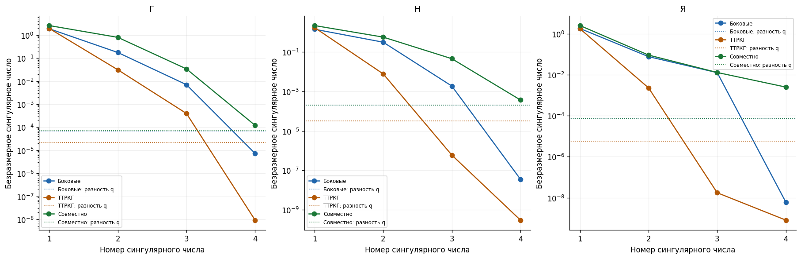
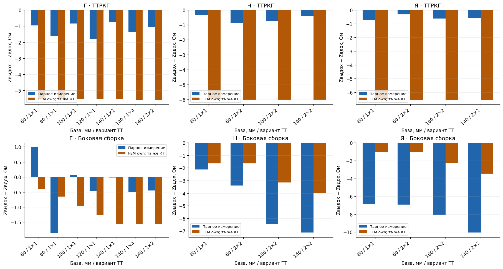

# 5 Формирование сигнала и оценка тканевых вкладов

## 5.1 От однородной среды к двум слоям

Тканевая поправка должна описывать электрический вклад мягких тканей и лёгкого именно в монтаж ТТРКГ. Измеренный импеданс, удельное сопротивление ткани и сердечный объём связаны прямой физической моделью, поэтому эти величины нельзя взаимозаменять. Рассмотренные модели образуют последовательность усложнения: однородное полупространство объясняет геометрический масштаб передачи; двуслойная модель исследует разделение поверхностного и глубокого вкладов; индивидуальная КТ/FEM учитывает неоднородную анатомию и конкретные электроды. Усложнение описания само по себе не подтверждает точность обратной оценки.

В двуслойной постановке верхний изотропный слой имеет толщину $h$ и удельное сопротивление $\rho_1$, нижнее полупространство — $\rho_2$. Поверхностный потенциал на единичный ток задаётся сохранённым рядом отражений:

$$
\begin{gathered}
G_P(r)=\frac{\rho_1}{2\pi}\left[\frac1r+
2\sum_{n=1}^{P}\frac{k^n}{\sqrt{r^2+(2nh)^2}}\right],
\\
k=\frac{\rho_2-\rho_1}{\rho_2+\rho_1},\qquad P=256.
\end{gathered}
\tag{5.1}
$$

Здесь $r,h$ выражены в метрах, $\rho_j$ — в Ом·м, $G_P$ — в омах. При равных сопротивлениях ряд исчезает, возвращая однородную среду. Для токовых контактов $A,B$ и измерительных $M,N$ передача равна $G_P(|M-A|)-G_P(|M-B|)-G_P(|N-A|)+G_P(|N-B|)$. В рассмотренной линейной сборке внешняя база равна $L$, потенциальная — $L/2$. Изменение $L$ меняет соотношение чувствительностей к обоим слоям и создаёт физическую предпосылку их разделения.

Расчёт усредняет потенциал по двум дискам диаметром 5 мм при равномерном возбуждении. Он не описывает перераспределение тока под металлическим контактом. Кривизна грудной клетки и отдельные кости также отсутствуют. Толщина $h$ является эффективным параметром: её минимум по электрической ошибке не равен анатомической толщине без отдельного сопоставления с КТ. Малый прямой вклад сердца в боковую сборку остаётся допущением. Две сборки рассматриваются как сокращённый протокол, пригодность которого проверяется на полном размерном наборе; решение двух уравнений не заменяет прогноз исключённых измерений. Эта аналитическая ветвь описывает боковые идеализации; отдельная аналитическая модель фактических прекардиальных монтажей здесь не подтверждена и общим FEM-расчётом не заменяется.

## 5.2 Индивидуальный прямой оператор и чувствительность

КТ/FEM заменяет плоские слои пространственными областями с заданными свойствами. Подготовка анатомии и её геометрический контроль описаны в главе 3. В сохранённых электрических расчётах проводимость скалярна, вещественна и положительна; анизотропия и ёмкостные свойства не разрешены. Частота определяет сценарий материалов. При неподвижной геометрии используются уравнение проводимости и полная электродная модель CEM:

$$
\begin{gathered}
\nabla\!\cdot(\sigma\nabla u)=0,\qquad \sigma=1/\rho,
\\
g_l=\sigma\frac{\partial u}{\partial n},\qquad
u+z_lg_l=U_l,\qquad \int_{e_l}g_l\,dS=I_l.
\end{gathered}
\tag{5.2}
$$

Потенциалы ткани $u$ и электрода $U_l$ выражены в В, проводимость $\sigma$ — в См/м, ток $I_l$ — в А, плотность входящего тока $g_l$ — в А/м², контактный параметр $z_l$ — в Ом·м²; $\mathbf n$ — внешняя нормаль, $e_l$ — контактная площадка. Вне площадок граница изолирована, сумма токов равна нулю. Конечная площадь входит в решение; одинаковый $z_l$ не делает разные электроды эквивалентными. Даже контакт с нулевым суммарным током может менять поле. Вариационная постановка CEM приведена у [Dardé и Staboulis, 2015; §2](https://arxiv.org/pdf/1312.4202).

Передаточный импеданс $Z=(U_{V+}-U_{V-})/I$ имеет единицы Ом и сохраняет полярность выбранных пар. Для малой вариации проводимости при неизменных контактах его чувствительность определяется двумя полями:

$$
\begin{gathered}
\delta Z_{ba}=-\frac1{I_aI_b}\int_\Omega
\delta\sigma\,\nabla u^{(a)}\!\cdot\nabla u^{(b)}\,d\Omega,
\\
K_{\rho,k}=-\frac{K_{\sigma,k}}{\rho_k^2}.
\end{gathered}
\tag{5.3}
$$

Индексы $a,b$ обозначают возбуждающую и измерительную пары, $\Omega$ — расчётную область; $K_{\sigma,k}=\partial Z/\partial\sigma_k$ для компартмента $k$ имеет единицы Ом/(См/м), $K_{\rho,k}=\partial Z/\partial\rho_k$ — м⁻¹. Скалярное произведение полей тетраполярного измерения может менять знак. Поэтому рост локальной проводимости не обязательно уменьшает передачу; отрицательная чувствительность согласуется с общим результатом [Naydenova и соавт., 2016; аннотация](https://pubmed.ncbi.nlm.nih.gov/27475783/).

Объём, положение и эффективные свойства сердца создают разные, потенциально смешиваемые вклады:

$$
\Delta Z\simeq K_V\Delta V+K_x\Delta x+K_y\Delta y+K_z\Delta z
+\sum_kK_{\rho,k}\Delta\rho_k.
\tag{5.4}
$$

Здесь $V$ — объём эквивалентной сердечной области в мл, координаты — в мм, $K_V$ — Ом/мл, $K_x,K_y,K_z$ — Ом/мм. Закон изменения формы задан явно. Разноразмерные производные сопоставляются по откликам при заданных масштабах воздействий; движение сердца и смена электродов являются отдельными изменениями задачи. При конечных совместных изменениях линейная сумма не исключает взаимодействий.

Программная согласованность подтверждена частными проверками: синтетический прямой ответ отличался от EIDORS на $6{,}5019\cdot10^{-14}$ относительно, ошибки трёх производных составляли $4{,}3432\cdot10^{-9}$–$8{,}0717\cdot10^{-9}$. Это не проверка анатомии или тканей. Серия из 810 расчётных состояний уточнила шаг и квадратуру, но не установила сеточную сходимость. Для эллипсоида при сердечном сопротивлении 4 Ом·м и пробе ±1% коэффициент изменялся 0,03165 → 0,02237 → 0,02297 мОм/мл при 64, 256 и 1024 точках интегрирования. Знак также зависит от материального контраста: на исходной STL с 256 точками коэффициент по заданному объёму равен −0,48117; +0,17587; +1,23795 мОм/мл при сопротивлении сердца соответственно 1,35; 4; 21,88959 Ом·м. Один сценарий не исключает сферу и не подтверждает эквивалентность форм; необходимы совместные геометрическая и электрическая проверки.

## 5.3 Что показали боковые измерения

Для Н и Я исследованы сборки 60, 100 и 140 мм, базовые уровни отдельно подбирались на кандидатных интервалах вдоха и выдоха. Результаты таблицы 5.1 относятся к двуслойной модели; пространственный поиск Г использует другой набор данных и не позволяет ранжировать участников по корню из средней квадратичной ошибки (RMSE).

Таблица 5.1 — Базовая проверка боковой гипотезы

| Постановка | $h$, мм | RMSE, Ом | Граница вывода |
|---|---:|---:|---|
| Н, вдох | 80 | 1,581720 | $\rho_2=24,074074$ Ом·м, верхняя граница |
| Н, выдох | 5 | 1,301088 | Анатомическое изменение $h$ не измерено |
| Я, вдох | 5 | 2,822919 | $\rho_1=1,377410$ Ом·м, нижняя граница |
| Я, выдох | 5 | 3,297675 | Допустимый общий бюджет ошибки не установлен |
| Г, совместный FEM-поиск | — | 13,534701 | 8 неверных знаков контраста из 12 |
| Г, контроль того же кандидата на сгущении | — | 13,527612 | Те же 8 неверных знаков; повторного подбора нет |

У Н разность минимизирующих толщин 75 мм характеризует смену предпочтительной эффективной модели, а не измеренное дыхательное перемещение. У Г ошибка контраста давала только 0,445000% суммы квадратов ошибок: минимум преимущественно описывал средние уровни. Поэтому подгонка абсолютного импеданса могла сохранять неправильное направление дыхательного изменения. Сгущение в выбранной точке этот результат не исправило.

Пульсовая проверка также осталась условной. При $h=120$ мм на вдохе максимум модуля изменения логарифма сопротивления равен 0,135179 для Н и 0,207403 для Я, превышая принятый диагностический порог малости 0,1. Нелинейное подтверждение не завершено; принятый набор тканевых поправок не получен. Это ограниченный отрицательный результат рассмотренных постановок.

Рисунок 5.1 — Сингулярные числа безразмерной матрицы $E$ на вдохе в индивидуальных КТ/FEM-моделях Г, Н, Я: боковые отведения, ТТРКГ и совместный набор. Здесь $E_{ij}=J_{\log,ij}/Z_i$, $J_{\log,ij}=\partial Z_i/\partial\ln\rho_j$; q1024/q4096 — вложенные наборы 1024/4096 точек Соболя для оценки тканевых долей в тетраэдрах неизменной сетки (определения — [приложение Е, §Е.3](../supplement/05_signal_models.md#е3-дополнительные-ограничения-боковой-задачи)). Пунктир — спектральная норма разности $E$ при этих двух правилах интегрирования; она не является строгой границей ошибки. Слабейшее совместное направление преимущественно связано с сопротивлением целого сердца. Практическая раздельная оценка четырёх сопротивлений не установлена; шум и ошибки положения электродов численно не оценены.

Рисунок 5.1 показывает различие чувствительности и идентифицируемости. Объединение каналов может изменить спектр, однако полный машинный ранг не устанавливает устойчивого разделения тканей. Это сравнение расчётных наборов боковых отведений и ТТРКГ; пояс PulmoVista в нём не сравнивался.

Рисунок 5.2 — Медианы наблюдаемых парных разностей «выдох минус вдох», Ом, и модельный контраст при изменении только единого лёгочного компартмента. Категории задают базу боковой сборки и вариант ТТРКГ. Расхождение величины, а для части боковых монтажей Г и знака, сохраняется. Движение грудной клетки не рассчитывалось; разметка ретроспективна, отведения записаны последовательно, межсессионная неопределённость не оценена.

Оба рисунка из [сохранённого HTML-отчёта, 2026; изображения 2 и 1](../../../../scorpion_v2/33.43_Индивидуальная_КТ_FEM_проверка_трёх_участников_Scorpion.html) ограничивают тканевую интерпретацию. Сценарий изменения только лёгкого не является полной моделью дыхания. Эти проверки не устанавливают превосходства боковых сборок или пояса по точности УО.

## 5.4 Условная оценка свойств по поясной ЭИТ

Индивидуальная ЭИТ Н использует 208 напряжений на кадр при 20 Гц, ток 7,234 мА и частоту 79,505 кГц из заголовков. Положение пояса алгоритмическое, размеры контактов и контактные параметры приняты как допущения; независимая абсолютная калибровка чтения отсутствует. Подбираются эффективные параметры областей одной КТ, а не независимо измеренные свойства крови или миокарда. Абсолютная база необходима и при последующей относительной инверсии.

Таблица 5.2 — Условные базовые сопротивления Н при двух кандидатных высоких плато

| Область | Запись 02, 36–44 с, Ом·м | Запись 04, 30–37 с, Ом·м |
|---|---:|---:|
| Мягкотканный фон | 2,853969 | 2,724398 |
| Единые лёгкие | 18,468929 | 18,143062 |
| Сердечная область | 21,889590 | 40,097267 |
| Кости, фиксировано | 19,147705 | 19,147705 |
| Жир, фиксировано | 23,063216 | 23,063216 |
| Невзвешенная вольтовая невязка, % | 32,436531 | 30,288275 |

Векторы плато различаются на 1,65238% нормы первого, тогда как оценка сопротивления сердечной области — на +83,1796%. Значения 21,89 и 40,10 Ом·м не приняты как установленные свойства смеси крови и миокарда. Освобождение всех пяти областей уменьшило вольтовую невязку до 26,4698%, но привело к вырождению матриц и проводимости кости $7{,}13\cdot10^{-11}$ См/м; решение отвергнуто. Регуляризация, фиксация тканей и положительная параметризация ограничивают поиск, но не добавляют независимого измерения.

Обращать следует полную проводимость, а не её приращение:

$$
\rho_{k,0}=\frac1{\sigma_{k,0}},\qquad
\Delta\rho_k=\frac1{\sigma_{k,0}+\Delta\sigma_k}-\frac1{\sigma_{k,0}}
=-\frac{\Delta\sigma_k}{\sigma_{k,0}(\sigma_{k,0}+\Delta\sigma_k)}.
\tag{5.5}
$$

Проводимости выражены в См/м, сопротивления — в Ом·м; индекс 0 обозначает опору. Неположительная итоговая проводимость отмечает выход линейной оценки за физическую область. В пульсовом расчёте фиксированный взвешенный якобиан псевдообращением проецировал напряжения полосы 0,7–3 Гц на изменения фона, лёгких и сердечной области. Изменения костей и жира заданы нулевыми. Такая полоса не выделяет чистый сердечный источник и отличается от обработки собственной системы в полосе 0,7–12 Гц.

Таблица 5.3 — Остаток ЭИТ и условные RMS-вклады в расчётную ТТРКГ

| Участок, с | Взвешенный остаток полосы, % | Фон, мОм | Лёгкие, мОм | Сердечная область, мОм |
|---|---:|---:|---:|---:|
| 02-A, 36–44 | 61,12698 | 73,03796 | 32,53379 | 2,35676 |
| 02-B, 51–59 | 77,61856 | 32,39835 | 45,93089 | 1,27104 |
| 04-A, 19–25 | 81,04188 | 33,99802 | 42,77910 | 1,79885 |
| 04-B, 30–37 | 62,75856 | 63,77619 | 26,41297 | 1,77044 |

Среднеквадратическая величина (RMS) характеризует рассчитанное колебание, теряя его знак и фазу; столбцы нельзя складывать как синхронные амплитуды. Большой остаток исключает трактовку таблицы как измеренных физиологических долей. Относительная нормировка улучшала прогноз исключённых пульсовых пар, однако вольтовые остатки превышали 100%, то есть были хуже нулевого пульсового прогноза в этой норме. Доказательства объёмной интерпретации такого решения нет. Подробности исправления критерия, обеих нормировок и отвергнутых вариантов сохранены в дополнительном материале «Формирование сигнала и оценка тканевых вкладов».

## 5.5 Перенос поправки и поглощение геометрического сигнала

Поясной якобиан не является оператором ТТРКГ. В отдельном четырёхконтактном расчёте «рука–рука» без пояса для каждого компартмента определяется собственная производная; кандидатный остаток имеет вид

$$
\Delta Z_{\mathrm{res}}(t)=\Delta Z_{\mathrm{TT}}(t)
-\sum_{k\in\mathcal T}K_{\rho,k}^{\mathrm{TT}}\widehat{\Delta\rho_k}(t).
\tag{5.6}
$$

Все слагаемые выражены в Ом, $\mathcal T$ включает мягкий фон и единое лёгкое. Оба сохраняют пульсовое кровенаполнение на задержке дыхания. При больших изменениях поправка определяется разностью прямых решений при одинаковой геометрии. Перенос с 79,505 на 100 кГц не выполнен; совместная установка приборов, задержки и общая временная опора не проверены. Нынешние раздельные сеансы не допускают поточечного вычитания.

В контрольном опыте изменялась только геометрия при постоянных свойствах. Тканевая инверсия неподвижной модели всё же находила ложные изменения:

$$
\begin{aligned}
\widehat{\Delta\boldsymbol\rho}_{\mathrm{false}}
&=(WS_\rho)^+WG_q\Delta\mathbf q,\\
K_{\mathrm{eff}}&=K_q-K_\rho(WS_\rho)^+WG_q.
\end{aligned}
\tag{5.7}
$$

Здесь $\mathbf q=(V,x,y,z)^T$, $G_q$ и $S_\rho$ — геометрические и тканевые производные напряжений ЭИТ, $W$ — фиксированные веса, знак «+» означает псевдообращение; $K_q,K_\rho$ — соответствующие производные ТТРКГ. Ложная поправка удаляет часть искомого сердечного отклика.

Рисунок 5.3 — Объёмный коэффициент до и после тканевой инверсии при истинном $\Delta\rho=0$, мОм/мл. Формы: исходная STL, равновеликая сфера G1 и моментный эллипсоид L1. Д4 задаёт сердцу 4 Ом·м; О-STL — общая условная подгонка исходной STL. Между опорами меняются также фон и лёгкие; значения приведены в дополнении. S2 освобождает фон и лёгкие, S3 также сердце; веса общие по базе STL, учтена численная примесь изменения объёма. Геометрические пробы заданы исследователем; шум не задан, сходимость не установлена.

Для STL/О-STL коэффициент +1,294387 мОм/мл после S3 становится −1,005816, после S2 — −13,459414. Фиксация сопротивления сердца смешения не устраняет. Величина такого эффекта в реальной синхронной записи неизвестна. Геометрическое изменение и эффективную проводимость требуется различать, сохраняя также заданный закон состава.

Локальный пересчёт остатка в объём показывает зависимость требований от модели:

$$
\begin{gathered}
\widehat{\Delta V}-\Delta V\simeq
\frac{\mathbf K_d\Delta\mathbf d_H+
\mathbf K_\rho\boldsymbol\varepsilon_\rho+\varepsilon_Z}{K_V},
\\
\boldsymbol\varepsilon_\rho=\Delta\boldsymbol\rho-
\widehat{\Delta\boldsymbol\rho}.
\end{gathered}
\tag{5.8}
$$

Смещение $\Delta\mathbf d_H$ выражено в мм, электрический остаток $\varepsilon_Z$ — в Ом; ошибка объёма — в мл, $K_V\ne0$. В отдельном контроле STL/О-STL при q256 — 256 точках интегрирования материальных долей в выбранных тетраэдрах неизменной сетки — и точном устранении остальных вкладов остаток мягкотканной поправки +1% базы даёт линейный эквивалент +594,2 мл, лёгочного — +38,86 мл. Это усиление ошибки при делении на $K_V$, а не предсказанный физиологический объём. Иллюстративному пределу 5 мл соответствуют изолированные ограничения 0,008415% и 0,1287% базовых сопротивлений; достижимость не установлена. Предел не является клинической нормой, а ограничения нельзя одновременно считать общим бюджетом. Ковариации ошибок и нелинейный остаток не оценены.

Получен прямой оператор и условные тканевые проекции с выявленными пределами применимости. Принятая синхронная поправка, её устойчивость к неизвестному движению и сквозная точность УО пока не установлены. Глава 6 рассматривает дальнейший переход от сердечного остатка к объёмам; качество электрической подгонки не заменяет этой проверки.

## Источники к главе 5

1. Dardé J., Staboulis S. *Electrode modelling: The effect of contact impedance*. arXiv:1312.4202v2, 2015. Использован §2: CEM и вариационная форма. [Полный текст](https://arxiv.org/pdf/1312.4202).
2. Adler A. и разработчики EIDORS. *system_mat_fields*. Документация и исходный код объёмной и контактной частей FEM; в исходной редакции отчёта просмотрен исходник с идентификатором 6481 от 26.12.2022. [Официальная документация](https://eidors3d.sourceforge.net/doc/eidors/solvers/forward/system_mat_fields.html).
3. Naydenova E., Cavendish S., Wilson A. J. *Measurement and modelling the sensitivity of tetrapolar transfer impedance measurements*. Medical Engineering & Physics. 2016. Vol. 38, no. 10. P. 1090–1099. DOI: [10.1016/j.medengphy.2016.07.005](https://doi.org/10.1016/j.medengphy.2016.07.005). Для общего утверждения об отрицательной чувствительности в исходном отчёте проверена [авторская аннотация](https://pubmed.ncbi.nlm.nih.gov/27475783/); численные границы статьи не переносились.
4. Материалы текущей электроимпедансной серии, 2026. [Профили двуслойной модели Н и Я](../../../../../Experiments/scorpion_20261022/derived/exploratory/session_3340/two_layer.local.json); [пространственный подбор Г](../../../../scorpion_v2/33.31_Численная_сходимость_и_совместный_подбор_Георгия_Scorpion_v2.md), таблицы 17, 18, 24. Локальные результаты разработки; индивидуальные свойства не подтверждены.
5. CompartmentPipeline / CompartmentReconstruction. Версия предоставленного программного источника `a382dbf8fd5f23bba9e69fcf8c6169a1627bc102` с локальным исправлением производной относительного остатка. [Карта интеграции](../../../ИНТЕГРАЦИЯ_PULMOVISTA.md); [техническая проверка](../../../pulmovista_check_20261028/README.md); [индивидуальный расчёт Н](../../../pulmovista_check_20261028/PATIENT_RESULT.md), 28.10.2026.
6. Индивидуальные расчёты Н, 28.10.2026: [условные параметры](../../../pulmovista_check_20261028/local/patient_v3/tissue_parameters_conditional.csv), [оператор ТТРКГ](../../../pulmovista_check_20261028/local/patient_v3/ttrkg_operator.csv), [пульсовые проекции](../../../pulmovista_check_20261028/local/patient_v3/plateau_contributions.csv); [нормировки и законы состава](../../../pulmovista_check_20261028/local/composition_pulse_v1/README.md), [общая метрика](../../../pulmovista_check_20261028/local/composition_pulse_v1/common_metric_comparison.csv).
7. Вычислительная проверка смешения геометрии и свойств, 28.10.2026: [электрические изменения](../../../pulmovista_check_20261028/local/motion_electrical_analysis_v1/analysis.local.json), [остаточные коэффициенты](../../../pulmovista_check_20261028/local/shape_electrical_comparison_v1/target_chain_effective_geometry.csv); [описание форм и различимости](../../chapters/17_shape_electrical_identifiability.md), §§17.4–17.6, 17.10–17.12.
8. Дополнительная условная FEM-серия одной КТ, 28.10.2026: [состав и ограничения](../../results/montage_sensitivity_v1/README.md), [манифест](../../results/montage_sensitivity_v1/manifest.json), [таблицы](../../results/montage_sensitivity_v1/tables.md), [производные](../../results/montage_sensitivity_v1/tables/derivatives.csv), [уточнение квадратуры](../../results/montage_sensitivity_v1/tables/volume_refinement.csv), [контроль материальной производной](../../results/montage_sensitivity_v1/tables/rho_checks.csv), [изолированные ошибки](../../results/montage_sensitivity_v1/tables/omission_units.csv), [ограничения](../../results/montage_sensitivity_v1/tables/exclusion_error_budgets.csv).
9. Сохранённый [HTML-отчёт индивидуальной КТ/FEM-проверки трёх участников](../../../../scorpion_v2/33.43_Индивидуальная_КТ_FEM_проверка_трёх_участников_Scorpion.html), 2026: изображения 2 и 1 при нумерации от нуля; рисунки 5.1–5.2 настоящей главы.
10. Замороженные редакционные основания: [прямые модели](../../revision_20261029_contract/chapters/06_forward.md), [тканевые параметры](../../revision_20261029_contract/chapters/08_tissue.md). Точные фрагменты, хэши и карта переноса находятся в [реестре главы](../reviews/05_ledger.json); переработка не является повторной проверкой первичных экспериментов.
