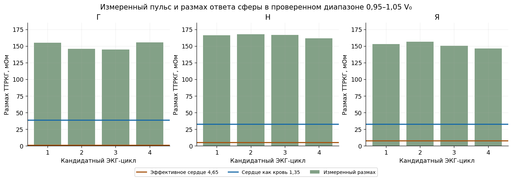
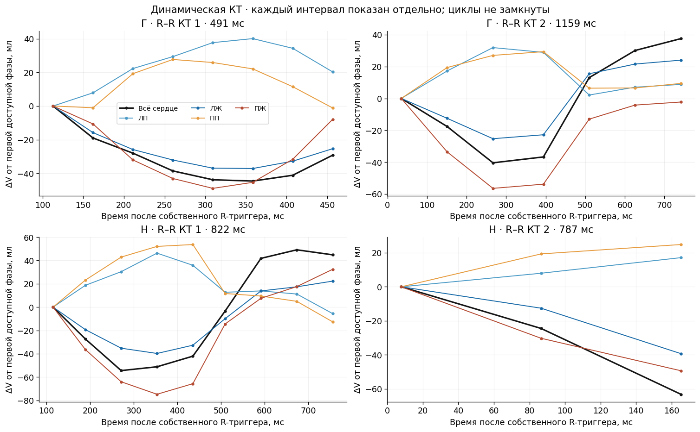
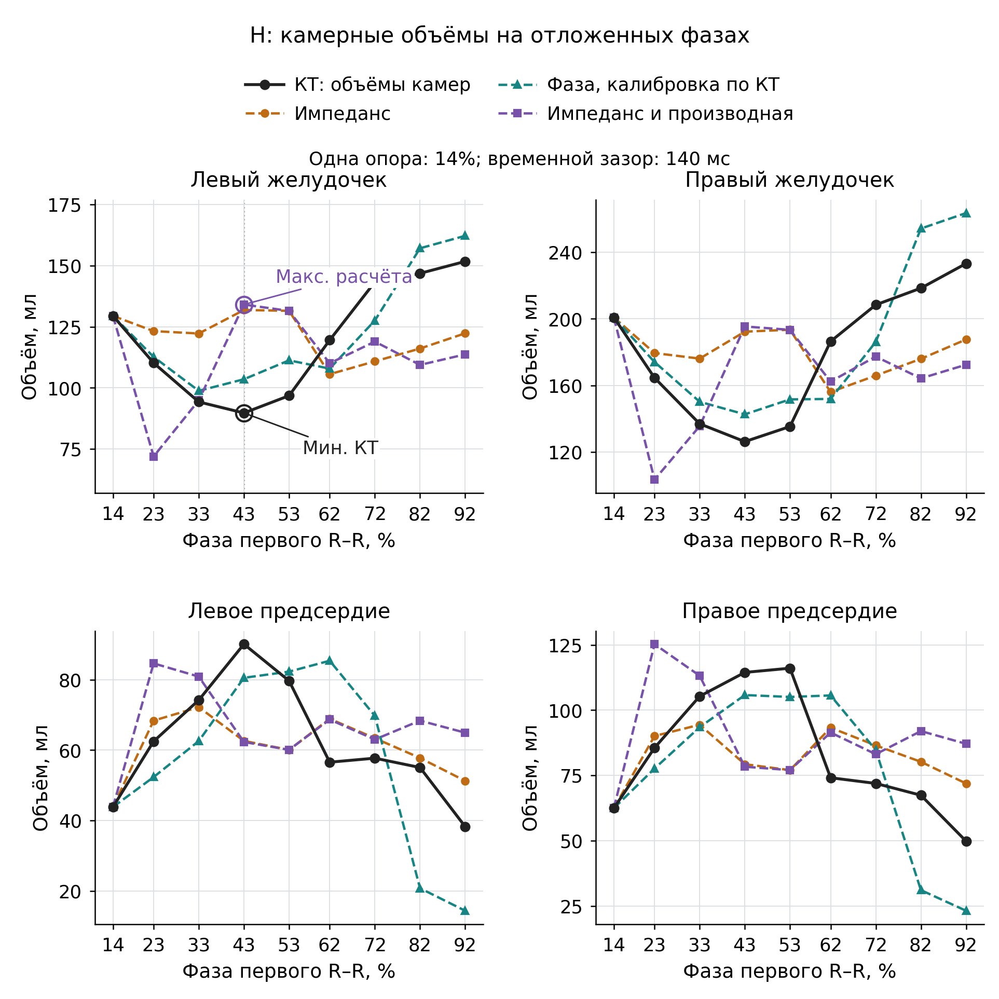

# 6 Переход от электрического сигнала к УО

## 6.1 Что требуется восстановить

Оценка изменения объёма эквивалентного сердца, полученная из электрического сигнала, ещё не является ударным объёмом (УО) желудочка. Требуются два проверяемых преобразования: из ТТРКГ с тканевыми поправками — в изменение сердечной геометрии, затем — в межфазное изменение объёма выбранной камеры. Здесь рассматриваются результаты этих преобразований и причины, по которым сквозная оценка УО пока не валидирована. Общая постановка и тканевой этап приведены в главах 2 и 5.

Операционный вход содержит одну индивидуальную КТ. Фазовые объёмы, центры и полуоси 4D-КТ используются как референс разработки либо известные управляющие входы вычислительного опыта; передавать их в проверяемое восстановление нельзя. ЭКГ задаёт временные признаки, но не измеряет движение. Начальное исследуемое состояние — глубокий вдох с задержкой; пульсовые вклады мягких тканей и единого лёгочного компартмента сохраняются. Имеющиеся электрические и КТ-сессии разновременны.

Динамика опорной формы задаётся масштабированием и переносом по (3.3). Восстановлению подлежат масштаб и смещение; целевые фазовые значения в этот расчёт не передаются. Фиксированное положение — частный сценарий; соответствие реальной деформации проверяется отдельно.

Электрическая статическая STL участника Н имеет объём 578,720801 мл; динамическая опорная маска — 624,256 мл. Происхождение STL сверено с манифестом, полнота охвата камер и миокарда независимо не установлена. Динамические маски достигают границы поля зрения и включают вычислительную крышку. Проверенной межсерийной регистрации нет; простого выравнивания объёмов недостаточно. Неизвестная фаза статической КТ также остаётся параметром или источником неопределённости, а не автоматически принимается конечной диастолой.

## 6.2 Почему совпадения базового импеданса недостаточно

Сравнение индивидуальной STL, сферы G1 и эллипсоида L1 разделяет два вопроса: влияние формы при одинаковых свойствах и пригодность каждой формы с собственными эффективными параметрами. В общей опоре Д4 сопротивления мягкого фона, лёгкого и сердца равны 2,853969; 18,468929; 4,000000 Ом·м, в О-STL — 2,888793; 17,997668; 23,468976 Ом·м. Между опорами меняется несколько свойств. Эффективное сопротивление целого сердца \(\rho_H\) не тождественно сопротивлению крови или миокарда.

Расчёты выполнены при 79 505 Гц и 7,234 мА, с четырьмя дисками диаметром 5 мм на продолжениях рук и промежутком ток–напряжение 100 мм. Соответствие фактической установке не подтверждено. В таблице 6.1 коэффициент \(K_V\) определён по пробам ±5% с интегрированным изменением объёма [электрическое сравнение, 28.10.2026](../../chapters/17_shape_electrical_identifiability.md).

Таблица 6.1 — Форма, электрическая база и объёмная чувствительность

| Общая опора / форма | Отличие базы ТТРКГ, Ом | Отличие базы ЭИТ, % | \(K_V\), мОм/мл |
|---|---:|---:|---:|
| Д4 / STL | 0 | 0 | +0,175416 |
| Д4 / G1 | −0,040034 | 1,3559 | −0,141640 |
| Д4 / L1 | −0,017596 | 0,2765 | +0,023567 |
| О-STL / STL | 0 | 0 | +1,294387 |
| О-STL / G1 | −0,042417 | 0,8205 | +0,776577 |
| О-STL / L1 | −0,045926 | 1,1491 | +0,906762 |

Отличия рассчитаны относительно STL в той же опоре. Для ЭИТ использовано отношение нормы разности базовых векторов к норме базового вектора STL.

При собственной подгонке каждой формы пары «\(\rho_H\), Ом·м; невязка ЭИТ, %» составляют: STL — 23,46898; 32,69854, G1 — 34,27721; 32,61836, L1 — 16,49615; 33,39616. Соответствующие \(K_V\) равны 1,29439; 0,88311; 0,79490 мОм/мл. Параметры получены по кандидатному плато 36–44 с записи 02 без принятой дыхательной разметки; использован один старт. Эта невязка нормирована на измеренный вектор, в отличие от межмодельного сравнения таблицы 6.1.

В О-STL базы G1 и L1 отличаются от STL на −0,0450 и −0,0487%, но чувствительности ниже на 40,0 и 29,9%. В Д4 у сферы меняется знак. Поэтому ни близкая база, ни знак при одном заданном \(\rho_H=4\) Ом·м не определяют пригодность сферы. При собственных параметрах невязка остаётся около 33%; её уменьшение не устанавливает физиологические свойства смеси. Геометрический и проводимостный эффекты требуется разделять: если \(\rho_H\) задано функцией объёма и фазы, его вклад включается в полную объёмную производную и не учитывается повторно как независимый источник.

## 6.3 Неизвестное движение и электрическая неоднозначность

Локальное разложение (5.4) связывает импеданс с объёмом, координатами и свойствами тканей. Нелинейность и ошибки образуют дополнительный остаток, выраженный в омах. Один отсчёт оставляет одну связь для объёма и трёх координат даже при точной тканевой поправке. Дополнительные отсчёты помогают лишь при проверенном конечномерном законе динамики; его перенос на нового человека пока не установлен.

При запрете движения ошибка объёмного пересчёта оценивается по (5.8): неучтённое смещение и остаточные тканевые влияния делятся на объёмную чувствительность. Такая оценка применима локально при ненулевом коэффициенте.

Вычислительный сдвиг L1 на +5 мм по x в Д4 даёт кажущийся объём −1077,816 мл при \(K_V=0,023567\) мОм/мл. Это отказ интерпретации из-за малого знаменателя. При собственных свойствах L1 максимальный модуль уменьшается до 21,034 мл, но движение остаётся источником ошибки. Шаг ±5 мм не является измеренной границей движения.

Производные разных размерностей сравниваются через отклики на объявленные возмущения. В О-STL для исходной формы +1% объёма даёт линейный отклик +7,491 мОм, +1 мм по z — +6,239 мОм, +1% сердечного сопротивления — +1,385 мОм. Это сценарные масштабы, а не измеренные амплитуды пульса. Координатные значения получены масштабированием крупных проб; отдельная проверка малого шага ниже показывает предел такого переноса. Большая чувствительность к параметру сама по себе не означает, что его вклад можно отделить от остальных.

Для нескольких отведений проверяется определимость самого объёма, а не только полного вектора:

$$
\mathbf c_V\in\operatorname{range}(J^{\mathsf T})
\ \Longleftrightarrow\ 
\mathbf c_V^{\mathsf T}\mathbf n=0\quad\forall\mathbf n\in\ker J,
\qquad \mathbf c_V=(1,0,0,0,0)^{\mathsf T}.
\tag{6.1}
$$

Здесь \(J\) относится к \((V,x,y,z,\rho_H)\). Три альтернативных расчётных монтажа дали ранг 3, но условие (6.1) нарушено во всех шести сочетаниях формы и общей опоры. Это альтернативные граничные задачи, не три одновременно записанных канала. При точно известных XYZ пара \(V,\rho_H\) имеет ранг 2, однако число обусловленности составляет 708,0–26 680. Масштабы — 1% объёма, 1 мм по каждой оси и 1% \(\rho_H\); практическая точность неизвестна.

Неоднозначность сохраняется и в конечных пробах. Для G1/Д4 объёмное изменение почти компенсируется изменением \(\rho_H\): максимумы модулей по двум знакам составляют 5,856 мл и 0,3195%; после одного уточнения максимальный остаток исходного монтажа равен 1,871·10⁻⁶ мОм. Эти максимумы могут относиться к разным знакам. Остатки других монтажей ненулевые; их обнаружимость не установлена. Одновременно проверена граница суперпозиции: для L1/Д4 сумма отдельных откликов +0,3872 мОм превратилась в совместный ответ −0,2066 мОм. Уточнение шага также существенно: исправленная Y-чувствительность STL/О-STL меняется с +0,881944 мОм/мм при ±5 мм на −0,522128 при ±1 мм, оставаясь отрицательной при уточнении интегрирования. Физическая нелинейность и дискретизация отдельно не разделены [серия проверки чувствительности, 28.10.2026](../../results/montage_sensitivity_v1/README.md).

Тканевая коррекция может дополнительно поглотить геометрический сигнал: механизм описан формулой (5.7), изменение чувствительности — на рисунке 5.3. В конечной пробе STL/О-STL перенос на +5 мм по y после трёхпараметрической поправки даёт +291,30 мл вместо нулевого изменения объёма; невязка ЭИТ 66,73% не позволяет принять тканевое объяснение.

Положительная локальная проверка ограничена известными остальными параметрами: для малых объёмных STL-проб в О-STL максимальная ошибка пересчёта по собственному коэффициенту равна 0,05228 мл. При переносе коэффициентов G1 и L1 она возрастает до 4,061 и 2,704 мл; в Д4 — до 14,73 и 48,44 мл. Универсально лучшая форма не выбрана.

Рисунок 6.1 — Отдельный сферический опыт: измеренные размахи ТТРКГ и ответ при 0,95–1,05\(V_0\). Панели относятся к Г, Н и Я. Обе сценарные материальные постановки дают меньший размах во всех двенадцати интервалах. Фиксированы центр и фон, тканевые пульсовые вклады не вычтены. Этот отрицательный результат ограниченной однородной модели не исключает сферу и не разрешает назвать экстраполированный объём УО.

## 6.4 От целого сердца к желудочку

Камерное преобразование должно учитывать взаимную компенсацию полостей. У Н на участке 14–43% первого R–R сумма желудочков уменьшается на 114,428 мл, сумма предсердий увеличивается на 98,288 мл. Во всех десяти соседних переходах двух окон направления противоположны, но модули не равны. Следовательно, постоянство суммарного камерного объёма этими масками не подтверждено.

Рисунок 6.2 — Изменения автоматических объёмов относительно первой доступной фазы каждого отдельного R–R: вверху Г, внизу Н. Четыре панели имеют разные опоры; линии не замыкают цикл. Изменение целой области не тождественно изменению камеры. Начальные точки не приняты за конечную диастолу; независимая ошибка масок не определена.

Рабочая связь записывается через изменение камеры от одной анатомической опоры:

$$
\begin{aligned}
\widehat V_v(t)&=V_v^*+\Delta\mathcal M_v(\widehat{\mathbf g}(t),\phi(t);\mathbf g^*,\phi^*,\mathbf d_{CT},\boldsymbol\beta_v)+b_{v,\mathrm{sess}},\\
SV_v&=V_v(t_{ED,v})-V_v(t_{ES,v}).
\end{aligned}
\tag{6.2}
$$

\(v\) — выбранный желудочек, \(\mathbf g\) — геометрия сердца, \(\phi\) — фаза, \(\mathbf d_{CT}\) — статические признаки, \(\boldsymbol\beta_v\) — коэффициенты закона; звёздочка — разрешённая опора. Изменение \(\Delta\mathcal M_v\), абсолютный уровень и межсессионное смещение \(b\) выражены в мл. Моменты \(t_{ED,v},t_{ES,v}\) соответствуют конечной диастоле и систоле одного сокращения; \(SV_v\) — УО, мл. Пригодный закон для нового человека пока не получен. Постоянные уровни сокращаются в УО; две независимые абсолютные оценки не обязательны. Требуются масштаб межфазной разности и конечные состояния одного сокращения [Lang и соавт., 2015, §2.2](https://doi.org/10.1016/j.echo.2014.10.003).

У Н доступны фазы 14–92% первого R–R и 1–21% второго при длительностях около 822 и 787 мс. Номинальное временное разрешение — около 140 мс; клапанные события не подтверждены. Второе окно не дополняет первое до полного цикла. Наблюдаемые размахи ЛЖ 62,004 и 39,301 мл поэтому не принимаются за УО. Подробная механическая разметка всех камер не обязательна, но принадлежность конечных состояний выбранного желудочка одному сокращению должна быть обоснована.

## 6.5 Что показали камерные проверки

Анатомический перенос исследован на 39 фазах трёх участников Г, Н и А с исключением человека из калибровки. Разрешена одна его опора; проверены 36 остальных фаз. Добавление центра и полуосей к объёму улучшило прогноз ЛЖ, но текущие геометрические признаки подавались из 4D-КТ (таблица 6.2). Сохранились смещения +6,52; −4,55; +2,09 мл соответственно. Эти ошибки не включают электрическое восстановление геометрии.

Общий гармонический профиль фазы не заменяет индивидуальную геометрию: у Г его RMSE равен 38,87 мл против 26,70 мл постоянной опоры. Таким образом, улучшение анатомической калибровки относится к известным текущим признакам сердца, а не к универсальной временной кривой для нового человека.

Таблица 6.2 — Положительные анатомические проверки и электрические контрсравнения ЛЖ

| Проверка | Признаки | RMSE, мл |
|---|---|---:|
| Исключение участника, равные веса трёх людей | Постоянная опора / объём сердца / объём, центр, полуоси / общий профиль фазы | 23,71 / 8,35 / 5,98 / 26,84 |
| Н, исключённые блоки | Известный объём сердца / объём и фаза | 12,903 / 8,285 |
| Н, три фазы следующего интервала | Те же фиксированные законы | 3,488 / 2,581 |
| Н, электрические отложенные блоки | Постоянная опора / импеданс / импеданс и производная | 25,84 / 29,57 / 31,96 |
| Н, следующий интервал | Те же электрические сравнения | 17,80 / 15,46 / 17,95 |

Индивидуальные блоки исключали соседние фазы с зазором около 140 мс, сохраняя известную опору. Геометрические и электрические строки проверяют разные преобразования.

Прямые электрические зависимости служат контролем без принятой тканевой поправки. Использованы реокардиомонитор, частота 100 кГц, монтаж 2×2 с боковой сборкой 140 мм и полоса 0,7–12 Гц. Сопоставленные КТ и электрические сессии имеются только у Г и Н. Индивидуальная опора увеличила RMSE ЛЖ у обоих; у Н добавление производной улучшило подгонку с 19,41 до 14,24 мл, но ухудшило обе проверки таблицы 6.2. Индивидуальный фазовый контроль, калиброванный по дополнительным КТ-фазам, лучше воспроизводит желудочки, однако не реагирует на амплитуду ТТРКГ и не доказывает электрического измерения функции.

Таблица 6.3 — Почти правильный размах при неверной траектории ЛЖ

| Н, первое неполное окно | Размах, мл | Ошибка размаха, мл | Максимум / минимум, % R–R |
|---|---:|---:|---:|
| КТ | 62,004 | — | 92 / 43 |
| Подгонка по импедансу и производной | 58,833 | −3,171 | 92 / 23 |
| Отложенные блоки той же зависимости | 62,172 | +0,168 | 43 / 23 |

Рисунок 6.3 — КТ и предсказания камерных объёмов Н. Известна опора 14%; остальные точки собраны из четырёх блочных калибровок, а не одной фиксированной формулы. У ЛЖ фиолетовая последовательность имеет максимум на месте КТ-минимума. Ошибка размаха +0,168 мл скрывает неверный порядок экстремумов и не является точностью УО.

## 6.6 Достигнутый результат и неопределённость УО

Пусть \(D,S\) — конечный диастолический и систолический объёмы, \(\varepsilon_D,\varepsilon_S\) — их ошибки, мл. Тогда

$$
\varepsilon_{SV}=\varepsilon_D-\varepsilon_S,
\qquad \operatorname{Var}(\varepsilon_{SV})=u_D^2+u_S^2-2C_{DS}.
\tag{6.3}
$$

\(u_D^2,u_S^2\) — дисперсии, \(C_{DS}\) — ковариация, мл². Общая аддитивная ошибка сокращается, ошибка масштаба сохраняется. Независимость конечных оценок не обоснована; неизвестную ошибку сегментации нельзя считать нулевой или повторно прибавлять, если она уже входит в остаток камерного закона. Локальная оценка ошибки времени не описывает перестановку экстремумов либо отсутствие конечной фазы. Совместные распределения ошибок цепочки не установлены, численный доверительный интервал УО не получен.

Достигнуты частные объёмные преобразования, проверочные камерные законы и количественные границы их переноса. Незавершёнными остаются восстановление при неизвестном движении и свойствах, отделение тканевой динамики и камерное преобразование без скрытой 4D-информации. Поэтому текущие выходы — условные кривые, размахи доступных окон или отказ от УО; экспериментальная погрешность сквозного УО не установлена. Дополнительные численные проверки и короткий разбор ФВ сохранены в «Дополнительных материалах к главе 6».

## Источники к главе 6

1. Собственные результаты. [Условия однофазной методики](../../../ПЛАН_ОДНОФАЗНАЯ_КТ_УО_ФВ.md), 26–28.10.2026; [постановка обратной задачи](../../chapters/07_inverse_single_phase.md).
2. Собственные результаты. [Электрическое сравнение форм и различимость параметров](../../chapters/17_shape_electrical_identifiability.md), 28.10.2026; [объёмная STL-методика и собственные эффективные параметры](../../chapters/14_stl_volume_method.md).
3. Собственные результаты. [Серия проверки чувствительности и различимости](../../results/montage_sensitivity_v1/README.md), 28.10.2026; [сводные таблицы](../../results/montage_sensitivity_v1/tables.md); [электрические пробы движения](../../chapters/16_single_ct_motion.md). Расчётные результаты одного участника.
4. Собственные результаты. [Фазовый набор анатомических объёмов](../../../execution_20261026/single_phase/ct_dataset/INTERFACE.md); [перенос камерных зависимостей](../../../execution_20261026/single_phase/transfer_validation/README.md), 26.10.2026; [временной анализ](../../../execution_20261026/single_phase/ct_timing/README.md).
5. Собственные результаты. [Индивидуальное камерное сравнение: протокол](../../../execution_20261026/single_phase/nix_only/exploratory/PROTOCOL.md) и [результаты](../../../execution_20261026/single_phase/nix_only/exploratory/results.json); [камерный закон с объёмом и фазой](../../../pulmovista_check_20261028/local/chamber_law/README.md), 28.10.2026; [межиндивидуальный электрический перенос](../../../execution_20261026/single_phase/empirical_relation/RESULTS.md).
6. Собственные результаты. [Сохранённый HTML-отчёт экспериментально-расчётной серии](../../../../scorpion_v2/33.44_Измеренный_пульс_ТТРКГ_объёмная_чувствительность_и_камеры_КТ.html), изображения 2 и 3 при нумерации от нуля; в этой главе рисунки 6.1 и 6.2.
7. Lang R. M., Badano L. P., Mor-Avi V., Afilalo J., Armstrong A., Ernande L., Flachskampf F. A., Foster E., Goldstein S. A., Kuznetsova T., Lancellotti P., Muraru D., Picard M. H., Rietzschel E. R., Rudski L., Spencer K. T., Tsang W., Voigt J.-U. *Recommendations for Cardiac Chamber Quantification by Echocardiography in Adults: An Update from the American Society of Echocardiography and the European Association of Cardiovascular Imaging*. Journal of the American Society of Echocardiography. 2015;28(1):1–39.e14. [DOI: 10.1016/j.echo.2014.10.003](https://doi.org/10.1016/j.echo.2014.10.003), §2.2. Определение камерного УО; клиническая валидация электрического метода из рекомендаций не следует.

Часть локальных первичных материалов по сохранённым адресам недоступна в текущей копии. Числа и условия перенесены из замороженных глав отчёта; новой проверкой первичного эксперимента эта редакция не является.
