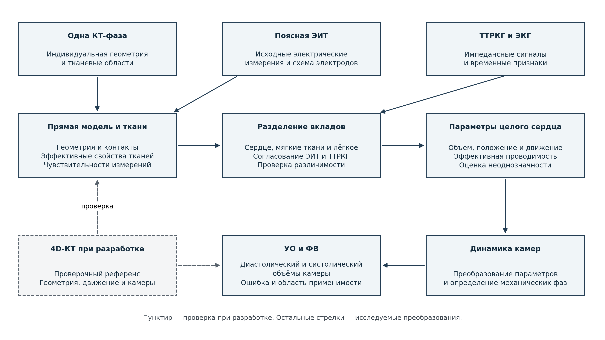
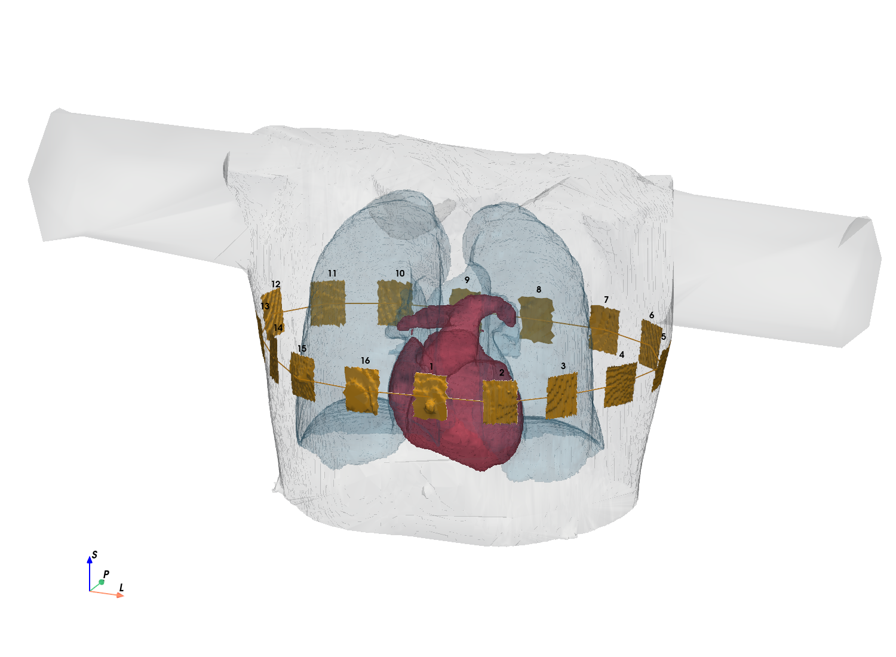
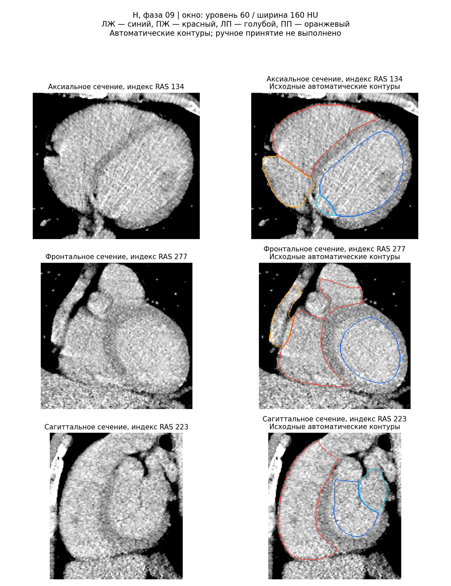
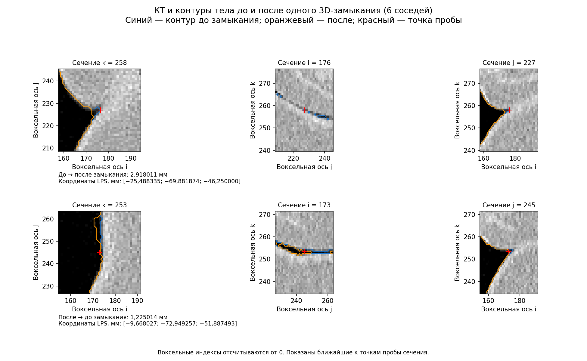
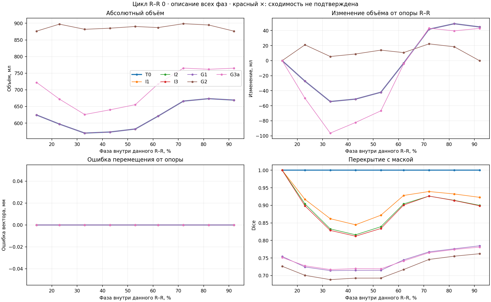
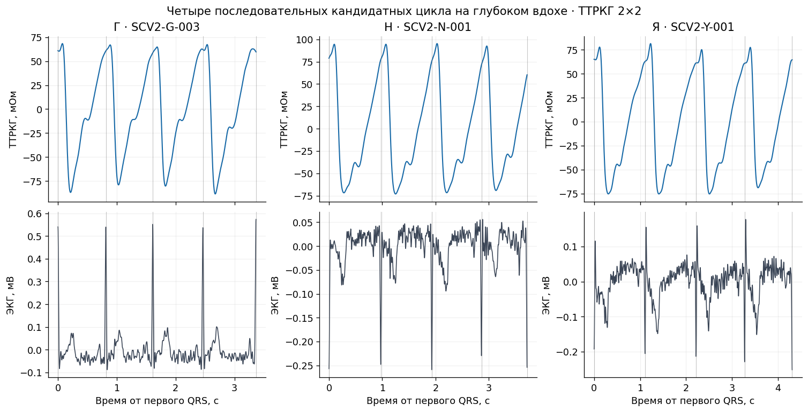
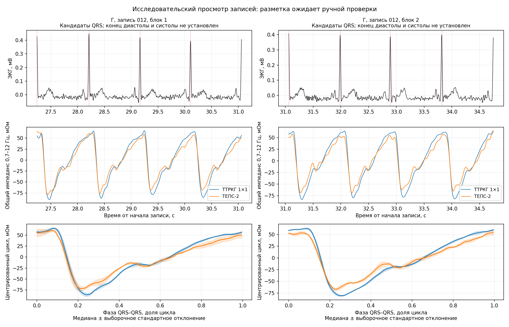
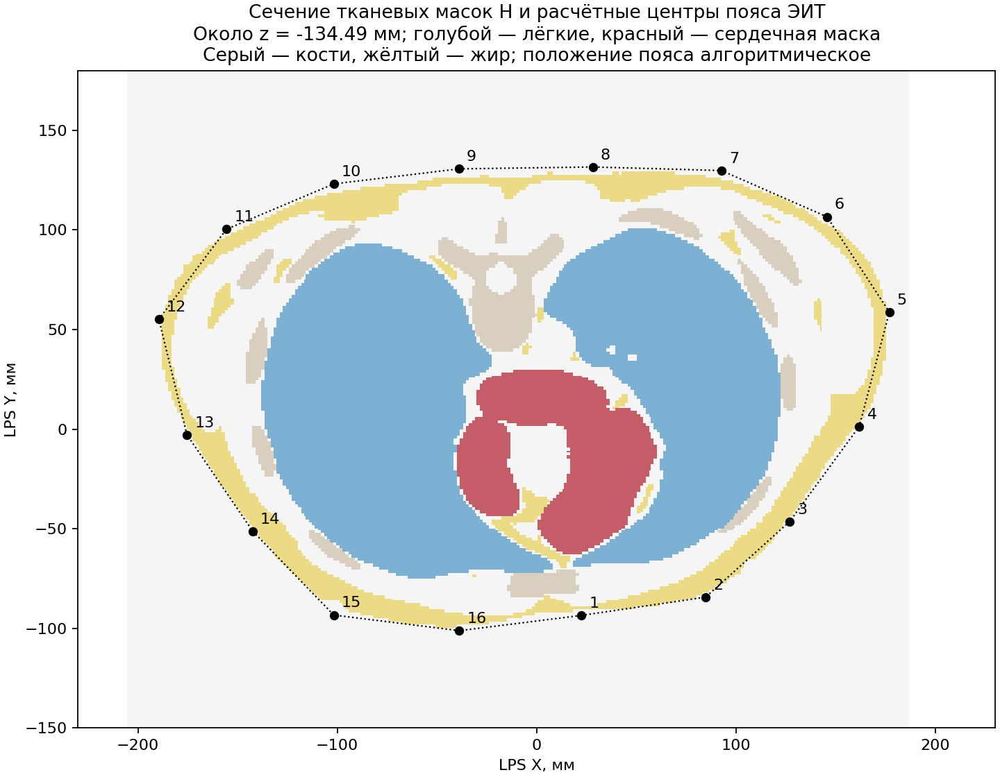

Реферат

Исследована методика определения ударного объёма по электроимпедансным измерениям с индивидуальной КТ-опорой. Рассмотрены боковые электродные сборки и поясная электроимпедансная томография как источники сведений о тканевых вкладах. Приведены подготовка анатомических моделей, аналитические и конечно-элементные расчёты, обработка записей добровольцев и проверка перехода от электрического сигнала к камерной динамике.

Получены численные характеристики отдельных преобразований и выявлены ограничения: смешение геометрических и тканевых изменений, зависимость чувствительности от формы и свойств сердца, неоднозначность объёма при неизвестном движении, межсессионное несоответствие и недостаточность одного совпадения объёмного размаха. Сквозная точность УО по полной последовательности не установлена. Фракция выброса рассматривается дополнительно, поскольку требует абсолютного конечного диастолического объёма.

Содержание

[[TOC]]

# Обозначения

УО — ударный объём; ФВ — фракция выброса; КДО — конечный диастолический объём; ЛЖ и ПЖ — левый и правый желудочки. КТ — компьютерная томография; 4D-КТ — фазовые трёхмерные реконструкции кардиоцикла; STL — формат представления поверхностей. ЭИТ — электроимпедансная томография; ТТРКГ — трансторакальная реокардиография в отведении «рука–рука»; ЭКГ — электрокардиограмма. FEM — метод конечных элементов; CEM — полная электродная модель; RMSE — корень из средней квадратичной ошибки. Участники обозначены Н, Г, Я и А. Обозначения параметров и единицы вводятся при первом использовании.

# Введение

Электроимпедансные измерения позволяют регистрировать изменения электрических свойств и геометрии грудной клетки, сопровождающие сердечную деятельность. Однако сигнал зависит одновременно от кровенаполнения тканей, дыхания, положения органов и условий контакта. Для количественной оценки УО необходимо установить, какую часть сигнала можно связать с изменением объёма выбранного желудочка и при каких исходных данных такая связь определима.

Цель выполненной работы — разработка и проверка расчётной методики с индивидуальной анатомической опорой. Исследование объединяет литературные и патентные основания, подготовку КТ и STL, физическое моделирование, регистрацию и обработку экспериментальных сигналов. Проверяются два варианта получения тканевых поправок: боковые сборки и поясная ЭИТ. Основной конечный показатель — УО; ФВ оставлена дополнительным направлением.

Одна КТ-фаза задаёт анатомию целевого расчёта, а доступная 4D-КТ служит референсом разработки. Вычислительные пробы с известными фазовыми параметрами отделяются от восстановления неизвестной динамики по электрическим данным. Изложение следует этой последовательности: основания и методика, данные и модели, результаты переходов, достигнутые характеристики. Соответствие требованиям договора и границы подтверждения сведены в приложение А; дополнительные расчётные сведения вынесены в научные приложения.

# 1 Научные основания и существующие решения

## 1.1 От электрического измерения к функции сердца

Электроимпедансный прибор регистрирует отклик проводящего объёма грудной клетки, тогда как ударный объём (УО) характеризует выброс крови выбранным желудочком. Периодичность сигнала и согласованность с электрокардиограммой (ЭКГ) устанавливают временную связь с сердечным циклом, но не определяют долю камерного выброса, движения сердца и кровенаполнения окружающих тканей. Научная задача состоит в обосновании преобразования электрического измерения в миллилитры. Основной целевой показатель работы — УО; фракция выброса (ФВ) рассматривается как дополнительный выход.

Объёмное определение УО — разность конечного диастолического и конечного систолического объёмов одной камеры. ФВ выражает отношение этой разности к конечному диастолическому объёму (КДО) в процентах. Следовательно, отдельно проверенная межфазная разность может дать УО без независимого восстановления двух абсолютных объёмов, но для ФВ необходим также КДО. Минутный объём кровообращения (МОК, CO) характеризует поток; его оценка вместе с частотой сокращений не определяет КДО. Камерный и потоковый УО сопоставимы лишь при согласованных физиологических условиях и усреднении. Выбор механических фаз нельзя заменить отметкой ЭКГ. [\[1, §1.2, §2.2, с. 3–7\]](https://doi.org/10.1016/j.echo.2014.10.003).

Различие измеряемых величин определяет роль альтернативных методов (таблица 1.1). Даже визуализационный референс не является безошибочным: у пациентов с ишемической болезнью сердца и дисфункцией левого желудочка (ЛЖ) расхождение ФВ между биплановой эхокардиографией и магнитно-резонансной томографией (МРТ) укладывалось в 5 процентных пунктов только в 43,1% из 204 пар. Полная выборка составляла 2032 пациента; не каждый имел все парные исследования. Эти данные показывают межметодное расхождение, а не ошибку относительно известной истинной ФВ. [\[14\]](https://doi.org/10.1001/jamanetworkopen.2018.1456).

Таблица 1.1 — Измерительные подходы и границы их переноса

| Подход | Основание оценки | Ограничение для настоящей задачи |
|---|---|---|
| Эхокардиография, кино-МРТ, многофазная компьютерная томография (КТ), ЭКГ-синхронизированная однофотонная эмиссионная КТ (ОФЭКТ) | Изображения полости в разных фазах | Покрытие камеры, контуры и фазы влияют на результат; одна статическая КТ не содержит наблюдённой динамики |
| Фик, термодилюция | Кислородный баланс либо температурный отклик индикатора | Определяют поток; КДО неизвестен, неопределённость зависит от протокола |
| PiCCO; ClearSight | Калиброванный пульсоконтурный анализ; пальцевой объёмный зажим | Калибровка по термодилюции и внутренняя подстройка Physiocal имеют разный смысл |
| ICON; PhysioFlow; Starling | Электрические признаки и алгоритмический пересчёт | Проверка МОК не проверяет ФВ; важны конкретная версия и временная обработка |
| PulmoVista 500 | Граничные измерения поясной электроимпедансной томографии (ЭИТ), относительные вентиляционные изображения | Абсолютные тканевые сопротивления и функции сердца требуют отдельной обратной задачи |

Основания таблицы: [\[12\]](https://doi.org/10.1186/s12968-020-00607-1), [\[13\]](https://doi.org/10.1016/j.jacc.2012.01.046), [\[15\]](https://www.getinge.com/no/products/picco/), [\[16\]](https://www.edwards.com/ca-en/healthcare-professionals/products-services/hemodynamic-monitoring/clearsight-system), [\[17\]](https://www.osypkamed.com/technology/noninvasive-hemodynamics/electrical-cardiometry/), [\[18\]](https://www.physioflow.com/sm_icg_technology.php), [\[20\]](https://emeamedicationdelivery.baxter.com/sites/g/files/ebysai3906/files/2022-12/B-UG-EN_Rev_3_Baxter_Starling_Monitor_User_Guide.pdf), [\[21\]](https://www.draeger.com/Content/Documents/Products/pulmovista-ifu-9511001-en.pdf).

Обзор опирается на предоставленный тематический корпус: 59 уникальных публикаций 1966–2025 гг.; по его паспорту доступны 55 полных текстов и четыре записи либо реферата. Это характеристика подборки, а не нового чтения. Систематический поиск и собственный метаанализ не выполнены. Литературные характеристики приборов далее служат основаниями проверки гипотез, а не характеристиками разрабатываемой методики.

## 1.2 Почему импеданс не определяет объём однозначно

В тетраполярном измерении токовая пара возбуждает поле, а потенциальная пара регистрирует напряжение. Базовый импеданс $Z_0$, пульсовое изменение и его производная относятся к конкретным монтажу, частоте и состоянию тканей. Классическая формула Кубичека связывает УО с этими признаками:

$$
\mathrm{УО}_{K}=\rho_b\frac{L^2}{Z_0^2}T_{\mathrm{изг}}D,
\qquad D=\left|\frac{dZ}{dt}\right|_{\mathrm{пик\ систолы}}.
\qquad\text{(1.1)}
$$

Здесь $\rho_b$ — принятое удельное сопротивление крови, Ом·см; $L$ — длина проводящего сегмента между измерительными уровнями, см; $T_{\mathrm{изг}}$ — время изгнания, с; $D$ — модуль систолического экстремума производной, Ом/с; $Z_0$ выражен в омах. Результат получается в см³, то есть миллилитрах. Знак производной определяется фактически регистрируемой величиной. [\[2, с. 2–3, 10\]](https://doi.org/10.1111/j.1469-8986.1990.tb02171.x). Квадратичная зависимость от длины и базового импеданса — свойство уравнения, а не измеренная чувствительность нашего отведения «рука–рука» (ТТРКГ). Изменение монтажа меняет исследуемый объём и поле, поэтому одной замены расстояния недостаточно.

Физическую неоднозначность поясняет однородный цилиндрический проводник:

$$
Z=\rho\frac{L^2}{V},\qquad
\frac{dZ}{Z}=\frac{d\rho}{\rho}+2\frac{dL}{L}-\frac{dV}{V}.
\qquad\text{(1.2)}
$$

Здесь $V$ — объём проводника, $\rho$ — его удельное сопротивление. При положительных величинах и согласованных единицах второе равенство является дифференциалом первого. Только фиксированные $\rho$ и $L$ позволяют свести электрическое изменение к объёмному. Эта идеализация объясняет неоднозначность, но не описывает неоднородную грудную клетку. В формулах Sramek геометрия задаётся иначе:

$$
\mathrm{УО}_{S}=\frac{L^3}{4{,}25}\frac{D}{Z_0}T_{\mathrm{изг}},\qquad
\mathrm{УО}_{SB}=\delta\,\mathrm{УО}_{S}.
\qquad\text{(1.3)}
$$

При $L$ в сантиметрах множитель $L^3/4{,}25$ имеет размерность миллилитров; $\delta$ — безразмерная антропометрическая поправка. Использованное в сравнении приближение $L=0{,}17H$, где $H$ — рост в сантиметрах, не является измерением индивидуального токового пути. [\[3, §2.3, с. 445–448\]](https://doi.org/10.1007/BF02344724). Смена формулы меняет результат, но не добавляет пространственных наблюдений; сравнительные значения сохранены в дополнительном материале «Научные основания: дополнительные сравнения и патентные ограничения».

В индивидуальной модели остаются два разных источника неопределённости: электрические свойства и геометрия. Литературные значения проводимости не являются измерениями данного человека. Например, Gabriel и соавт. объединяли низкочастотный обзор с измерениями тканей свиньи in vivo и жидкостей in vitro ниже 1 МГц. [\[Gabriel и соавт., 2009, реферат\]](https://researchportal.ukhsa.gov.uk/en/publications/electrical-conductivity-of-tissue-at-frequencies-below-1-mhz/). Эффективное сопротивление целого сердца отражает кровь и миокард совместно; диапазон свойств разных образцов не задаёт пульсового изменения одной ткани.

Геометрическая неопределённость также физиологически содержательна. МРТ показывает перераспределение объёмов между камерами при движении атриовентрикулярной плоскости, поэтому внешнее изменение сердца не равно УО желудочка. [\[Carlsson и соавт., 2007b, разделы о продольной и радиальной функции\]](https://pubmed.ncbi.nlm.nih.gov/17307988/). В модели Proença деформация миокарда давала 56% желудочкового импедансного изменения, а движение коррелировало с объёмом ЛЖ: $r=0{,}978$. Это расчёт по динамической МРТ одного мужчины, не восстановление неизвестного движения по статическому снимку. [\[Proença и соавт., 2015, реферат\]](https://pubmed.ncbi.nlm.nih.gov/26006113/).

Следовательно, качество формы проверяется одновременно по объёму и электрическому отклику. Сфера остаётся допустимым кандидатом: знак при сценарном $\rho=4$ Ом·м не является основанием её отвергнуть. Сравнение форм при одинаковых свойствах и сравнение каждой формы с собственным эффективным сопротивлением отвечают разным вопросам; подбор сопротивления не должен скрывать ошибку объёма. Чувствительность к каждому параметру ещё не означает их совместной различимости.

## 1.3 Что показывают проверки существующих решений

Опубликованные проверки дают неодинаковые результаты (таблица 1.2). Корреляция характеризует совместную изменчивость, но допускает смещение и ошибку масштаба. Для количественного сравнения необходимы направление разности, её среднее, стандартное отклонение (SD) и пределы согласия. Процентная ошибка (PE), согласованность направлений изменений и ошибка ФВ в процентных пунктах имеют разные определения. Повторные пары одного пациента не увеличивают число независимых участников.

Таблица 1.2 — Количественные результаты и границы литературных проверок

| Исследование | Результат | Граница вывода |
|---|---|---|
| Greiwe, 2025: 41 пациент после шунтирования, 157 пар | Термодилюция минус электрическая оценка МОК: −0,2 ± 1,2 л/мин, среднее ± SD; пределы −2,6…2,3 л/мин; PE 47%, 95% ДИ 37–56% | Малое смещение не обеспечило взаимозаменяемости; согласованность изменений 48% при зоне исключения 10% |
| Sanders, 2020: 13 взрослых исследований, 620 уникальных пациентов | Смещение 0,03 л/мин; пределы −2,78…2,84 л/мин; средняя PE 48%; $I^2=93\%$ | Выраженная неоднородность; метаанализ не добавляет независимых первичных участников |
| Braun, 2018: десять здоровых добровольцев, один исключён из-за контактов | При индивидуальной калибровке ошибка сердечного признака 0,0 ± 15,2 мл, среднее ± SD; согласованность изменений 80,9% | Пригодные записи лёжа; кислородный референс и вентиляционное смешение ограничивают интерпретацию |
| Braun, 2020: 20 пациентов на искусственной вентиляции лёгких, 39 измерений | Сердечная область: 52,6%, $r=0{,}13$, $p=0{,}44$; лёгочная: 94,4%, $r=0{,}72$, $p<0{,}0001$ | Согласованность направлений и корреляция изменений УО; не абсолютный УО и не ФВ |

Источники: [\[9, с. 372–375\]](https://doi.org/10.1007/s10877-024-01246-y), [\[10, с. 433–435, 437–443, приложение 6\]](https://doi.org/10.1007/s10877-019-00330-y), [\[7\]](https://doi.org/10.1371/journal.pone.0191870), [\[8\]](https://doi.org/10.1007/s10877-019-00402-z). Последние два исследования различаются популяцией, воздействием и референсом; объединять их проценты нельзя. Влияние вентиляции, положения и контактов сохраняется и при положительном лёгочном результате.

Для ФВ проверка нужна отдельно. У Bowling при $r^2=0{,}55$ разность «радионуклидная ФВ минус импедансная» у 20 взрослых составляла −8,85 п.п., пределы — −23,2…+5,5 п.п. Корреляция не обеспечила согласия. [\[11, с. 1523–1527\]](https://doi.org/10.1097/00003246-199310000-00021). При этом утверждение, что импедансные изделия вообще не выводят ФВ, неверно: такой выход заявлен для PhysioFlow Enduro PF07. Его клиническая точность не устанавливается паспортной повторяемостью на имитаторе или проверкой МОК. [\[19\]](https://www.accessdata.fda.gov/cdrh_docs/pdf10/K103283.pdf). Положительные частные результаты, конфликты знака, временная обработка и различия калибровок подробно сохранены в указанном дополнительном материале.

## 1.4 Основания боковой и поясной тканевых гипотез

Боковые сборки исследуются как способ получить различающиеся чувствительности к поверхностным мягким тканям и лёгкому при изменении размера отведения. Исходная идеализация — полупространство, затем слой над полупространством; цилиндрическая формула (1.2) эту модель не заменяет. При заданной толщине слоя $h$ два наблюдения позволяют записать два уравнения относительно сопротивлений, однако устойчивость зависит от независимости откликов. Неизвестная $h$ добавляет ещё один параметр. Возврат к однородному пределу проверяет математику, но не пригодность модели грудной клетки.

Поэтому индивидуальная КТ нужна для профиля тканей под фактическим монтажом и проверки редукции относительно трёхмерной модели с кривизной, костями и конечными контактами. Способ сведения неоднородного профиля к эффективной $h$, оптимальная пара размеров и преимущество правого бока не установлены. Полный размерный ряд необходим для проверки предсказаний. Последовательная установка сборок сохраняет ограничения по состоянию человека, времени и контактам.

В проверенных боковых постановках принятого набора тканевых поправок не получено. Это мотивирует исследование пространственно разнообразных измерений поясной ЭИТ, но не доказывает её превосходства. Условные базовые оценки ЭИТ также не означают валидированной динамической поправки. Шестнадцать контактов используемого пояса не гарантируют различимости всех выбранных тканей; алгоритмическое положение пояса не становится измеренным положением. Результаты соответствующих проверок представлены в главе 5.

Главная опасность обеих обратных задач — объяснить геометрическое изменение сердца изменением проводимости. Тогда перенесённая поправка может удалить часть целевого ТТРКГ-сигнала. Даже соотношение $\rho=1/\sigma$ для действительных скалярных свойств, где $\sigma$ выражена в См/м, а $\rho$ — в Ом·м, не превращает относительное ЭИТ-изображение в абсолютные свойства. Требуются проверка геометрического смешения и согласование полей, частот и времени. Пульсовые вклады мягких тканей и единого лёгочного компартмента сохраняются на задержке дыхания. Операторы переноса и условия их проверки определяются в главе 2.

## 1.5 Патентные пересечения и остающийся предмет исследования

Патентный корпус показывает, что анатомическая опора, геометрическая инверсия, тканевая коррекция и объёмная калибровка уже представлены в предшествующих решениях. Существенны конкретные пункты, а не совпадение названий (таблица 1.3).

Таблица 1.3 — Ближайшие патентные решения и точные границы сопоставления

| Публикация и локатор | Раскрытый признак | Значимое ограничение |
|---|---|---|
| US20150297099A1, пп. 1, 31, 58 | Подбор сердечной геометрии; в п. 31 внесердечная ткань изменяется по фиксированной функции кардиофазы | Внутренние электроды обязательны для пп. 1/58, но не п. 31; наружный монтаж не устраняет близости ко всему документу |
| US8131354B2, пп. 1, 9, 17; US8868175B2, пп. 1, 3–6 | Две кардиофазы, объёмная разность; размер, положение и ориентация сердечной области | Неизменность внесердечной области — зависимое условие п. 9 первого документа, не свойство всей группы |
| US10278598B2, п. 1; EP2385788B1, пп. 1, 5, 10 | Предсердная/желудочковая компоненты и объёмная калибровка | Данные in vitro прямо включены в независимый пункт US; в EP эксперимент с изолированным сердцем задан зависимым п. 5 |
| RU2415641C1, единственный пункт, с. 11 | Потенциальные электроды на руках, антропометрический объёмный пересчёт | Токовые контакты на груди/спине отличаются от контактов на руках; антропометрический объём не камерный |
| RU2778992C1, единственный пункт, с. 11; описание, с. 10 | КТ/МРТ-проекция перед систолой, радиальные каналы, отдельный мягкотканный канал; описание сферической динамики и смещений | Не задан наш перенос ЭИТ-параметров в ТТРКГ; не доказаны достаточность «рука–рука» и оптимальность боковой установки |

Тексты пунктов: [\[22\]](https://patents.google.com/patent/US20150297099A1/en), [\[23\]](https://patents.google.com/patent/US8131354B2/en), [\[23\]](https://patents.google.com/patent/US8868175B2/en), [\[24, с. 9–10\]](https://patentimages.storage.googleapis.com/0e/93/85/c14cab1dea781b/US10278598.pdf), [\[24, с. 7–9\]](https://patentimages.storage.googleapis.com/88/a4/2e/9489a6dfd4136a/EP2385788B1.pdf), [\[25, с. 11\]](https://patentimages.storage.googleapis.com/e7/78/e6/852c057a4530f2/RU2415641C1.pdf), [\[26, с. 10–11\]](https://patentimages.storage.googleapis.com/5b/36/f5/e6fd88bfc69cad/RU2778992C1.pdf).

Связь с работой А. Н. Тихомирова здесь установлена по последнему патенту. Полные тексты диссертаций Тимохина и Тихомирова в проверенной поставке не установлены; их содержательное сопоставление не завершено. Фамилии и источники не отождествляются. Патент не заменяет диссертацию и не подтверждает точность собственного метода.

Предмет разработки после этого сопоставления сужается до проверяемых переходов: различимость тканевых параметров при неизвестном движении; перенос их в оператор ТТРКГ; совместное сохранение геометрии и электрического отклика эквивалентного сердца; связь с камерным УО. Для ФВ требуется дополнительно определить КДО. Одна КТ задаёт опору, а фазовая 4D-КТ служит референсом, не скрытым входом. Нормировка разносессионных записей не создаёт синхронности, отложенные фазы одного человека не проверяют перенос на другого.

Поиск остаётся неполным: не установлены национальный охват, все продолжения, материалы экспертизы и современное действие прав. Для группы US20150297099A1 анализ ограничен редакцией A1. Юридическая чистота, патентоспособность и новизна всей комбинации не установлены. Научное основание продолжения работы состоит в проверке точности и определимости указанной последовательности, включая условия отказа; литературный и патентный анализ не подтверждают завершённой валидации УО.

# 2 Цель и методика определения ударного объёма

## 2.1 Цель и проверяемые гипотезы

Цель работы — разработать методику определения ударного объёма выбранного желудочка по электроимпедансным измерениям с индивидуальной анатомической опорой и установить границы её работоспособности. В рассматриваемом применении доступен один трёхмерный том КТ. Остальные фазы 4D-КТ используются при разработке и проверке; их объёмы, координаты и форма не должны поступать в расчёт как известные ответы. Первоначальным объектом камерной проверки служит левый желудочек. Фракция выброса рассматривается дополнительно.

Исследуются три последовательные гипотезы: дополнительные измерения позволяют оценить тканевые изменения и скорректировать ТТРКГ; эквивалентная форма сердца сохраняет связь геометрии с электрическим откликом; восстановленная динамика содержит информацию, достаточную для определения межфазной разности объёма желудочка. Каждая гипотеза требует собственной проверки. Точная подгонка одного сигнала не подтверждает всю последовательность.

Для проверки этих положений выполнены подготовка КТ и анатомических моделей, анализ электродных вариантов, аналитические и конечно-элементные расчёты, обработка записей добровольцев и сопоставление вычисленных признаков с доступными КТ-референсами. Результаты оцениваются по той величине, которая действительно восстанавливалась: электрический сигнал, параметры тканей, объём целого сердца, камерный объём или его разность.

УО определяется для конечных диастолического и систолического состояний одного сокращения:

$$
SV=V_{\mathrm{ED}}-V_{\mathrm{ES}},\qquad CO=10^{-3}SV\,HR.
\qquad\text{(2.1)}
$$

Здесь $V_{\mathrm{ED}}$ и $V_{\mathrm{ES}}$ — объёмы выбранного желудочка, мл; $SV$ — УО, мл; $HR$ — частота сокращений, мин⁻¹; $CO$ — минутный объём, л/мин. При изменчивых сокращениях произведение средних $SV$ и $HR$ не принимается автоматически за средний поток. Для УО достаточно обоснованной оценки разности; дополнительная ФВ требует абсолютного КДО. Размах наружной сердечной маски или неполного фазового окна этим определениям не эквивалентен.

## 2.2 Входные данные и последовательность расчёта

КТ задаёт геометрию тканей и исходное представление сердца. Требуются также сведения об электродах, контактах, частотах и единицах, ТТРКГ, ЭКГ и дополнительные электрические измерения для оценки тканевых влияний. Неизмеренные координаты и свойства вводятся как допущения с собственными ограничениями. Обратный расчёт не превращает заданный параметр в измеренный.

Прекардиальные отведения зарегистрированы и обработаны как дополнительная экспериментальная ветка; для отведения №2 выполнено прямое FEM-сопоставление с ТТРКГ. Завершённый расчёт УО по прекардиальным отведениям не представлен. Основная последовательность ниже относится к ТТРКГ «рука–рука» с тканевыми поправками; результаты прекардиальной ветки не заменяют проверку этой последовательности.

Принятая последовательность представлена на рисунке 2.1. ЭИТ используется для оценки эффективных тканевых параметров; геометрия сердца исследуется по ТТРКГ с соответствующими поправками. Диагностические опыты совместной инверсии по ЭИТ не заменяют эту целевую схему.

Рисунок 2.1 — Исследуемая последовательность определения УО. Схема задаёт связи между этапами; её наличие не подтверждает завершённость каждого перехода. Дополнительное направление ФВ использует камерный УО и абсолютный КДО.

Таблица 2.1 — Входы и выходы этапов методики

| Этап и вход | Выход | Необходимое условие интерпретации |
|---|---|---|
| КТ, сегментации, сведения об электродах | Индивидуальная геометрия и прямая электрическая модель | Требуется проверить происхождение, координаты и назначение материалов; неизвестные контакты задать явно |
| Боковые измерения либо ЭИТ с КТ | Эффективные базовые сопротивления и их изменения | Различимость параметров и отсутствие подмены геометрии тканевыми изменениями |
| Тканевые параметры и оператор ТТРКГ | Поправка электрического сигнала в омах | Требуется согласовать монтаж, частоту, знак и временную шкалу |
| ТТРКГ с поправкой, КТ-опора и ЭКГ | Динамика объёма и положения эквивалентного сердца | Требуется проверить ограничения движения и сердечных свойств; скрыть референсные фазы |
| Сердечная динамика и камерный закон | Межфазная разность объёма выбранного желудочка | Требуется подтвердить камерное преобразование и конечные состояния одного сокращения |

Тканевые параметры в таблице являются эффективными характеристиками областей модели. Один лёгочный компартмент сохраняет пульсовой вклад; он не означает однородность реального лёгкого. Задержка дыхания также не обнуляет изменения кровенаполнения мягких тканей. Эти влияния учитываются при оценке сердечного компонента.

## 2.3 Два варианта электродной системы

Боковые сборки различного размера исследуются как сокращённый способ разделить влияния грудной стенки и лёгкого. Исходной служит двуслойная модель, применимость которой проверяется относительно индивидуальной анатомии. Набор размеров позволяет оценивать глубину чувствительности и взаимозависимость параметров. Переход к двум сборкам допустим после проверки пары; в имеющихся результатах такая оптимальная пара и принятая тканевая поправка не установлены.

Поясная ЭИТ предоставляет пространственно различающиеся электрические измерения и допускает более подробную обратную задачу. Она выбрана для продолжения основной ветки как источник дополнительных данных. Число измерений само по себе не доказывает точности тканевых оценок или превосходства по конечному УО. Положение пояса, контактные свойства и геометрическое смешение остаются условиями расчёта. Физические основания обоих вариантов приведены в главах 1 и 5, а их реализованные монтажи — в главе 4.

## 2.4 Условия перехода к количественному результату

Начальное состояние — задержка на глубоком вдохе, соответствующая протоколу КТ. Это способ согласовать анатомическое и электрическое состояния, а не доказательство оптимальности режима. Дыхательные интервалы электрических записей имеют собственную разметку. Совпадение нормированной доли R–R в разных сессиях не создаёт синхронности; ЭКГ задаёт временные ориентиры, но не измеряет перемещение сердца и не удостоверяет механические экстремумы объёма.

Исходная STL, сфера и эллипсоид сравниваются при явно заданных материалах. Согласие базового импеданса недостаточно: требуется сохранение динамического отклика. Изменения объёма, положения и эффективного сопротивления сердца рассматриваются раздельно и совместно. Сфера остаётся допустимым кандидатом; знак отклика в одном сценарии свойств не является основанием исключить её. Если закон изменения состава уже включён в объёмную чувствительность, повторное свободное изменение того же материального вклада недопустимо.

Проверка включает самоконтроль программных операций, вычислительные опыты с известными воздействиями и сравнение с экспериментальными данными. Эти уровни доказательности не взаимозаменяемы. Ненулевая чувствительность или полный алгебраический ранг не гарантируют устойчивость на фоне ошибок входов. Если допустимые решения дают разные объёмы, результат следует сохранять как условный либо фиксировать отказ от количественной интерпретации.

Рабочая постановка с одной КТ ещё не является протоколом без КТ. Исключение анатомической опоры или дополнительных электрических входов допустимо после проверки способа их замены и связанной ошибки. Фактически достигнутые характеристики и незавершённые переходы сведены в главе 7; матрица договора приведена в приложении А.

# 3 КТ и подготовка анатомических моделей

## 3.1 Происхождение и назначение анатомии

Индивидуальная КТ задаёт пространственную опору для проверки того, какую область представляет эквивалентная форма сердца. Для определения УО необходимо сохранить связь между этой областью, её электрическим вкладом и кровью выбранного желудочка. Поэтому геометрическая точность рассматривается вместе с ограничениями сегментации и подготовки расчётной области. Объём всей сердечной маски сам по себе не является камерным объёмом.

По подтверждённой автором последовательности сначала получены КТ добровольцев на глубоком вдохе с задержкой дыхания и выполнена итоговая ручная сегментация в Inobitec; затем у тех же добровольцев регистрировались физиологические сигналы. Кардиофазы внутри задержки не являются дыхательными фазами. Протокол КТ также не определяет границы дыхательных проб электрической записи другой сессии.

Ручную анатомию следует отличать от канонических статических STL — треугольных представлений поверхностей, выбранных 26.10.2026. Последние получены TotalSegmentator 2.18.0: для Н, Г и Я сохранены тело, лёгкие, кости, сердце и жир. Отдельную ветвь образуют автоматические маски динамической КТ. Между этими продуктами не установлена взаимозаменяемость; независимая анатомическая валидация автоматических границ не выполнена. Происхождение статического набора закреплено паспортами и контрольными суммами [канонического реестра STL, 2026](<../../../../../configs/scorpion_canonical_stl.json>).

Исторический геометрический корпус содержит 39 фаз: 15 у Г, 12 у Н и 12 у А. Динамическая последовательность Я в этом корпусе отсутствует; А не заменяет Я из экспериментальной тройки. Подробные сравнения ниже относятся к Н. Одна КТ является входом применения, а доступные фазовые КТ используются как референс разработки, с сохранением ограничений их охвата.

Рисунок 3.1 — Статическая модель Н: сердце бордовое, лёгкие голубые, наружная область серая, контакты ЭИТ жёлтые. L, P, S — направления влево, назад, вверх; координаты модели — мм. Продолжения рук и положение 16 контактов заданы алгоритмически. Сцена показывает взаимное расположение областей, но не измеренную установку пояса или их электрические вклады.

## 3.2 Координаты, экспорт и объём

Подготовка связывает выбранный КТ-том, маски, поверхности и расчётную сетку. Индексы вокселя $(i,j,k)$ переводятся в мировые координаты аффинной матрицей $A$, содержащей шаг, ориентацию и начало отсчёта:

$$
\begin{pmatrix}\mathbf x_{RAS}\\1\end{pmatrix}
=A\begin{pmatrix}i\\j\\k\\1\end{pmatrix},\qquad
\begin{pmatrix}\mathbf x_{LPS}\\1\end{pmatrix}
=\operatorname{diag}(-1,-1,1,1)
\begin{pmatrix}\mathbf x_{RAS}\\1\end{pmatrix}.
\qquad\text{(3.1)}
$$

Координаты выражены в мм. Положительные оси RAS направлены вправо, вперёд и вверх, LPS — влево, назад и вверх. КТ и маски должны иметь одинаковые размеры и точные аффинные матрицы. Смена знаков двух осей согласует координаты, но не регистрирует разные серии; необходимое совмещение требует собственного преобразования и проверки. Перед электрическим расчётом длины согласованно переводятся в метры [стандарт подготовки, 2026; раздел «Исходные данные и координаты»](<../../../../../docs/CT_FEM_PREPARATION_STANDARD.md>).

Канонический экспорт выполнен на исходной сетке при уровне изоповерхности 0,49, без морфологических изменений, обрезания, добавления рук или электродов. Сохранены компоненты поверхности и внутренние интерфейсы. Объём бинарной маски сердца $M_H$ и объём замкнутой ориентированной STL рассчитываются раздельно:

$$
V_H=\frac{|\det A_{3\times3}|}{1000}\sum_{i,j,k}M_H(i,j,k),\qquad
V_{STL}=\frac1{6000}\left|\sum_f\mathbf a_f\cdot
(\mathbf b_f\times\mathbf c_f)\right|.
\qquad\text{(3.2)}
$$

Оба результата выражены в мл при координатах вершин $\mathbf a_f,\mathbf b_f,\mathbf c_f$ грани $f$ в мм; $1$ мл соответствует $1000$ мм³. Знаки внутренних поверхностей сохраняются до взятия общего модуля. Отверстия и несогласованная ориентация нарушают предпосылки поверхностной формулы. Замкнутость не исключает самопересечений или анатомической ошибки.

Таблица 3.1 — Паспортные показатели статических сердечных областей

| Участник | Маска, мл | STL, мл | Треугольники | Компоненты |
|---|---:|---:|---:|---:|
| Н | 578,4382 | 578,7208 | 187 576 | 4 |
| Г | 650,4594 | 650,7781 | 171 988 | 1 |
| Я | 602,9579 | 603,2471 | 164 048 | 1 |

Замкнутость и согласованная ориентация подтверждены техническими проверками. Значения относятся к автоматическим статическим сегментациям; конечные диастола и систола им не назначены.

Согласованность объёмов проверяет экспорт, а не точность границ. Для сплошной FEM-области внутренние компоненты допустимо считать полостями лишь после проверки их расположения внутри наружной оболочки и ограничения суммарного объёма. Незамкнутость, внешняя компонента или превышение допуска блокируют подготовку; принудительное заполнение не подтверждает анатомическую полноту.

## 3.3 Состав сердца и ограничения динамического референса

В паспорте статической STL Н полнота охвата камер и миокарда оставлена неподтверждённой; четыре компоненты поверхности не означают четыре камеры. Автоматические маски целого сердца и камер не образуют заведомо точного разбиения. Поэтому объём крови учитывается по объединению камер и его пересечению с целой маской. Остаток включает несовпадение границ и не является валидированной маской миокарда.

На 12 фазах Н доля крови внутри целого сердца составляет 0,6802–0,7129, остаток — 164,890–209,391 мл. При фиксации остатка по первой опоре корень средней квадратичной ошибки (RMSE) на восьми других фазах первого R–R равен 18,749 мл, максимальная ошибка по модулю — 32,007 мл. Таким образом, постоянный остаток на этих масках не подтверждён; физические изменения и вариабельность сегментации не разделены учёт состава сердца, 2026 (материал не приложен).

Рисунок 3.2 — Фаза 09 Н: аксиальное, фронтальное и сагиттальное сечения до и после наложения контуров. ЛЖ синий, ПЖ красный, левое предсердие голубое, правое оранжевое. Уровень окна 60, ширина 160 HU. Индексы сетки RAS не являются расстояниями в мм. Экспертное принятие всех камерных границ не выполнено.

Попытка нового ручного камерного референса остановлена из-за недостаточного контрастирования. Сохранённый просмотр автоматических контуров эту проверку не заменяет. Девять фаз первого R–R охватывают 14–92%, три второго — 1–21%; длительности интервалов около 822 и 787 мс. Это два неполных фрагмента, а временное разрешение около 140 мс не равно шагу центров реконструкций. Все 12 масок достигают верхней границы поля зрения. Вычислительное замыкание поверхности не восстанавливает отсутствующую ткань.

Объём динамической целой маски равен 569,852–673,371 мл, наблюдаемый размах — 103,520 мл. Он не является УО желудочка. Статические 578,721 мл также нельзя отнести к установленной динамической фазе без регистрации и фазового обоснования пофазные результаты, 2026 (материал не приложен).

## 3.4 От поверхности к расчётной области: отрицательный контроль

Анатомическая STL и граница FEM-сетки являются разными продуктами. Продолжения рук, их соединение с телом, конечные контакты, тетраэдры и материальное разбиение создаются после экспорта. Их происхождение и геометрические проверки сохраняются отдельно. На рисунке 3.1 пояс из номинальных площадок 30×40 мм расположен около уровня −134,49 мм; положение и размеры являются допущениями. Диски диаметром 5 мм в трансторакальных моделях также не подтверждают фактический размер электродов записи.

Отрицательный результат получен при подготовке наружного контура Г: сравнение до и после одного замыкания не прошло допуск 1,25 мм. Выборочный максимум составил 2,329064 мм, локальный максимум по проверенным вершинам — 2,918011 мм. Контроль точности экспорта уже исправленной поверхности нельзя переносить на анатомическое изменение исходной маски [сохранённый отчёт, 2026; таблица 42](<../../../../scorpion_v2/33.30_Сгущение_у_всех_контактов_и_продолжение_подбора_Георгия_Scorpion_v2.html>).

Рисунок 3.3 — Локальные сечения Г до замыкания (синий контур) и после него (оранжевый); красные кресты — точки пробы. Верхний ряд: до → после, нижний: после → до. Координаты LPS, мм; индексы от нуля. Уровни сечений 0,5 и поверхностей 0,49 различаются. Ближайшие срезы могут не проходить через точку. Максимумы выборочные, не глобальное расстояние Хаусдорфа; анатомическая приемлемость коррекции не установлена.

Диагностика контура не меняла замороженную FEM-геометрию. Другой геометрический отказ относится к прекардиальному контакту Г: радиальный размер 3,90736 мм превысил допуск 3,7 мм. Близкая к номиналу площадь не устранила нарушение. В камерном опыте Г также обнаружено 8,447–10,118 мл крови вне исходной сердечной оболочки; исследовательская область объединена с камерами без обрезки крови. Это правило не доказывает регистрации серий и не рассчитывает вытеснение соседних органов.

Сетка Г содержала 829 578 узлов и 4 174 356 тетраэдров, Н — 494 051 и 2 266 380 соответственно. Число элементов и малые ошибки полного интегрированного объёма не устанавливают сеточную сходимость: локальные ошибки могут компенсироваться. Электрический оператор, материальная квадратура и их проверки рассматриваются в главе 5; геометрические подробности сохранены в дополнительном материале «КТ и анатомические модели».

## 3.5 Что сохраняет эквивалентная форма

Сфера G1 помещается в объёмный центроид и сохраняет объём $\mathcal V$ исходной области: её радиус $r_V=(3\mathcal V/4\pi)^{1/3}$ выражен в мм при $\mathcal V$ в мм³. Эллипсоид L1 сохраняет объём, отношения главных полуосей и направления объёмных вторых моментов. Моментные G2 и L2 не нормируются по объёму. Индивидуальная форма I1 строится единым масштабированием опоры $H_0$:

$$
H(t)=\{\mathbf c_0+\mathbf d(t)+s(t)(\mathbf x-\mathbf c_0):\mathbf x\in H_0\},
\qquad V(t)=s(t)^3V_0.
\qquad\text{(3.3)}
$$

Здесь $\mathbf c_0$ — центроид опоры, $\mathbf d(t)$ — перенос в мм, $s(t)$ — безразмерный масштаб; $V_0,V(t)$ — опорный и текущий объёмы в мл. Фиксированный центр означает $\mathbf d=0$. Поворот I2 и анизотропия I3 усложняют преобразование, но не отслеживают материальные точки. При близких главных моментах ориентация неустойчива.

Таблица 3.2 — Геометрическое сравнение со статической STL Н

| Форма | Объём, мл | Ошибка объёма, % | RMS поверхности, мм | Dice |
|---|---:|---:|---:|---:|
| STL | 578,721 | 0 | 0 | 1 |
| G1 | 578,721 | 0, задано | 13,628 | 0,73275 |
| G2 | 855,613 | +47,845 | 13,958 | 0,70261 |
| G3a | 686,736 | +18,664 | 13,302 | 0,72716 |
| G3b | 676,605 | +16,914 | 13,126 | 0,71251 |
| L1 | 578,721 | 0, задано | 10,478 | 0,78857 |
| L2 | 757,218 | +30,843 | 10,828 | 0,78815 |

G3a/G3b подогнаны по поверхности с фиксированным/свободным центром. Dice характеризует перекрытие областей; RMS — корень среднего квадрата площадочно взвешенных односторонних расстояний от сердца к фигуре. Обе оценки выборочные, непрерывная сходимость не установлена.

L1 лучше G1 воспроизводит поверхность и перекрытие при одинаковом объёме. Однако меньший RMS G3b сочетается с завышением объёма, а близкий Dice L1/L2 — с разными объёмами. Следовательно, одной метрики недостаточно паспорт статических аппроксимаций, 2026 (материал не приложен).

Рисунок 3.4 — Первый R–R Н: объём и его изменение, мл; ошибка перемещения центра, мм; Dice. T0 — исходная маска, I1–I3 — индивидуальные преобразования, G1/G2/G3a — сферы; цвета заданы легендой. Абсцисса — фаза R–R, %. Совпадение объёмных кривых и нулевые ошибки центров обусловлены заданными целевыми параметрами. Линии соединяют доступные отсчёты; красный крест предусмотрен для неподтверждённой сходимости.

На десяти неопорных фазах средний Dice I1 равен 0,9059, G1 — 0,7438, L1 — 0,8038. Объёмы и центры этих целей известны из КТ, поэтому нулевые ошибки заданных величин не являются результатом восстановления по сигналу. Добавление поворота и анизотропии ухудшало среднее перекрытие, не доказывая отсутствия реального движения. В двумерном сравнении 61 из 72 подгонок окружности достигла границы радиуса 60 мм; такое постоянство отражает ограничение поиска, а окружность не определяет глубину сердца. Чувствительность к опоре, настройкам и известному переносу раскрыта в дополнительном материале.

## 3.6 Граница анатомического результата

Подготовлены прослеживаемые анатомические входы и выполнены ограниченные сравнения форм. Полнота сегментации, межсерийная регистрация и дискретное представление сохраняют неопределённость. Геометрическое согласие не устанавливает электрическую эквивалентность: она проверяется в главе 5, а переход к камерным объёмам и УО — в главе 6. Дополнительные геометрические результаты приведены в приложении Г.

# 4 Экспериментальные данные и обработка сигналов

## 4.1 Участники, сессии и состав наблюдений

Экспериментальный корпус включает октябрьские исследования трёх добровольцев: Г — 05.10.2026, Н и Я — 22.10.2026. Реокардиомонитор регистрировал два электроимпедансных отведения и ЭКГ; ТТРКГ соответствует трансторакальному отведению «рука–рука». Отдельный источник — четыре июльские записи поясной электроимпедансной томографии (ЭИТ) PulmoVista участника Н. Более ранние приборные серии в этот корпус не включены. Состав данных и доступность анатомического референса приведены в таблице 4.1.

Таблица 4.1 — Экспериментальные сессии и пределы сопоставления

| Участник, сессия | Записи и монтажи | Анатомический референс и ограничение |
|---|---|---|
| Г, 05.10.2026 | 18 TXT; боковые базы 60, 80, 100, 120, 140 мм; ТТРКГ 1×1, 2×2, 1×4; боковые кресты, прекардиальные отведения и отведение на руке | Статическая анатомия; 15 динамических КТ-фаз. Полного повторения всех монтажей у других участников нет |
| Н, 22.10.2026 | 8 TXT; боковые базы 60, 100, 140 мм; ТТРКГ 1×1, 2×2; отключения и перестановка токовой/измерительной пар | Статическая анатомия и 12 динамических КТ-фаз |
| Я, 22.10.2026 | 7 TXT; боковые базы 60, 100, 140 мм; ТТРКГ 1×1, 2×2; отключения | Статическая анатомия; динамический камерный КТ-референс в проверенном корпусе не найден |
| Н, июль 2026 | 4 EIT; технические параметры — в таблице 4.3 | Отдельная сессия, без синхронности с октябрьской ТТРКГ |

Единицами наблюдения служат участник, сессия и запись определённого монтажа. Дыхательные интервалы и сердечные циклы вложены в запись: увеличение числа циклов не увеличивает число независимых участников. Последовательно зарегистрированные размеры сборок сопоставляются при допущении близкого физиологического состояния. Такой ряд не является одновременным многоканальным измерением; различия контактов и состояния могут смешиваться с эффектом размера [протокол Г, 2026; задачи и монтажи](<../../../../../Experiments/scorpion_v2_georg/PROTOCOL.md>), [протокол Н и Я, 2026](<../../../../../Experiments/scorpion_20261022/PROTOCOL.md>).

Реквизиты этического разрешения, формы согласия и полные критерии включения в предоставленных материалах не установлены. Подробная опись наблюдений сохранена в приложении Д; доступность исходных файлов и ограничения исторического архива — в приложении И.

## 4.2 Электродные отведения

Боковые тетраполярные сборки располагались справа над рёбрами с общим центром и основной осью вдоль тела. Через крайние контакты A и B вводился ток, между внутренними M и N измерялось напряжение. Номинальные координаты относительно центра равны $(-\frac{L}{2},-\frac{L}{4},\frac{L}{4},\frac{L}{2})$: внешняя токовая база — $L$, внутренняя потенциальная — $L/2$, обе в миллиметрах. Эти значения не определяют фактическую длину по коже; центр в координатах КТ не измерен.

Обозначения ТТРКГ 1×1, 2×2 и 1×4 задают число токовых и измерительных контактов на каждой руке. Токовая и измерительная группы соединены раздельно. В 1×1 использованы верхние контакты; в 2×2 добавлены диаметрально противоположные нижние, в 1×4 измерительные контакты расположены через 90°. Измерительная группа находилась примерно в 20 мм от плеча, токовая — в 100 мм от неё. Площадь контакта и погрешность установки неизвестны; протокольная метка «точечные» не означает нулевую площадь.

У Г в записях 001–005 ТТРКГ занимала первый канал, в 007–010 — второй; для 005 вариант 1×4 остаётся предположительным. В крестах 006 и 011 оба канала были боковыми, провода с рук снимали. В 012–017 одновременно с ТТРКГ 1×1 записывались прекардиальные конфигурации ТЕПС-2–ТЕПС-7; АЕПС-5 в 018 относится к руке. ТЕПС и АЕПС здесь — идентификаторы электродных конфигураций из протокола; номера соответствуют схемам его раздела «ТЕПС и АЕПС», а не отдельным приборам. Точные координаты и полярности требуют проверки по фактической установке. У Н обычная ТТРКГ соответствует первому полю, у Я — второму; это назначение получено анализом отдельных проб и ЭКГ, а не прямым воспоминанием автора о поле.

В пробах отключения разъёмы вынимали из прибора, оставляя электроды на теле. По автору Н и Я находились на глубоком вдохе. При проверке взаимности Н меняли токовую и измерительную пары ТТРКГ при подключённой боковой сборке 60 мм. Активность каналов этих проб учитывается по интервалам; обычный дыхательный протокол им автоматически не назначается.

## 4.3 Временная шкала, дыхательная разметка и выделение циклов

TXT содержит два поля общего импеданса BEI в омах и два поля EMG, интерпретируемых по протоколу как ЭКГ с измерительных контактов соответствующего канала, в милливольтах. Базовая и пульсовая составляющие отдельно не записаны. Неинтерпретированные служебные поля не используются для тканевых оценок. Зондирование 100 кГц подтверждено автором; ток около 7000 мкА относится к каждому источнику. Амплитудная конвенция и относительная фаза источников не уточнены.

Рабочая частота дискретизации — 1000 Гц, кроме записей 005 и 006 Г, для которых принято 400 Гц. Сопоставление TXT с бинарными потоками поддерживает эти значения, однако единица поля периода и точность часов независимо не подтверждены. Для 001 и 002 Г бинарное соответствие не найдено, применяется настройка по умолчанию. Время отсчёта задано как $t_n=n/f_s$, где $n$ — индекс, $f_s$ — частота в герцах; $t_n$ выражено в секундах. Циклический COUNT не является секундной шкалой. Сохранённый файловый контроль не выявил нечисловых значений и нарушений счётчика, но не проверяет правильность подключения и физиологическую пригодность.

Обычная последовательность проб по автору: спокойное дыхание → задержка на глубоком вдохе → усиленное дыхание → задержка на глубоком выдохе. Временные метки команд отсутствуют. Границы восстановлены по медленному импедансу и сведениям автора; ручное принятие разметки не завершено. Неоднозначные границы характеризуют экспертную реконструкцию, а не статистический доверительный интервал. Сохранность файла не доказывает присутствия всех режимов в каждой записи.

Глубокий вдох выбран первым состоянием для согласования с протоколом КТ, выполненной с задержкой дыхания. Его преимущество по точности УО не установлено. Одинаковое название пробы не гарантирует одинаковой глубины вдоха и положения органов в разных сессиях. Даже на задержке сохраняются пульсовое кровенаполнение мягких тканей и единого лёгочного компартмента; получаемый пульс не является изолированным сердечным сигналом.

ЭКГ обрабатывается режекторами 50, 100 и 150 Гц с добротностью 30 и фильтром 0,5–40 Гц; сохранён контрольный вариант с одним режектором 50 Гц. Детектор QRS использует полосу 5–25 Гц, усреднение квадрата за 80 мс, порог по медиане и трём медианным абсолютным отклонениям в окне 10 с, минимальное расстояние 300 мс. Экстремум уточняется в пределах ±90 мс; события ближе 1 с к краям исключаются. Клиническая точность детектора здесь не установлена.

QRS-экстремум остаётся кандидатом R. Согласие двух детекций не заменяет ручной проверки; ЭКГ не измеряет движение сердца и не устанавливает конец диастолы, систолы или начало изгнания. Поправка задержки принята нулевой, поскольку задержка не измерена. Общая сетка импеданса и ЭКГ не устраняет неизвестные задержки трактов.

Общий импеданс канала $z_c$ разделён на медленную составляющую $b_c$, остаток $r_c$, полосовой сигнал $p_c$ и дополнительный остаток $u_c$:

$$
b_c=\mathcal L_{0{,}5}\{z_c\},\quad r_c=z_c-b_c,\quad
p_c=\mathcal B_{0{,}7;12}\{z_c\},\quad u_c=r_c-p_c.
\qquad\text{(4.1)}
$$

Здесь $c$ — канал, $\mathcal L$ — низкочастотный фильтр со срезом 0,5 Гц, $\mathcal B$ — полоса 0,7–12 Гц; сигналы выражены в омах. Использованы фильтры Баттерворта с параметром порядка 4 и проходом вперёд и назад. Продолжение ряда составляет 5 с; при количественном отборе первые и последние 5 с исключены. Равенство $z_c=b_c+p_c+u_c$ проверяет арифметику, но перекрывающиеся спектры тканевых источников не разделяются этим тождеством.

В блоке отсчётов $W$ постоянный положительный базовый уровень $Z_{0c}$, Ом, и безразмерные наблюдения заданы как

$$
Z_{0c}=\operatorname{median}_{n\in W}b_c[n],\qquad
y_c[n]=\frac{r_c[n]}{Z_{0c}},\qquad y_c^{(p)}[n]=\frac{p_c[n]}{Z_{0c}}.
\qquad\text{(4.2)}
$$

Нормировка однократная, знак и масштаб исходного импеданса сохранены. При передаче в физическую модель различаются омы и относительное изменение.

Отбираются полные QRS–QRS-интервалы длительностью 0,45–1,8 с внутри дыхательного окна. Это технический допуск, не диагностический критерий аритмии. Оба канала используют общие события. Каждый цикл линейно интерполируется на 200 фазовых точек без конечной границы, центрируется и входит в поточечную медиану. Пропущенный цикл не заменяется нулём и не склеивается с соседним; одинаковая нормированная фаза не гарантирует одинакового механического события спецификация обработки, 2026 (материал не приложен).

## 4.4 Наблюдаемые сигналы и влияние обработки

Рисунок 4.1 показывает реальные ТТРКГ 2×2 и ЭКГ трёх участников. Сопоставляются отдельные записи; их фазовое представление не создаёт общей синхронной сессии.

Рисунок 4.1 — Четыре последовательных кандидатных цикла Г, Н и Я, отнесённых к глубокому вдоху. Импеданс: 0,7–12 Гц, мОм; ЭКГ: 0,5–40 Гц после подавления 50, 100, 150 Гц, мВ. Время — от первого QRS, с; вертикали — QRS-кандидаты. Обозначение «ТРКГ» внутри исходного изображения относится к зарегистрированному отведению ТТРКГ «рука–рука». Усиление, задержка и амплитудная нормировка не подбирались; тканевые вклады не вычтены. Источник: [сохранённый HTML, 2026; изображение 0](<../../../../scorpion_v2/33.44_Измеренный_пульс_ТТРКГ_объёмная_чувствительность_и_камеры_КТ.html>).

Количественный пример — запись 012 Г, первая подходящая по протоколу пара ТТРКГ 1×1 и ТЕПС-2, выбранная без ранжирования амплитуд и использования КТ-динамики или УО. Неоднозначные границы задержки — 20–25 и 40–43 с. После отступов по 2 с окно 27–38 с содержало 11 полных кандидатных циклов. Взяты первые два блока по четыре; оставшиеся три не образовали полного блока и не были отклонены по качеству.

Рисунок 4.2 — Два блока записи 012 Г: 27,239–31,060 и 31,060–34,747 с. Сверху — ЭКГ, мВ; в середине — полосовой импеданс, мОм; снизу — центрированные медианы четырёх циклов на фазе QRS–QRS. Синий — ТТРКГ, оранжевый — ТЕПС-2; затенение — ± одно выборочное стандартное отклонение. Механические фазы не приняты.

Таблица 4.2 — Базовый уровень, размах медианного цикла и межцикловая изменчивость записи 012 Г

| Блок; интервал, с | Отведение | $Z_0$, Ом | Размах, мОм | RMS относительно медианы, мОм |
|---|---|---:|---:|---:|
| 1; 27,239; 31,060) | ТТРКГ 1×1 | 61,027843 | 151,183 | 3,380 |
| 1; [27,239; 31,060) | ТЕПС-2 | 57,966734 | 131,993 | 4,760 |
| 2; [31,060; 34,747) | ТТРКГ 1×1 | 60,917142 | 143,294 | 2,179 |
| 2; [31,060; 34,747) | ТЕПС-2 | 57,785437 | 120,877 | 3,137 |

Для центрированных циклов $\widetilde x_{ckj}$, их медианы $m_{cj}$ и остатков $e_{ckj}=\widetilde x_{ckj}-m_{cj}$ рассчитаны размах $A_c$ и среднеквадратичное отклонение $R_c$:

$$
A_c=\max_jm_{cj}-\min_jm_{cj},\qquad
R_c=\sqrt{\frac{1}{KP}\sum_{k,j}e_{ckj}^{2}}.
\qquad\text{(4.3)}
$$

Здесь $k$ — цикл, $j$ — фазовая точка, $K=4$, $P=200$; показатели имеют единицы импеданса. В таблице 4.2 они представлены в мОм. Размах ТТРКГ больше в обоих блоках, а межцикловые отклонения во втором меньше. Однако $R_c$ объединяет физиологическую вариабельность, ошибки привязки, интерполяцию и измерительный шум; аппаратный шум отдельно не выделен. Соседние блоки не определяют межсессионную воспроизводимость, десятичные знаки — метрологическую точность.

При неизменных событиях и окнах повышение нижней границы полосы с 0,7 до 1 Гц уменьшало размах примерно на 11–15%. RMS различия сигналов составлял 10,236–16,213 мОм, превышая межцикловые отклонения 2,179–4,760 мОм. Расширение верхней границы до 20 Гц давало RMS различия 0,619–0,716 мОм. Следовательно, малый разброс циклов не исключает систематической зависимости амплитуды от обработки. Принятая полоса не доказана оптимальной для выделения сердечного источника; диапазон настроек не является доверительным интервалом [сохранённые результаты, 2026 (материал не приложен).

## 4.5 Поясная ЭИТ и границы совместного использования

В заголовках ЭИТ Н указаны 15.07.2026, 79,505 кГц и 7234 мкА. Дата каталога 16.07.2026 расходится с заголовками; причина не установлена. Характеристики четырёх записей перенесены из прежнего протокола чтения (таблица 4.3).

Таблица 4.3 — Записи ЭИТ участника Н

| Запись | Кадров | Между первым и последним кадром, с |
|---|---:|---:|
| 01 | 300 | 14,95 |
| 02 | 1420 | 70,95 |
| 03 | 100 | 4,95 |
| 04 | 1020 | 50,95 |

Во всех четырёх записях — 208 измерений на кадр при 20 Гц; доля конечных числовых значений равна 1.

Сохранённый контроль не выявил нулевых или постоянных строк, неположительных временных шагов и скачков счётчика. Это не проверяет контакты и тканевое происхождение колебаний. Индивидуальная процедура использовала ток 7,234 мА вместо стандартных 5 мА читателя EIDORS. Коэффициенты перевода в напряжения оценочные; независимой проверки абсолютной шкалы нет, свободное усиление не подбиралось проверка ЭИТ, 2026 (материал не приложен).

Рисунок 4.3 — Алгоритмические центры 16 контактов около $z=-134{,}49$ мм; координаты LPS, мм, положительные X и Y направлены влево и назад. Голубой — лёгкие, красный — сердечная область, серый — кости, жёлтый — жир. Пунктир не задаёт ширину пояса; физическая установка не подтверждена.

Положение пояса, площадки 30×40 мм и контактный параметр 0,01 Ом·м² — условия модели. Сердечная метка не подтверждает полного охвата крови и миокарда. Плато записи 02, 36–44 с, 161 кадр с границами, остаётся кандидатным; дыхательная команда и механическая фаза не установлены.

ЭИТ должна давать тканевые поправки для ТТРКГ через физический оператор, учитывающий различие частот 79,505 и 100 кГц, монтаж и контакты. Импеданс ЭИТ в омах нельзя непосредственно вычесть из ТТРКГ или отождествить с удельным сопротивлением в Ом·м. Июльская ЭИТ не даёт измеренной покадровой поправки к октябрьскому сигналу. Подтверждённая автором будущая совместная регистрация потребует проверки задержек и взаимодействия систем. Полученный корпус обеспечивает исследование сигналов и условных модельных поправок, но валидированные тканевые оценки и погрешность определения УО по нему пока не получены.

# 5 Формирование сигнала и оценка тканевых вкладов

## 5.1 От однородной среды к двум слоям

Тканевая поправка должна описывать электрический вклад мягких тканей и лёгкого именно в монтаж ТТРКГ. Измеренный импеданс, удельное сопротивление ткани и сердечный объём связаны прямой физической моделью, поэтому эти величины нельзя взаимозаменять. Рассмотренные модели образуют последовательность усложнения: однородное полупространство объясняет геометрический масштаб передачи; двуслойная модель исследует разделение поверхностного и глубокого вкладов; индивидуальная КТ/FEM учитывает неоднородную анатомию и конкретные электроды. Усложнение описания само по себе не подтверждает точность обратной оценки.

В двуслойной постановке верхний изотропный слой имеет толщину $h$ и удельное сопротивление $\rho_1$, нижнее полупространство — $\rho_2$. Поверхностный потенциал на единичный ток задаётся сохранённым рядом отражений:

$$
\begin{gathered}
G_P(r)=\frac{\rho_1}{2\pi}\left[\frac1r+
2\sum_{n=1}^{P}\frac{k^n}{\sqrt{r^2+(2nh)^2}}\right],
\\
k=\frac{\rho_2-\rho_1}{\rho_2+\rho_1},\qquad P=256.
\end{gathered}
\qquad\text{(5.1)}
$$

Здесь $r,h$ выражены в метрах, $\rho_j$ — в Ом·м, $G_P$ — в омах. При равных сопротивлениях ряд исчезает, возвращая однородную среду. Для токовых контактов $A,B$ и измерительных $M,N$ передача равна $G_P(|M-A|)-G_P(|M-B|)-G_P(|N-A|)+G_P(|N-B|)$. В рассмотренной линейной сборке внешняя база равна $L$, потенциальная — $L/2$. Изменение $L$ меняет соотношение чувствительностей к обоим слоям и создаёт физическую предпосылку их разделения.

Расчёт усредняет потенциал по двум дискам диаметром 5 мм при равномерном возбуждении. Он не описывает перераспределение тока под металлическим контактом. Кривизна грудной клетки и отдельные кости также отсутствуют. Толщина $h$ является эффективным параметром: её минимум по электрической ошибке не равен анатомической толщине без отдельного сопоставления с КТ. Малый прямой вклад сердца в боковую сборку остаётся допущением. Две сборки рассматриваются как сокращённый протокол, пригодность которого проверяется на полном размерном наборе; решение двух уравнений не заменяет прогноз исключённых измерений. Эта аналитическая ветвь описывает боковые идеализации; отдельная аналитическая модель фактических прекардиальных монтажей здесь не подтверждена и общим FEM-расчётом не заменяется.

## 5.2 Индивидуальный прямой оператор и чувствительность

КТ/FEM заменяет плоские слои пространственными областями с заданными свойствами. Подготовка анатомии и её геометрический контроль описаны в главе 3. В сохранённых электрических расчётах проводимость скалярна, вещественна и положительна; анизотропия и ёмкостные свойства не разрешены. Частота определяет сценарий материалов. При неподвижной геометрии используются уравнение проводимости и полная электродная модель CEM:

$$
\begin{gathered}
\nabla\!\cdot(\sigma\nabla u)=0,\qquad \sigma=1/\rho,
\\
g_l=\sigma\frac{\partial u}{\partial n},\qquad
u+z_lg_l=U_l,\qquad \int_{e_l}g_l\,dS=I_l.
\end{gathered}
\qquad\text{(5.2)}
$$

Потенциалы ткани $u$ и электрода $U_l$ выражены в В, проводимость $\sigma$ — в См/м, ток $I_l$ — в А, плотность входящего тока $g_l$ — в А/м², контактный параметр $z_l$ — в Ом·м²; $\mathbf n$ — внешняя нормаль, $e_l$ — контактная площадка. Вне площадок граница изолирована, сумма токов равна нулю. Конечная площадь входит в решение; одинаковый $z_l$ не делает разные электроды эквивалентными. Даже контакт с нулевым суммарным током может менять поле. Вариационная постановка CEM приведена у [\[41, §2\]](https://arxiv.org/pdf/1312.4202).

Передаточный импеданс $Z=(U_{V+}-U_{V-})/I$ имеет единицы Ом и сохраняет полярность выбранных пар. Для малой вариации проводимости при неизменных контактах его чувствительность определяется двумя полями:

$$
\begin{gathered}
\delta Z_{ba}=-\frac1{I_aI_b}\int_\Omega
\delta\sigma\,\nabla u^{(a)}\!\cdot\nabla u^{(b)}\,d\Omega,
\\
K_{\rho,k}=-\frac{K_{\sigma,k}}{\rho_k^2}.
\end{gathered}
\qquad\text{(5.3)}
$$

Индексы $a,b$ обозначают возбуждающую и измерительную пары, $\Omega$ — расчётную область; $K_{\sigma,k}=\partial Z/\partial\sigma_k$ для компартмента $k$ имеет единицы Ом/(См/м), $K_{\rho,k}=\partial Z/\partial\rho_k$ — м⁻¹. Скалярное произведение полей тетраполярного измерения может менять знак. Поэтому рост локальной проводимости не обязательно уменьшает передачу; отрицательная чувствительность согласуется с общим результатом [\[43\]](https://pubmed.ncbi.nlm.nih.gov/27475783/).

Объём, положение и эффективные свойства сердца создают разные, потенциально смешиваемые вклады:

$$
\Delta Z\simeq K_V\Delta V+K_x\Delta x+K_y\Delta y+K_z\Delta z
+\sum_kK_{\rho,k}\Delta\rho_k.
\qquad\text{(5.4)}
$$

Здесь $V$ — объём эквивалентной сердечной области в мл, координаты — в мм, $K_V$ — Ом/мл, $K_x,K_y,K_z$ — Ом/мм. Закон изменения формы задан явно. Разноразмерные производные сопоставляются по откликам при заданных масштабах воздействий; движение сердца и смена электродов являются отдельными изменениями задачи. При конечных совместных изменениях линейная сумма не исключает взаимодействий.

Программная согласованность подтверждена частными проверками: синтетический прямой ответ отличался от EIDORS на $6{,}5019\cdot10^{-14}$ относительно, ошибки трёх производных составляли $4{,}3432\cdot10^{-9}$–$8{,}0717\cdot10^{-9}$. Это не проверка анатомии или тканей. Серия из 810 расчётных состояний уточнила шаг и квадратуру, но не установила сеточную сходимость. Для эллипсоида при сердечном сопротивлении 4 Ом·м и пробе ±1% коэффициент изменялся 0,03165 → 0,02237 → 0,02297 мОм/мл при 64, 256 и 1024 точках интегрирования. Знак также зависит от материального контраста: на исходной STL с 256 точками коэффициент по заданному объёму равен −0,48117; +0,17587; +1,23795 мОм/мл при сопротивлении сердца соответственно 1,35; 4; 21,88959 Ом·м. Один сценарий не исключает сферу и не подтверждает эквивалентность форм; необходимы совместные геометрическая и электрическая проверки.

## 5.3 Что показали боковые измерения

Для Н и Я исследованы сборки 60, 100 и 140 мм, базовые уровни отдельно подбирались на кандидатных интервалах вдоха и выдоха. Результаты таблицы 5.1 относятся к двуслойной модели; пространственный поиск Г использует другой набор данных и не позволяет ранжировать участников по корню из средней квадратичной ошибки (RMSE).

Таблица 5.1 — Базовая проверка боковой гипотезы

| Постановка | $h$, мм | RMSE, Ом | Граница вывода |
|---|---:|---:|---|
| Н, вдох | 80 | 1,581720 | $\rho_2=24,074074$ Ом·м, верхняя граница |
| Н, выдох | 5 | 1,301088 | Анатомическое изменение $h$ не измерено |
| Я, вдох | 5 | 2,822919 | $\rho_1=1,377410$ Ом·м, нижняя граница |
| Я, выдох | 5 | 3,297675 | Допустимый общий бюджет ошибки не установлен |
| Г, совместный FEM-поиск | — | 13,534701 | 8 неверных знаков контраста из 12 |
| Г, контроль того же кандидата на сгущении | — | 13,527612 | Те же 8 неверных знаков; повторного подбора нет |

У Н разность минимизирующих толщин 75 мм характеризует смену предпочтительной эффективной модели, а не измеренное дыхательное перемещение. У Г ошибка контраста давала только 0,445000% суммы квадратов ошибок: минимум преимущественно описывал средние уровни. Поэтому подгонка абсолютного импеданса могла сохранять неправильное направление дыхательного изменения. Сгущение в выбранной точке этот результат не исправило.

Пульсовая проверка также осталась условной. При $h=120$ мм на вдохе максимум модуля изменения логарифма сопротивления равен 0,135179 для Н и 0,207403 для Я, превышая принятый диагностический порог малости 0,1. Нелинейное подтверждение не завершено; принятый набор тканевых поправок не получен. Это ограниченный отрицательный результат рассмотренных постановок.

Рисунок 5.1 — Сингулярные числа безразмерной матрицы $E$ на вдохе в индивидуальных КТ/FEM-моделях Г, Н, Я: боковые отведения, ТТРКГ и совместный набор. Здесь $E_{ij}=J_{\log,ij}/Z_i$, $J_{\log,ij}=\partial Z_i/\partial\ln\rho_j$; q1024/q4096 — вложенные наборы 1024/4096 точек Соболя для оценки тканевых долей в тетраэдрах неизменной сетки (определения — [приложение Е, §Е.3](<../supplement/05_signal_models.md>)). Пунктир — спектральная норма разности $E$ при этих двух правилах интегрирования; она не является строгой границей ошибки. Слабейшее совместное направление преимущественно связано с сопротивлением целого сердца. Практическая раздельная оценка четырёх сопротивлений не установлена; шум и ошибки положения электродов численно не оценены.

Рисунок 5.1 показывает различие чувствительности и идентифицируемости. Объединение каналов может изменить спектр, однако полный машинный ранг не устанавливает устойчивого разделения тканей. Это сравнение расчётных наборов боковых отведений и ТТРКГ; пояс PulmoVista в нём не сравнивался.

Рисунок 5.2 — Медианы наблюдаемых парных разностей «выдох минус вдох», Ом, и модельный контраст при изменении только единого лёгочного компартмента. Категории задают базу боковой сборки и вариант ТТРКГ. Расхождение величины, а для части боковых монтажей Г и знака, сохраняется. Движение грудной клетки не рассчитывалось; разметка ретроспективна, отведения записаны последовательно, межсессионная неопределённость не оценена.

Оба рисунка из [сохранённого HTML-отчёта, 2026; изображения 2 и 1](<../../../../scorpion_v2/33.43_Индивидуальная_КТ_FEM_проверка_трёх_участников_Scorpion.html>) ограничивают тканевую интерпретацию. Сценарий изменения только лёгкого не является полной моделью дыхания. Эти проверки не устанавливают превосходства боковых сборок или пояса по точности УО.

## 5.4 Условная оценка свойств по поясной ЭИТ

Индивидуальная ЭИТ Н использует 208 напряжений на кадр при 20 Гц, ток 7,234 мА и частоту 79,505 кГц из заголовков. Положение пояса алгоритмическое, размеры контактов и контактные параметры приняты как допущения; независимая абсолютная калибровка чтения отсутствует. Подбираются эффективные параметры областей одной КТ, а не независимо измеренные свойства крови или миокарда. Абсолютная база необходима и при последующей относительной инверсии.

Таблица 5.2 — Условные базовые сопротивления Н при двух кандидатных высоких плато

| Область | Запись 02, 36–44 с, Ом·м | Запись 04, 30–37 с, Ом·м |
|---|---:|---:|
| Мягкотканный фон | 2,853969 | 2,724398 |
| Единые лёгкие | 18,468929 | 18,143062 |
| Сердечная область | 21,889590 | 40,097267 |
| Кости, фиксировано | 19,147705 | 19,147705 |
| Жир, фиксировано | 23,063216 | 23,063216 |
| Невзвешенная вольтовая невязка, % | 32,436531 | 30,288275 |

Векторы плато различаются на 1,65238% нормы первого, тогда как оценка сопротивления сердечной области — на +83,1796%. Значения 21,89 и 40,10 Ом·м не приняты как установленные свойства смеси крови и миокарда. Освобождение всех пяти областей уменьшило вольтовую невязку до 26,4698%, но привело к вырождению матриц и проводимости кости $7{,}13\cdot10^{-11}$ См/м; решение отвергнуто. Регуляризация, фиксация тканей и положительная параметризация ограничивают поиск, но не добавляют независимого измерения.

Обращать следует полную проводимость, а не её приращение:

$$
\rho_{k,0}=\frac1{\sigma_{k,0}},\qquad
\Delta\rho_k=\frac1{\sigma_{k,0}+\Delta\sigma_k}-\frac1{\sigma_{k,0}}
=-\frac{\Delta\sigma_k}{\sigma_{k,0}(\sigma_{k,0}+\Delta\sigma_k)}.
\qquad\text{(5.5)}
$$

Проводимости выражены в См/м, сопротивления — в Ом·м; индекс 0 обозначает опору. Неположительная итоговая проводимость отмечает выход линейной оценки за физическую область. В пульсовом расчёте фиксированный взвешенный якобиан псевдообращением проецировал напряжения полосы 0,7–3 Гц на изменения фона, лёгких и сердечной области. Изменения костей и жира заданы нулевыми. Такая полоса не выделяет чистый сердечный источник и отличается от обработки собственной системы в полосе 0,7–12 Гц.

Таблица 5.3 — Остаток ЭИТ и условные RMS-вклады в расчётную ТТРКГ

| Участок, с | Взвешенный остаток полосы, % | Фон, мОм | Лёгкие, мОм | Сердечная область, мОм |
|---|---:|---:|---:|---:|
| 02-A, 36–44 | 61,12698 | 73,03796 | 32,53379 | 2,35676 |
| 02-B, 51–59 | 77,61856 | 32,39835 | 45,93089 | 1,27104 |
| 04-A, 19–25 | 81,04188 | 33,99802 | 42,77910 | 1,79885 |
| 04-B, 30–37 | 62,75856 | 63,77619 | 26,41297 | 1,77044 |

Среднеквадратическая величина (RMS) характеризует рассчитанное колебание, теряя его знак и фазу; столбцы нельзя складывать как синхронные амплитуды. Большой остаток исключает трактовку таблицы как измеренных физиологических долей. Относительная нормировка улучшала прогноз исключённых пульсовых пар, однако вольтовые остатки превышали 100%, то есть были хуже нулевого пульсового прогноза в этой норме. Доказательства объёмной интерпретации такого решения нет. Подробности исправления критерия, обеих нормировок и отвергнутых вариантов сохранены в дополнительном материале «Формирование сигнала и оценка тканевых вкладов».

## 5.5 Перенос поправки и поглощение геометрического сигнала

Поясной якобиан не является оператором ТТРКГ. В отдельном четырёхконтактном расчёте «рука–рука» без пояса для каждого компартмента определяется собственная производная; кандидатный остаток имеет вид

$$
\Delta Z_{\mathrm{res}}(t)=\Delta Z_{\mathrm{TT}}(t)
-\sum_{k\in\mathcal T}K_{\rho,k}^{\mathrm{TT}}\widehat{\Delta\rho_k}(t).
\qquad\text{(5.6)}
$$

Все слагаемые выражены в Ом, $\mathcal T$ включает мягкий фон и единое лёгкое. Оба сохраняют пульсовое кровенаполнение на задержке дыхания. При больших изменениях поправка определяется разностью прямых решений при одинаковой геометрии. Перенос с 79,505 на 100 кГц не выполнен; совместная установка приборов, задержки и общая временная опора не проверены. Нынешние раздельные сеансы не допускают поточечного вычитания.

В контрольном опыте изменялась только геометрия при постоянных свойствах. Тканевая инверсия неподвижной модели всё же находила ложные изменения:

$$
\begin{aligned}
\widehat{\Delta\boldsymbol\rho}_{\mathrm{false}}
&=(WS_\rho)^+WG_q\Delta\mathbf q,\\
K_{\mathrm{eff}}&=K_q-K_\rho(WS_\rho)^+WG_q.
\end{aligned}
\qquad\text{(5.7)}
$$

Здесь $\mathbf q=(V,x,y,z)^T$, $G_q$ и $S_\rho$ — геометрические и тканевые производные напряжений ЭИТ, $W$ — фиксированные веса, знак «+» означает псевдообращение; $K_q,K_\rho$ — соответствующие производные ТТРКГ. Ложная поправка удаляет часть искомого сердечного отклика.

Рисунок 5.3 — Объёмный коэффициент до и после тканевой инверсии при истинном $\Delta\rho=0$, мОм/мл. Формы: исходная STL, равновеликая сфера G1 и моментный эллипсоид L1. Д4 задаёт сердцу 4 Ом·м; О-STL — общая условная подгонка исходной STL. Между опорами меняются также фон и лёгкие; значения приведены в дополнении. S2 освобождает фон и лёгкие, S3 также сердце; веса общие по базе STL, учтена численная примесь изменения объёма. Геометрические пробы заданы исследователем; шум не задан, сходимость не установлена.

Для STL/О-STL коэффициент +1,294387 мОм/мл после S3 становится −1,005816, после S2 — −13,459414. Фиксация сопротивления сердца смешения не устраняет. Величина такого эффекта в реальной синхронной записи неизвестна. Геометрическое изменение и эффективную проводимость требуется различать, сохраняя также заданный закон состава.

Локальный пересчёт остатка в объём показывает зависимость требований от модели:

$$
\begin{gathered}
\widehat{\Delta V}-\Delta V\simeq
\frac{\mathbf K_d\Delta\mathbf d_H+
\mathbf K_\rho\boldsymbol\varepsilon_\rho+\varepsilon_Z}{K_V},
\\
\boldsymbol\varepsilon_\rho=\Delta\boldsymbol\rho-
\widehat{\Delta\boldsymbol\rho}.
\end{gathered}
\qquad\text{(5.8)}
$$

Смещение $\Delta\mathbf d_H$ выражено в мм, электрический остаток $\varepsilon_Z$ — в Ом; ошибка объёма — в мл, $K_V\ne0$. В отдельном контроле STL/О-STL при q256 — 256 точках интегрирования материальных долей в выбранных тетраэдрах неизменной сетки — и точном устранении остальных вкладов остаток мягкотканной поправки +1% базы даёт линейный эквивалент +594,2 мл, лёгочного — +38,86 мл. Это усиление ошибки при делении на $K_V$, а не предсказанный физиологический объём. Иллюстративному пределу 5 мл соответствуют изолированные ограничения 0,008415% и 0,1287% базовых сопротивлений; достижимость не установлена. Предел не является клинической нормой, а ограничения нельзя одновременно считать общим бюджетом. Ковариации ошибок и нелинейный остаток не оценены.

Получен прямой оператор и условные тканевые проекции с выявленными пределами применимости. Принятая синхронная поправка, её устойчивость к неизвестному движению и сквозная точность УО пока не установлены. Глава 6 рассматривает дальнейший переход от сердечного остатка к объёмам; качество электрической подгонки не заменяет этой проверки.

# 6 Переход от электрического сигнала к УО

## 6.1 Что требуется восстановить

Оценка изменения объёма эквивалентного сердца, полученная из электрического сигнала, ещё не является ударным объёмом (УО) желудочка. Требуются два проверяемых преобразования: из ТТРКГ с тканевыми поправками — в изменение сердечной геометрии, затем — в межфазное изменение объёма выбранной камеры. Здесь рассматриваются результаты этих преобразований и причины, по которым сквозная оценка УО пока не валидирована. Общая постановка и тканевой этап приведены в главах 2 и 5.

Операционный вход содержит одну индивидуальную КТ. Фазовые объёмы, центры и полуоси 4D-КТ используются как референс разработки либо известные управляющие входы вычислительного опыта; передавать их в проверяемое восстановление нельзя. ЭКГ задаёт временные признаки, но не измеряет движение. Начальное исследуемое состояние — глубокий вдох с задержкой; пульсовые вклады мягких тканей и единого лёгочного компартмента сохраняются. Имеющиеся электрические и КТ-сессии разновременны.

Динамика опорной формы задаётся масштабированием и переносом по (3.3). Восстановлению подлежат масштаб и смещение; целевые фазовые значения в этот расчёт не передаются. Фиксированное положение — частный сценарий; соответствие реальной деформации проверяется отдельно.

Электрическая статическая STL участника Н имеет объём 578,720801 мл; динамическая опорная маска — 624,256 мл. Происхождение STL сверено с манифестом, полнота охвата камер и миокарда независимо не установлена. Динамические маски достигают границы поля зрения и включают вычислительную крышку. Проверенной межсерийной регистрации нет; простого выравнивания объёмов недостаточно. Неизвестная фаза статической КТ также остаётся параметром или источником неопределённости, а не автоматически принимается конечной диастолой.

## 6.2 Почему совпадения базового импеданса недостаточно

Сравнение индивидуальной STL, сферы G1 и эллипсоида L1 разделяет два вопроса: влияние формы при одинаковых свойствах и пригодность каждой формы с собственными эффективными параметрами. В общей опоре Д4 сопротивления мягкого фона, лёгкого и сердца равны 2,853969; 18,468929; 4,000000 Ом·м, в О-STL — 2,888793; 17,997668; 23,468976 Ом·м. Между опорами меняется несколько свойств. Эффективное сопротивление целого сердца $\rho_H$ не тождественно сопротивлению крови или миокарда.

Расчёты выполнены при 79 505 Гц и 7,234 мА, с четырьмя дисками диаметром 5 мм на продолжениях рук и промежутком ток–напряжение 100 мм. Соответствие фактической установке не подтверждено. В таблице 6.1 коэффициент $K_V$ определён по пробам ±5% с интегрированным изменением объёма [электрическое сравнение, 28.10.2026](<../../chapters/17_shape_electrical_identifiability.md>).

Таблица 6.1 — Форма, электрическая база и объёмная чувствительность

| Общая опора / форма | Отличие базы ТТРКГ, Ом | Отличие базы ЭИТ, % | $K_V$, мОм/мл |
|---|---:|---:|---:|
| Д4 / STL | 0 | 0 | +0,175416 |
| Д4 / G1 | −0,040034 | 1,3559 | −0,141640 |
| Д4 / L1 | −0,017596 | 0,2765 | +0,023567 |
| О-STL / STL | 0 | 0 | +1,294387 |
| О-STL / G1 | −0,042417 | 0,8205 | +0,776577 |
| О-STL / L1 | −0,045926 | 1,1491 | +0,906762 |

Отличия рассчитаны относительно STL в той же опоре. Для ЭИТ использовано отношение нормы разности базовых векторов к норме базового вектора STL.

При собственной подгонке каждой формы пары «$\rho_H$, Ом·м; невязка ЭИТ, %» составляют: STL — 23,46898; 32,69854, G1 — 34,27721; 32,61836, L1 — 16,49615; 33,39616. Соответствующие $K_V$ равны 1,29439; 0,88311; 0,79490 мОм/мл. Параметры получены по кандидатному плато 36–44 с записи 02 без принятой дыхательной разметки; использован один старт. Эта невязка нормирована на измеренный вектор, в отличие от межмодельного сравнения таблицы 6.1.

В О-STL базы G1 и L1 отличаются от STL на −0,0450 и −0,0487%, но чувствительности ниже на 40,0 и 29,9%. В Д4 у сферы меняется знак. Поэтому ни близкая база, ни знак при одном заданном $\rho_H=4$ Ом·м не определяют пригодность сферы. При собственных параметрах невязка остаётся около 33%; её уменьшение не устанавливает физиологические свойства смеси. Геометрический и проводимостный эффекты требуется разделять: если $\rho_H$ задано функцией объёма и фазы, его вклад включается в полную объёмную производную и не учитывается повторно как независимый источник.

## 6.3 Неизвестное движение и электрическая неоднозначность

Локальное разложение (5.4) связывает импеданс с объёмом, координатами и свойствами тканей. Нелинейность и ошибки образуют дополнительный остаток, выраженный в омах. Один отсчёт оставляет одну связь для объёма и трёх координат даже при точной тканевой поправке. Дополнительные отсчёты помогают лишь при проверенном конечномерном законе динамики; его перенос на нового человека пока не установлен.

При запрете движения ошибка объёмного пересчёта оценивается по (5.8): неучтённое смещение и остаточные тканевые влияния делятся на объёмную чувствительность. Такая оценка применима локально при ненулевом коэффициенте.

Вычислительный сдвиг L1 на +5 мм по x в Д4 даёт кажущийся объём −1077,816 мл при $K_V=0,023567$ мОм/мл. Это отказ интерпретации из-за малого знаменателя. При собственных свойствах L1 максимальный модуль уменьшается до 21,034 мл, но движение остаётся источником ошибки. Шаг ±5 мм не является измеренной границей движения.

Производные разных размерностей сравниваются через отклики на объявленные возмущения. В О-STL для исходной формы +1% объёма даёт линейный отклик +7,491 мОм, +1 мм по z — +6,239 мОм, +1% сердечного сопротивления — +1,385 мОм. Это сценарные масштабы, а не измеренные амплитуды пульса. Координатные значения получены масштабированием крупных проб; отдельная проверка малого шага ниже показывает предел такого переноса. Большая чувствительность к параметру сама по себе не означает, что его вклад можно отделить от остальных.

Для нескольких отведений проверяется определимость самого объёма, а не только полного вектора:

$$
\mathbf c_V\in\operatorname{range}(J^{\mathsf T})
\ \Longleftrightarrow\ 
\mathbf c_V^{\mathsf T}\mathbf n=0\quad\forall\mathbf n\in\ker J,
\qquad \mathbf c_V=(1,0,0,0,0)^{\mathsf T}.
\qquad\text{(6.1)}
$$

Здесь $J$ относится к $(V,x,y,z,\rho_H)$. Три альтернативных расчётных монтажа дали ранг 3, но условие (6.1) нарушено во всех шести сочетаниях формы и общей опоры. Это альтернативные граничные задачи, не три одновременно записанных канала. При точно известных XYZ пара $V,\rho_H$ имеет ранг 2, однако число обусловленности составляет 708,0–26 680. Масштабы — 1% объёма, 1 мм по каждой оси и 1% $\rho_H$; практическая точность неизвестна.

Неоднозначность сохраняется и в конечных пробах. Для G1/Д4 объёмное изменение почти компенсируется изменением $\rho_H$: максимумы модулей по двум знакам составляют 5,856 мл и 0,3195%; после одного уточнения максимальный остаток исходного монтажа равен 1,871·10⁻⁶ мОм. Эти максимумы могут относиться к разным знакам. Остатки других монтажей ненулевые; их обнаружимость не установлена. Одновременно проверена граница суперпозиции: для L1/Д4 сумма отдельных откликов +0,3872 мОм превратилась в совместный ответ −0,2066 мОм. Уточнение шага также существенно: исправленная Y-чувствительность STL/О-STL меняется с +0,881944 мОм/мм при ±5 мм на −0,522128 при ±1 мм, оставаясь отрицательной при уточнении интегрирования. Физическая нелинейность и дискретизация отдельно не разделены [серия проверки чувствительности, 28.10.2026](<../../results/montage_sensitivity_v1/README.md>).

Тканевая коррекция может дополнительно поглотить геометрический сигнал: механизм описан формулой (5.7), изменение чувствительности — на рисунке 5.3. В конечной пробе STL/О-STL перенос на +5 мм по y после трёхпараметрической поправки даёт +291,30 мл вместо нулевого изменения объёма; невязка ЭИТ 66,73% не позволяет принять тканевое объяснение.

Положительная локальная проверка ограничена известными остальными параметрами: для малых объёмных STL-проб в О-STL максимальная ошибка пересчёта по собственному коэффициенту равна 0,05228 мл. При переносе коэффициентов G1 и L1 она возрастает до 4,061 и 2,704 мл; в Д4 — до 14,73 и 48,44 мл. Универсально лучшая форма не выбрана.

Рисунок 6.1 — Отдельный сферический опыт: измеренные размахи ТТРКГ и ответ при 0,95–1,05$V_0$. Панели относятся к Г, Н и Я. Обе сценарные материальные постановки дают меньший размах во всех двенадцати интервалах. Фиксированы центр и фон, тканевые пульсовые вклады не вычтены. Этот отрицательный результат ограниченной однородной модели не исключает сферу и не разрешает назвать экстраполированный объём УО.

## 6.4 От целого сердца к желудочку

Камерное преобразование должно учитывать взаимную компенсацию полостей. У Н на участке 14–43% первого R–R сумма желудочков уменьшается на 114,428 мл, сумма предсердий увеличивается на 98,288 мл. Во всех десяти соседних переходах двух окон направления противоположны, но модули не равны. Следовательно, постоянство суммарного камерного объёма этими масками не подтверждено.

Рисунок 6.2 — Изменения автоматических объёмов относительно первой доступной фазы каждого отдельного R–R: вверху Г, внизу Н. Четыре панели имеют разные опоры; линии не замыкают цикл. Изменение целой области не тождественно изменению камеры. Начальные точки не приняты за конечную диастолу; независимая ошибка масок не определена.

Рабочая связь записывается через изменение камеры от одной анатомической опоры:

$$
\begin{aligned}
\widehat V_v(t)&=V_v^*+\Delta\mathcal M_v(\widehat{\mathbf g}(t),\phi(t);\mathbf g^*,\phi^*,\mathbf d_{CT},\boldsymbol\beta_v)+b_{v,\mathrm{sess}},\\
SV_v&=V_v(t_{ED,v})-V_v(t_{ES,v}).
\end{aligned}
\qquad\text{(6.2)}
$$

$v$ — выбранный желудочек, $\mathbf g$ — геометрия сердца, $\phi$ — фаза, $\mathbf d_{CT}$ — статические признаки, $\boldsymbol\beta_v$ — коэффициенты закона; звёздочка — разрешённая опора. Изменение $\Delta\mathcal M_v$, абсолютный уровень и межсессионное смещение $b$ выражены в мл. Моменты $t_{ED,v},t_{ES,v}$ соответствуют конечной диастоле и систоле одного сокращения; $SV_v$ — УО, мл. Пригодный закон для нового человека пока не получен. Постоянные уровни сокращаются в УО; две независимые абсолютные оценки не обязательны. Требуются масштаб межфазной разности и конечные состояния одного сокращения [\[1, §2.2\]](https://doi.org/10.1016/j.echo.2014.10.003).

У Н доступны фазы 14–92% первого R–R и 1–21% второго при длительностях около 822 и 787 мс. Номинальное временное разрешение — около 140 мс; клапанные события не подтверждены. Второе окно не дополняет первое до полного цикла. Наблюдаемые размахи ЛЖ 62,004 и 39,301 мл поэтому не принимаются за УО. Подробная механическая разметка всех камер не обязательна, но принадлежность конечных состояний выбранного желудочка одному сокращению должна быть обоснована.

## 6.5 Что показали камерные проверки

Анатомический перенос исследован на 39 фазах трёх участников Г, Н и А с исключением человека из калибровки. Разрешена одна его опора; проверены 36 остальных фаз. Добавление центра и полуосей к объёму улучшило прогноз ЛЖ, но текущие геометрические признаки подавались из 4D-КТ (таблица 6.2). Сохранились смещения +6,52; −4,55; +2,09 мл соответственно. Эти ошибки не включают электрическое восстановление геометрии.

Общий гармонический профиль фазы не заменяет индивидуальную геометрию: у Г его RMSE равен 38,87 мл против 26,70 мл постоянной опоры. Таким образом, улучшение анатомической калибровки относится к известным текущим признакам сердца, а не к универсальной временной кривой для нового человека.

Таблица 6.2 — Положительные анатомические проверки и электрические контрсравнения ЛЖ

| Проверка | Признаки | RMSE, мл |
|---|---|---:|
| Исключение участника, равные веса трёх людей | Постоянная опора / объём сердца / объём, центр, полуоси / общий профиль фазы | 23,71 / 8,35 / 5,98 / 26,84 |
| Н, исключённые блоки | Известный объём сердца / объём и фаза | 12,903 / 8,285 |
| Н, три фазы следующего интервала | Те же фиксированные законы | 3,488 / 2,581 |
| Н, электрические отложенные блоки | Постоянная опора / импеданс / импеданс и производная | 25,84 / 29,57 / 31,96 |
| Н, следующий интервал | Те же электрические сравнения | 17,80 / 15,46 / 17,95 |

Индивидуальные блоки исключали соседние фазы с зазором около 140 мс, сохраняя известную опору. Геометрические и электрические строки проверяют разные преобразования.

Прямые электрические зависимости служат контролем без принятой тканевой поправки. Использованы реокардиомонитор, частота 100 кГц, монтаж 2×2 с боковой сборкой 140 мм и полоса 0,7–12 Гц. Сопоставленные КТ и электрические сессии имеются только у Г и Н. Индивидуальная опора увеличила RMSE ЛЖ у обоих; у Н добавление производной улучшило подгонку с 19,41 до 14,24 мл, но ухудшило обе проверки таблицы 6.2. Индивидуальный фазовый контроль, калиброванный по дополнительным КТ-фазам, лучше воспроизводит желудочки, однако не реагирует на амплитуду ТТРКГ и не доказывает электрического измерения функции.

Таблица 6.3 — Почти правильный размах при неверной траектории ЛЖ

| Н, первое неполное окно | Размах, мл | Ошибка размаха, мл | Максимум / минимум, % R–R |
|---|---:|---:|---:|
| КТ | 62,004 | — | 92 / 43 |
| Подгонка по импедансу и производной | 58,833 | −3,171 | 92 / 23 |
| Отложенные блоки той же зависимости | 62,172 | +0,168 | 43 / 23 |

Рисунок 6.3 — КТ и предсказания камерных объёмов Н. Известна опора 14%; остальные точки собраны из четырёх блочных калибровок, а не одной фиксированной формулы. У ЛЖ фиолетовая последовательность имеет максимум на месте КТ-минимума. Ошибка размаха +0,168 мл скрывает неверный порядок экстремумов и не является точностью УО.

## 6.6 Достигнутый результат и неопределённость УО

Пусть $D,S$ — конечный диастолический и систолический объёмы, $\varepsilon_D,\varepsilon_S$ — их ошибки, мл. Тогда

$$
\varepsilon_{SV}=\varepsilon_D-\varepsilon_S,
\qquad \operatorname{Var}(\varepsilon_{SV})=u_D^2+u_S^2-2C_{DS}.
\qquad\text{(6.3)}
$$

$u_D^2,u_S^2$ — дисперсии, $C_{DS}$ — ковариация, мл². Общая аддитивная ошибка сокращается, ошибка масштаба сохраняется. Независимость конечных оценок не обоснована; неизвестную ошибку сегментации нельзя считать нулевой или повторно прибавлять, если она уже входит в остаток камерного закона. Локальная оценка ошибки времени не описывает перестановку экстремумов либо отсутствие конечной фазы. Совместные распределения ошибок цепочки не установлены, численный доверительный интервал УО не получен.

Достигнуты частные объёмные преобразования, проверочные камерные законы и количественные границы их переноса. Незавершёнными остаются восстановление при неизвестном движении и свойствах, отделение тканевой динамики и камерное преобразование без скрытой 4D-информации. Поэтому текущие выходы — условные кривые, размахи доступных окон или отказ от УО; экспериментальная погрешность сквозного УО не установлена. Дополнительные численные проверки и короткий разбор ФВ сохранены в «Дополнительных материалах к главе 6».

# 7 Достигнутые характеристики и ограничения

## 7.1 Что установлено выполненными проверками

Разработанная последовательность объединяет подготовку анатомии, электрическую модель, оценку тканевых вкладов и переход к камерной динамике. Реализованные операции дают численные результаты на модельных и экспериментальных входах. Однако проверка отдельного звена и проверка конечного УО отвечают на разные вопросы. Сводные характеристики в таблице 7.1 сохраняют это различие; их нельзя складывать в общую погрешность методики.

Таблица 7.1 — Достигнутые характеристики и их доказательный смысл

| Проверка | Результат | Что именно подтверждено |
|---|---|---|
| Прямой электрический оператор, синтетический тест | Относительное расхождение с EIDORS 6,50·10⁻¹⁴; ошибка исправленной производной остатка 2,25·10⁻¹⁰ | Согласованность реализаций и производной; точность анатомии и тканевых параметров не оценена этим тестом |
| Локальный пересчёт объёмных проб STL ±1%, собственная материальная опора, q256; прочие входы точны | Максимальная ошибка 0,05228 мл | Внутренний контроль изменения объёма целого сердца в дискретной модели |
| Камерный переход по известным динамическим КТ-признакам; поочерёдно исключались Г, Н, А | Сводный RMSE объёма ЛЖ 5,98 мл; 36 неопорных фаз | Информативность известной геометрии для камерного преобразования; электрическое восстановление признаков не проверялось |
| Исследовательская межсессионная проверка Н: ТТРКГ и производная без тканевой коррекции; 8 неопорных КТ-фаз | RMSE объёма ЛЖ 31,96 мл против 25,84 мл у постоянной опоры | Индивидуальные коэффициенты получены по другим динамическим КТ-фазам; улучшение относительно постоянной опоры не показано |
| Размах блочного прогноза ЛЖ, окно 14–92% R–R | 62,172 мл против 62,004 мл по КТ; максимум на 43% вместо 92% R–R | Близкий размах при неверном временном ходе; ошибка +0,168 мл не является ошибкой УО |
| Фиксированная формула на 11 электрических циклах Н | Размах ЛЖ 57,05–59,84 мл; стандартное отклонение 0,96 мл | Повторяемость условного выхода; синхронного референса каждого цикла нет |

Источники таблицы: проверки электрического решателя [56], монтажная серия [57], камерное преобразование [58] и индивидуальное сравнение Н [59]. Обозначение q256 означает 256 точек интегрирования тканевых долей в выбранных тетраэдрах при неизменной FEM-сетке. Подробные условия проверок приведены в приложении З, доступность первичных материалов и ограничения воспроизведения — в приложении И.

Для камерной проверки использованы 14 неопорных фаз Г и по 11 фаз Н и А. Сводный показатель равновесен по трём участникам и не увеличивает выборку за счёт повторных фаз. Динамические объём, центр и полуоси целого сердца были известны из целевых КТ-фаз. Поэтому положительный результат 5,98 мл относится к преобразованию геометрии, а не к восстановлению УО из ТТРКГ при одном снимке.

В индивидуальном электрическом сравнении добавление производной улучшило подгонку, но увеличило проверочную ошибку: RMSE ЛЖ на исключённых блоках вырос с 29,57 до 31,96 мл, ПЖ — с 44,93 до 50,16 мл. При этом близкий размах составной кривой получен из четырёх наборов коэффициентов. Этот контрпример показывает, почему одной ошибки конечного числа недостаточно: проверять нужно также камерные объёмы и порядок механических состояний.

## 7.2 Устойчивость к шумам и модельным ошибкам

Проверки выявили несколько разных причин неустойчивости. Численные производные зависят от шага и способа интегрирования материалов; тканевая инверсия может объяснять геометрическое изменение через сопротивления; объёмный отклик допускает компенсацию движением и сердечными свойствами. При переносе между сессиями добавляются различия состояния, контактов, частот и временной привязки. Эти источники нельзя заранее объединить одним уровнем «шума».

Для исходной STL в общей условной материальной опоре знак Y-производной менялся при уменьшении шага с ±5 до ±1 мм. Уточнение квадратуры сохраняло отрицательный знак малого шага, но не доказывало пространственную сходимость сетки. Следовательно, успешный тест решателя не гарантирует точности всех коэффициентов, используемых в обратном пересчёте. Аналогично уменьшение электрической невязки при добавлении свободных тканевых параметров не удостоверяет физиологическую допустимость решения.

Разброс выхода на 11 циклах не определяет суммарную погрешность: небольшое стандартное отклонение размаха сохранялось при неверной форме восстановленной кривой. Без синхронного сравнения нельзя разделить физиологическую вариабельность, шум тракта, ошибки выделения событий и влияние фильтрации. Полная зависимость ошибки УО и доли отказов от экспериментального шума и артефактов не получена. Результаты частных проверок характеризуют устойчивость только соответствующей операции и сценария.

Зависимость ошибок конечных объёмов учитывается формулой (6.3). Она описывает распространение уже установленных ошибок и не задаёт численной погрешности при неизвестных дисперсиях и ковариации. Геометрическая и тканевая ошибки также могут зависеть от одних и тех же изменений, поэтому их независимое квадратичное сложение не обосновано.

## 7.3 Границы количественной интерпретации

Для полного расчёта УО остаются незавершённые переходы таблицы 7.2. Они относятся к конкретным данным и преобразованиям, а не отменяют выполненные численные опыты. Ограничения по отдельным моделям раскрыты рядом с их результатами в главах 3–6.

Таблица 7.2 — Ограничения передачи результатов между этапами

| Переход | Ограничение и его следствие |
|---|---|
| КТ → анатомическая и электрическая опора | Полнота масок, фаза, межсерийное совмещение, фактические контакты и пространственная сходимость проверены не полностью; модель сохраняет геометрическую неопределённость |
| ЭИТ → тканевая поправка ТТРКГ | Условные оценки могут поглощать движение и изменение объёма; точность поправки, частотный перенос и задержки не установлены на согласованной синхронной записи |
| ТТРКГ с поправкой → объём сердца | При свободных движении и эффективном сопротивлении объём неоднозначен в проверенных постановках; точность задачи с ограничениями ещё не определена |
| Объём сердца → камерная динамика | Положительные КТ-проверки используют известные признаки; перенос на электрически восстановленные признаки должен учитывать их ошибки |
| Камерная динамика → УО | Нужны обоснованные конечные состояния одного сокращения; неполные окна и совпадение размаха этого не обеспечивают |
| Дополнительная ФВ | Помимо УО необходим абсолютный КДО с оценкой ошибки; произвольная опорная КТ-фаза его не заменяет |

Сокращение набора входов должно сохранять связь с полной постановкой. При переходе от 4D-КТ к одной фазе нельзя оставлять целевые координаты или объёмы скрытыми управляющими величинами. Выбор опорной фазы или закона по уже просмотренным проверочным ответам сохраняет исследовательский статус результата. При исключении самой КТ понадобится отдельно обосновать замену анатомической информации; этот переход текущими расчётами не выполнен.

Будущая одновременная запись ЭИТ, ТТРКГ и ЭКГ предусмотрена принятой программой исследования, но не делает имеющиеся сессии синхронными. Сопоставление нынешних данных ограничено условиями их регистрации и качеством референса. Независимая анатомическая точность автоматических масок и непрерывные экстремумы полного цикла не установлены для всех используемых последовательностей.

## 7.4 Итог относительно требований договора

Выполнены исследования, подготовлены модели и реализованы операции обработки; получены частные положительные результаты и количественные контрпримеры. Это позволяет оценить работоспособность отдельных звеньев и определить условия их дальнейшего применения. Вместе с тем нельзя свести итог к утверждению «УО уже определяется, неизвестна лишь точность»: в свободных постановках остаётся неоднозначность самого объёма, а камерный и временной переходы проверены не полностью.

Матрица в приложении А отделяет описание выполненных работ от положительных характеристик конечного результата. Сквозная погрешность УО, численные критерии приемлемости и доля пригодных оценок не установлены. Ограничения не заменяются нулевой ошибкой; вычислительный отказ сохраняется как результат проверки. Полные архивы сегментаций, STL, записей и программ, а также презентация относятся к самостоятельным результатам передачи. Их комплектность должна подтверждаться соответствующей описью файлов.

# Заключение

Разработана и исследована последовательность оценки УО, связывающая индивидуальную КТ, электрические свойства тканей, ТТРКГ и камерную динамику. Подготовлены анатомические модели, реализованы вычислительные и сигнальные операции, выполнены проверки на модельных воздействиях и доступных записях. Литературные и патентные основания позволяют обосновать исследуемые варианты, но не устанавливают новизну всей методики или её преимущество по точности.

Результаты подтверждают работоспособность отдельных преобразований и задают границы их использования. Простое совпадение базового импеданса не обеспечивает эквивалентности динамического отклика; дополнительные измерения не устраняют автоматически зависимость параметров. Тканевая поправка может поглощать геометрический сигнал, а изменение объёма — компенсироваться движением и сопротивлением сердца. Эти отрицательные результаты определяют условия, которые должны выполняться при сокращении числа неизвестных.

Камерные проверки показали информативность известных КТ-признаков, но не подтвердили сквозное восстановление УО по целевому набору электрических входов. Близкий размах при ошибочном времени экстремума не является корректным УО; повторяемость выхода не заменяет оценку его погрешности. Основными незавершёнными переходами остаются согласованная тканевая поправка, восстановление геометрии при допустимом движении и камерное преобразование с обоснованными конечными состояниями. Дополнительная ФВ требует ещё абсолютного КДО.

Итог этапа — методическая постановка, реализованные расчётные звенья, количественные частные проверки и описанные ограничения. Они пригодны для продолжения исследования при сохранении версий, условий и происхождения данных.

# Список использованных источников

1. Lang R. M., Badano L. P., Mor-Avi V., Afilalo J., Armstrong A., Ernande L., Flachskampf F. A., Foster E., Goldstein S. A., Kuznetsova T., Lancellotti P., Muraru D., Picard M. H., Rietzschel E. R., Rudski L., Spencer K. T., Tsang W., Voigt J.-U. *Recommendations for Cardiac Chamber Quantification by Echocardiography in Adults: An Update from the American Society of Echocardiography and the European Association of Cardiovascular Imaging*. Journal of the American Society of Echocardiography. 2015;28(1):1–39.e14. [DOI: 10.1016/j.echo.2014.10.003](https://doi.org/10.1016/j.echo.2014.10.003).

2. Sherwood A., Allen M. T., Fahrenberg J., Kelsey R. M., Lovallo W. R., van Doornen L. J. P. *Methodological Guidelines for Impedance Cardiography*. Psychophysiology. 1990;27(1):1–23. [DOI: 10.1111/j.1469-8986.1990.tb02171.x](https://doi.org/10.1111/j.1469-8986.1990.tb02171.x).

3. Bernstein D. P., Lemmens H. J. M. *Stroke volume equation for impedance cardiography*. Medical & Biological Engineering & Computing. 2005;43(4):443–450. [DOI: 10.1007/BF02344724](https://doi.org/10.1007/BF02344724).

4. Gabriel C., Peyman A., Grant E. H. *Electrical conductivity of tissue at frequencies below 1 MHz*. Physics in Medicine and Biology. 2009;54(16):4863–4878. [DOI: 10.1088/0031-9155/54/16/002](https://doi.org/10.1088/0031-9155/54/16/002).

5. Carlsson M., Ugander M., Heiberg E., Arheden H. *The quantitative relationship between longitudinal and radial function in left, right, and total heart pumping in humans*. American Journal of Physiology–Heart and Circulatory Physiology. 2007;293(1):H636–H644. [DOI: 10.1152/ajpheart.01376.2006](https://doi.org/10.1152/ajpheart.01376.2006).

6. Proença M., Braun F., Rapin M., Solà J., Adler A., Grychtol B., Bohm S. H., Lemay M., Thiran J.-P. *Influence of heart motion on cardiac output estimation by means of electrical impedance tomography: a case study*. Physiological Measurement. 2015;36(6):1075–1091. [DOI: 10.1088/0967-3334/36/6/1075](https://doi.org/10.1088/0967-3334/36/6/1075).

7. Braun F., Proença M., Adler A., Riedel T., Thiran J.-P., Solà J. *Accuracy and reliability of noninvasive stroke volume monitoring via ECG-gated 3D electrical impedance tomography in healthy volunteers*. PLOS ONE. 2018;13(1):e0191870. [DOI: 10.1371/journal.pone.0191870](https://doi.org/10.1371/journal.pone.0191870).

8. Braun F., Proença M., Wendler A., Solà J., Lemay M., Thiran J.-P., Weiler N., Frerichs I., Becher T. *Noninvasive measurement of stroke volume changes in critically ill patients by means of electrical impedance tomography*. Journal of Clinical Monitoring and Computing. 2020;34(5):903–911; опубликовано онлайн 17.10.2019. [DOI: 10.1007/s10877-019-00402-z](https://doi.org/10.1007/s10877-019-00402-z).

9. Greiwe G., Saad R., Hapfelmeier A., Neumann N., Tariparast P., Saugel B. et al. *Electrical cardiometry for non-invasive cardiac output monitoring: a method comparison study in patients after coronary artery bypass graft surgery*. Journal of Clinical Monitoring and Computing. 2025;39(2):371–376; опубликовано онлайн 11.12.2024. [DOI: 10.1007/s10877-024-01246-y](https://doi.org/10.1007/s10877-024-01246-y).

10. Sanders M., Servaas S., Slagt C. *Accuracy and precision of non-invasive cardiac output monitoring by electrical cardiometry: a systematic review and meta-analysis*. Journal of Clinical Monitoring and Computing. 2020;34(3):433–460; опубликовано онлайн 07.06.2019. [DOI: 10.1007/s10877-019-00330-y](https://doi.org/10.1007/s10877-019-00330-y).

11. Bowling L. S., Sageman W. S., O’Connor S. M., Cole R., Amundson D. E. *Lack of agreement between measurement of ejection fraction by impedance cardiography versus radionuclide ventriculography*. Critical Care Medicine. 1993;21(10):1523–1527. [DOI: 10.1097/00003246-199310000-00021](https://doi.org/10.1097/00003246-199310000-00021).

12. Kramer C. M., Barkhausen J., Bucciarelli-Ducci C., Flamm S. D., Kim R. J., Nagel E. Standardized cardiovascular magnetic resonance imaging (CMR) protocols: 2020 update. *Journal of Cardiovascular Magnetic Resonance*. 2020;22:17. [DOI: 10.1186/s12968-020-00607-1](https://doi.org/10.1186/s12968-020-00607-1).

13. Greupner J. et al. Head-to-head comparison of left ventricular function assessment with 64-row computed tomography, biplane left cineventriculography, and both 2- and 3-dimensional transthoracic echocardiography: comparison with magnetic resonance imaging as the reference standard. *Journal of the American College of Cardiology*. 2012;59(21):1897–1907. [DOI: 10.1016/j.jacc.2012.01.046](https://doi.org/10.1016/j.jacc.2012.01.046).

14. Pellikka P. A. et al. Variability in Ejection Fraction Measured By Echocardiography, Gated Single-Photon Emission Computed Tomography, and Cardiac Magnetic Resonance in Patients With Coronary Artery Disease and Left Ventricular Dysfunction. *JAMA Network Open*. 2018;1(4):e181456. [DOI: 10.1001/jamanetworkopen.2018.1456](https://doi.org/10.1001/jamanetworkopen.2018.1456).

15. Getinge. PiCCO. Официальное описание технологии; разделы Methodology, Arterial pulse contour analysis, Transpulmonary thermodilution. [Страница производителя](https://www.getinge.com/no/products/picco/). Дата обращения: 28.10.2026.

16. Edwards Lifesciences. ClearSight system. Официальное описание пальцевой манжеты, объёмного зажима и Physiocal. [Страница производителя](https://www.edwards.com/ca-en/healthcare-professionals/products-services/hemodynamic-monitoring/clearsight-system). Дата обращения: 28.10.2026.

17. Osypka Medical. Electrical Cardiometry. Официальное описание метода и расположения датчиков. [Страница производителя](https://www.osypkamed.com/technology/noninvasive-hemodynamics/electrical-cardiometry/). Дата обращения: 28.10.2026.

18. PhysioFlow. SM-ICG Technology. [Описание производителя](https://www.physioflow.com/sm_icg_technology.php). Дата обращения: 28.10.2026.

19. Manatec Biomedical. PhysioFlow Enduro Model PF07. 510(k) Summary, K103283; 26 October 2010. [Документ FDA](https://www.accessdata.fda.gov/cdrh_docs/pdf10/K103283.pdf).

20. Baxter. Starling Monitor User Guide. B-UG-01 Rev. 3; May 2021; software 5.6 or later. [Официальное руководство](https://emeamedicationdelivery.baxter.com/sites/g/files/ebysai3906/files/2022-12/B-UG-EN_Rev_3_Baxter_Starling_Monitor_User_Guide.pdf).

21. Dräger. Instructions for use. PulmoVista 500 SW 1.3n. Electrical impedance tomograph. 9511001, Edition 1, 2020-04. [Официальная инструкция](https://www.draeger.com/Content/Documents/Products/pulmovista-ifu-9511001-en.pdf).

22. **P01.** Arad (Abboud) S., Mahajna M., Horman K.; Ramot at Tel-Aviv University Ltd. *Parametric electric impedance tomography of the chest*. US20150297099A1, 22.10.2015. [Формула и описание](https://patents.google.com/patent/US20150297099A1/en). Связанные публикации: WO2014054045A1; EP2903512A1/A4.

23. **P02a–c.** Arad (Abboud) S.; Tel Aviv University Future Technology Development LP. *Apparatus and method for estimating stroke volume of the heart using bio-impedance techniques*. [US8131354B2](https://patents.google.com/patent/US8131354B2/en), 06.03.2012; [US8694089B2](https://patents.google.com/patent/US8694089B2/en), 08.04.2014; [US8868175B2](https://patents.google.com/patent/US8868175B2/en), 21.10.2014.

24. **P03a–b.** Konings M. K.; Hemologic B.V. *Method for determining the stroke volume of a heart, method for determining the electrode positions therefor, and sheet shaped device therefor*. US10278598B2, 07.05.2019, [оригинал](https://patentimages.storage.googleapis.com/0e/93/85/c14cab1dea781b/US10278598.pdf); EP2385788B1, 06.08.2014, [оригинал](https://patentimages.storage.googleapis.com/88/a4/2e/9489a6dfd4136a/EP2385788B1.pdf). Исходная публикация корпуса: US20120059593A1, 08.03.2012.

25. **P07.** Цветков А. А., Николаев Д. В. *Способ оценки величины сердечного выброса*. RU2415641C1, 10.04.2011, бюл. № 10. [Оригинальная публикация](https://patentimages.storage.googleapis.com/e7/78/e6/852c057a4530f2/RU2415641C1.pdf).

26. **P14.** Щукин С. И., Тихомиров А. Н., Брико А. Н., Кобелев А. В. *Способ определения гемодинамических параметров на основе многоканальной электроимпедансной компьютерной кардиографии*. RU2778992C1, 29.08.2022, бюл. № 25. [Оригинальная публикация](https://patentimages.storage.googleapis.com/5b/36/f5/e6fd88bfc69cad/RU2778992C1.pdf).

27. Канонический реестр статических STL. Решение автора от 26.10.2026; TotalSegmentator 2.18.0, паспорта Н, Г, Я и контрольные суммы. [Реестр](<../../../../../configs/scorpion_canonical_stl.json>).

28. Единый стандарт подготовки индивидуальной КТ-модели. Редакция от 26.10.2026. Разделы «Исходные данные и координаты», «Обязательный начальный этап», «Наружный контур и цилиндрические руки», «Сетка и тканевые доли». [Стандарт](<../../../../../docs/CT_FEM_PREPARATION_STANDARD.md>).

29. Паспорт проверенного КТ-референса, 26.10.2026; историческое геометрическое сравнение, 14.09.2026. Паспорт (материал не приложен), пофазный реестр (материал не приложен).

30. Собственные расчёты проекта. Паспорт статической STL Н и её аппроксимаций, 28.10.2026. Происхождение (материал не приложен).

31. Собственные расчёты проекта. Учёт крови внутри целой маски и остаточного объёма Н, 28.10.2026. Результат (материал не приложен).

32. Собственные расчёты проекта. Пофазные результаты полного геометрического сравнения Н, 28.10.2026. Показатели (материал не приложен).

33. Сохранённый HTML-отчёт экспериментально-расчётной серии. Раздел «Изменение КТ-контура в общей подготовке», таблица 42, рисунок подготовки геометрии 1; исходное изображение 0 при счёте от нуля. [Отчёт](<../../../../scorpion_v2/33.30_Сгущение_у_всех_контактов_и_продолжение_подбора_Георгия_Scorpion_v2.html>).

34. Собственные расчёты проекта. Камерная прямая задача Г и технические проверки модели Н, срез от 28.10.2026. Условия и численные локаторы сохранены в [расширенной главе о прямой модели, §§6.6–6.8](<../../revision_20261029_contract/chapters/06_forward.md>) и [её рецензии](<../../revision_20261029_contract/reviews/07_review.md>).

35. [Материалы и экспериментальная методика: замороженная расширенная редакция от 29.10.2026, §7.1–7.10](<../../revision_20261029_contract/chapters/07_experiments.md>). Источник редакционного переноса результатов; первичные записи заново не проверялись.

36. [Протокол исследования участника Г 05.10.2026, с уточнениями до 14.10.2026](<../../../../../Experiments/scorpion_v2_georg/PROTOCOL.md>); инвентаризация (материал не приложен). Внутренние материалы исследования.

37. [Протокол сессии Н и Я 22.10.2026](<../../../../../Experiments/scorpion_20261022/PROTOCOL.md>); инвентаризация (материал не приложен). Внутренние материалы исследования.

38. Спецификация извлечения циклов (материал не приложен), численные результаты и статусы (материал не приложен), сохранённые программные проверки (материал не приложен). Срез обработки от 26.10.2026, цитируемый по расширенной редакции.

39. Техническая проверка ЭИТ от 28.10.2026 (материал не приложен); числовой протокол чтения (материал не приложен); сверка с каноническим архивом (материал не приложен). Цитируются по расширенной редакции.

40. [Сохранённый HTML-отчёт экспериментально-расчётной серии](<../../../../scorpion_v2/33.44_Измеренный_пульс_ТТРКГ_объёмная_чувствительность_и_камеры_КТ.html>), изображение 0. Существующий рисунок ТТРКГ и ЭКГ трёх участников, без пересчёта.

41. Dardé J., Staboulis S. *Electrode modelling: The effect of contact impedance*. arXiv:1312.4202v2, 2015. Использован §2: CEM и вариационная форма. [Полный текст](https://arxiv.org/pdf/1312.4202).

42. Adler A. и разработчики EIDORS. *system_mat_fields*. Документация и исходный код объёмной и контактной частей FEM; в исходной редакции отчёта просмотрен исходник с идентификатором 6481 от 26.12.2022. [Официальная документация](https://eidors3d.sourceforge.net/doc/eidors/solvers/forward/system_mat_fields.html).

43. Naydenova E., Cavendish S., Wilson A. J. *Measurement and modelling the sensitivity of tetrapolar transfer impedance measurements*. Medical Engineering & Physics. 2016. Vol. 38, no. 10. P. 1090–1099. DOI: [10.1016/j.medengphy.2016.07.005](https://doi.org/10.1016/j.medengphy.2016.07.005). Для общего утверждения об отрицательной чувствительности в исходном отчёте проверена [авторская аннотация](https://pubmed.ncbi.nlm.nih.gov/27475783/); численные границы статьи не переносились.

44. Материалы текущей электроимпедансной серии, 2026. Профили двуслойной модели Н и Я (материал не приложен); [пространственный подбор Г](<../../../../scorpion_v2/33.31_Численная_сходимость_и_совместный_подбор_Георгия_Scorpion_v2.md>), таблицы 17, 18, 24. Локальные результаты разработки; индивидуальные свойства не подтверждены.

45. CompartmentPipeline / CompartmentReconstruction. Версия предоставленного программного источника `a382dbf8fd5f23bba9e69fcf8c6169a1627bc102` с локальным исправлением производной относительного остатка. Карта интеграции (материал не приложен); техническая проверка (материал не приложен); индивидуальный расчёт Н (материал не приложен), 28.10.2026.

46. Индивидуальные расчёты Н, 28.10.2026: условные параметры (материал не приложен), оператор ТТРКГ (материал не приложен), пульсовые проекции (материал не приложен); нормировки и законы состава (материал не приложен), общая метрика (материал не приложен).

47. Вычислительная проверка смешения геометрии и свойств, 28.10.2026: электрические изменения (материал не приложен), остаточные коэффициенты (материал не приложен); [описание форм и различимости](<../../chapters/17_shape_electrical_identifiability.md>), §§17.4–17.6, 17.10–17.12.

48. Дополнительная условная FEM-серия одной КТ, 28.10.2026: [состав и ограничения](<../../results/montage_sensitivity_v1/README.md>), [манифест](<../../results/montage_sensitivity_v1/manifest.json>), [таблицы](<../../results/montage_sensitivity_v1/tables.md>), [производные](<../../results/montage_sensitivity_v1/tables/derivatives.csv>), [уточнение квадратуры](<../../results/montage_sensitivity_v1/tables/volume_refinement.csv>), [контроль материальной производной](<../../results/montage_sensitivity_v1/tables/rho_checks.csv>), [изолированные ошибки](<../../results/montage_sensitivity_v1/tables/omission_units.csv>), [ограничения](<../../results/montage_sensitivity_v1/tables/exclusion_error_budgets.csv>).

49. Сохранённый [HTML-отчёт индивидуальной КТ/FEM-проверки трёх участников](<../../../../scorpion_v2/33.43_Индивидуальная_КТ_FEM_проверка_трёх_участников_Scorpion.html>), 2026: изображения 2 и 1 при нумерации от нуля; рисунки 5.1–5.2 настоящей главы.

50. Замороженные редакционные основания: [прямые модели](<../../revision_20261029_contract/chapters/06_forward.md>), [тканевые параметры](<../../revision_20261029_contract/chapters/08_tissue.md>). Точные фрагменты, хэши и карта переноса находятся в [реестре главы](<../reviews/05_ledger.json>); переработка не является повторной проверкой первичных экспериментов.

51. Собственные результаты. [Условия однофазной методики](<../../../ПЛАН_ОДНОФАЗНАЯ_КТ_УО_ФВ.md>), 26–28.10.2026; [постановка обратной задачи](<../../chapters/07_inverse_single_phase.md>).

52. Собственные результаты. [Электрическое сравнение форм и различимость параметров](<../../chapters/17_shape_electrical_identifiability.md>), 28.10.2026; [объёмная STL-методика и собственные эффективные параметры](<../../chapters/14_stl_volume_method.md>).

53. Собственные результаты. [Серия проверки чувствительности и различимости](<../../results/montage_sensitivity_v1/README.md>), 28.10.2026; [сводные таблицы](<../../results/montage_sensitivity_v1/tables.md>); [электрические пробы движения](<../../chapters/16_single_ct_motion.md>). Расчётные результаты одного участника.

54. Собственные результаты. Фазовый набор анатомических объёмов (материал не приложен); перенос камерных зависимостей (материал не приложен), 26.10.2026; временной анализ (материал не приложен).

55. Собственные результаты. Индивидуальное камерное сравнение: протокол (материал не приложен) и результаты (материал не приложен); камерный закон с объёмом и фазой (материал не приложен), 28.10.2026; межиндивидуальный электрический перенос (материал не приложен).

56. Проверки электрического решателя и производной остатка, 28.10.2026: численный контроль (материал не приложен), проверка производной (материал не приложен). Исторические результаты; доступность исходных файлов ограничена.

57. Монтажная конечно-элементная серия, 28.10.2026: [условия и состав](<../../results/montage_sensitivity_v1/README.md>), [манифест](<../../results/montage_sensitivity_v1/manifest.json>), [сводные таблицы](<../../results/montage_sensitivity_v1/tables.md>). Численные состояния одной индивидуальной анатомии не являются независимыми экспериментами.

58. Проверка камерного преобразования с исключением участника: результаты разбиений (материал не приложен), 26.10.2026. Динамические геометрические признаки известны из КТ.

59. Индивидуальная межсессионная проверка Н: метрики ошибок (материал не приложен), размахи и положения экстремумов (материал не приложен), разбиения и межцикловая изменчивость (материал не приложен), 26.10.2026.

60. Carlsson M., Ugander M., Mosén H., Buhre T., Arheden H. *Atrioventricular plane displacement is the major contributor to left ventricular pumping in healthy adults, athletes, and patients with dilated cardiomyopathy*. American Journal of Physiology–Heart and Circulatory Physiology. 2007;292(3):H1452–H1459. [DOI: 10.1152/ajpheart.01148.2006](https://doi.org/10.1152/ajpheart.01148.2006).

61. Lumens J., Delhaas T., Kirn B., Arts T. *Three-Wall Segment (TriSeg) Model Describing Mechanics and Hemodynamics of Ventricular Interaction*. Annals of Biomedical Engineering. 2009;37(11):2234–2255. [DOI: 10.1007/s10439-009-9774-2](https://doi.org/10.1007/s10439-009-9774-2).

62. Critchley L. A. H., Critchley J. A. J. H. *A Meta-Analysis of Studies Using Bias and Precision Statistics to Compare Cardiac Output Measurement Techniques*. Journal of Clinical Monitoring and Computing. 1999;15(2):85–91. [DOI: 10.1023/A:1009982611386](https://doi.org/10.1023/A:1009982611386).

63. Zoremba N., Bickenbach J., Krauss B., Rossaint R., Kuhlen R., Schälte G. *Comparison of electrical velocimetry and thermodilution techniques for the measurement of cardiac output*. Acta Anaesthesiologica Scandinavica. 2007;51(10):1314–1319. [DOI: 10.1111/j.1399-6576.2007.01445.x](https://doi.org/10.1111/j.1399-6576.2007.01445.x).

64. Cox P. B. W., den Ouden A. M., Theunissen M., Montenij L. J., Kessels A. G. H., Lancé M. D. et al. *Accuracy, Precision, and Trending Ability of Electrical Cardiometry Cardiac Index versus Continuous Pulmonary Artery Thermodilution Method: A Prospective, Observational Study*. BioMed Research International. 2017;2017:2635151. [DOI: 10.1155/2017/2635151](https://doi.org/10.1155/2017/2635151).

65. Wang D.-J., Lee I.-S., Chou A.-H., Chen C.-Y., Ting P.-C., Teng Y.-H. et al. *Non-invasive cardiac output measurement with electrical velocimetry in patients undergoing liver transplantation: comparison of an invasive method with pulmonary thermodilution*. BMC Anesthesiology. 2018;18:138. [DOI: 10.1186/s12871-018-0600-y](https://doi.org/10.1186/s12871-018-0600-y).

66. Van der Meer N. J. M., Oomen M. W. N., Vonk Noordegraaf A., Pijpers R. J., Plaizier M. A. B. D., de Vries P. M. J. M. *Does impedance cardiography reliably estimate left ventricular ejection fraction?* Journal of Clinical Monitoring. 1996;12(1):5–9. [DOI: 10.1007/BF02025304](https://doi.org/10.1007/BF02025304).

67. Thompson B., Drazner M. H., Dries D. L., Yancy C. W. *Systolic Time Ratio by Impedance Cardiography to Distinguish Preserved vs Impaired Left Ventricular Systolic Function in Heart Failure*. Congestive Heart Failure. 2008;14(5):261–265. [DOI: 10.1111/j.1751-7133.2008.00001.x](https://doi.org/10.1111/j.1751-7133.2008.00001.x).

68. PhysioFlow. PhysioFlow Enduro Service Manual. V4.1; 10 June 2021. Appendix C: Performance Specifications. [Официальный PDF](https://www.physioflow.com/download/free/userManual/PhysioFlow_Enduro_service_manual_en_2025-06-24.pdf).

69. PhysioFlow. Instructions for attaching leads. V6.1; 7 May 2020. [Официальный PDF](https://www.physioflow.com/download/free/userManual/Instructions_for_attaching_leads_en_2025-06-24.pdf).

70. PhysioFlow. Software. Перечень выпусков, включая 2.8.12 от 27 February 2026. [Страница загрузок](https://www.physioflow.com/software.php). Дата обращения: 28.10.2026.

71. Kemps H. M. et al. Evaluation of two methods for continuous cardiac output assessment during exercise in chronic heart failure patients. *Journal of Applied Physiology*. 2008;105(6):1822–1829. [DOI: 10.1152/japplphysiol.90430.2008](https://doi.org/10.1152/japplphysiol.90430.2008).

72. Gavelli F., Beurton A., Teboul J.-L., De Vita N., Azzolina D., Shi R., Pavot A., Monnet X. Bioreactance reliably detects preload responsiveness by the end-expiratory occlusion test when averaging and refresh times are shortened. *Annals of Intensive Care*. 2021;11:133. [DOI: 10.1186/s13613-021-00920-7](https://doi.org/10.1186/s13613-021-00920-7).

73. Jang G. Y. et al. Noninvasive, simultaneous, and continuous measurements of stroke volume and tidal volume using EIT: feasibility study of animal experiments. *Scientific Reports*. 2020;10:11242. [DOI: 10.1038/s41598-020-68139-3](https://doi.org/10.1038/s41598-020-68139-3).

74. **P04.** Skrabal F., Fortin J.; CNSystems Medizintechnik GmbH. *Impedance-based measuring method for hemodynamic parameters*. US7783345B2, 24.08.2010. [Формула и описание](https://patents.google.com/patent/US7783345B2/en). Исходная публикация корпуса: US20050177062A1, 11.08.2005.

75. **P05.** Reining International Ltd. *Impedance cardiograph apparatus and method*. US5505209A, 09.04.1996. [Публикация](https://patents.google.com/patent/US5505209A/en).

76. **P06.** CardioDynamics International Corp. *Method and apparatus for hemodynamic assessment including fiducial point detection*. US6561986B2, 13.05.2003. [Публикация](https://patents.google.com/patent/US6561986B2/en).

77. **P08.** Попов А. Ю.; АО «Медитек». *Способ диагностики и контроля лечения сердечных патологий*. RU2790406C1, 20.02.2023. [Публикация](https://patents.google.com/patent/RU2790406C1/en); [оригинал](https://patentimages.storage.googleapis.com/d7/b9/a8/b89fb4fd2eef88/RU2790406C1.pdf).

78. **P09.** Swisstom AG. *Electrical impedance tomography system*. US10952634B2, 23.03.2021. [Публикация](https://patents.google.com/patent/US10952634B2/en).

79. **P10.** Drägerwerk AG & Co. KGaA. *Device and process for electrical impedance tomography (EIT) with identification of a heart region*. US20200138335A1, 07.05.2020. [Публикация](https://patents.google.com/patent/US20200138335A1/en).

80. **P11.** Drägerwerk AG & Co. KGaA. *Device and method for processing tomographic data*. US9384549B2, 05.07.2016. [Публикация](https://patents.google.com/patent/US9384549B2/en).

81. **P12.** Cardioinsight Technologies Inc. *Three-dimensional electrical impedance tomographic imaging*. US20260102074A1, 16.04.2026. [Формула и описание](https://patents.google.com/patent/US20260102074A1/en).

82. **P13.** Davydov D., Reyes Del Paso G.; Universidad de Jaén. *Wearable device, system, and method for monitoring homeostatic state*. WO2024003008A1, 04.01.2024. [Формула и описание](https://patents.google.com/patent/WO2024003008A1/en).

83. Замороженная расширенная редакция отчёта, 29.10.2026. [Глава «Анатомическая модель», §§5.2–5.9](<../../revision_20261029_contract/chapters/05_anatomy.md>), [глава о прямой модели, §§6.6–6.8](<../../revision_20261029_contract/chapters/06_forward.md>). Это редакционные источники сохранённых результатов, не повторный первичный эксперимент.

84. Собственные расчёты проекта, 28.10.2026. Паспорт статических аппроксимаций (материал не приложен), [рецензия с численными локаторами и объёмом выборок](<../../revision_20261029_contract/reviews/06_review.md>).

85. Реестр методов аппроксимации сердца. [Определения способов](<../../../../40.15_Реестр_методов_аппроксимации_сердца.md>).

86. Собственные расчёты проекта, 28.10.2026. Фазовые показатели (материал не приложен), численное уточнение (материал не приложен), единственная опора (материал не приложен), контурная проверка (материал не приложен).

87. Собственные расчёты проекта, 28.10.2026. Парное сравнение переноса (материал не приложен), проверка закона движения (материал не приложен).

88. Собственные расчёты проекта, 28.10.2026. Паспорт электрического сравнения (материал не приложен), итоговый анализ (материал не приложен).

89. Собственные результаты. [Аппроксимации целого сердца](<../../chapters/15_4d_whole_heart_approximation.md>) и [движение при одной КТ](<../../chapters/16_single_ct_motion.md>), 28.10.2026: парные сравнения и прогноз положения.

90. Собственные результаты. Пространственное сопоставление камер и закона состава (материал не приложен), 28.10.2026: 12 фаз, постоянный остаток, постоянная доля, калибруемый наклон.

91. Собственные результаты. Проверка электрических временных ориентиров (материал не приложен); проверка направлений (материал не приложен); сравнение волны с интегралом (материал не приложен).

92. Robinson S., Ring L., Oxborough D., Harkness A., Bennett S., Rana B., Sutaria N., Lo Giudice F., Shun-Shin M., Paton M., Duncan R., Willis J., Colebourn C., Bassindale G., Gatenby K., Belham M., Cole G., Augustine D., Smiseth O. A. *The assessment of left ventricular diastolic function: guidance and recommendations from the British Society of Echocardiography*. Echo Research and Practice. 2024;11:16. [DOI: 10.1186/s44156-024-00051-2](https://doi.org/10.1186/s44156-024-00051-2). Определения фаз ЛЖ и функции ЛП; не валидация электрического метода.

93. Численные проверки, 28.10.2026: решатель (материал не приложен), производная остатка (материал не приложен), квадратура и объёмный шаг (материал не приложен), камерная FEM-проверка Г (материал не приложен). Исторические результаты с ограниченной доступностью исходных файлов.

94. Монтажная серия, 28.10.2026: [манифест](<../../results/montage_sensitivity_v1/manifest.json>), [таблицы результатов](<../../results/montage_sensitivity_v1/tables.md>).

95. Геометрическая проверка камерного преобразования: результаты (материал не приложен), 26.10.2026.

96. Индивидуальная проверка Н: протокол (материал не приложен), полные результаты (материал не приложен), 26.10.2026.

97. Диагностическая пульсовая реконструкция, 28.10.2026: сопоставление в общей метрике (материал не приложен), условия проверки (материал не приложен).

# Приложение А Матрица соответствия договору

Матрица содержит все 41 переданное требование. Коды введены для навигации, текст требований отделён от пояснений автора. Наличие описания работы не означает доказанности положительной характеристики методики. «Частично подтверждено» ограничивает охват проверки; «не подтверждено» относится к конкретному требованию; «отдельная поставка» обозначает файлы, комплектность которых не удостоверяется данным отчётом.

Историческая опись, ограничения целостности и доступные программные точки входа приведены в [приложении И](<../supplement/08_archive.md>). Исследовательский архив в эту редакцию не передавался. Готовность Word для рецензирования отделяется от актуальности окончательной сборки и передачи полного комплекта.

## Действия исполнителя

Таблица А.1 — Действия исполнителя

| Код | Требование договора | Раздел | Статус и ограничение |
|---|---|---|---|
| А01 | проведение анализа научно-технической литературы, патентных материалов и существующих электроимпедансных методов и систем мониторинга гемодинамики сердца | Глава 1 | Представлено. Тематический обзор; полный разбор диссертаций Тимохина и Тихомирова не завершён. Новизна всей методики не доказана. |
| А02 | проведение теоретического исследования по электроимпедансным методам и системам мониторинга гемодинамики сердца | Главы 2, 5–7 | Представлено. Цель, гипотезы и теоретические результаты ограничены исследованными моделями и сценариями. |
| А03 | подготовка и обработка данных компьютерной томографии добровольцев | Главы 3–4 | Представлено. Происхождение и обработка КТ описаны; полный исходный массив заново не проверен. |
| А04 | сегментация данных КТ-томографии добровольцев и получение трехмерных STL-моделей анатомических структур | Глава 3 | Представлено. Ручные и автоматические сегментации разделены; независимая анатомическая точность автоматических масок не установлена. |
| А05 | подготовка моделей для проведения аналитического и конечно-элементного моделирования | Главы 3 и 5 | Представлено. Геометрия, совмещение, материалы и сетка описаны; полнота проверки регистрации и сходимости ограничена. |
| А06 | разработка методики определения ударного объема (УО) по данным прекардиальных электроимпедансных измерений в области грудной клетки и реографического трансторакального отведения «рука–рука» | §2.2; §§4.2–4.4; главы 5–7; таблица Е.4 | Частично подтверждено. Прекардиальные сигналы зарегистрированы и обработаны; для отведения №2 выполнено прямое FEM-сопоставление с ТТРКГ. Завершённый расчёт УО по прекардиальным отведениям не представлен. Целевая схема использует ТТРКГ с тканевыми поправками; единого проверенного расчёта УО на экспериментальных входах нет. |
| А07 | обоснование выбора количества, конфигурации и расположения электродных систем | Главы 1–2, 4–6 | Частично подтверждено. Обоснованы два варианта; оптимальная пара сборок и преимущество пояса по точности УО не установлены. |
| А08 | проведение аналитического моделирования процессов формирования прекардиальных электроимпедансных сигналов | §1.4; §5.1; приложение Е, таблица Е.4 | Частично подтверждено. Аналитически описаны однородная и двуслойная идеализации боковой сборки. Специальный аналитический результат для фактического прекардиального монтажа в сохранённых материалах не установлен; прекардиальная FEM-проверка его не заменяет. |
| А09 | анализ и оценка влияния пульсового кровенаполнения на результаты электроимпедансных измерений на основе аналитического и конечно-элементного моделирования | Главы 5–6 | Представлено с ограничениями. Разделение кровенаполнения, движения и геометрии исследовано; экспериментальная однозначность не подтверждена. |
| А10 | проведение экспериментальных исследований с участием добровольцев | Главы 3–4 | Представлено. КТ и электрические записи документированы; разные сессии не являются синхронным опытом. |
| А11 | подготовка экспериментальной установки и измерительного оборудования к проведению исследований | Глава 4 | Частично документировано. Оборудование и монтаж описаны; независимая метрология и фактические координаты части контактов не подтверждены. |
| А12 | регистрация электроимпедансных сигналов в реализованных режимах измерений | Глава 4 | Представлено. Реальные сигналы и схемы показаны; реконструированные режимы отделены от зарегистрированных событий. |
| А13 | разработка алгоритмов обработки электроимпедансных сигналов и расчета гемодинамических параметров | Главы 2, 4–7 | Частично подтверждено. Обработка и отдельные расчётные звенья реализованы; конечная точность УО не установлена. |
| А14 | разработка алгоритмов выделения информативных признаков электроимпедансных сигналов | Глава 4 | Представлено с ограничениями. Дыхательные и временные признаки выделены; их физиологическая специфичность и принятие разметки ограничены. |
| А15 | реализация разработанных алгоритмов обработки электроимпедансных сигналов | Главы 4–7; [приложение И](<../supplement/08_archive.md>), §И.3 | Представлено для отдельных компонентов. Доступные точки входа и исторический порядок использования указаны; точные версии части исторического кода и полный воспроизводимый запуск на всех экспериментальных входах не подтверждены. |
| А16 | тестирование и проверка работоспособности реализованных алгоритмов обработки электроимпедансных сигналов | Главы 4–7 | Представлено. Программные, модельные и экспериментальные проверки различены по предмету и доказательной силе. |
| А17 | обработка и анализ экспериментальных данных | Главы 4–7 | Представлено. Участники, отбор, обработка и результаты указаны; ограничения переноса сохранены. |
| А18 | оценка устойчивости разработанных алгоритмов к шумам и артефактам измерений | §4.4; §7.2; приложения Д, Е, З | Частично подтверждено для влияния фильтрации, межцикловой повторяемости и модельных/численных возмущений. Измерительный шум отдельно не выделен; ошибки и доля отказов при заданных шумах и артефактах не получены. |
| А19 | определение фактически достигнутых характеристик разработанной методики | Глава 7, таблица 7.1 | Представлено для выполненных проверок. Ошибки промежуточных величин отделены от неизвестной сквозной погрешности УО. |

## Требования к качеству услуг по пункту 3.1

Таблица А.2 — Требования к качеству услуг по пункту 3.1

| Код | Требование договора | Раздел | Статус и ограничение |
|---|---|---|---|
| К01 | разработанная методика должна обеспечивать возможность оценки параметров гемодинамики сердца по данным электроимпедансных измерений | Главы 2, 6–7 | Частично подтверждено. Условные оценки получены; однозначность и физиологический смысл конечного УО ещё не проверены по всей последовательности. |
| К02 | реализованные алгоритмы обработки должны обеспечивать расчет ударного объема и других гемодинамических параметров в объеме, достаточном для оценки работоспособности методики | Главы 6–7 | Не подтверждено для полной последовательности. Демонстрации оценивают отдельные звенья и отказы; близкий размах не удостоверяет УО. |
| К03 | результаты аналитического и конечно-элементного моделирования должны обеспечивать обоснование выбора электродных систем и режимов измерений | Главы 1–2, 5–6 | Частично подтверждено. Исследуемые варианты обоснованы; окончательный выбор по точности УО не завершён. |
| К04 | реализованные алгоритмы должны обеспечивать обработку экспериментальных данных и выделение информативных компонент электроимпедансных сигналов | Главы 4–6 | Подтверждено в показанном объёме обработки. Выделенная компонента не обязательно имеет единственный физиологический источник. |
| К05 | экспериментальные исследования должны обеспечивать получение данных, достаточных для проверки разработанной методики | Главы 4 и 7 | Частично подтверждено. Данных достаточно для отдельных проверок; согласованного синхронного опыта всей последовательности нет. |
| К06 | выявленные в ходе выполнения работ ограничения методики, алгоритмов и экспериментальной реализации должны быть описаны Исполнителем | Главы 3–7; научные приложения | Представлено. Сохранены допущения, отрицательные результаты, неопределённость и ограничения переноса. |
| К07 | результаты выполненных работ должны быть пригодны для использования при проведении дальнейших научно-исследовательских работ | Главы 2–7; [приложение И](<../supplement/08_archive.md>), §§И.2–И.3 | Подтверждено в пределах доступных описаний и результатов. Воспроизведение части исторических опытов ограничено исключёнными файлами, отсутствующими содержимыми STL и неполными историческими версиями кода; доступность полного архива не подтверждена. |

## Состав результата по пункту 3.2

Таблица А.3 — Состав результата по пункту 3.2

| Код | Требование договора | Раздел | Статус и ограничение |
|---|---|---|---|
| Р01 | аннотированный массив результатов сегментации КТ-изображений добровольцев | Глава 3; [приложение И](<../supplement/08_archive.md>), §§И.1–И.2 | Отдельный результат передачи. Маски и аннотации описаны по исторической описи; архив в эту редакцию не передавался. Его комплектность и целостность заново не проверялись. |
| Р02 | трехмерные STL-модели анатомических структур | Глава 3; [приложение И](<../supplement/08_archive.md>), §§И.1–И.2 | Отдельный результат передачи. STL описаны и показаны; сами модели и архив в эту редакцию не передавались. Иллюстрации не заменяют модели; исторические пропуски сохранены. |
| Р03 | описание разработанной методики определения ударного объема по данным электроимпедансных измерений | Главы 2, 5–7 | Представлено. Входы, преобразования, статусы результатов и нерешённые переходы определены. |
| Р04 | результаты аналитического и конечно-элементного моделирования с обоснованием выбора электродных систем | Главы 3, 5–6; научные приложения | Представлено с ограничениями. Выводы относятся к рассмотренным моделям, монтажам и сценариям. |
| Р05 | аннотированный массив экспериментальных данных и результаты их обработки | Глава 4; научные приложения; [приложение И](<../supplement/08_archive.md>), §И.1 | Частично в редакционном комплекте. Результаты обработки приведены; полный аннотированный массив записей и исследовательский архив в эту редакцию не передавались. |
| Р06 | алгоритмы расчета гемодинамических параметров (описание и программная реализация) | Главы 2, 4–7; [приложение И](<../supplement/08_archive.md>), §§И.2–И.3 | Частично подтверждено. Описание, отдельные реализации и доступные точки входа указаны. Точные версии части исторического кода неполны; наличие исходника не подтверждает полного запуска с корректным конечным УО или передачи полного комплекта. |
| Р07 | результаты оценки устойчивости алгоритмов к шумам и артефактам измерений | §4.4; §7.2; приложения Д, Е, З | Представлены результаты изменения полосы, межцикловой вариабельности и модельных/численных проверок. Специальная характеристика измерительного шума и артефактов с ошибкой УО и долей отказов не получена. |
| Р08 | описание выявленных ограничений методики и алгоритмов | Главы 3–7; научные приложения | Представлено. Ограничения сопровождают выводы; их сводка находится в главе 7. |
| Р09 | презентационные материалы | Отдельный результат передачи | Не включено в текущую редакционную поставку. Готовность презентации этой работой не подтверждается. |
| Р10 | справка-отчет по результатам выполненных исследований | Исходники настоящего отчёта; [Word для рецензирования](<Отчёт_ГПХ_РНЦХ_20261029_сокращённый_для_рецензирования.docx>) | Редактируемый Word для рецензирования сформирован. Включение последних редакционных правок, окончательный объём и вёрстка проверяются при финальной сборке; готовность полного архива этим не подтверждается. |

## Свойства результата по пункту 3.2

Таблица А.4 — Свойства результата по пункту 3.2

| Код | Требование договора | Раздел | Статус и ограничение |
|---|---|---|---|
| С01 | возможность практического применения разработанной методики для анализа электроимпедансных данных | Главы 4–7 | Частично подтверждено для исследовательской обработки. Количественное применение всей последовательности к УО не установлено. |
| С02 | работоспособность реализованных алгоритмов обработки на экспериментальных данных | Главы 4–7 | Подтверждено для показанных операций. Работоспособность программы не равна точности конечного показателя. |
| С03 | корректность расчета гемодинамических параметров в разработанных методиках измерений | Главы 6–7 | Не подтверждено для всей последовательности УО. Требуются обоснованные конечные состояния и оценка ошибки. |
| С04 | пригодность результатов для проведения дальнейших научно-исследовательских работ | Главы 2–7; [приложение И](<../supplement/08_archive.md>), §§И.2–И.3 | Подтверждено в пределах доступных материалов. Условия и отрицательные результаты описаны; неполные исторические версии кода, исключённые файлы и недостающие содержимые ограничивают воспроизведение. |
| С05 | передача результатов в электронном виде | [Word для рецензирования](<Отчёт_ГПХ_РНЦХ_20261029_сокращённый_для_рецензирования.docx>); редакционные исходники; [приложение И](<../supplement/08_archive.md>) | Word для рецензирования подготовлен; актуальность финальной сборки проверяется отдельно. Исследовательский архив в эту редакцию не передавался, презентация не включена. Подготовка документа не подтверждает комплектность или факт передачи полного набора результатов. |

# Приложение Б Научные основания и патентные ограничения

## Б.1 Согласие методов и неоднородность результатов

Для разностей «исследуемый метод минус референс» пределы согласия записывают как $\overline d\pm kSD_d$, процентную ошибку — $PE=100kSD_d/\overline y$, где $\overline d$ — средняя разность, $SD_d$ — её стандартное отклонение, $\overline y$ — согласованно определённый средний уровень. При близких к нормальным независимых разностях $k=1{,}96$ даёт приблизительные 95%-ные пределы; повторы требуют отдельного учёта. Доверительный интервал среднего не задаёт индивидуального расхождения. Ориентир PE 30% получен из сочетания независимых прецизионностей около ±20%: ожидаемое расхождение ±28,3%. В исходной невзвешенной биоимпедансной сводке PE составляла 37%, диапазон 15–82%. Это не универсальный допуск УО или ФВ. [\[62, с. 87–90\]](https://doi.org/10.1023/A:1009982611386).

Таблица Б.1 — Дополнительные количественные сравнения с термодилюцией

| Работа | Сохранённые результаты | Ограничение |
|---|---|---|
| Bernstein–Lemmens, 2005; 106 послеоперационных кардиохирургических пациентов | МОК, среднее ± SD: N 6,06 ± 1,48; термодилюция 5,97 ± 1,41; K 3,70 ± 1,53; S 4,16 ± 1,83; SB 4,37 ± 1,82 л/мин. Пределы N: −32…+30% среднего двух оценок | Время изгнания — по инвазивному лучевому давлению; одна усреднённая пара на пациента; коэффициенты заданы заранее |
| Zoremba, 2007; 50 пациентов, две группы по 25 | Разности: −0,05 ± 0,71 и 0,22 ± 0,78 л/мин, среднее ± SD; пределы −1,47…1,37 и −1,34…1,78 л/мин; PE 26,5% и 26,4% | Порядок вычитания не установлен. Методы описывают синусовый ритм, таблица сообщает стимуляцию у 23; 45 на ИВЛ, пять дышат самостоятельно; исключена левосторонняя клапанная дисфункция |
| Cox, 2017; 50 пациентов, 284 фактические пары | Электрический сердечный индекс (СИ) минус референсный: −0,52 л/(мин·м²); пределы −2,2…1,1 л/(мин·м²); PE 67%, 95% ДИ 60–73%; согласованность 55% при зоне 15% | Знак взят из таблицы 3/графика, в реферате противоположный. Не планировавшиеся 300 пар; наблюдения повторные |
| Wang, 2018; 23 пациента, 207 пар, трансплантация печени | Референсный МОК минус электрический: −1,26 ± 2,39 л/мин, среднее ± SD; пределы −5,94…3,42 л/мин; PE 60,0% | Согласованность изменений 56,5% относится к 124 парам вне ±1 л/мин: из 184 исключены 60 |
| Sanders, 2020; педиатрическая часть | 11 исследований, 603 пациента; смещение −0,02 л/мин; пределы −1,22…1,18 л/мин; PE 42%; $I^2=86\%$ | Не переносится на взрослых |

Локаторы: [\[3, с. 443, 448, таблица 2\]](https://doi.org/10.1007/BF02344724), [\[63, с. 1314–1317\]](https://doi.org/10.1111/j.1399-6576.2007.01445.x), [\[64\]](https://doi.org/10.1155/2017/2635151), [\[65\]](https://doi.org/10.1186/s12871-018-0600-y), [\[10, с. 437–443, приложение 6\]](https://doi.org/10.1007/s10877-019-00330-y).

У Cox иной, полярный анализ 77 пар вне 10%-ной зоны дал 66% в секторе ±30°; его нельзя смешивать с четырёхквадрантными 55%. В метаанализ Sanders входит Wang; Cox исключён из-за представления СИ. Взрослые 620 уникальных участников не заменяются числом 667 на графике с повторными условиями; семь работ динамики не дали единой сводной оценки. У Greiwe стабильная послеоперационная группа, пациентский бутстрэп и учёт повторов ограничивают перенос на быстро меняющиеся состояния; референс усреднял пять термодилюций. [\[9, с. 372–375\]](https://doi.org/10.1007/s10877-024-01246-y). Причины межстатейной неоднородности количественно не разделены.

## Б.2 Объёмная геометрия, проводимость и дополнительная оценка ФВ

У Carlsson в первой работе было по 12 здоровых, спортсменов и пациентов с дилатационной кардиомиопатией; продольный вклад определялся движением атриовентрикулярной плоскости вместе с площадью сечения. Во второй работе 11 добровольцев продольное движение обеспечивало около 80% УО ПЖ и 60% УО ЛЖ. Доли не являются индивидуальными коэффициентами. [\[60\]](https://doi.org/10.1152/ajpheart.01148.2006), [\[2007b, Abstract\]](https://pubmed.ncbi.nlm.nih.gov/17307988/). TriSeg связывает сферические сегменты стенок и перегородки механическим равновесием; это не проверка электрической сферы целого сердца. [\[61\]](https://doi.org/10.1007/s10439-009-9774-2). У Proença после двухточечной калибровки ошибка моделируемого УО составила 0,57 ± 2,19 мл, $r=0{,}996$; результат с известной динамикой одного человека не доказывает восстановления неизвестного движения. [\[Proença, 2015, реферат\]](https://pubmed.ncbi.nlm.nih.gov/26006113/).

Для действительной скалярной проводимости точное преобразование имеет вид $\Delta\rho=-\Delta\sigma/[\sigma_0(\sigma_0+\Delta\sigma)]$; приближение $-\Delta\sigma/\sigma_0^2$ допустимо при малом относительном изменении проводимости. Здесь $\sigma_0>0$ — исходная проводимость в См/м; сопротивление выражено в Ом·м, 1 Ом·м = 100 Ом·см. Обратная комплексная проводимость не равна модулю удельного импеданса. Алгебраическое преобразование не калибрует относительную ЭИТ.

Временные признаки $PEP=t_B-t_{Q,\mathrm{нач}}$, $LVET=t_X-t_B$, $STR=PEP/LVET$ требуют согласованных единиц времени; B/X связывают с началом/концом изгнания. Начало Q либо R при неразличимом Q отличается от максимума R усреднения; экстремум производной не задаёт автоматически механическую границу. [\[2, с. 8–13, рисунки 2–3\]](https://doi.org/10.1111/j.1469-8986.1990.tb02171.x).

У Bowling использована регрессия $\widehat{\mathrm{ФВ}}[\%]=84-64STR$; SD разности составляло 7,15 п.п. [\[11, с. 1523–1527\]](https://doi.org/10.1097/00003246-199310000-00021). У van der Meer на 24 пациентах новая формула дала $r=0{,}75$, разность «ИКГ минус радионуклидная ФВ» −0,24 п.п., SD 6,2 п.п., пределы −0,24 ± 12,4 п.п. Коэффициенты получены на этих же данных. Дополнительные 12 пациентов дали $r=0{,}91$ без столь же подробной оценки согласия. Отрицать наличие анализа согласия вообще неверно. Признак $dZ_{tot}$ — размах производной между предсистолическим минимумом и среднесистолическим максимумом, не исходного импеданса. [\[66, с. 5–9, рисунок 4\]](https://doi.org/10.1007/BF02025304).

У Thompson порог STR ≥0,50 распознавал ФВ ≤50% у 52 пациентов с ХСН: чувствительность 93%, специфичность 85%, AUC 0,86; между ЭКГ-импедансным и визуализационным исследованием допускалось до двух недель. Это классификация, не ошибка количественной ФВ. [\[67, с. 261–264\]](https://doi.org/10.1111/j.1751-7133.2008.00001.x). При правильно выбранных фазах ошибка УО равна разности ошибок КДО и КСО. Их компенсация либо усиление означает, что средняя ошибка объёмной кривой не задаёт ошибки УО/ФВ; ошибочная фаза добавляет отдельное расхождение.

## Б.3 Приборная версия, калибровка и временная обработка

В проверке Greiwe использован ICON, ПО 3.11.4, четыре электрода на шее/левой стороне груди. PhysioFlow PF07: руководство V4.1, схема V6.1, шесть электродов — две шейные, две спинные позиции у мечевидного отростка и два электрода ЭКГ. По описанию SM-ICG базовый $Z_0$ не входит в расчёт УО. Паспортные 5% вариабельности ФВ относятся к фиксированным имитированным сигналам, калибровке по 30 сокращениям и усреднению 15 с в покое; это не 5 п.п. клинической ошибки. Дата PDF не заменяет внутреннюю редакцию; отдельная версия ПО 2.8.12 датирована 27.02.2026. [\[18\]](https://www.physioflow.com/sm_icg_technology.php), [\[68\]](https://www.physioflow.com/download/free/userManual/PhysioFlow_Enduro_service_manual_en_2025-06-24.pdf), [\[69\]](https://www.physioflow.com/download/free/userManual/Instructions_for_attaching_leads_en_2025-06-24.pdf), [\[70\]](https://www.physioflow.com/software.php).

Исторический PhysioFlow у десяти мужчин с ХСН сравнивался с прямым/непрерывным Фиком: смещение МОК в покое 48% с пределами ±60% относительно смещения, при нагрузке 48% ±52%; относительные изменения −2% ±36%. Здесь ± — пределы, не SD и не PE. Это реализация 2008 года, не проверка современного PF07 или ФВ. [\[71\]](https://doi.org/10.1152/japplphysiol.90430.2008).

Starling по B-UG-01 Rev. 3 использует четыре двойных датчика, восемь контактов и фазовый признак при 75 кГц, ПО 5.6+. [\[20\]](https://emeamedicationdelivery.baxter.com/sites/g/files/ebysai3906/files/2022-12/B-UG-EN_Rev_3_Baxter_Starling_Monitor_User_Guide.pdf). Gavelli на v5.5 у 42 пациентов на ИВЛ проверяли 15-секундную конечно-экспираторную окклюзию: вместо штатных усреднения 24 с/обновления 4 с применили 8 с/1 с. Улучшилось распознавание ответа относительно PiCCO2; критерий — рост индекса не менее 10% при подъёме ног. Это не точность абсолютного МОК или ФВ. [\[72\]](https://doi.org/10.1186/s13613-021-00920-7).

У Braun 2018 использованы две плоскости по 16 электродов и индивидуальная наружная геометрия, не полная КТ-анатомия. Нормировка общей проводимостью могла улучшаться из-за связи дыхательного объёма с УО и кислородным референсом. У Jang KHU Mark 2.5 использовал 16 электродов, 208 напряжений, 100 кадров/с; на шести анестезированных свиньях после компонентного разделения и термодилюционной калибровки различия УО находились в ±4,7 мл при 15–45 мл. Движение и переносимость оставались ограничениями; это не абсолютный УО из некалиброванной ЭИТ. [\[7\]](https://doi.org/10.1371/journal.pone.0191870), [\[73\]](https://doi.org/10.1038/s41598-020-68139-3).

## Б.4 Дополнительные патентные различия

В P03 объёмный масштаб задаётся $V_{out}(\tau)=[V_{calib}/\phi_{calib}]\psi(\tau)$: $\psi$ — желудочковая компонента, $V_{calib}$ — известное изменение объёма, $\phi_{calib}$ — соответствующая компонента калибровки. При объёме в мл отношение имеет размерность «мл на единицу компоненты»; нормировки должны совпадать. Поглощение изоволюмического движения предсердной компонентой в описании не является раздельным восстановлением координат. Название желудочковой компоненты не устанавливает объём конкретного желудочка. [\[24, с. 9–10\]](https://patentimages.storage.googleapis.com/0e/93/85/c14cab1dea781b/US10278598.pdf), [\[24, с. 7–9\]](https://patentimages.storage.googleapis.com/88/a4/2e/9489a6dfd4136a/EP2385788B1.pdf).

P04 определяет эффективную длину $L_0=d/(Z_{02}/Z_{01}-1)$ при разности измерительных длин $d$; $Z_{02}$ и $Z_{01}$ — импедансы большей и меньшей длины. Близость импедансов делает знаменатель малым; это свойство формулы, не измеренная ошибка. Пункты 14/17 вводят многочастотность и оценку сопротивления крови; самостоятельный пункт 26 включён в исходное сопоставление эмпирических выходов УО/ФВ. Такие измерения не обосновывают нашу двухслойную инверсию. [\[74\]](https://patents.google.com/patent/US7783345B2/en).

Для P07 сохранены $V_{св}\simeq k(\pi/8)AB(2Q/\pi-B+kL)$, $k=0{,}5$, и $\mathrm{СВ}=V_{св}\Delta Z_{св}/Z_{св}$. Здесь A — расстояние шея–мечевидный отросток, B — между подмышечными впадинами, Q — периметр груди по подмышечной линии, L — между измерительными электродами. При длинах в см выход в см³, импедансы/амплитуда в омах. «СВ» без ЧСС является объёмом, не минутным потоком. Множитель Q подтверждён изображением; его потеря относится к текстовому извлечению. Пример $L=13;16;21$ см даёт 82,5;77,9;74,9 см³ — иллюстрация патента, не независимая проверка. [\[25, с. 11, таблица 2\]](https://patentimages.storage.googleapis.com/e7/78/e6/852c057a4530f2/RU2415641C1.pdf). В P14 мягкотканный канал расположен в 10 см справа от сердца, в четвёртом–пятом межреберье; эта установка не доказывает оптимальности нашей сборки. [\[26, с. 11\]](https://patentimages.storage.googleapis.com/5b/36/f5/e6fd88bfc69cad/RU2778992C1.pdf).

Таблица Б.2 — Смежные операции, не заменяющие целевой расчёт

| Документ, пункты | Различие |
|---|---|
| US8694089B2, 1, 5, 21–22 | Жидкость/сопротивление лёгких при не более восьми позициях; не тот же независимый предмет, что двухфазный УО других P02 |
| RU2790406C1, 1 | КТ/МРТ и пространственный импеданс передаются в обратную ЭКГ для карт активности, не УО/ФВ |
| US10952634B2, 1–5; US20200138335A1, 1–4; US9384549B2, 1–2 | Соответственно популяционная анатомия/пояс, выделение сердечной области, фазовая обработка; не доказательство абсолютных тканевых параметров |
| US20260102074A1, 1, 10–13, 16–20 | Координатная 3D-ЭИТ, совмещение изображений, движение/деформация; не наша передача только тканевых параметров в ТТРКГ |
| WO2024003008A1, 1, 10–12 | Локальный/сегментарный биоимпеданс и гомеостатический контроль; КТ либо радиоизотопное разведение как референс не равны индивидуальной электрической модели |
| US5505209A, 1–6, 14–16; US6561986B2, 1–9, 45–46 | Антропометрическая коррекция и опорные точки кривой — аналоги отдельных операций |

Первичные ссылки даны в источниках ниже. История поиска: 28 запросов и 11 групп исходно, ещё 14 запросов при расширении до 14 рабочих групп. Это не подтверждённые семейства INPADOC/DOCDB. Для P01 выявлены WO2014054045A1 и EP2903512A1/A4; отсутствие найденной B-публикации не доказывает отсутствия производств. Не получены дело European Patent Register P01 и карточка ФИПС P07. Полный классификационный, национальный и цитатный поиск не выполнен. Отсутствие операции в выбранном пункте не доказывает её отсутствия во всём описании/семействе; оригинальный PDF не подтверждает современного действия прав.

# Приложение В Дополнительные условия постановки

## В.1 Параметризация цикла

Один импеданс в каждый момент не определяет пять свободных параметров сердца. Временные отсчёты могут добавлять информацию, если используют общий ограниченный закон, а не отдельный набор неизвестных в каждом кадре. Рассмотренное кандидатное семейство связывает параметр $q$ с нормированной фазой $\varphi$:

$$
q(t)=q_*+\sum_{k=1}^{K}a_k\left[\psi_k\!\left(\varphi(t)-\delta_k\right)-\psi_k\!\left(\varphi_* -\delta_k\right)\right].
\qquad\text{(В.1)}
$$

$q_*$ — опорное значение; $\varphi_*$ — фаза КТ; $K$ — число безразмерных функций $\psi_k$; $a_k$ — амплитуды в единицах $q$; $\delta_k$ — задержки в долях цикла. Функции, нормировки и число параметров задаются до проверки. Вычитание опорного значения обеспечивает привязку к снимку, но не подтверждает переноса на другую сессию. Это организация кандидатной модели, а не установленный закон сокращения.

При условно известных тканевых параметрах оценка задаётся минимумом электрической невязки:

$$
(\widehat{\boldsymbol\theta},\widehat{\boldsymbol\nu})\in\operatorname*{arg\,min}_{(\boldsymbol\theta,\boldsymbol\nu)\in\mathcal D}\left\|W\left[\mathbf z-\mathbf f(\boldsymbol\theta,\boldsymbol\nu\mid G_*,\widehat{\boldsymbol\rho},E)\right]\right\|_2^2.
\qquad\text{(В.2)}
$$

$\mathbf z$ объединяет измерения ТТРКГ по времени и отведениям; $\mathbf f$ — прогноз прямой модели; $\boldsymbol\theta$ и $\boldsymbol\nu$ — сердечные и мешающие параметры; $\mathcal D$ — допустимая область; $G_*$ — КТ-опора; $E$ — признаки ЭКГ. Матрица $W$ задаёт метрику: считать её весами измеренного шума можно только при соответствующем основании. Неопределённость условных тканевых входов передаётся в результат. Регуляризация добавляет предпосылку, но сама не подтверждает различимость.

## В.2 Условия физических преобразований

При вычислении проводимости $\sigma$ в См/м сопротивление $\rho$ в Ом·м получается обращением полного значения. Приращение сопротивления равно разности обратных проводимостей, а не обратному приращению. Базовый интервал, дыхательный контраст и пульсовые изменения задаются отдельно. Поправка к ТТРКГ вычисляется собственным оператором отведения и имеет размерность Ом; параметры в Ом·м непосредственно из сигнала не вычитаются. Для временной коррекции сохраняются знак и фаза, которые теряются при замене кривой её размахом.

Радиус равновеликой сферы параметризует объём и не превращает исходную FEM-форму в сферу. При масштабировании формы и её переносе различают номинальный геометрический объём и объём назначенного материала на сетке. Повороты и неоднородные деформации, не включённые в выбранный закон, остаются источниками расхождения с анатомией. Если состав сердца задан функцией объёма, его материальный вклад учитывается в полной производной по объёму; добавление такого же независимого изменения сопротивления создало бы двойной учёт.

## В.3 Сокращение входов и проверка

Критерий проверки должен фиксировать скрытые данные, допустимые входы и правило отказа. Для одной КТ запрещена скрытая передача целевых фазовых объёмов, центров и полуосей. Выбор опоры по её будущей проверочной ошибке также использует ответ. Алгебраический ранг оценивается отдельно от устойчивости при неопределённости входов. При нескольких неразличимых наборах параметров требуется проверить, совпадает ли сам целевой объём; неоднозначность параметров и неоднозначность УО — разные вопросы.

Исключение индивидуальной КТ убирает внутренние границы, пространственный масштаб и положение органов относительно электродов. Для боковой ветки замена КТ-оценки эффективной толщины $h$ остаётся отдельной задачей: сначала проверяется сведение неоднородного профиля к параметру модели, затем его различимость с сопротивлениями. Равенство $h$ одному анатомическому расстоянию не установлено. Сокращение до двух сборок, устранение движения или исключение ЭИТ не принимаются только ради упрощения протокола.

Материал сохраняет условия развёрнутой постановки; численные проверки и их исходы приведены в основных главах и соответствующих дополнительных материалах.

# Приложение Г Геометрические проверки анатомии

## Г.1 Геометрическая подготовка и отрицательный контроль

Повторный объём статической STL Н — 578,720801 мл, паспортный — 578,720828 мл: контроль экспорта. В камерном опыте Г три состояния интегрированы в общей области 336 675 тетраэдров вложенными наборами 64/256 точек Соболя. Девять долей суммируются в единицу; фон вне сердечной области неизменен. Ошибки интегрированного объёма ЛЖ равны +0,04623%; −0,00048%; −0,02215%, но взвешенные объёмами элементов суммы абсолютных локальных различий долей — 1,354; 1,339; 1,185 мл. Их компенсация не подтверждает электрической точности.

У непринятого прекардиального контакта Г площадь равна 19,97296 мм², смещение центра — 0,53986 мм; превышение радиального допуска сохраняется. Пространственная сходимость и количественная инверсия варианта не приняты. При коррекции наружного контура Г обратное расстояние «после → до» имело выборочный максимум 1,130395 мм и локальный вершинный 1,225014 мм. Асимметрия направлений не отменяет отрицательного результата «до → после».

## Г.2 Определения сравниваемых форм и метрик

Для объёмной области определялись центроид и матрица центральных вторых моментов $C$. Ковариация вершин зависит от триангуляции и не заменяет объёмные моменты. Радиус G2 равен $\sqrt{5\operatorname{tr}C/3}$; полуоси L2 — $\sqrt{5\lambda_i}$, где $\lambda_i$ — собственные значения $C$. L1 дополнительно масштабируется до исходного объёма. Для статической STL Н радиус G1 равен 51,696 мм, полуоси L1 — 66,644; 51,082; 40,583 мм.

I1 при единичном масштабе тождественна STL. I2 добавляет вращение, I3 — масштабы главных направлений с заданным определителем. Поворот сферы область не меняет. L3a/L3b подгоняются по поверхности при фиксированном/свободном центре и свободном объёме; L3c/L3d сохраняют объём. G4a/L4a сохраняют объём при максимизации перекрытия, G4b/L4b освобождают его. M1 — библиотечная реализация BOOK, M8 — свободный эллипсоид.

Ошибка изменения объёма определяется как разность ошибок уровня относительно опоры. Постоянная поправка по опорному объёму устраняет лишь постоянное смещение. Dice равен удвоенному пересечению, делённому на сумму объёмов. Поверхностное RMS использует площадочные веса ближайших расстояний. Статические оценки использовали 8192 точки поверхности и 65536 точек Соболя для перекрытия; непрерывная сходимость не установлена.

## Г.3 Фазовые результаты и численная устойчивость

Полный набор содержит 348 записей: 19 способов проекта, девять библиотечных и T0 на 12 фазах. Ниже исключены первые доступные опоры обоих R–R: восемь и две неопорные фазы. Последний столбец усредняет односторонние RMS по общей выборке 32 768 точек каждой целевой поверхности.

Таблица Г.1 — Геометрия десяти неопорных фаз Н при известных целевых параметрах

| Способ | Dice | RMSE V, мл | RMSE ΔV, мл | RMS Δc, мм | Среднее RMS поверхности, мм |
|---|---:|---:|---:|---:|---:|
| I1 | 0,9059 | 0* | 0* | 0* | 2,627 |
| I2 | 0,8848 | 0* | 0* | 0* | 3,180 |
| I3 | 0,8821 | 0* | 0* | 0* | 3,264 |
| G1 | 0,7438 | 0* | 0* | 0* | 13,505 |
| G4b | 0,7492 | 50,492 | 49,237 | 3,904 | 13,748 |
| L1 | 0,8038 | 0* | 0* | 0* | 10,669 |
| L3b | 0,7470 | 40,985 | 15,600 | 2,280 | 9,609 |
| L4a | 0,8299 | 0* | 0* | 1,118 | 12,244 |
| L4b | 0,8298 | 8,126 | 10,728 | 1,182 | 12,209 |
| M8 | 0,7763 | 57,483 | 4,186 | 0,943 | 9,884 |

*Задано из целевой КТ; не ошибка восстановления. RMSE — корень средней квадратичной ошибки. Фазы и разности зависимы.

Первоначальный поиск L4a/L4b исчерпал 900 вычислений во всех 24 сочетаниях; при бюджете 9000 завершился успешно. Локальный успех не доказывает глобальности минимума.

Таблица Г.2 — Максимальные изменения по модулю при уточнении настроек на 12 фазах

| Способ, изменение | Объём, мл | Dice | Поверхностное RMS, мм |
|---|---:|---:|---:|
| G4b: решётка 3 → 2 мм и больший бюджет | 35,865 | 0,000744 | 0,458 |
| L4b: 3 → 2 мм, бюджет 9000 | 11,510 | 0,001393 | 0,274 |
| L3a: 1024 → 4096 точек | 26,694 | 0,013350 | 0,043 |
| L3b: 1024 → 4096 точек | 28,613 | 0,007487 | 0,049 |

У G4b изолированный эффект шага не выделен. Устойчивость критерия не обеспечивает устойчивости объёма.

При переборе 12 единственных опор средний Dice составлял 0,8698–0,9179 для I1, 0,8521–0,9027 для I2, 0,8496–0,9002 для I3; худшая пара I1 — 0,8226. I1 имела наибольшее среднее среди трёх вариантов для каждой опоры. Во всех 432 сочетаниях цель оставалась известной. В контурном 2D-опыте границы радиуса достигли все 36 фронтальных подгонок; постоянство радиуса не подтверждает анатомический закон.

## Г.4 Фиксированный центр и известное перемещение

Максимальное межцентроидное расстояние масок Н — 4,501 мм; от опоры 00 максимум 4,173 мм, RMS по 11 другим фазам — 2,222 мм. Парный опыт включал 864 записи: 12 опор, 12 целей, три формы, два варианта центра. При исключении самосравнений оставалось 132 зависимые пары на форму, включая межинтервальные.

При известном переносе средний Dice I1 изменился с 0,90881 до 0,90360 (−0,00521), G1 — с 0,74586 до 0,74764 (+0,00179), L1 — с 0,80077 до 0,80204 (+0,00128). Для I1 ухудшение наблюдалось в 109 парах, улучшение в 21, равенство в двух. Центроид деформируемой области не описывает её жёсткий перенос; электрическая незначимость движения не установлена.

Линейная гипотеза $\mathbf d=\mathbf k(V-V_0)$, с $\mathbf k$ в мм/мл, уменьшала RMS координат при исключении проверяемых фаз первого R–R у всех девяти опор. На трёх фазах следующего R–R улучшение сохранилось у шести, у трёх ошибка возросла. Для опоры 00: 0,9048 → 1,2682 мм. Объём цели известен; универсальный закон движения по одному снимку не получен.

## Г.5 Исходное электрическое сравнение форм

Первое сравнение содержало 54 состояния STL/G1/L1: две материальные опоры, объёмы 0,95/1,00/1,05 исходного и шесть осевых сдвигов ±5 мм. Оно вошло в расширенные 810 состояний. Номинальный объём — 578,720801 мл; частота 79 505 Гц, ток 7,234 мА, четыре диска диаметром 5 мм, промежуток ток–напряжение каждой руки 100 мм. Установка модельная. Прежнее сердце заменяется фоном, новая область приоритетна; механическое вытеснение соседних органов отсутствует.

Таблица Г.3 — Общие материальные опоры, Ом·м

| Опора | Фон | Лёгкое | Кость | Сердце | Жир |
|---|---:|---:|---:|---:|---:|
| Диагностическая | 2,853969 | 18,468929 | 19,147705 | 4,000000 | 23,063216 |
| Условная подгонка STL | 2,888793 | 17,997668 | 19,147705 | 23,468976 | 23,063216 |

Оба набора сценарные; меняется не только сердечное сопротивление.

Таблица Г.4 — Первоначальные базовые разности и секущие объёмные коэффициенты

| Опора | Форма | Разность Z со STL, Ом | Коэффициент, мОм/мл |
|---|---|---:|---:|
| Диагностическая | STL | 0 | +0,175416 |
| Диагностическая | G1 | −0,040034 | −0,141640 |
| Диагностическая | L1 | −0,017596 | +0,023567 |
| Условная подгонка STL | STL | 0 | +1,294387 |
| Условная подгонка STL | G1 | −0,042417 | +0,776577 |
| Условная подгонка STL | L1 | −0,045926 | +0,906762 |

Базовые Z исходной STL: 93,135970 и 94,303026 Ом. Коэффициент получен на ±5% с интегрированной разностью объёмов в знаменателе; это первоначальная секущая, без последующего линейного приведения объёмов.

Во второй опоре базовые ошибки G1/L1 около −0,0450/−0,0487%, но чувствительность меньше STL на 40,0/29,9%. Интегрированные базовые объёмы STL/G1/L1 равны 578,525391/578,722445/578,688995 мл. Аналитическое равенство объёмов не устраняет квадратурную ошибку. Знак при 4 Ом·м не отвергает сферу, а совпадение базового Z не подтверждает динамическую эквивалентность. Поглощение геометрии в тканевые Δρ и повторный учёт одного проводимостного эффекта остаются ограничениями переноса; физическое обоснование дано в главе 5.

# Приложение Д Подробности экспериментальных протоколов и обработки

## Д.1 Происхождение и файловый контроль

Сведения перенесены из замороженной расширенной главы, §7.1–7.10; исходные физиологические записи и расчёты повторно не проверялись. По прежней описи 18 TXT Г, 8 Н и 7 Я имеют соответственно 18, 8 и 7 различных контрольных сумм. У Г учтены 10 BIN, из них 7 пустых; во второй сессии — 2 непустых BIN. Связанные TXT/BIN представляют одну регистрацию. Всего 32 EIT соответствуют 31 уникальному содержимому: четыре записи Н и дополнительный архив 28 файлов, 27 уникальных, включающий записи 2024 года. Архив не является одним апрельским сеансом. Соседние июльские CSV другой приборной серии к октябрьскому корпусу не добавлены.

Предыдущие проверки охватывали хэши, строки, поля, конечность значений и приращение COUNT по модулю 256. У Г 16 из 18 TXT сопоставлены с BIN по COUNT и обоим ЭКГ на всей длине; 001/002 не сопоставлены. Во второй сессии связаны все 15 TXT. Поля периода 2500 и 1000 приняты за микросекунды, поддерживая 400 и 1000 Гц; единица и точность часов независимо не подтверждены. Длительность между крайними отсчётами — $(N_s-1)/f_s$, а $N_s/f_s$ использует иную конвенцию. COUNT 0–255 непосредственно не переводится в секунды. Хэш не проверяет монтаж, движение или качество контакта.

Дыхательные артефакты этапов 11.20 для Г и 11.40 для Н/Я сохраняют автора решения, признаки выбора, временную шкалу и неоднозначные границы. Последующая обработка принимает их без повторного подбора. Ни файловый контроль, ни совпадение TXT/BIN не повышают кандидатную разметку до принятой. Реквизиты этического разрешения, согласия и полные критерии включения не установлены; демография и диагнозы по виду КТ не восстанавливались.

## Д.2 Монтажи и специальные пробы

По протоколу Г ТТРКГ занимала канал 1 в 001–005, боковая сборка — канал 2; 002/003/004 соответствуют 1×1/2×2/1×4, для 005 вариант 1×4 предположителен. В 005 боковая ось перпендикулярная. В 006/011 оба канала боковые, провода с рук сняты. В 007–010 канал 1 боковой, канал 2 — ТТРКГ 1×1 по подтверждению 14.10.2026; прежние метки 1×4 в именах не переопределяют подключение. В 012–017 канал 2 — ТЕПС-2–ТЕПС-7, в 018 — АЕПС-5; канал 1 — ТТРКГ 1×1. Пара «ТТРКГ плюс боковая» не повторяет прекардиальный опыт.

Старые названия боковых осей «горизонтальная/вертикальная» требуют сверки с поздним протоколом. Погрешность ручной реконструкции центров ТЕПС неизвестна; номер конфигурации не является координатой. Обхват рук 370 мм сообщён для Н и Г, для Я — приблизительно. Цилиндрические продолжения рук и контактные площадки являются модельными входами; обхват не определяет форму по всей длине. Ошибка наклейки электродов отличается от движения сердца. В специальных пробах состояние каналов учитывается по интервалам; оставшиеся на коже электроды не означают подключённый канал.

## Д.3 Анатомический референс

Каноническая опись содержит по пять статических STL Г, Н и Я: тело, лёгкие, кости, сердце, жир, всего 15. Ручные поверхности Inobitec и автоматические TotalSegmentator принадлежат разным ветвям; их эквивалентность не доказана. Геометрическая замкнутость и воспроизводимый масочный объём не удостоверяют анатомические границы. Целое сердце не равно крови, миокарду или ЛЖ. Единственная КТ-фаза не принимается автоматически за конечную диастолу; кардиофазы задержки не являются дыхательными фазами.

Исторические 39 фаз включают 15 Г, 12 Н и 12 А; А не заменяет Я. У Я найдены 265 статических пространственных позиций, но динамический камерный референс не установлен. Прежний аудит 27 фаз Г/Н охватывал 6912 DICOM-заголовков, 27 КТ-томов, 27 масок целого сердца, 108 камерных масок и 27 объёмов ЛЖ. Для пяти повреждённых производных КТ Г созданы отдельные восстановленные копии без увеличения числа физиологических фаз; оригиналы и маски сохранены.

Отдельные R–R-интервалы около 491 и 1159 мс у Г, 822 и 787 мс у Н не склеиваются. Неполный объёмный диапазон без принятых механических фаз не является УО. Разрешение реконструкции около 140 мс не улучшается от более плотного расположения центров кадров.

## Д.4 Амплитуда и межцикловая изменчивость

Центрирование каждого интерполированного цикла удаляет его среднее, но не переопределяет базовый импеданс. Полуоткрытые блоки записи 012 Г имеют общий граничный QRS-кандидат без общих отсчётов. Первые восемь из 11 полных циклов образуют два блока по четыре; три оставшихся не являются отбраковкой. Пример не характеризует весь протокол или остальные монтажи.

Стандартное отклонение затенения рисунка 4.2 рассчитано относительно среднего цикла с делителем $K-1$; RMS — относительно медианного, с делителем $KP$. Эти меры не взаимозаменяемы. Для одновременно записанных каналов сохранена описательная ковариация:

$$
\begin{aligned}
C_{cd}&=\frac{\sum_{k,j}(e_{ckj}-\bar e_c)(e_{dkj}-\bar e_d)}{KP-1},\\
C_y&=D^{-1}CD^{-1},\qquad D=\operatorname{diag}(Z_{01},Z_{02}).
\end{aligned}
\qquad\text{(Д.1)}
$$

Здесь $c,d$ — каналы, $e$ — отклонения от медианного цикла, $\bar e$ — их среднее по циклам и фазам; $C$ выражена в Ом², $C_y$ безразмерна. Базовые уровни условно фиксированы: их неопределённость не включена. $KP=800$ коррелированных фазовых точек не являются независимыми измерениями. Распределение и независимость ошибок состояния, контакта, установки, привязки, фильтрации, сегментации и анатомической модели не установлены; ковариация и внутриблочный RMS не заменяют полного бюджета ошибки УО/ФВ. ФВ как доля и её процентное значение различаются; разности процентных значений выражаются в процентных пунктах.

Таблица Д.1 — Размах медианного цикла при неизменных событиях и разных полосах, мОм

| Блок; отведение | 0,5–12 Гц | 0,7–12 Гц | 1,0–12 Гц | 0,7–20 Гц |
|---|---:|---:|---:|---:|
| 1; ТТРКГ | 152,824 | 151,183 | 128,994 | 151,629 |
| 1; ТЕПС-2 | 131,027 | 131,993 | 114,278 | 133,472 |
| 2; ТТРКГ | 143,918 | 143,294 | 125,588 | 142,438 |
| 2; ТЕПС-2 | 121,317 | 120,877 | 107,070 | 121,029 |

## Д.5 ЭИТ

Четыре файла Н не показали нулевых/постоянных строк, неположительных временных шагов и скачков счётчика. Оценочное преобразование читателя в напряжение и различие заголовочной даты 15.07.2026 с каталогом 16.07.2026 сохраняются без догадки. Проводимость $\sigma$ измеряется в См/м, $\rho=1/\sigma$ — в Ом·м, импеданс — в Ом.

На сечении рисунка 4.3 две анатомические области лёгких объединены одним электрическим параметром. Внутри красного контура есть область без сердечной метки, отнесённая к фону; маска не доказана полной маской крови и миокарда. Расчётные центры и пунктир не проверяют размер, площадь и качество контакта. Кандидатное плато 02, 36–44 с, 161 кадр, не устанавливает команду дыхания или механическую фазу. Двунаправленная фильтрация не измеряет аппаратную задержку; фазовое совмещение разновременных ЭИТ, КТ и ТТРКГ не даёт синхронных тканевых поправок.

# Приложение Е Дополнительные результаты физических моделей

## Е.1 Электрические условия и границы модели

Для гармонического возбуждения исходная постановка допускает комплексную проводимость $\gamma=\sigma+i\omega\varepsilon$, где $\omega=2\pi f$, $\varepsilon$ — Ф/м. Квазистатика сама по себе не исключает ёмкостного тока; сохранённые результаты используют только вещественную изотропную проводимость. На идеальных внутренних границах непрерывны потенциал и нормальный ток, внутреннее контактное сопротивление отсутствует. Собственные источники ЭКГ в задачу зондирования не включены.

Слабая форма CEM сохраняет объёмную и контактную части:

$$
\int_\Omega\sigma\nabla u\!\cdot\nabla v\,d\Omega+
\sum_l\frac1{z_l}\int_{e_l}(u-U_l)(v-V_l)\,dS=\sum_l I_lV_l.
\qquad\text{(Е.1)}
$$

$v,V_l$ — пробные значения. При подстановке решения правая часть равна неотрицательной сумме объёмной и контактной диссипации; это не требует положительной тетраполярной передачи. Тождество вещественной задачи не задаёт мощность для произвольной конвенции комплексных амплитуд. Общая константа потенциала исключена опорным узлом, без дополнительного заземления. Линейные тетраэдры и контактные треугольники дают симметричную систему; её нулевые суммы контактных строк сохраняют общий потенциал. Сосредоточенное $R_c=z_l/A_l$ применимо лишь при равномерном токе. Взаимность требует неизменности всех материалов, геометрии и контактов. Одновременные источники дают сумму передач; выделение собственной требует известного аппаратного режима.

Г: 100 кГц, вычислительная нормировка 1 А, диски 5 мм, $z_l=1,59154943\cdot10^{-4}$ Ом·м². Из 16 площадок 12 расположены на продолжениях рук и 4 прекардиально; для ТТРКГ восемь контактов рук плавающие, их фактическое присутствие отдельно не подтверждено. Н: 79,505 кГц, 7,234 мА; пояс из 16 контактов 30×40 мм около −134,49 мм, $z_l=0,01$ Ом·м². Отдельная ТТРКГ без пояса: четыре диска 5 мм, промежуток ток–напряжение 100 мм. Номинальные площади диска/прямоугольника — 19,634954/1200 мм²; площади дисков оператора — 19,85–20,25 мм². Соответствие фактическим контактам неизвестно. Около 7 мА собственной системы сообщено предварительно; конвенция амплитуды не установлена, множитель $\sqrt2$ не применялся.

Таблица Е.1 — Материалы камерного вычислительного опыта участника Г при 100 кГц

| Материал | $\rho$, Ом·м | $\sigma$, См/м | Основание |
|---|---:|---:|---|
| Мягкотканный фон | 2,5 | 0,400000 | Середина сообщённого автором сценарного интервала 2–3 Ом·м |
| Единый лёгочный компартмент | 7 | 0,142857 | Середина сообщённого сценарного интервала 2–12 Ом·м |
| Кость | 48,097674 | 0,020791 | Сохранённый сценарий при 100 кГц |
| Жир | 23,040605 | 0,043402 | Тот же сценарий |
| Остаточная сердечная ткань | 4,648809 | 0,215109 | Допущение эффективного материала остаточной области |
| Кровь каждой из четырёх камер | 1,35 | 0,740741 | Значение, сообщённое автором |

Камеры имеют общее сопротивление крови; остаточная область не подтверждена как чистый миокард. Сценарные середины интервалов не являются индивидуальными оценками; различимость четырёх камер по двум передачам не доказана. Для ЭИТ 16 соседних возбуждений по 13 пар дают 208 напряжений. Первая строка: $I_+2/I_-1$, $V_+3/V_-4$; далее циклический сдвиг. Программный порядок не устанавливает анатомическую нумерацию. Читатель заменяет умолчание 5 мА заголовочным током; коэффициенты перевода двух блоков 0,00098242 и −0,00019607 оценочные, независимая калибровка отсутствует. Свободное усиление не вводилось.

## Е.2 Интегрирование, производные и отрицательные прямые результаты

Материальные доли $f_{Tk}=|T\cap\Omega_k|/|T|$ суммируются до единицы; средняя проводимость равна $\sum_k f_{Tk}/\rho_k$. Это пространственное интегрирование, не закон микроскопической смеси. Точные доли не устраняют ошибку поля. Назначение по центроидам может скачкообразно реагировать на движение границы; изменение квадратуры не является сгущением сетки. Радиус равновеликой сферы как объёмная координата не заменяет STL сферической геометрией в FEM.

Г: 829 578 узлов, 4 174 356 тетраэдров; общая область интегрирования — 336 675 элементов, вложенные наборы 64/256 точек Соболя. Камерная кровь вне исходной оболочки — 8,447–10,118 мл; использовано объединение без обрезки крови. Механическое вытеснение соседних органов отсутствует. Отклонения интегрированного объёма ЛЖ: +0,04623%; −0,00048%; −0,02215%, но суммы абсолютных локальных различий долей: 1,354; 1,339; 1,185 мл. Компенсация ошибок объёма не подтверждает точность электрического ответа. Н: 494 051 узел, 2 266 380 тетраэдров.

Таблица Е.2 — Объёмная производная ТТРКГ: исходная STL Н при $\rho_H=4$ Ом·м, неизменных сетке и контактах

| Геометрический шаг | 64 точки на тетраэдр, мОм/мл | 256 точек на тетраэдр, мОм/мл | Изменение при уточнении квадратуры, % |
|---|---:|---:|---:|
| ±2% объёма | 0,192125 | 0,192018 | −0,056 |
| ±5% объёма | 0,175416 | 0,176143 | +0,414 |

Знаменатели производных — разности фактически интегрированных объёмов материала. Процент в последнем столбце вычислен относительно результата с 64 точками.

Для исходной STL различие квадратур менее 0,5%, однако при 256 точках коэффициент ±5% на 8,27% меньше коэффициента ±2%. Это локальный контроль без сгущения сетки.

Таблица Е.3 — Выполненные проверки электрической реализации и пределы их вывода

| Проверка | Сохранённый результат | Что проверено |
|---|---|---|
| Камерный опыт Г, 3 состояния и 4 правые части в каждом | Максимум $r_H=2,9551\cdot10^{-14}$; максимум $e_{\mathrm{rec}}=2,8422\cdot10^{-14}$ Ом | Решение дискретной CEM-системы и симметрия передач |
| Исправленный компартментный решатель, синтетический тест | Относительное расхождение прямого ответа с EIDORS $6,5019\cdot10^{-14}$; расхождение якобианов 0 в сохранённой арифметике | Согласованность двух программных путей на тестовой модели |
| Тот же тест, центральные разности трёх производных | Относительные ошибки от $4,3432\cdot10^{-9}$ до $8,0717\cdot10^{-9}$ | Производные по параметрам при использованном шаге |
| Индивидуальная дробная модель Н, исходный пояс и пояс ниже на 20 мм | Расхождение с обычным EIDORS $1,9077\cdot10^{-13}$ и $2,1356\cdot10^{-13}$ | Прямой оператор на двух конкретных граничных постановках |
| Удвоение тока в модели с нижним поясом | Относительное расхождение с удвоенным напряжением 0 в сохранённой арифметике | Линейность вычисления по току |
| Первое новое состояние расширенного сравнения форм Н | Относительные расхождения с EIDORS $9,8885\cdot10^{-15}$ и по взаимности $9,0644\cdot10^{-15}$ | Контроль одного состояния; не проверка сходимости всех производных |

Камерный опыт дал шесть ответов при трёх факторизациях и 12 правых частях. Кодовые допуски: относительная невязка $<10^{-7}$, абсолютная взаимность $<10^{-7}$ Ом; поздний контроль Н использует относительную взаимность $<10^{-8}$. Полный поверхностный поток отдельно не оценён. Алгебраические проверки не снимают запрета количественной инверсии варианта Г с непройденной пространственной сходимостью; отрицательный геометрический контактный QC сохранён в главе 3. Контроль первого нового состояния не распространяется на все состояния.

Таблица Е.4 — Прямые ответы для трёх камерных состояний участника Г

| Состояние | Объём ЛЖ по исходной маске, мл | ТТРКГ «рука–рука», Ом | Прекард. №2, Ом | $\Delta Z$ ТТРКГ, мОм | $\Delta Z$ прекард. №2, мОм |
|---|---:|---:|---:|---:|---:|
| 00 | 145,800698 | 95,68178658349 | 99,43925321830 | 0 | 0 |
| 01 | 130,003754 | 95,69127347917 | 99,49892420872 | +9,486896 | +59,670990 |
| 02 | 119,956947 | 95,68617523928 | 99,49861290672 | +4,388656 | +59,359688 |

Фаза 00 не принята как конец диастолы. Немонотонность передач при уменьшении ЛЖ возникает на фоне изменения других областей; отношение межфазных приращений не является изолированной чувствительностью ЛЖ. Модель выше измерения на 34,65–34,76 Ом (56,78–57,07%) для ТТРКГ и 41,47–41,65 Ом (71,55–72,08%) прекардиально. Блоки 27,239–31,060 и 31,060–34,747 с содержат по четыре кандидатных цикла предполагаемой задержки вдоха. Причины межсессионного расхождения не разделены; отношение уровней не определяет усиление, три состояния не задают полный пульс. Раннее сравнение форм Н использовало заданное изменение объёма ±28,936 мл, а не измеренный УО.

У Н остатки исходного/нижнего пояса составили 32,69854/28,58192%; асимметрия взаимных измерений 0,177262% даёт нижнюю границу взаимного предсказания 0,088631%. Она не объясняет основное расхождение. При $z_l=0,001$ и 0,1 Ом·м² остатки исходного пояса — 31,70745/35,21651%, нижнего — 27,50036/31,43792%. Другие контакты и комплексные свойства не исследованы; высоты используют собственные подгонки, поэтому меньший остаток не доказывает положение пояса.

Серия Н содержит 720 основных, 18 дополнительных состояний L1/q1024 и две серии по 36 состояний конечной компенсации: всего 810, включая 54 переиспользованных. Предыдущий срез — 54 состояния, 42 новых и 12 переиспользованных; три базовые материальные карты совпали после расширения проверки. Это вычислительные состояния одного участника. Д4: фон/лёгкое/сердце 2,853969/18,468929/4,000000 Ом·м; О-STL: 2,888793/17,997668/23,468976 Ом·м; кость/жир обеих — 19,147705/23,063216 Ом·м. Между опорами меняется несколько тканей; собственные параметры форм здесь не подбирались.

Монтажи: 100 мм, 95 мм и поворот контактов одной руки на 180° при 100 мм; в каждом решении только четыре контакта. Это альтернативы, не совместно записанные каналы. При q64 пробы объёма ±1/2,5/5%, координат LPS ±1/2,5/5 мм, сопротивления сердца ±1/5%; q256 повторяет базу и минимальные геометрические шаги; q1024 — только объём L1 ±1%. Номинальная опора — 578,720801 мл; масштабы не являются физиологическими амплитудами.

При неравных интегрированных шагах $h_-=V_0-V_-$, $h_+=V_+-V_0$ сохранена трёхточечная производная:

$$
\begin{gathered}
D_-=(Z_0-Z_-)/h_-,\quad D_+=(Z_+-Z_0)/h_+,\\
K_V^{(3)}=\frac{h_+D_-+h_-D_+}{h_-+h_+}.
\end{gathered}
\qquad\text{(Е.2)}
$$

Она отличается от центральной секущей при неравных шагах. Старые коэффициенты сохраняют своё определение.

Таблица Е.5 — Объёмная чувствительность исходного монтажа при уточнении шага и квадратуры, мОм/мл

| Опора | Форма | q64: ±5% | q64: ±2,5% | q64: ±1% | q256: ±1% | q1024: ±1% |
|---|---|---:|---:|---:|---:|---:|
| Д4 | STL | 0,1758 | 0,1897 | 0,1942 | 0,1938 | — |
| Д4 | G1 | −0,1416 | −0,1418 | −0,1394 | −0,1354 | — |
| Д4 | L1 | 0,02364 | 0,02506 | 0,03165 | 0,02237 | 0,02297 |
| О-STL | STL | 1,294 | 1,318 | 1,312 | 1,317 | — |
| О-STL | G1 | 0,7766 | 0,7805 | 0,7825 | 0,7802 | — |
| О-STL | L1 | 0,9068 | 0,909 | 0,9146 | 0,9051 | 0,9059 |

Проценты в заголовке задают номинальные геометрические пробы. Производные вычислены по фактически интегрированным шагам формулой (Е.2). Прочерк означает отсутствие результата q1024. Значения сохранены из [таблиц монтажной серии, 2026](<../../results/montage_sensitivity_v1/tables.md>).

Для L1/Д4 отличие q256 от q1024 — около 2,64%; односторонние q1024: 0,027953/0,018037 мОм/мл. Для L1/О-STL: 0,9146 → 0,9051 → 0,9059 мОм/мл. Материальная производная согласуется с конечными разностями среди 18 сочетаний с максимумом 0,00718% при ±1% и 0,17976% при ±5%. Геометрическая сходимость и предел обнаружения этим не установлены; знак Y-производной менялся при уменьшении шага.

## Е.3 Дополнительные ограничения боковой задачи

Для рисунка 5.1 используется определение из [сохранённого HTML-отчёта, §4 «Локальная различимость четырёх сопротивлений», соотношения (3)–(4)](<../../../../scorpion_v2/33.43_Индивидуальная_КТ_FEM_проверка_трёх_участников_Scorpion.html>): $J_{\log,ij}=\partial Z_i/\partial\ln\rho_j$, $E_{ij}=J_{\log,ij}/Z_i$. Индекс $i$ обозначает импедансное измерение, $j$ — фон, единое лёгкое, целое сердце или жир; кость фиксирована. $J_{\log}$ имеет единицы Ом, деление каждой строки на её собственный $Z_i$ делает $E$ безразмерной. Знаки импедансов и производных сохранены; нормировка не задаёт дисперсию шума.

По §1 того же источника q1024/q4096 — вложенные наборы 1024/4096 точек Соболя для оценки долей материалов внутри прежних линейных тетраэдров; первые 1024 точки входят в набор 4096. Узлы и элементы сетки не добавляются. Обозначения q64/q256/q1024 [отдельной монтажной серии, раздел «Условия расчёта»](<../../results/montage_sensitivity_v1/README.md>) также задают число точек интегрирования тканевых долей в выбранных тетраэдрах. Смысл $q$ одинаков, однако это разные расчётные серии; совпадение обозначения не устанавливает совпадение их сеток или материальных опор. Разность правил интегрирования не является строгой границей ошибки пространственной дискретизации.

Сетка $h$: 5, 10, 15, 20, 30, 40, 50, 60, 80, 100, 120, 150 мм; это технический перебор. Границы при 100 кГц: $\rho_1=1,377410468$–41,689884458, $\rho_2=3,681694081$–24,074073807 Ом·м. Индивидуальная физиологическая валидность не установлена. На кандидатном вдохе уровни Н и Я выше выдоха для всех трёх размеров; последовательность записей не разделяет толщину, ткани, контакт и состояние.

У Г лучшая из 39 допустимых оценок: RMS ошибки среднего уровня 13,504553 Ом, половины контраста 0,902877 Ом. Для парных ошибок $a_p=(e_{i,p}+e_{e,p})/2$, $b_p=(e_{e,p}-e_{i,p})/2$ сохраняется $\mathrm{RMSE}^2=\sum_{p=1}^{12}(a_p^2+b_p^2)/12$. Восемь неверных знаков не доказывают невозможности всех боковых постановок.

При $h=120$ мм Я/выдох проходит только диагностический критерий малости: 0,087067. Н/выдох не имеет трёхразмерной задачи из-за неполного цикла окна 140 мм. База оценена по всем размерам: исключение пульсовой кривой не делает всю проверку независимой. Уточнение дисков $4\times16\to6\times24$ и ряда 256→512 в четырёх точках меняло базу/якобиан менее $6\cdot10^{-12}$ Ом, но не проверяло анатомическую адекватность. Границы рисунков 5.1–5.2 сохраняются: спектральная разность квадратур не равна строгой ошибке; сценарий только лёгкого не описывает всё дыхание и не сравнивает точность УО с поясом. Глубокий вдох соответствует протоколу КТ, но меньшая итоговая ошибка УО для него не установлена.

## Е.4 Нормировка и отвергнутые варианты инверсии ЭИТ

Внутренняя нормировка EIDORS отключена. Данные, прогноз и якобиан должны преобразовываться одной фиксированной матрицей; двойное деление или нормировка только данных нарушает масштаб. Малые базы требуют ограничения веса. Суммирование элементных производных по областям даёт компартментный якобиан; усреднение меняет определение параметра.

При $\theta_k=\log(\sigma_k/\sigma_{k,\mathrm{ref}})$ исправлена производная относительного остатка:

$$
r_i=\frac{u_i-f_i}{|f_i|},\qquad
B_{ij}=-\frac{\partial r_i}{\partial\theta_j}
=\frac{u_i\operatorname{sign}(f_i)}{|f_i|^2}\frac{\partial f_i}{\partial\theta_j}.
\qquad\text{(Е.3)}
$$

При постоянном ограничителе знаменателя $\epsilon$ производная равна $(\partial f_i/\partial\theta_j)/\epsilon$. Прежнее деление только на $|f_i|$ ошибочно при ненулевом остатке; точный синтетический тест этого не выявлял. Центральные разности: ошибка 0,465171 → $2,2493\cdot10^{-10}$. Исправленный синтетический тест: ошибка проводимости $2,2446\cdot10^{-8}$%, невязка $5,8085\cdot10^{-9}$%. Демпфирование $10^{-3}$, множители 5/3, минимум $10^{-9}$, до восьми проб; шаги $\max|\Delta\theta|>2$ отклоняются, остановка $<10^{-4}$. Это алгоритмические, не физиологические пределы.

База 02: 161 кадр, индексы 721–881 включительно; база 04: 141 кадр. Начало поиска 02, фон/лёгкие/кости/сердце/жир: 0,363939019/0,091002479/0,052225581/0,097441714/0,043359087 См/м. Итоговые проводимости: 0,350389211/0,054144991/0,052225581/0,045683817/0,043359087 См/м. После девяти шагов вольтовая ошибка выросла 25,6142→32,4365%, относительная уменьшилась 41,0961→37,6594%. Их знаменатели различны; вес не является измеренной ковариацией шума.

Взаимность FEM: $2,91\cdot10^{-13}$; измерительная асимметрия 0,1772%, нижняя граница 0,0886%. Между плато сопротивления фона/лёгкого меняются −4,5400/−1,7644%. Нестабильность не разделена на физиологию, контакты и геометрию. Свободный поиск даёт формальное $\rho_{bone}\approx1,40\cdot10^{10}$ Ом·м; обусловленность пяти логарифмических столбцов 30,65 не предотвращает нелинейного вырождения.

Регуляризация $L=I$, $\alpha=\lambda s_{max}$ предусмотрена библиотекой; пульсовая проекция выполнялась без штрафа, при $\lambda=0$ — псевдообращение. Нормировка столбцов теряет абсолютную чувствительность. Остаточная доля направления $\eta_j=\|(I-P_{-j})A_j\|/\|A_j\|$ не является долей дисперсии. Если тканевой оператор не различает направление $\mathbf n$, поправка определима лишь при $K\mathbf n=0$ для всех таких направлений.

Полоса ЭИТ: Баттерворт третьего порядка вперёд/назад; удалены края по 2 с, запись 03 длиной 4,95 с слишком коротка. Для четырёх участков использована общая база 02; A/B не подтверждают дыхательные состояния. Малый проводимостный вклад фиксированной сердечной области не ограничивает геометрический вклад. Относительная нормировка каждой пары на собственную измеренную/модельную базу устраняет лишь постоянное одинаковое усиление; смещения и смешение каналов остаются. Абсолютная база уже участвовала в подборе.

Таблица Е.6 — Влияние нормировки на пульсовой расчёт при постоянной доле крови

| Геометрия и условия | Запись | RMS $\Delta V$, мл | $E_{\mathrm{rel}}$, прежняя → отн., % | Вольтовый остаток, % | Отсчёты вне проб, % |
|---|---|---:|---:|---:|---:|
| Исходная STL, исходный пояс, собственная условная база | 02 | 2,8129 | 71,973 → 50,493 | 132,679 | 0 |
| То же | 04 | 2,1081 | 73,632 → 52,385 | 126,465 | 0 |
| Исходная STL, пояс ниже на 20 мм, $\rho_H=4$ Ом·м | 02 | 43,4365 | 73,376 → 58,379 | 148,908 | 53,42 |
| То же | 04 | 22,7022 | 73,771 → 58,534 | 144,581 | 18,44 |

В таблице Е.6 стрелка сопоставляет прежнюю и относительную постановки на исключённых парах. RMS, вольтовый остаток и доля отсчётов вне объёмных проб относятся к относительному решению.

Общая метрика: $E_{\mathrm{rel}}=100\|D_m(\Delta U^{\mathrm{meas}}-\Delta\widehat U^{\mathrm{meas}})\|_F/\|D_m\Delta U^{\mathrm{meas}}\|_F$, где $D_m=\operatorname{diag}(1/u_0^{\mathrm{meas}})$, $\|\cdot\|_F$ — норма Фробениуса. Постоянная доля крови задаёт нулевую производную состава. Исключены восемь групп с сохранением взаимных строк вместе: 104 пары из 208 строк; база определена по всем строкам. Полные 336 вариантов — комбинации шести опор, семи законов, двух смесей, двух нормировок, двух записей. RMS $\Delta V$ не является УО или ошибкой; выход за объёмные пробы ограничивает интерпретацию.

## Е.5 Оператор поправки, геометрическое смешение и ошибки

Отдельная база ТТРКГ — 93,5165 Ом при свойствах базы 02. Производная сердечного материала проверена центральной разностью с шагом $10^{-4}$: расхождение $2,77\cdot10^{-9}$. Это проверка единиц/реализации, не частотного переноса.

Таблица Е.7 — Чувствительность расчётного отведения «рука–рука» к тканевым свойствам

| Область | $K_\sigma$, Ом/(См/м) | $K_\rho$, м⁻¹ |
|---|---:|---:|
| Мягкотканный фон | −221,763732 | 27,226510 |
| Единые лёгкие | −92,458766 | 0,271060 |
| Кости | −68,813282 | 0,187689 |
| Сердечная область | −3,206831 | 0,006693 |
| Жир | −162,987128 | 0,306418 |

Таблица Е.8 — Объёмный коэффициент ТТРКГ до и после ложной тканевой поправки, мОм/мл

| Материальная опора | Форма | Исходный $K_V$ | $K_{\mathrm{eff},V}$, S3 | $K_{\mathrm{eff},V}$, S2 |
|---|---|---:|---:|---:|
| Сердце 4 Ом·м | STL | +0,175416 | −0,129348 | −1,125556 |
| Та же | G1 | −0,141640 | −0,063944 | +0,777780 |
| Та же | L1 | +0,023567 | −0,284175 | −0,826592 |
| Общая условная подгонка STL | STL | +1,294387 | −1,005816 | −13,459414 |
| Та же | G1 | +0,776577 | +0,227571 | −9,252966 |
| Та же | L1 | +0,906762 | −1,083965 | −10,934691 |

Для ложной поправки задано 0,95/1,05 исходного объёма и сдвиги ±5 мм, q64, одинаковый фон. Общие относительные веса STL и поправка численной примеси объёма не подтверждают сходимость. Истинные тканевые изменения нулевые; величина смешения в эксперименте неизвестна. Изменение сердечного сопротивления допустимо учитывать только без повторного учёта геометрии и закона состава.

Таблица Е.9 — Линейная эквивалентная ошибка объёма при одном неучтённом вкладе и остальных точных входах, мл

| Опора | Форма | X: +1 мм | Y: +1 мм | Z: +1 мм | ρH: +1% | ρS: +1% | ρL: +1% |
|---|---|---:|---:|---:|---:|---:|---:|
| Д4 | STL | 3,332 | 0,5389 | 5,898 | 12,91 | 3982 | 265,5 |
| Д4 | G1 | 31,75 | −8,361 | 22,38 | −18,67 | −5695 | −380,2 |
| Д4 | L1 | −113,3 | 0,1402 | −59,46 | 107,9 | 3,449·10⁴ | 2304 |
| О-STL | STL | 4,116 | −0,38 | 6,684 | 1,052 | 594,2 | 38,86 |
| О-STL | G1 | 1,752 | 0,8521 | 3,895 | 1,657 | 1002 | 66,08 |
| О-STL | L1 | 3,013 | −0,06946 | 4,221 | 1,282 | 864,3 | 56,83 |

H — материал целого сердца, S — мягкий фон, L — единые лёгкие. Источник: [монтажная серия, 2026; таблица 18.3](<../../results/montage_sensitivity_v1/tables.md>), CSV `omission_units`, q256, исходный монтаж. Кости и жир фиксированы; приведены линейные эквиваленты, а не нелинейное восстановление объёмов.

Таблица Е.10 — Изолированные ограничения остаточных ошибок для иллюстративного предела объёмной ошибки 5 мл

| Опора | Форма | \|εX\|, мм | \|εY\|, мм | \|εZ\|, мм | \|ερH\|, % базы | \|ερS\|, % базы | \|ερL\|, % базы |
|---|---|---:|---:|---:|---:|---:|---:|
| Д4 | STL | 1,501 | 9,279 | 0,8477 | 0,3874 | 0,001256 | 0,01883 |
| Д4 | G1 | 0,1575 | 0,598 | 0,2234 | 0,2678 | 0,000878 | 0,01315 |
| Д4 | L1 | 0,04415 | 35,66 | 0,08409 | 0,04633 | 0,000145 | 0,00217 |
| О-STL | STL | 1,215 | 13,16 | 0,7481 | 4,755 | 0,008415 | 0,1287 |
| О-STL | G1 | 2,854 | 5,868 | 1,284 | 3,017 | 0,004988 | 0,07566 |
| О-STL | L1 | 1,659 | 71,99 | 1,185 | 3,899 | 0,005785 | 0,08799 |

Источник: [монтажная серия, 2026; таблица 18.4](<../../results/montage_sensitivity_v1/tables.md>), CSV `exclusion_error_budgets`, q256, исходный монтаж, бюджет 5 мл. Здесь ε — остаточная ошибка поправки. Конечная применимость границ и сходимость производных не подтверждены; таблица не задаёт суммарную ошибку.

Последние две таблицы: исходный монтаж 100 мм, q256, минимальные геометрические пробы ±1% и ±1 мм; координатные производные исправлены на численное изменение объёма. Каждый фактор действует один при точном устранении остальных. Обращение локального пересчёта даёт $|\varepsilon_i|\leq B_V|K_V|/|K_i|$ при ненулевых $K_V,K_i$. Проценты относятся к базовому сопротивлению, не пульсовой амплитуде; проценты невязки напряжений имеют другие знаменатели и напрямую с допусками не сопоставляются. Формальные тысячи мл — линейные эквиваленты, не нелинейно восстановленные объёмы или измеренная ошибка УО. Допуск Y=71,99 мм для L1/О-STL не разрешает такое движение: конечная граница не проверена, знак Y-чувствительности STL/О-STL менялся при шаге ±5→±1 мм.

При линейной поправке $c=\mathbf k^T\mathbf d$ сохраняются перекрёстные ковариации:

$$
\begin{gathered}
\operatorname{Var}(c)\simeq\mathbf d^T\Sigma_{kk}\mathbf d+
\mathbf k^T\Sigma_{dd}\mathbf k+2\mathbf d^T\Sigma_{kd}\mathbf k,
\\
\operatorname{Var}(\Delta Z_{corr})=\operatorname{Var}(\Delta Z_{obs})+
\operatorname{Var}(c)-2\operatorname{Cov}(\Delta Z_{obs},c).
\end{gathered}
\qquad\text{(Е.4)}
$$

$\mathbf k$ — м⁻¹, $\mathbf d=\Delta\boldsymbol\rho$ — Ом·м, дисперсии — Ом². Ковариации не измерены; анатомическая систематика не объявляется шумом. При неизвестной вероятностной модели сценарии не являются доверительными интервалами. Изолированный предел 5 мл не задаёт клинический критерий или совместный бюджет. Ошибки обоих фазовых объёмов и их связь требуют отдельного переноса к УО; ошибка импеданса не является готовой ошибкой УО/ФВ.

# Приложение Ж Проверки сердечной динамики и камерного перехода

## Ж.1 Геометрический контроль и ограничения обратной задачи

Геометрический опыт Н содержит 864 сопоставления и 432 парные разности, включая 396 без самосравнений. При известном объёме и референсном переносе средний Dice индивидуальной формы снижается с 0,90881 до 0,90360; ухудшение наблюдается в 109 из 132 пар, улучшение — в 21, равенство — в двух. Для G1 и L1 средний выигрыш составляет лишь 0,179 и 0,128 п.п. Максимальное расстояние центроидов 4,501 мм включает деформацию и неопределённость масок; электрическую незначимость движения оно не устанавливает. Подробные геометрические таблицы сохранены в дополнительных материалах к главе 3.

Линейный закон $\mathbf d=\mathbf k(V-V_0)+\mathbf r$ уменьшил RMS положения на исключённых фазах первого R–R для всех девяти опор, но при переносе на три фазы второго ухудшил результат для 00, 06 и 07. Например, для 00 ошибка выросла с 0,9048 до 1,2682 мм. Близким объёмам соответствуют разные положения. Коэффициент опоры 00 равен (−0,030513; 0,010687; −0,018317) мм/мл в RAS+; без регистрации он не переносился в статическую LPS-модель. Целевой объём здесь известен из КТ, восстановление по сигналу не проверяется.

В формообразующих пробах исходное сердце заменяют мягким фоном и накладывают аппроксимацию; механическое вытеснение органов отсутствует. Свободную деформацию заменяют фиксированными отношениями размеров и ориентацией. Кость и жир фиксированы условно: 19,147705 и 23,063216 Ом·м. Неизвестны межсессионное смещение, фаза КТ и переносимый временной базис.

Регуляризованная нелинейная постановка минимизирует взвешенную невязку и штраф отклонения параметров от опоры с заданными физическими масштабами. Она пока не проверена как полный алгоритм по ТТРКГ. Единственный минимум не доказывает единственности физического решения; универсальные штраф и допустимая ошибка не приняты. При неизвестной ковариации веса задают только метрику. Нормирование на базовый импеданс требует согласованного преобразования якобиана и ковариации. Границы линейной ошибки при заданных пределах смещений и тканевых ошибок являются условными оценками, не доверительными интервалами.

Минимальная норма выбирает представителя множества решений. Фиксация XYZ и $\rho_H$ либо заданная связь всех помех с объёмом оставляет одно направление; его алгебраическая определимость не проверяет физиологическую истинность связи.

## Ж.2 Численная устойчивость, смешение и конечные пробы

В ранней диагностике 208 измерений ЭИТ дают ранг 7 для семи параметров. Остающаяся доля нормы объёмного направления и ошибки конечных STL-проб показывают ограниченность этого положительного алгебраического результата.

Таблица Ж.1 — Различимость и отказы семипараметрической диагностики ЭИТ

| Опора, обратная форма | $\kappa$ столбцов | Остаток V, % | Макс. ошибка объёма, мл | Проба максимума, мм | Невязка пробы, % | Нарушения, из 8 |
|---|---:|---:|---:|---|---:|---:|
| Д4, STL | 21,45 | 12,15 | 239,28 | y=−5 | 17,49 | 7 |
| Д4, G1 | 20,89 | 15,75 | 46,12 | z=+5 | 25,24 | 4 |
| Д4, L1 | 18,69 | 15,62 | 88,01 | z=−5 | 28,94 | 6 |
| О-STL, STL | 27,15 | 9,60 | 15,03 | x=−5 | 9,25 | 4 |
| О-STL, G1 | 31,43 | 8,28 | 84,31 | y=−5 | 26,99 | 8 |
| О-STL, L1 | 22,65 | 11,39 | 49,01 | x=+5 | 16,99 | 4 |

$\kappa$ — число обусловленности матрицы с нормированными столбцами; остаток V — остаточная норма объёмного направления, %. Нарушения означают выход объёма за ±5%, координат за ±5 мм либо неположительное итоговое сопротивление. Максимум ошибки и флаг могут относиться к разным пробам. Общие веса STL, поправка численного объёма; истинные тканевые приращения нулевые.

В О-STL косинусы объёмного и сердечного материального столбцов равны 0,9885; 0,9875; 0,9876. В расширенном массиве 716 из 1152 зависимых инверсий имеют выходы за границы или неположительные параметры; это не частота отказов у пациентов. Меньшая ошибка G1 относительно STL в Д4 не доказывает превосходства сферы: самоконтроль STL выявляет отказ линеаризации.

Для переноса STL на +5 мм по y ложные тканевые приращения составляют −0,024794; +1,197646; −9,592616 Ом·м для фона, лёгкого и сердца. Исходный отклик −0,0106283 Ом превращается после вычитания −0,387688 Ом в +0,377060 Ом. В реальных ЭИТ-окнах освобождение сердечной проводимости увеличивает RMS условного объёма G1 с 2,793 до 15,483 мл и с 1,949 до 13,706 мл при уменьшении невязки на 4,262 и 4,845 п.п. Это зависимость от параметризации, а не ошибка относительно камерного референса.

Серия из 810 состояний включает 54 повторно использованных; независимых участников больше не становится. Для L1/Д4 при ±1% уточнение интегрирования q64→q256→q1024 изменяет производную 0,03165→0,02237→0,02297 мОм/мл. Для Y-переноса STL при ±1 мм результат q256 равен −0,500497 мОм/мм. Общая сходимость производных не доказана. Вычитание численной объёмной примеси выполняется однократно; эта поправка не устраняет других ошибок дискретизации.

Альтернативные монтажи имеют промежутки 100 и 95 мм либо поворот контактов одной руки на 180° при 100 мм. Смена монтажа меняет оператор и отличается от движения сердца; совместная аппаратная работа не подтверждена.

Совместные воздействия заданы как ±1% объёма, ±(1,−1,1) мм и ±1% сердечного сопротивления. Для L1/Д4 отрицательное направление даёт погашение отдельных вкладов 93,42%; несовпадение интегрированных объёмов −0,368425 мл, исправленный остаток суперпозиции −0,582180 мОм. Он включает численную ошибку; две противоположные пробы не устанавливают область линейности всего цикла. Для STL/О-STL конечная компенсация требует изменения сопротивления до 5,924%, за прежним диапазоном ±5%; физиологическая допустимость не установлена. Для G1/Д4 максимум остатка двух других монтажей 0,008729 мОм ненулевой, несмотря на почти погашенный исходный отклик.

При собственных свойствах L1 объёмный коэффициент положителен во всех семи проверенных положениях: в базе 0,794904 мОм/мл; отношение нормы координатной чувствительности к объёмной равно 4,369 мл/мм против 136,849 в Д4. Д4 допускает смену знака объёмного коэффициента. Это условное улучшение, не разрешение игнорировать движение.

Конечная компенсация строилась по известной объёмной пробе, не восстанавливала её независимо. Собственный локальный пересчёт STL/Д4 имеет ошибку до 0,4854 мл; контроль в О-STL и отказы переноса форм приведены в основной главе.

## Ж.3 Камерная анатомия и отрицательные результаты переноса

В 12 фазах Н пересечений камер нет, но 8,248–12,716 мл их объединения лежат вне маски сердца. Пространственный остаток 164,890–209,391 мл отличается от алгебраического; 53,552–74,407 мл не покрыты отдельной маской миокарда. Поэтому весь остаток нельзя именовать миокардом. При близких суммарных объёмах желудочков 231,148 и 232,054 мл предсердия различаются на 16,229 мл; физиологический гистерезис при неизвестной ошибке масок не доказан. На участке 43–92% желудочки увеличиваются на 169,095 мл, предсердия уменьшаются на 116,468 мл.

Таблица Ж.2 — Наблюдаемые диапазоны автоматических камерных объёмов Н, мл

| Камера | Первый R–R: минимум–максимум; размах | Второй R–R: минимум–максимум; размах |
|---|---|---|
| ЛЖ | 89,738–151,742; 62,004 | 114,401–153,702; 39,301 |
| ПЖ | 126,169–233,259; 107,091 | 187,491–236,848; 49,357 |
| ЛП | 38,284–90,110; 51,826 | 34,601–51,725; 17,124 |
| ПП | 49,803–116,057; 66,254 | 44,544–69,387; 24,844 |

Минимумы желудочков и максимум ЛП находятся на 43%, около 353,5 мс; максимум ПП — на 53%, 435,7 мс. Разница 82,2 мс меньше разрешения около 140 мс и не доказывает задержки. Во втором окне все экстремумы граничные. Электрический минимум следует через 275,09 мс после кандидатного QRS, SD 5,11 мс по 11 циклам; событие не принято за подтверждённый R-зубец. Межсессионную разность времён нельзя назвать электромеханической задержкой. Замена доли R–R временем после события уменьшила корреляцию ЛЖ с импедансом с 0,758 до 0,586 на девяти фазах. Механическая систола определяется клапанными событиями; знак изменения предсердного объёма не разделяет пассивное и активное опорожнение [\[Robinson и соавт., 2024\]](https://pmc.ncbi.nlm.nih.gov/articles/PMC11145885/).

Межиндивидуальные коэффициенты связи ЛЖ с объёмом сердца 0,59091; 0,70058; 0,66213 не являются универсальной долей. Обратная четырёхкамерная анатомическая аппроксимация даёт RMSE 4,510 мл против 15,303 мл простой суммы, но не устанавливает электрические доли или обратимость. Индивидуальный коэффициент Н в блочных проверках меняется примерно 0,252–0,859; в двух подгонках остаётся одна остаточная степень свободы. Добавление объёма сердца к фазе ухудшает ЛП: 19,557→25,378 мл. Для объединённой крови постоянный остаток, постоянная доля и калибруемый наклон дают RMSE 18,749; 11,967; 20,530 мл; свободный наклон не улучшает перенос.

Таблица Ж.3 — Межиндивидуальный электрический перенос: RMSE, мл

| Область | Г: абсолютный закон / одна опора | Н: абсолютный закон / одна опора |
|---|---:|---:|
| ЛЖ | 22,46 / 37,83 | 23,43 / 34,52 |
| ПЖ | 36,01 / 48,47 | 45,07 / 46,63 |
| ЛП | 36,21 / 42,73 | 40,32 / 37,84 |
| ПП | 38,12 / 30,43 | 44,07 / 29,95 |
| Сердце | 85,44 / 42,20 | 77,79 / 44,30 |

Проверены 14 неопорных фаз Г и 11 фаз Н; интервалы имеют одинаковые суммарные веса. А и Я не образуют третьей пары КТ/электрической сессии.

Интеграл волны уменьшает сводный RMSE ЛЖ 36,22→28,31 мл, но увеличивает ошибку размаха 24,70→34,36 мл; волна вместе с интегралом даёт 45,70 и 23,19 мл соответственно. Интеграл имеет единицу Ом при безразмерной фазе и не измеряет кровоток. Варианты выбраны после просмотра ошибок, подтверждающей проверки нет.

У Н производная ухудшает проверку обоих желудочков при полном столбцовом ранге признаков; это не точная линейная зависимость. Для ЛП импеданс лучше индивидуальной фазы: 13,87 против 19,56 мл в блоках. На участках 33–43% и 1–11% желудочки уменьшаются при росте импеданса во всех 11 циклах; в четырёх из 12 фаз знак производной различается между циклами. Одной сменой знака предсердной компоненты расхождение не устраняется. Для ЛЖ с производной RMSE 31,96 мл сопровождается смещением −8,50 мл, MAE 28,42 мл и SD ошибки 32,94 мл; эти метрики не взаимозаменяемы.

## Ж.4 Размах, повторяемость и дополнительная ФВ

Относительный размах неполного окна ЛЖ составляет 40,861%, ПЖ — 45,911%; это не ФВ. Для ЛЖ подгонка даёт 40,062% (−0,799 п.п.), блочная проверка — 46,358% (+5,497 п.п.). У ПЖ фазовая проверка даёт 45,920%: ошибка отношения лишь +0,009 п.п. при ошибке размаха +13,964 мл. Отношение скрывает совместную ошибку числителя и знаменателя.

При фиксированных коэффициентах по 11 электрическим циклам диапазон ЛЖ меняется 57,05–59,84 мл, SD 0,96 мл; относительный диапазон — 34,66–45,21%, SD 3,65 п.п. Это повторяемость выхода без синхронного референса; физиологическая вариабельность и помехи не разделены. Блочная последовательность из разных калибровок также не является траекторией одного закона.

### ФВ как дополнительная характеристика

Для ФВ необходим абсолютный КДО $D>0$, кроме УО. При КСО $S$ локальное распространение ошибки имеет вид

$$
\begin{gathered}
EF=1-\frac SD,\\
\varepsilon_{EF}\approx\frac{S}{D^2}\varepsilon_D-\frac{\varepsilon_S}{D},\\
u_{EF}^2\approx\frac{S^2u_D^2}{D^4}+\frac{u_S^2}{D^2}-\frac{2S C_{DS}}{D^3}.
\end{gathered}
\qquad\text{(Ж.1)}
$$

$EF$ — доля; $100u_{EF}$ — неопределённость в процентных пунктах. Эквивалентная запись через УО требует ковариации его ошибки с КДО, равной $u_D^2-C_{DS}$; это та же неопределённость. Общее смещение $b$ сохраняет УО, но меняет знаменатель ФВ на $D+b$; общий положительный масштаб сохраняет ФВ, изменяя УО. Смещения также распространяются линейно; средняя квадратичная ошибка включает квадрат смещения. Эти свойства не описывают перестановку экстремумов. При неизвестной фазе опоры и нескольких допустимых КДО точечная ФВ не определена; фазу нельзя выбирать по известному проверочному УО.

# Приложение З Условия численной и экспериментальной проверки

## З.1 Метрики и единица наблюдения

Для ошибки камерного объёма $e_j=\widehat V_j-V_j$ использовались смещение, RMSE и выборочное стандартное отклонение:

$$
\begin{gathered}
b=\frac1n\sum_{j=1}^{n}e_j,\qquad \mathrm{RMSE}=\sqrt{\frac1n\sum_{j=1}^{n}e_j^2},\\
s_e=\sqrt{\frac1{n-1}\sum_{j=1}^{n}(e_j-b)^2},\qquad \mathrm{RMSE}^2=b^2+\frac{n-1}{n}s_e^2.
\end{gathered}
\qquad\text{(З.1)}
$$

$n$ — число проверяемых фаз; $s_e$ определено при $n>1$. Все три характеристики объёмной ошибки выражаются в мл. Сводный показатель по трём участникам вычислялся как корень из среднего квадрата индивидуальных RMSE, с одинаковым весом каждого человека. Фазы, циклы и расчётные состояния не являются дополнительными участниками. Невыданный результат не заменяется нулевой ошибкой.

Монтажная серия содержит 810 состояний: 720 основных, 18 для уточнения объёмной производной L1 и две серии по 36 состояний компенсации до и после уточнения сопротивления. В число 810 входят 54 повторно использованных состояния. Эти количества не следует складывать как независимые опыты. Серия относится к одной индивидуальной анатомии [94].

## З.2 Численная проверка и сходимость

После исправления производной относительная ошибка теста уменьшилась с 0,465 до 2,25·10⁻¹⁰. Это проверка функции при ненулевом остатке, а не независимая оценка тканевых свойств. Относительное расхождение оператора с EIDORS 6,50·10⁻¹⁴ также характеризует согласованность двух реализаций одной дискретной задачи [93].

Таблица З.1 — Дополнительные результаты проверки численных коэффициентов

| Условие | Результат | Ограничение |
|---|---|---|
| Исходные STL-пробы Н, сердечное сопротивление 4 Ом·м, шаг объёма ±2%; квадратура 64 → 256 точек | 0,192125 → 0,192018 мОм/мл; изменение −0,056% | Не проверены пространственная сетка и контакты |
| Та же постановка, шаг объёма ±5% | 0,175416 → 0,176143 мОм/мл; изменение +0,414% | При 256 точках увеличение шага ±2 → ±5% меняет коэффициент на −8,27% |
| L1, опора Д4, исходный монтаж, шаг ±1%; q64, q256, q1024 | 0,03165; 0,02237; 0,02297 мОм/мл | Локальное уточнение интегрирования на одной сетке, не общая сходимость |
| STL, опора О-STL, коэффициент по Y после поправки численного объёма | +0,000881944 Ом/мм при q64 и ±5 мм; −0,000522128 при q64 и ±1 мм; −0,000500497 при q256 и ±1 мм | Смена знака зависит от шага; физическая нелинейность и дискретизация не разделены |

Обозначение q задаёт число точек квадратуры на тетраэдр. В новой серии поправка использует трёхточечную производную с фактическими неравными объёмными шагами; прежняя — секущую между пробами ±5%. Оцениватели не полностью совпадают. Отрицательный малошаговый коэффициент также не объявляется сходившимся пределом. При переносе формы номинальный объём постоянен, но дискретное назначение материалов может менять его интегрированное значение.

Сохранённый камерный опыт Г имеет прямые ответы, отрицательный статус пространственной сходимости и замечания к контактам и регистрации анатомии. Одновременное изменение камер и положения в трёх состояниях не является изолированной пробой ЛЖ. Отношение общей разности ТТРКГ к разности объёма ЛЖ поэтому не принимается за проверенный камерный коэффициент.

## З.3 Проверочная информация и электрические остатки

В пульсовой ЭИТ-проверке исключались восемь групп взаимных пар; обе передачи одной пары оставались в общей группе. Однако базовые параметры ранее подбирались по всем строкам. Это условная проверка относительно известной базы, а не независимая проверка всей процедуры [97].

Вольтовая и относительная нормы остатка различаются:

$$
\begin{gathered}
e_U=\frac{\|\Delta U-\widehat{\Delta U}\|_F}{\|\Delta U\|_F},\\
e_{\mathrm{rel}}=\frac{\|D_0^{-1}(\Delta U-\widehat{\Delta U})\|_F}{\|D_0^{-1}\Delta U\|_F},\qquad D_0=\operatorname{diag}(U_{0m}).
\end{gathered}
\qquad\text{(З.2)}
$$

$U_{0m}$ — базовое напряжение пары $m$, В; $\Delta U$ — матрица измеренных приращений, В; шляпка обозначает прогноз. Норма Фробениуса объединяет пары и отсчёты принятого окна. Метрики безразмерны; знаменатели должны быть ненулевыми. Малая база меняет вес пары. Обе метрики описывают электрический остаток, не ошибку объёма.

Для исходной STL, собственной условной базы и постоянной доли крови согласованная относительная постановка уменьшила остаток на исключённых парах записи 02 с 71,97 до 50,49%, записи 04 — с 73,63 до 52,38%. Вольтовые остатки этих решений составили 132,68 и 126,46%. Улучшена выбранная метрика; достаточность физического описания пульса не подтверждена. Диагностический объёмный параметр ЭИТ не заменяет целевое восстановление геометрии из ТТРКГ.

## З.4 Межцикловая вариабельность и ошибка разности

Индивидуальная проверка Н использует 12 КТ-фаз и 11 электрических циклов другой сессии, без тканевой коррекции. Разрешённая опора — 14% первого R–R. Поочерёдно исключались блоки 23–33, 43–53, 62–72 и 82–92% и соседние точки в пределах 140 мс. Восемь неопорных фаз проверены по одному разу; число обучающих точек — 5, 4, 4 и 5. Коэффициенты полной подгонки первого окна затем переносились на три фазы второго. Временной зазор не доказывает независимости реконструкций. Результаты на этих данных уже были известны до организации блочной проверки, поэтому она сохраняет исследовательский статус. Эти циклы Н не относятся к отдельному примеру Г из главы 4.

Для блочной формулы $Z+dZ/dt$ Н смещение ЛЖ равно −8,50 мл, выборочное стандартное отклонение ошибок — 32,94 мл, максимальный модуль — 44,37 мл при RMSE 31,96 мл. Эти величины не являются доверительным интервалом. Проверка по фазе использует коэффициенты индивидуальной КТ-кривой: считать их известными новому участнику по одной опоре нельзя [96].

В составной блочной последовательности относительный размах ЛЖ равен 46,358% вместо 40,861%, ошибка +5,497 п.п. Максимум объёма оказался там, где КТ показывает минимум. В 11 циклах при фиксированных коэффициентах полной подгонки относительный размах изменялся от 34,66 до 45,21%, стандартное отклонение — 3,65 п.п. Эти показатели относятся к неполному окну, а не к валидированной ФВ. Размах в мл и относительный размах нельзя смешивать; второму необходим абсолютный уровень.

Общая аддитивная ошибка двух конечных объёмов сокращается в УО, общий множитель масштаба сохраняется. Для ФВ зависимость иная. Неизвестные дисперсии и ковариации не заменяются нулём. Изолированные ограничения одного фактора, рассчитанные на весь условный допуск, не образуют общий бюджет при одновременном действии нескольких факторов. Численные пороги приемлемости конечного УО и доля отказов пока не установлены.

# Приложение И Исторический архив и программные исходники

## И.1 Состав по сохранённой описи

Приложение сохраняет сведения [замороженной редакции, приложения Б «Состав электронного комплекта» и В «Порядок использования программных исходников»](<../../revision_20261029_contract/appendices.md>). Это историческая опись, а не новый аудит наличия или целостности архивов. **Исследовательский архив в настоящую сокращённую редакцию не передавался.** Редактируемый Word для рецензирования, текстовые исходники и иллюстрации составляют отдельный редакционный комплект и не заменяют медицинские массивы, STL, расчётные входы или презентацию.

Таблица И.1 — Исторически описанные исследовательские тома

| Том | Файлов данных | Объём до сжатия, ГБ | Содержание |
|---|---:|---:|---|
| core | 6131 | 4,653 | Записи, протоколы, сегментации, основные результаты, код и паспорта |
| optional_ct4d | 29 | 1,999 | Дополнительные пространственные КТ-фазы для контроля референса |
| optional_recompute | 116 | 11,423 | Крупные производные, сетки и массивы повторения расчётов |
| researchstate | 73 | 0,016 | Отдельный срез исследования форм и различимости |

ГБ означает 10⁹ байт; служебные документы архива в эти подсчёты не включены. Источник: приложение Б, таблица Б.1 замороженной редакции.

По той же описи основной набор включал 33 октябрьские текстовые записи и 12 двоичных файлов, в том числе семь пустых, четыре поясные ЭИТ-записи Н, 15 канонических STL и 495 файлов масок. Указаны три статические КТ-опоры, три опорные фазы 4D-КТ и пять отдельно восстановленных томов; полные DICOM-серии и внешние программные среды не включались. Файлы не являются независимыми наблюдениями или автоматически принятыми сегментациями.

Исторически каждый том сопровождался README, CSV-описью и JSON-манифестом с происхождением, назначением, единицами, статусами и SHA-256. В сохранённом источнике сообщалось о чтении ZIP с проверками CRC и SHA-256. Самих архивов эта редакционная работа не проверяла; прежний результат не является новой проверкой. При отсутствии пофайловых описей в текущем комплекте проверяемым источником этих сведений остаётся указанное приложение Б, а не предполагаемый путь к отсутствующему архиву.

## И.2 Сохраняющиеся ограничения исторического комплекта

По последнему абзацу приложения Б два КТ-тома А и одна маска кровяного пула Н не совпали с паспортными хэшами. Эти **три файла были исключены из исторической поставки до разрешения происхождения**. Из семи отсутствовавших старых технических STL-путей для одного найден побайтово идентичный файл; остальные шесть путей соответствовали **трём недостающим содержимым STL**. Пути и различные содержимые здесь не отождествляются.

Точные редакции части исторического кода восстановлены не полностью. Наличие нынешней рабочей точки входа не доказывает совпадения с программой прежнего расчёта. Эти ограничения затрагивают воспроизведение отдельных опытов; отсутствие файла сейчас само по себе не опровергает факт выполнения описанного опыта. Нового разрешения перечисленных расхождений эта редакция не содержит.

## И.3 Проверяемая навигация по программным материалам

Таблица И.2 — Существующие точки входа и границы их использования

| Этап | Проверяемый адрес | Что можно установить по источнику |
|---|---|---|
| Сегментация и экспорт поверхностей | [Скрипт КТ → STL](<../../../../../tools/segment_ct_to_stl.py>) | Индивидуальная конфигурация КТ, автоматическая сегментация и экспорт пяти анатомических поверхностей; руки, контакты и объёмная сетка сюда не входят |
| Подготовка КТ/FEM | [Скрипт подготовки](<../../../../../tools/prepare_ct_fem.py>), [стандарт подготовки](<../../../../../docs/CT_FEM_PREPARATION_STANDARD.md>) | Поэтапные геометрические проверки, сетка, материалы и вход контактов; интерфейс подготовки сам не решает электрическую задачу |
| Электрические расчёты | [run_pipeline.m](<../../../../../MATLAB_TRKG4_real_subjects/run_pipeline.m>) | Явный профиль и его индивидуальные входы; наличие интерфейса не удостоверяет комплектность старых расчётных паспортов |
| Историческое использование сигналов и камерных расчётов | [Сохранённое приложение В](<../../revision_20261029_contract/appendices.md>) | Открыть паспорт выбранного опыта, установить соответствующие зависимости и версии, переназначить пути; точные команды и версии недоступного опыта по одному описанию не восстанавливаются |

Проверено наличие перечисленных файлов и их заявленное назначение; запуск сегментации, FEM или обработки не выполнялся. Доступные исходники не объявляются точными историческими версиями. Лицензии, веса сегментации, зависимости, медицинские входы и конфигурации должны соответствовать конкретному опыту; их наличие в новом редакционном комплекте не подразумевается. Исторические абсолютные пути не являются переносимой конфигурацией.

Повторение начинается с проверки файлов и геометрии, затем контактов, единиц, частоты, токов и применимости оператора. Программное выполнение отделяется от анатомической и физиологической точности; отказы сохраняются. Описание алгоритма, наличие исходника, воспроизводимый запуск и передача полного комплекта — разные результаты. Комплектность архива и презентации потребует отдельной пофайловой описи и подтверждения передачи; готовность Word этого не удостоверяет.
