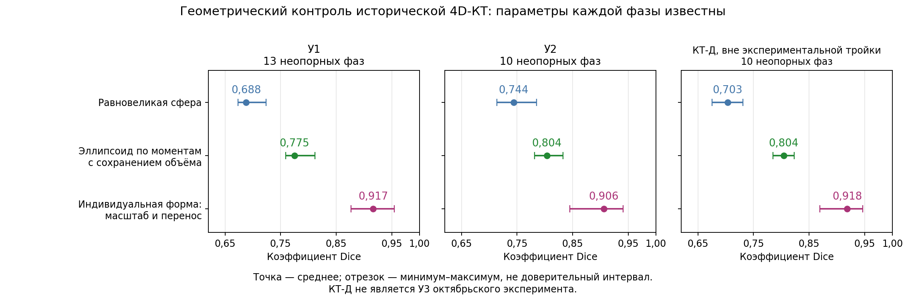

# Отчёт ГПХ РНЦХ

**Разработка методики мониторинга параметров гемодинамики сердца по данным электроимпедансных измерений**

Расширенная научная редакция от 28 октября 2026 года. Постановка применения: одна индивидуальная КТ-фаза, электроимпедансные сигналы и ЭКГ; 4D-КТ используется для разработки и проверки. Целевые функции — ударный объём и фракция выброса.

В отчёте раздельно изложены выполненные эксперименты и расчёты, принятые допущения и проверяемая методика. По уточнению автора от 28 октября основная последовательность включает оценку базовых и пульсовых тканевых ρ по поясной ЭИТ и КТ, разделение дыхательного и мягкотканного вкладов в ТТРКГ, затем восстановление сердечной динамики и расчёт функций сердца. Раздел 13 описывает реализацию первых звеньев во внешнем репозитории, сохранённые результаты и условия их использования. Индивидуальная проверка остаётся на Нике. Выполнены FEM/обратный расчёт реальной поясной ЭИТ и условная проекция в ТТРКГ; невязка базовых напряжений 32,44%, свободный подбор пяти тканей отвергнут как численно вырожденный. Эти результаты не устанавливают точность УО/ФВ; обучение ИИ не выполнялось. Раздел 14 содержит новые прямые расчёты от исходной STL, сравнение сфер и эллипсоидов, проверку знака и квадратуры, условное разделение объёмного и тканевых вкладов и отдельный подбор эффективных свойств каждой формы. Значение 4 Ом·м не принимается за известное ρ целого сердца; сфера по результатам фиксированного сценария не исключается. Раздел 12 содержит проверку четырёх камер и целого сердца, расчёт по отложенным блокам КТ и перенос на три фазы следующего RR. Разделы 10–12 сохраняют проверки без тканевых поправок PulmoVista как контрольные сравнения; разделы 6–9 — состояние более раннего прохода. Подключение фазовой КТ Ярослава не является условием нынешней индивидуальной проверки. Проверенный экспериментальный расчёт УО и ФВ по одной КТ-фазе пока не заявляется.

Продолжение раздела 14 включает проверку чтения измерений и электрического оператора, смещение пояса на 20 мм, условные материальные сценарии и пространственный аудит камер. Закон состава проверен по КТ и передан в пульсовую задачу с мягкотканным и единым лёгочным вкладом. Относительная постановка улучшила предсказание исключённых электрических измерений в общей относительной метрике, но сохранила большие вольтовые остатки и материальную неоднозначность объёма. Эти проценты не являются погрешностью УО/ФВ. По уточнению автора промежуточная цель — проверенный объём эквивалентной формы всего сердца; переход к желудочкам и их функциям выполняется после этого как отдельное звено.

Раздел 15 содержит завершённое сравнение 28 реализованных пространственных аппроксимаций целого сердца на 12 фазах Ника, уточнение численных настроек, проверку всех 12 вариантов единственной опоры и отдельные контурные расчёты. Индивидуальная масштабированная форма лучше сохраняет геометрию при известных объёме и центроиде; эти известные КТ-параметры пока не восстановлены из сигналов. Геометрические ошибки и численная чувствительность объёма приведены раздельно. Следующее звено — электрическая проверка выбранных форм и различимости их параметров.

## Содержание

1. Цель исследования и условия применения методики.
2. Научно-технические основания и патентные решения.
3. КТ, анатомические модели и референсные объёмы.
4. Экспериментальные сигналы, обработка и шум.
5. Проверка боковых электродных сборок и выбор источника тканевых параметров.
6. Прямая электрическая задача и выполненные FEM-расчёты.
7. Восстановление сердечного вклада по одной КТ-фазе; УО и ФВ.
8. Выбор аппроксимации и проверка переносимости.
9. Достигнутые результаты, ограничения и соответствие задачам договора.
10. Эмпирическая проверка камерной динамики и связи с электрическими сигналами.
11. Временная структура камерной динамики и математические связи между объёмами.
12. Индивидуальная проверка восстановления камерных объёмов по данным Ника.
13. Тканевые параметры поясной ЭИТ для разделения вкладов в ТТРКГ.
14. Расчётная доработка: объём исходной сердечной формы и тканевые пульсовые вклады.
15. Сравнение аппроксимаций целого сердца на последовательности 4D-КТ Ника.

Источники приведены в соответствующих разделах: публикации поддерживают литературные положения, а ссылки на расчёты обеспечивают происхождение собственных результатов. Глава 2 дополнена отдельным тематическим обзором 59 публикаций и адресной повторной сверкой десяти источников по расчёту УО, согласованию методов и оценке ФВ. Число отображаемых знаков в вычислительных таблицах не является оценкой метрологической точности.

## 1. Цель исследования и условия применения методики

### 1.1. Измеряемые сигналы и искомые функции сердца

Работа направлена на разработку методики определения функций сердца по поверхностным электроимпедансным измерениям с использованием индивидуальной анатомии грудной клетки. Рассматриваются трансторакальное отведение «рука–рука» и прекардиальные отведения, для которых имеются экспериментальные записи. Электрокардиограмма (ЭКГ), зарегистрированная одновременно с электрическим импедансом, используется для временной привязки и исследования повторяемости сердечных циклов. Основные выходные величины — ударный объём (УО) и фракция выброса (ФВ) выбранного желудочка. В первой количественной проверке таким желудочком служит левый; это определяет смысл результата, но не ограничивает область прямого электрического моделирования одним левым желудочком.

Для одного механического цикла связь целевых величин записывается в виде

$$
SV=V_{\mathrm{ED}}-V_{\mathrm{ES}},\qquad
EF=\frac{SV}{V_{\mathrm{ED}}},\qquad
CO=10^{-3}SV\,HR.
\tag{1.1}
$$

Здесь $V_{\mathrm{ED}}$ и $V_{\mathrm{ES}}$ — конечные диастолический и систолический объёмы одной камеры, мл; $SV$ — ударный объём, мл; $EF$ — фракция выброса как безразмерная доля, её процентное значение равно $100EF$; $HR$ — частота сердечных сокращений, мин⁻¹; $CO$ — минутный объём, л/мин. Последняя величина является производной от первых измерений. Для её расчёта при изменчивых циклах необходим согласованный способ усреднения: произведение отдельно усреднённых величин не объявляется автоматически равным среднему потоку.

Раздельная постановка УО и ФВ необходима потому, что электрический сигнал может содержать информацию об изменении объёма без достаточной информации об абсолютном объёме камеры. Даже при найденном $SV$ формула (1.1) не определяет $EF$, пока неизвестен её знаменатель. Поэтому в отчёте отдельно проверяются восстановление объёмного изменения, определение опорного камерного объёма и привязка к механическим фазам. Количественная работоспособность всей цепочки на экспериментальных данных пока не подтверждена.

### 1.2. Одна индивидуальная КТ-фаза как вход практического расчёта

По уточнённой постановке автора у человека, к которому применяется методика, предполагается наличие одного компьютерно-томографического объёма, относящегося к конкретной фазе сердечного цикла. Под «одним снимком» здесь понимается одна пространственная КТ-реконструкция грудной клетки, пригодная для построения трёхмерной модели. Наличие только отдельного двумерного среза не обеспечивает заявленный набор пространственных входов и в эту постановку не включено.

Индивидуальная КТ задаёт наружную геометрию, положение органов, сердечную область и доступные тканевые границы в опорной фазе. Она не содержит непосредственно измеренной индивидуальной траектории сокращения. Фаза может быть известна по метаданным либо оставаться неопределённой; эти случаи должны иметь разные входные условия и разные оценки неопределённости. Объём камеры в произвольной фазе не обозначается как конечный диастолический только потому, что доступен один том.

Исследовательская 4D-КТ имеет другую роль. Последовательности фаз используются для изучения допустимых изменений формы, построения ограниченного общего закона динамики, оценки ошибки аппроксимации и проверки восстановления функций сердца. При испытании методики на исключённом из разработки добровольце его полная 4D-последовательность должна быть скрыта от алгоритма и использоваться только для последующего сравнения. Иначе проверяется воспроизведение уже известной динамики, а не работа по одной фазе.

Различие входов этапа разработки и применения сведено в таблице 1.1. Оно является частью проверяемой методики: уменьшение объёма входной информации сопровождается самостоятельной оценкой потери точности.

Таблица 1.1. Входы разработки и применения методики

| Величина или материал | Разработка и проверка | Применение к отдельному человеку |
|---|---|---|
| Индивидуальная пространственная анатомия | КТ, маски тканей, камеры и поверхности | Одна КТ-фаза с собственной анатомией |
| Динамика сердца | Доступные 4D-последовательности исследовательского корпуса | Общая структура закона; индивидуальные параметры оцениваются по разрешённым входам |
| Электроимпедансные сигналы | Записи с известными монтажами и условиями | Реальные сигналы доступных одновременных отведений |
| ЭКГ | Проверка временных признаков и межцикловой вариабельности | Временные признаки для совместной модели; механические фазы требуют проверенного преобразования |
| Электрические свойства тканей | Условные сценарии; в дальнейшем — собственная инверсия исходных поясных измерений | Оценённые или явно заданные параметры с неопределённостью |
| Референс УО и ФВ | Сегментация доступной 4D-КТ с ограничениями фаз и анатомии | Не используется как заранее известный ответ |

Таблица 1.1 не утверждает, что все исследовательские входы уже получены для каждого участника. Соответствие конкретных добровольцев и полнота их данных разобраны в разделе 3. Выбранная автором 4D-КТ остаётся референсом разработки; получение другого независимого метода измерения УО не вводится как условие продолжения этой работы.

### 1.3. Сердце как эквивалентная форма и смысл универсальности

Эквивалентная форма представляет сердце ограниченным набором параметров, достаточным для воспроизведения существенной части электрического отклика и последующего расчёта целевой функции. Возможными представлениями служат сфера, эллипсоид и индивидуальная опорная форма с небольшим числом деформаций. Слово «эквивалентная» требует указания критерия: равенство анатомического объёма, близость поверхности, близость базового импеданса и близость его динамических изменений являются разными условиями.

В рамках этой работы универсальность понимается как общая структура модели и общий способ определения её параметров, переносимые между исследуемыми добровольцами. Индивидуальные положение, размер и ориентация сердца сохраняются по единственной КТ; амплитуды и задержки динамических компонент должны определяться по сигналам. Одинаковые радиус, координаты или амплитуда сокращения для всех людей не предполагаются. Сходство результата у трёх добровольцев может обосновать ограниченную переносимость на изученном корпусе, но не популяционную универсальность.

Удобное обозначение разрабатываемого метода имеет вид

$$
(\widehat{SV}_i,\widehat{EF}_i,\mathcal U_i)
=\mathcal A_{\eta}\bigl(G_i^*,\mathbf Z_i(t),E_i(t),\mathcal P_i\bigr),
\tag{1.2}
$$

где $i$ обозначает человека; $G_i^*$ — геометрия одной КТ-фазы; $\mathbf Z_i(t)$ — вектор фактически зарегистрированных импедансов; $E_i(t)$ — ЭКГ; $\mathcal P_i$ — измерительный протокол и тканевые входы; $\eta$ — общая структура и настройки, выбранные при разработке; $\mathcal U_i$ — описание неопределённости результата. Выражение (1.2) задаёт целевую организацию расчёта, а не уже реализованный алгоритм с установленной точностью.

Параметры $\eta$ нельзя заново выбирать по полной 4D-КТ проверяемого человека. Допустимая индивидуальная настройка должна быть заранее перечислена и использовать только правую часть (1.2). Отдельная подгонка каждого добровольца по всей его динамике может служить оценкой предельных возможностей модели, но не проверкой сформулированного режима применения.

### 1.4. Электрический вклад сердца и его физиологическая интерпретация

Измеряемое передаточное сопротивление относится ко всей проводящей области между токовыми и измерительными электродами. Оно зависит от распределения проводимости, положения и формы органов, электрических контактов и схемы возбуждения. Поэтому зарегистрированная пульсовая кривая не является непосредственной записью объёма сердца. Разрабатываемая последовательность включает описание прямой задачи, оценку внесердечных изменений, восстановление параметров эквивалентного сердца и проверяемое преобразование этих параметров в УО и ФВ.

Вклад сердца определяется относительно явно выбранной опорной модели: например, как изменение расчётного импеданса при изменении сердечной геометрии и фиксированных остальных входах. При одновременном изменении тканей и геометрии возможны нелинейные взаимодействия. Поэтому разложение общего отклика на независимые аддитивные доли является приближением, применимость которого проверяется по прямым расчётам. Процент общего пульсового сигнала, приписанный ЛЖ без такой постановки, не имеет достаточного физического основания.

ЭКГ позволяет исследовать временные закономерности наблюдаемых компонент. Использование всей кривой на протяжении цикла может уменьшать число свободных параметров относительно независимой подгонки каждой временной точки. Оно полезно только при проверенной структуре временных связей: если два допустимых механизма дают неразличимые пространственно-временные отклики, регуляризация не превращает их раздельные амплитуды в измеренные величины. Критерии определимости целевого функционала приведены в разделе 7.

### 1.5. Состав выполненной работы и границы настоящей редакции

В отчёте объединены анализ предоставленного научного текста, первичный патентный поиск, подготовка анатомических моделей, обработка октябрьских экспериментальных записей, аналитическая проверка боковых сборок, конечноэлементные расчёты и разработка вычислительной цепочки оценки объёмных параметров. Подробно приводятся исходные условия, формулы, сохранённые численные результаты и причины, по которым отдельные результаты ещё нельзя объединить в проверенную оценку УО и ФВ.

Экспериментальный корпус основного отчёта ограничен выбранными автором записями многоканальной электроимпедансной системы. Расчёты из предшествующих исследований используются для объяснения математических приёмов или как отдельно обозначенные вычислительные контроли; их коэффициенты не объявляются коэффициентами текущих измерений. Основной текст использует обезличенные обозначения участников и наименование оборудования по типу.

Исходные поясные электрические измерения, необходимые для исследования тканевых параметров, ожидаются в дальнейшем. До их поступления расчёты выполняются при условно заданных сопротивлениях тканей. Сообщённые автором диапазоны свойств и условия моделирования коллеги сохраняются как конкретные предпосылки, а не как измерения индивидуальных тканей. Требуемая численная точность УО и ФВ договором не задана; её нельзя заменить произвольно назначенным допустимым процентом. В разделах 7–9 устанавливается, какие ошибки уже вычислены, какие ещё неизвестны и какие проверки необходимы для осмысленного результата.

## 2. Научно-технические основания и патентные решения

### 2.1. Измерительная задача и границы обзора

Разрабатываемая методика связывает реальные сигналы трансторакального отведения «рука–рука» (ТТРКГ), прекардиальных отведений и синхронной ЭКГ с изменениями сердца и последующим расчётом ударного объёма (УО) и фракции выброса (ФВ). При применении предусмотрена одна индивидуальная КТ-фаза, задающая исходную анатомию грудной клетки. Для разработки общего закона аппроксимации всего сердца предусмотрены динамические серии 4D-КТ трёх добровольцев. Это условие этапа разработки не означает, что для каждого последующего обследования требуется индивидуальная многофазная КТ.

Обзор отвечает на пять вопросов: какие компоненты измеренного импеданса можно связать с сердцем; какое сокращённое описание сохраняет существенные изменения его геометрии; насколько обоснованы расчёты УО и ФВ по импедансу; как проверять их точность; какие элементы подхода уже раскрыты в патентах. Предоставленный исходный отчёт использован для постановки вопросов об измерениях и чувствительности. Его самостоятельная цель оценки вентиляционно-перфузионного отношения и результаты фантомного эксперимента не переносятся на настоящую работу.

По дополнительному указанию автора включён [отдельный литературный обзор](../../../Литературный%20обзор/07_Литературный_обзор.md) и его материалы: библиография, карточки исследований, сравнительная матрица и реестр доказательств. Этот тематический корпус содержит 59 уникальных публикаций 1966–2025 годов. По его манифесту для 55 источников подготовлены полнотекстовые материалы, для четырёх доступны метаданные или реферат. Наличие 55 текстов не означает их повторной полной проверки при подготовке настоящего отчёта: повторно сверяются конкретные используемые положения; объём чтения указан в [сопоставлении источников](../literature_integration/README.md). Полнота систематического поиска, формальная оценка риска смещения всех исследований и новый метаанализ здесь не заявляются.

Материалы обзора разделяют медицинскую потребность в повторной оценке кровотока и доказательство пригодности конкретного измерительного метода. УО характеризует выброс за сокращение, минутный объём кровообращения зависит также от частоты сокращений, а ФВ выражает выброшенную долю исходного желудочкового объёма. Эти величины взаимосвязаны, но не взаимозаменяемы. Поэтому исследовательская задача состоит в проверке каждого перехода от электрического признака к выбранному показателю. Литературные сравнения с термодилюцией и визуализацией задают полезные принципы такой проверки; в нашей работе принятым автором референсом остаётся имеющаяся 4D-КТ-сегментация.

При использовании исходного корпуса учтены его ограничения. Fuller (1992), Newman (1999), Sodolski (2007) и Savarese (2022) не используются здесь как полнотекстово проверенные основания численных выводов. К записи Kubicek (1966) прикреплён технический отчёт NASA 1967 года объёмом 192 страницы: страницы этого отчёта нельзя приписывать журнальной статье 1966 года. Первоначальные подборки `01` и `02` содержат предложения по структуре обзора; они рассматриваются как подготовительные материалы, а не самостоятельные доказательства.

### 2.2. От импедансного сигнала к сердечному вкладу

В методическом докладе [Sherwood et al., 1990](https://doi.org/10.1111/j.1469-8986.1990.tb02171.x) обсуждается неоднозначность теоретической интерпретации импедансной кардиографии и существенная роль эмпирической проверки. Авторы указывают на различия исследовательских методик и необходимость подробно описывать условия получения результатов. В первой редакции использовался реферат; при включении отдельного обзора дополнительно проверены фрагменты полного текста на с. 2–3 и 8–13 и изображения формулы и временных ориентиров. Это методический источник, а не экспериментальное подтверждение точности нашей схемы. Его значение состоит в требовании связать расчётный показатель с конкретной регистрацией и способом обработки.

Приведённая Sherwood классическая формула Кубичека показывает, какие дополнительные входы участвуют в преобразовании сигнала в УО:

$$
SV=\rho_b\left(\frac{L}{Z_0}\right)^2 LVET\,
\left|\frac{dZ}{dt}\right|_{\mathrm{peak,syst}}.
$$

При $\rho_b$ в Ом·см, расстоянии $L$ в см, базовом импедансе $Z_0$ в Ом, времени изгнания $LVET$ в с и производной в Ом/с результат имеет размерность см³, то есть мл. Систолический пик в принятом отображении соответствует модулю отрицательного экстремума производной исходного импеданса. Следовательно, формула использует геометрию, электрическое свойство крови, амплитуду и длительность. Она приведена как литературный пример зависимости расчёта от входов и не применена здесь к нашему отведению «рука–рука».

В [работе Bernstein и Lemmens, 2005](https://doi.org/10.1007/BF02344724), с. 443–446, рассмотрено другое уравнение, связывающее нормированную производную с движением крови и учитывающее объём проводника через массу тела. У 106 послеоперационных кардиохирургических пациентов средний минутный объём по этому уравнению составил 6,06 ± 1,48 л/мин против 5,97 ± 1,41 л/мин по термодилюции. Однако время изгнания в этом сравнении определяли по инвазивной лучевой артериальной кривой давления. Поэтому результат не подтверждает полностью электрическое определение $LVET$ и не может служить готовой проверкой нашей цепочки «ЭКГ + импеданс → УО». Различия трактовок сигнала и входов расчёта сохраняются даже при близких средних значениях.

В настоящей постановке раздельно описываются исходный импеданс, дыхательные изменения и компонента, воспроизводимая в сердечном цикле. ЭКГ позволяет согласовать записи по электрическим событиям, однако сама синхронность ещё не устанавливает анатомический источник импедансного изменения. Поэтому выделение сердечного вклада рассматривается как обратная задача с несколькими возможными причинами наблюдаемого сигнала. При интерпретации необходимо различать изменение кровенаполнения, перемещение границ тканей и изменения окружающей проводящей среды.

Это собственная методическая постановка работы. Индивидуальная КТ уменьшает неопределённость исходной геометрии, но не определяет автоматически удельные сопротивления тканей, состояние контактов и последующую динамику. Разные отведения имеют смысл совместно использовать постольку, поскольку их чувствительности дополняют друг друга. Простое увеличение числа каналов не доказывает независимости получаемой информации. При этом неоднозначность полного набора геометрических параметров сама по себе ещё не исключает устойчивого определения отдельного целевого функционала, например межфазной разности объёмов; проверять следует именно заявляемый результат.

### 2.3. Движение всего сердца и физиологический смысл объёмных показателей

Работа [Carlsson et al., 2007a](https://journals.physiology.org/doi/full/10.1152/ajpheart.01148.2006) показывает значимость продольного движения атриовентрикулярной плоскости. Авторы исследовали методом кинематографической МРТ три группы по 12 человек: здоровых добровольцев, спортсменов и пациентов с дилатационной кардиомиопатией. Вклад продольного движения оценивали совместно с площадью поперечного сечения, а УО — по объёмам желудочка. Для нашей задачи существенно, что изменение одной линейной величины нельзя интерпретировать независимо от формы и размеров сердца. Полученные авторами групповые соотношения не принимаются здесь за индивидуальные коэффициенты пересчёта.

В другом исследовании [Carlsson et al., 2007b](https://journals.physiology.org/doi/full/10.1152/ajpheart.01376.2006) у 11 здоровых добровольцев сопоставлены объёмные МРТ-измерения и потоки через сосуды, входящие в сердце и выходящие из него. Авторы раздельно рассматривают насосную функцию желудочков и изменение общего объёма содержимого перикарда. Последнее связано преимущественно с радиальной составляющей насосной функции; продольное движение обеспечивает существенное перераспределение между предсердиями и желудочками. Следовательно, изменение внешнего объёма сердца не тождественно суммарному ударному объёму желудочков. Проверены соответствующие разделы методов и обсуждения, а не только название публикации.

В принятой нами постановке геометрическая модель охватывает всё сердце. Физиологические выходы при этом требуют указания камеры и механических фаз. Для выбранного желудочка $c$ определения имеют вид

$$
\mathrm{УО}_c=V_{c,\mathrm{КД}}-V_{c,\mathrm{КС}},\qquad
\mathrm{ФВ}_c=\frac{\mathrm{УО}_c}{V_{c,\mathrm{КД}}}\,100\% .
\tag{2.1}
$$

Здесь объёмы выражены в миллилитрах; КД и КС обозначают конец диастолы и конец систолы одной камеры. Формула задаёт смысл выходных величин, но не способ их восстановления из импеданса. Допустим отдельно проверенный оператор непосредственного определения межфазной разности объёма: для УО тогда не обязательно независимо восстанавливать оба абсолютных объёма. Для ФВ всё равно необходим КДО. Ни внешний объём всего сердца, ни его относительное изменение не заменяют эти величины без проверенного преобразования. Одна исходная КТ-фаза также не становится автоматически конечно-диастолической; её положение в цикле должно быть установлено. Привязка к QRS не заменяет проверки механических фаз одного цикла.

### 2.4. Литературные подходы к сокращённому описанию геометрии

Ниже рассматриваются опубликованные способы описания формы и прежняя постановка исследования. По последующему решению автора новые физические, конечноэлементные и синтетические модели в текущей доделке не строятся. Действующая проверка основана на имеющихся сегментациях, реальных электрических записях и эмпирических зависимостях разделов 10–11. Обсуждение TriSeg и статистических атласов не означает их внедрения в расчёт УО.

[Lumens et al., 2009](https://link.springer.com/article/10.1007/s10439-009-9774-2) предложили модель TriSeg: свободные стенки двух желудочков и межжелудочковая перегородка представлены взаимодействующими сферическими сегментами. Их связь определяется механическим равновесием; модель включена в замкнутую систему кровообращения CircAdapt. Авторы сопоставляли расчёты с данными при различных условиях нагрузки и обсуждали геометрические ограничения упрощения. Это пример содержательного сокращения числа переменных посредством физических связей. TriSeg описывает желудочковую механику; она не является готовой аппроксимацией всех отделов сердца или электрическим решателем грудной клетки. Для переноса её принципов потребуются анатомическое размещение и собственная проверка электрического отклика.

Другой подход представлен в исследовании [Mauger et al., 2019](https://link.springer.com/article/10.1186/s12968-019-0551-6). Бивентрикулярный атлас построен по 4329 МРТ-исследованиям UK Biobank; референсная подгруппа включала 630 участников. Авторы совместно анализировали формы в конце диастолы и систолы. Преобразование совмещения, найденное для диастолической геометрии, применялось также к систолической, после чего использовался анализ главных компонент. Для нашей работы существенны совместное представление формы и её изменения, а также раздельный контроль поверхностных и объёмных ошибок. Этот атлас охватывает желудочки и две фазы; он не задаёт проверенный непрерывный закон движения всего сердца по одной КТ-фазе.

Возможные представления и необходимые проверки сопоставлены в таблице 2.1. Сфера и эллипсоид приведены как рабочие гипотезы настоящей разработки, а не как доказанные результаты названных публикаций.

Таблица 2.1 — Представления геометрии и границы их применения

| Представление | Задаваемые признаки и связи | Что необходимо проверить в нашей задаче |
|---|---|---|
| Эквивалентная сфера | Объём, положение центра; минимальное число переменных | Потерю анизотропии формы, различимость переноса и изменения размера |
| Эллипсоид | Объём, направления и отношения осей, ориентация | Устойчивость дополнительных параметров при фактических отведениях |
| Связанные сегменты, принцип TriSeg | Ограничения взаимного движения стенок | Применимость к целому сердцу и соответствие электрическому отклику |
| Статистические моды формы | Согласованные изменения нескольких геометрических признаков | Перенос между людьми, сохранение положения в грудной клетке, достаточность обучающей выборки |

Выбор описания должен учитывать одновременно геометрическую и электрическую задачи. Близость аппроксимации к поверхности КТ не гарантирует близости измеряемых напряжений, особенно при смещении границ в областях высокой чувствительности. Обратная ситуация также возможна: сходные электрические отклики могут соответствовать разным формам. В прежней постановке предлагалось сопоставлять ошибку поверхности, ошибку объёмного функционала и расхождение прямого электрического расчёта. В текущем эмпирическом этапе непосредственно проверяются геометрические зависимости и связь с зарегистрированными сигналами; новый прямой электрический расчёт не выполняется.

Общий закон аппроксимации на трёх добровольцах остаётся исследовательской гипотезой. Его параметры должны переноситься на нового испытуемого с использованием одной индивидуальной КТ-фазы и реально доступных сигналов. Проверку такого переноса следует отделять от подгонки к собственным многофазным данным. Возможная схема — последовательное исключение одного добровольца из построения закона с последующей проверкой на нём. Множество фаз одного человека не увеличивает число независимых испытуемых. Такая проверка даст предварительную оценку переносимости в имеющемся корпусе, но не установит применимость ко всем типам телосложения. Состав исторической 4D-тройки отличается от экспериментальной: совпадают только два участника, что ограничивает сквозную проверку по реальным сигналам (раздел 3.2).

### 2.5. Роль будущих измерений по методике Dräger PulmoVista

В [руководстве Dräger для PulmoVista 500, Software 1.3n](https://www.draeger.com/Content/Documents/Products/pulmovista-ifu-9511001-en.pdf), в разделе *Information displayed by PulmoVista 500*, с. 152, динамическое изображение описано как относительное изменение импеданса. Текущий набор измеренных напряжений сравнивается с опорным; обновление опорного кадра связано с дыханием. Это описание производителя относится к формированию отображаемого результата и не означает выдачи абсолютных удельных сопротивлений тканей. Проверен индексированный текст указанного раздела и обложки руководства; полный документ через прямое открытие не получен.

По условиям дальнейшей работы предполагается доступ к исходным электрическим измерениям. На момент подготовки главы они отсутствуют. Их методическая ценность состоит в возможности поставить собственную обратную задачу с индивидуальной геометрией, известным возбуждением и моделью электродных контактов. Изображения относительных изменений не подменяют такой вход. Даже исходные напряжения сами по себе не гарантируют раздельного восстановления сопротивлений лёгких и грудной стенки: потребуются проверка чувствительности, согласование частоты и единиц, анализ неоднозначности и неопределённости. До этого заданные сопротивления сохраняют статус условных параметров модели.

### 2.6. Патентные решения и место разрабатываемой методики

В выполненном патентном поиске зарегистрированы **28 запросов и 11 рабочих групп семейств**. Для настоящей главы повторно проверены четыре наиболее близкие публикации; это не новый полный поиск. Основным доступным представлением патентных текстов были карточки Google Patents. Проверка официальных реестров ФИПС, PATENTSCOPE и Espacenet в исходном поиске не завершена. Соответственно, ниже сопоставляются технические признаки, без заключения о действующем объёме охраны, патентоспособности или свободе использования.

Таблица 2.2 показывает, какие именно элементы уже раскрыты и где требуется осторожность при переносе.

Таблица 2.2 — Близкие патентные решения

| Идентификатор и публикация | Проверенные технические признаки | Значение и предел сопоставления |
|---|---|---|
| [P01 — US20150297099A1](https://patents.google.com/patent/US20150297099A1/en) | Индивидуальная модель по КТ/МРТ, определение удельного импеданса лёгких; пункт 31 — восстановление геометрических параметров сердца по фазам с изменяющимися свойствами внесердечной ткани | Близкая общая архитектура параметрической обратной задачи. Некоторые варианты предусматривают внутренние электроды, но этим не исчерпывается содержание публикации |
| [P02 — US8131354B2](https://patents.google.com/patent/US8131354B2/en) | Пункт 1: поверхностные электроды, два фазовых набора данных, две реконструкции и ограничения межфазных различий; разность оценённых объёмов используется для УО | Уже раскрыта связь электрической реконструкции и объёмной разности. Патентная формулировка не доказывает физиологическую эквивалентность внешнего объёма всего сердца и УО в нашей модели |
| [P03 — US20120059593A1](https://patents.google.com/patent/US20120059593A1/en) | Пункты 12–13: токовое возбуждение через конечности, грудные измерительные пары, разделение предсердной и желудочковой компонент, калибровка объёмного преобразования; учёт дыхания. Описание рассматривает изоволюмическое движение | Полезно для анализа смешанных источников сигнала. Проверена A1-публикация; наличие последующей B2 не означает, что её окончательная формула изучена |
| [P07 — RU2415641C1](https://patents.google.com/patent/RU2415641C1/en) | Потенциальные электроды на руках, фронтальные и соединённые с ними задние токовые электроды; геометрическая оценка области измерения | Близость поперечному отведению требует сравнения полной токовой схемы. Доступен индексированный текст описания; оригинальная формула изобретения не проверена |

Наиболее существенен P01: сочетание индивидуальной анатомии, электрических свойств лёгких и параметризованной геометрии сердца уже присутствует в известном решении. Поэтому доказанную новизну общей последовательности «КТ → электрическая модель → параметры сердца» заявлять нельзя. P02 дополнительно показывает, что межфазные ограничения и оценка объёмной разности также имеют предшествующее раскрытие.

P03 важен для собственного анализа разделения сердечного вклада: описание явно различает изменения наполнения и движение при сохранении объёма. Однако предлагаемые там коэффициенты и способы калибровки нельзя автоматически переносить на наши отведения. P07 показывает, почему обозначения «рука–рука» недостаточно для сопоставления методик: необходимо знать расположение всех токовых и потенциальных электродов. Эти выводы относятся к техническому сравнению; наличие патента само по себе не подтверждает точности заявленного способа.

Таким образом, содержательная задача настоящей разработки — проверить конкретный общий закон аппроксимации всего сердца, его индивидуализацию по одной КТ-фазе и восстановление необходимых параметров по совместным ТТРКГ, прекардиальным сигналам и ЭКГ. Возможный результат должен включать проверенное преобразование сердечного вклада в УО и ФВ, оценку неопределённости и условия отказа. Рассмотренные источники обосновывают такую постановку и выявляют её трудности; завершённого решения для принятого набора входов они не подтверждают.

### 2.7. Что показывают сравнительные исследования точности

В предоставленном обзоре раздельно рассмотрены абсолютное согласие измерений и воспроизведение их изменений. Это различие непосредственно относится к нашей задаче: сходство формы импедансной и объёмной кривых ещё не определяет коэффициент преобразования Ом в миллилитры. Высокая корреляция сохраняется при постоянном смещении и при положительном масштабном множителе, поэтому сама по себе не доказывает правильность абсолютного объёма. Для перехода к УО и ФВ необходимо проверять величины ошибок целевых показателей, а не только синхронность кривых.

При повторной сверке пяти методологических и сравнительных публикаций получены показатели таблицы 2.3. Полные определения, страницы и расхождения между разделами статей сохранены в [приложении по согласованию методов](../literature_integration/validation_sources.md). В таблице сохранены исходные единицы и направление разности. Сердечный индекс, то есть минутный объём, делённый на площадь поверхности тела, нельзя смешивать с минутным объёмом или УО.

Таблица 2.3 — Проверенные литературные оценки согласия; не характеристики нашей методики

| Публикация и условия | Выборка | Смещение и пределы согласия | Процентная ошибка и воспроизведение изменений |
|---|---|---|---|
| Cox, 2017; кардиохирургия, электрический сердечный индекс против непрерывной лёгочной термодилюции | 50 пациентов, 284 фактические пары | Электрический индекс минус референс: −0,52 л/(мин·м²); пределы −2,2…1,1 л/(мин·м²) | Общая PE 67%; четырёхквадрантная согласованность изменений 55% при 15%-ной зоне исключения |
| Greiwe, 2025, онлайн 2024; после коронарного шунтирования, минутный объём против прерывистой лёгочной термодилюции | 41 проанализированный пациент, 157 пар | Референс минус электрическая оценка: −0,2 л/мин; SD разностей 1,2 л/мин; пределы −2,6…2,3 л/мин | PE 47%, 95% ДИ 37–56%; согласованность изменений 48% при 10%-ной зоне исключения |
| Wang, 2018; трансплантация печени, минутный объём против непрерывной лёгочной термодилюции | 23 проанализированных пациента, 207 пар | Референс минус электрическая оценка: −1,26 л/мин; SD 2,39 л/мин; пределы −5,94…3,42 л/мин | PE 60,0%; согласованность изменений 56,5% после исключения изменений внутри ±1 л/мин |
| Sanders, 2020, онлайн 2019; метаанализ электрической кардиометрии, взрослая группа | 13 исследований, 620 уникальных пациентов | Сводное смещение 0,03 л/мин; пределы −2,78…2,84 л/мин | Средняя PE 48%; неоднородность $I^2=93\%$; единую сводную оценку динамики не рассчитывали |

Источники таблицы: [Cox et al.](https://doi.org/10.1155/2017/2635151), [Greiwe et al.](https://doi.org/10.1007/s10877-024-01246-y), [Wang et al.](https://doi.org/10.1186/s12871-018-0600-y), [Sanders et al.](https://doi.org/10.1007/s10877-019-00330-y). Для Cox отрицательный знак взят из таблицы 3 и согласуется с рисунком; в реферате указан положительный знак. В методах фигурирует 300 запланированных пар, но в общей строке результатов — 284. Это адресные расхождения первоисточника, а не пересчёт его результатов. Для Sanders число 620 означает число людей; большее число на сводном графике связано с представлением отдельных исследований в нескольких условиях. Wang входит в метаанализ Sanders, поэтому эти строки не являются независимыми первичными подтверждениями.

У Greiwe малое среднее смещение сочетается с широкими пределами согласия и низкой согласованностью изменений. Следовательно, близость средних значений не гарантирует ни точности отдельного измерения, ни правильного воспроизведения динамики. Вместе с тем эти результаты относятся к конкретным послеоперационным и хирургическим группам. В исходном тематическом обзоре представлены и более благоприятные оценки в других выборках. Представленные четыре строки выбраны для разбора статистических ошибок интерпретации; они не служат новой полной оценкой эффективности класса приборов и не доказывают несостоятельности исследуемого нами подхода.

Особое значение имеет обсуждаемый в литературе ориентир PE около 30%. В [работе Critchley и Critchley, 1999](https://doi.org/10.1023/A:1009982611386), с. 87 и 89–90, он обоснован примером сочетания независимых ошибок двух методов: при пределах прецизионности каждого ±20% ожидаемые пределы различий составляют приблизительно ±28,3%. Округление до 30% не превращает этот пример в универсальный критерий. Для нашей задачи меняются величина, единицы и референс. Поэтому принятие 30% как допустимой ошибки УО или ФВ только по ссылке на эту публикацию было бы необоснованным.

Для произвольной проверяемой величины $y$ подписанную ошибку определим как $e_i=\widehat y_i-y_i$. При $n$ сравнениях различаются смещение $b$, стандартное отклонение ошибок $s_e$ и корень средней квадратичной ошибки:

$$
b=\frac1n\sum_i e_i,\qquad
s_e^2=\frac1{n-1}\sum_i(e_i-b)^2,\qquad
RMSE^2=b^2+\frac{n-1}{n}s_e^2. \tag{2.2}
$$

Это определения и алгебраическое тождество, согласованные с разделом 10; они не являются новыми измерениями. Термин СКО в численных результатах должен сопровождаться указанием, идёт ли речь о $s_e$ или $RMSE$. Пределы вида $b\pm1{,}96s_e$ требуют соответствующей структуры распределения ошибок и не равны доверительному интервалу среднего смещения. Повторные фазы одного человека зависимы; их механическое объединение как независимых наблюдений не даёт обоснованной популяционной оценки пределов согласия.

В разных статьях процентную ошибку определяют с разными множителями и правилами усреднения. В общем обозначении

$$
PE=100\%\,\frac{k s_e}{\overline y}, \tag{2.3}
$$

где выбор $k$, знаменателя и способа учёта повторов должен быть указан. В проверенных работах встречаются 1,96, 2 и множитель на основе t-статистики. PE не равна средней абсолютной процентной ошибке и не равна относительному RMSE. Для ФВ особенно важно различать процентные пункты и относительные проценты. Сравнение ошибок из разных работ без этих определений может давать ложное впечатление близости результатов.

Для нашей небольшой выборки первичными остаются индивидуальные ошибки при исключении человека из подбора и явно определённая сводка с равными весами участников. Число КТ-фаз и сердечных циклов указывается отдельно от числа людей. Подбор формы зависимости, порога или временного сдвига по результатам того же исключённого участника переводит последующую оценку в исследовательский анализ; она больше не является независимой проверкой выбранного варианта.

### 2.8. Временные признаки и количественная оценка ФВ

В литературе различаются объёмное определение ФВ, её эмпирическое вычисление по электрическим признакам и распознавание категории сниженной функции. Для предизгнательного периода, времени изгнания и их отношения приняты обозначения

$$
PEP=t_B-t_{Q,\mathrm{onset}},\qquad
LVET=t_X-t_B,\qquad STR=\frac{PEP}{LVET}. \tag{2.4}
$$

Здесь начало Q означает начало желудочковой деполяризации; B соотносят с началом изгнания, X — с его окончанием. У [Sherwood et al., 1990](https://doi.org/10.1111/j.1469-8986.1990.tb02171.x), с. 8–13, обсуждаются неоднозначности определения B и X. Начало R, допускаемое как приближение при неразличимом Q, и максимум R, используемый для синхронного усреднения, — разные точки отсчёта. Экстремум производной внутри изгнания также не является ни его началом, ни концом. Поэтому повторяемость некоторого пика после QRS не позволяет без дополнительного обоснования обозначить его как B или X.

Для нашей проверки это различие принципиально: в разделе 11 вычислены время минимума полосового импеданса и время минимума его производной относительно кандидатного доминирующего экстремума QRS. Они имеют разные значения, а ноль не подтверждён как начало QRS. Таким образом, эти признаки пока не образуют измеренные PEP, LVET или STR. Проверять следует связь фактически извлечённых электрических признаков с камерной динамикой, сохраняя их собственные определения.

Таблица 2.4 — Расчёт ФВ и распознавание её категории в первичных исследованиях

| Исследование | Проверяемая задача и выборка | Результат | Граница вывода |
|---|---|---|---|
| Bowling, 1993 | Расчёт ФВ через историческую зависимость от STR; 20 взрослых | $r^2=0{,}55$; разность «радионуклидная ФВ минус ИКГ-ФВ» −8,85 п.п.; пределы −23,2…+5,5 п.п. | Умеренная связь сочеталась с завышением ФВ по ИКГ и широкими пределами индивидуальных различий |
| Van der Meer, 1996 | Четыре формулы ФВ; основная группа 24 пациента | Для новой формулы $r=0{,}75$; разность «ИКГ минус радионуклидная ФВ» −0,24 п.п.; SD 6,2 п.п., пределы MD ± 2SD = −0,24 ± 12,4 п.п. | Коэффициенты новой формулы получены на этих же 24 пациентах; отдельно описаны 12 пациентов с $r=0{,}91$, без столь же подробного анализа согласия |
| Thompson, 2008 | Ретроспективное распознавание ФВ ≤50% у 52 пациентов с хронической сердечной недостаточностью | STR ≥0,50: чувствительность 93%, специфичность 85%, AUC 0,86 | Классификация категории, а не ошибка количественной ФВ; между исследованиями допускалось до двух недель |

Источники: [Bowling et al.](https://doi.org/10.1097/00003246-199310000-00021), с. 1523–1527; [van der Meer et al.](https://doi.org/10.1007/BF02025304), с. 5–9; [Thompson et al.](https://doi.org/10.1111/j.1751-7133.2008.00001.x), с. 261–264. Подробности прочитанных представлений сохранены в [сверке механизмов и ФВ](../literature_integration/mechanisms_and_ef.md). Повторное чтение уточнило исходный реестр обзора: у van der Meer анализ согласия основной группы имеется. Ограничение состоит в обучении новой формулы на этой группе и неполноте независимой проверки, а не в полном отсутствии анализа согласия. Это уточнение учитывается в отчёте; исходные материалы обзора сохранены без изменений.

Опубликованные формулы нельзя непосредственно переносить на наш монтаж. Например, у van der Meer использована частота 50 кГц, у Bernstein–Lemmens — 70 кГц и шейно-грудная схема; фактический исследуемый корпус имеет частоту 100 кГц и собственную электродную конфигурацию. Помимо этих различий важно само определение признака: $dZ_{tot}$ у van der Meer — размах производной, а не размах исходного импеданса и не изменение объёма. Совпадение обозначений не устанавливает эквивалентность измеряемых величин.

Объёмная проверка по 4D-КТ позволяет явно показать, почему ошибка промежуточной камерной кривой не равна ошибке конечных УО и ФВ. Пусть ошибки оценок конечно-диастолического и конечно-систолического объёмов равны $e_{ED}$ и $e_{ES}$. При одной и той же правильно выбранной паре механических фаз из определений следует

$$
e_{SV}=e_{ED}-e_{ES},\qquad
e_{EF}=100\,
\frac{V_{ES}e_{ED}-V_{ED}e_{ES}}
{V_{ED}(V_{ED}+e_{ED})}. \tag{2.5}
$$

Первое выражение имеет единицу мл, второе — процентный пункт. Формулы являются точными алгебраическими следствиями определения показателей при ненулевых знаменателях, а не новой физиологической моделью. Ошибки двух фаз могут частично компенсироваться или усиливаться; одной средней ошибки объёмной кривой недостаточно для определения этого результата. Ошибка выбора самой фазы дополнительно меняет объём, к которому относится сравнение. Поэтому УО и ФВ должны проверяться непосредственно на допустимых КТ-циклах, а не получать погрешность подстановкой RMSE всей кривой.

### 2.9. Требования к текущей эмпирической методике, следующие из обзора

Связь камерной динамики с импедансом проверяется на нескольких уровнях. Сначала требуется воспроизводимый электрический признак с известными единицами и временным началом. Затем оценивается его связь с конкретным объёмным изменением при фиксированных правилах сопоставления с КТ. Наконец, отдельно проверяются УО в мл и ФВ в процентных пунктах. Сильная корреляция первого уровня не заменяет численной проверки последнего. Такая последовательность согласуется с результатами разделов 10–11: там уже получены ошибки анатомических аппроксимаций и временные характеристики сигналов, но они не переименовываются в точность УО/ФВ.

Входы применения ограничены одной индивидуальной КТ-фазой и реально записанными электрическими сигналами. Полная 4D-последовательность исключённого из подбора человека служит референсом; её динамические признаки нельзя одновременно передавать алгоритму и называть проверку восстановлением по одному снимку. Разновременность КТ и электрической записи сохраняется после нормировки времени: расхождение отражает совместное влияние метода, сегментации, фазового сопоставления и различий состояния. Отсутствие независимой оценки каждого слагаемого не даёт права считать всю разность чистой приборной ошибкой.

Обзор не устанавливает универсальности одной эмпирической зависимости для всех типов телосложения. Разнообразие опубликованных выборок указывает на необходимость сохранять состав участников, монтаж, частоту, обработку и правила отбраковки. Три добровольца позволяют исследовать перенос внутри имеющегося корпуса; число их фаз не расширяет это число до популяционной выборки. Основной текущий приоритет Ник–Ярослав и дополнительная роль Георга сохраняются. Получение нового внешнего референса не вводится как условие продолжения: работа проводится относительно выбранной автором 4D-КТ с её фактическими ограничениями.

Наконец, отсутствие в предоставленном обзоре прямой валидации нашей комбинации прекардиального картирования, ТТРКГ, ЭКГ и одной КТ-фазы является границей этого корпуса. Оно не доказывает отсутствие похожих работ во всей мировой литературе и не заменяет патентного исследования. И научная новизна, и работоспособность должны формулироваться по конкретно выполненным проверкам. Опубликованные результаты задают основания и критерии исследования; собственные численные характеристики берутся только из воспроизводимого анализа наших данных.

### Источники к главе 2

- **Sherwood1990.** Sherwood A., Allen M. T., Fahrenberg J., Kelsey R. M., Lovallo W. R., van Doornen L. J. *Methodological guidelines for impedance cardiography*. Psychophysiology. 1990;27(1):1–23. [DOI: 10.1111/j.1469-8986.1990.tb02171.x](https://doi.org/10.1111/j.1469-8986.1990.tb02171.x).
- **Critchley1999.** Critchley L. A. H., Critchley J. A. J. H. *A Meta-Analysis of Studies Using Bias and Precision Statistics to Compare Cardiac Output Measurement Techniques*. Journal of Clinical Monitoring and Computing. 1999;15:85–91. [DOI: 10.1023/A:1009982611386](https://doi.org/10.1023/A:1009982611386).
- **Cox2017.** Cox P. B. W. et al. *Accuracy, Precision, and Trending Ability of Electrical Cardiometry Cardiac Index versus Continuous Pulmonary Artery Thermodilution Method: A Prospective, Observational Study*. BioMed Research International. 2017:2635151. [DOI: 10.1155/2017/2635151](https://doi.org/10.1155/2017/2635151).
- **Greiwe2025.** Greiwe G. et al. *Electrical cardiometry for non-invasive cardiac output monitoring: a method comparison study in patients after coronary artery bypass graft surgery*. Journal of Clinical Monitoring and Computing. 2025;39:371–376; онлайн 11.12.2024. [DOI: 10.1007/s10877-024-01246-y](https://doi.org/10.1007/s10877-024-01246-y).
- **Wang2018.** Wang D.-J. et al. *Non-invasive cardiac output measurement with electrical velocimetry in patients undergoing liver transplantation: comparison of an invasive method with pulmonary thermodilution*. BMC Anesthesiology. 2018;18:138. [DOI: 10.1186/s12871-018-0600-y](https://doi.org/10.1186/s12871-018-0600-y).
- **Sanders2020.** Sanders M., Servaas S., Slagt C. *Accuracy and precision of non-invasive cardiac output monitoring by electrical cardiometry: a systematic review and meta-analysis*. Journal of Clinical Monitoring and Computing. 2020;34:433–460; онлайн 07.06.2019. [DOI: 10.1007/s10877-019-00330-y](https://doi.org/10.1007/s10877-019-00330-y).
- **Bernstein2005.** Bernstein D. P., Lemmens H. J. M. *Stroke volume equation for impedance cardiography*. Medical & Biological Engineering & Computing. 2005;43:443–450. [DOI: 10.1007/BF02344724](https://doi.org/10.1007/BF02344724).
- **Bowling1993.** Bowling L. S. et al. *Lack of agreement between measurement of ejection fraction by impedance cardiography versus radionuclide ventriculography*. Critical Care Medicine. 1993;21:1523–1527. [DOI: 10.1097/00003246-199310000-00021](https://doi.org/10.1097/00003246-199310000-00021).
- **Meer1996.** Van der Meer N. J. M. et al. *Does impedance cardiography reliably estimate left ventricular ejection fraction?* Journal of Clinical Monitoring. 1996;12:5–9. [DOI: 10.1007/BF02025304](https://doi.org/10.1007/BF02025304).
- **Thompson2008.** Thompson B. et al. *Systolic Time Ratio by Impedance Cardiography to Distinguish Preserved vs Impaired Left Ventricular Systolic Function in Heart Failure*. Congestive Heart Failure. 2008;14:261–265. [DOI: 10.1111/j.1751-7133.2008.00001.x](https://doi.org/10.1111/j.1751-7133.2008.00001.x).
- **Carlsson2007a.** Carlsson M., Ugander M., Mosén H., Buhre T., Arheden H. *Atrioventricular plane displacement is the major contributor to left ventricular pumping in healthy adults, athletes, and patients with dilated cardiomyopathy*. American Journal of Physiology–Heart and Circulatory Physiology. 2007;292:H1452–H1459. [DOI: 10.1152/ajpheart.01148.2006](https://doi.org/10.1152/ajpheart.01148.2006).
- **Carlsson2007b.** Carlsson M., Ugander M., Heiberg E., Arheden H. *The quantitative relationship between longitudinal and radial function in left, right, and total heart pumping in humans*. American Journal of Physiology–Heart and Circulatory Physiology. 2007;293:H636–H644. [DOI: 10.1152/ajpheart.01376.2006](https://doi.org/10.1152/ajpheart.01376.2006).
- **Lumens2009.** Lumens J., Delhaas T., Kirn B., Arts T. *Three-Wall Segment (TriSeg) Model Describing Mechanics and Hemodynamics of Ventricular Interaction*. Annals of Biomedical Engineering. 2009;37:2234–2255. [DOI: 10.1007/s10439-009-9774-2](https://doi.org/10.1007/s10439-009-9774-2).
- **Mauger2019.** Mauger C. et al. *Right ventricular shape and function: cardiovascular magnetic resonance reference morphology and biventricular risk factor morphometrics in UK Biobank*. Journal of Cardiovascular Magnetic Resonance. 2019;21:41. [DOI: 10.1186/s12968-019-0551-6](https://doi.org/10.1186/s12968-019-0551-6).
- **Dräger1.3n.** Dräger. *Instructions for use. PulmoVista 500. Electrical impedance tomograph. Software 1.3n*. Раздел *Information displayed by PulmoVista 500*, с. 152. [Официальный документ, 9511001](https://www.draeger.com/Content/Documents/Products/pulmovista-ifu-9511001-en.pdf).
- **P01.** *Parametric electric impedance tomography of the chest*. US20150297099A1, опубликовано 22.10.2015. [Текст публикации](https://patents.google.com/patent/US20150297099A1/en).
- **P02.** *Apparatus and method for estimating stroke volume of the heart using bio-impedance techniques*. US8131354B2, опубликовано 06.03.2012. [Текст публикации](https://patents.google.com/patent/US8131354B2/en).
- **P03.** *Method for Determining the Stroke Volume of a Heart, Method for Determining the Electrode Positions Therefor, and Sheet Shaped Device Therefor*. US20120059593A1, опубликовано 08.03.2012. [Текст публикации](https://patents.google.com/patent/US20120059593A1/en).
- **P07.** Цветков А. А., Николаев Д. В. *Способ оценки величины сердечного выброса*. RU2415641C1, опубликовано 10.04.2011. [Карточка и индексированный текст](https://patents.google.com/patent/RU2415641C1/en).

## 3. КТ, анатомические модели и референсные объёмы

### 3.1. Роль одной КТ-фазы в разрабатываемой методике

В принятой постановке индивидуальная компьютерная томография (КТ) задаёт
анатомическую геометрию грудной клетки и сердца. При практическом применении
предполагается **одна КТ-фаза конкретного человека**. Динамическая 4D-КТ
используется на исследовательском этапе для разработки и проверки
аппроксимации сердечной геометрии. Последовательность фаз проверяемого
участника не должна становиться скрытым входом восстановления его динамики.
Это уточнение постановки не изменяет сохранённые численные результаты.

Практический вход включает том выбранной фазы, анатомические маски,
пространственное положение электродов и реальные сигналы многоканальной
электроимпедансной измерительной системы с синхронной регистрацией ЭКГ.
По электрическим измерениям предполагается
оценивать изменение эквивалентной формы сердца, а затем ударный объём (УО)
и фракцию выброса (ФВ). КТ связывает форму с физическим масштабом и
окружающими тканями; сама по себе одна фаза не задаёт амплитуду сокращения.
Камерные объёмы служат для проверки преобразования динамики всего сердца
в целевые показатели. Выполненный ниже аудит левого желудочка (ЛЖ)
не означает принятия изолированного ЛЖ в качестве основной электрической модели.

### 3.2. Анатомическая база и соответствие участников

В экспериментальный корпус отчёта входят У1, У2 и У3. Для каждого имеются
индивидуальные статические КТ и анатомические производные. По подтверждению
автора КТ-съёмка выполнена на глубоком вдохе с задержкой дыхания.
Кардиофазы одной задержки не являются разными дыхательными состояниями;
эта геометрия не измеряет состояние глубокого выдоха. Происхождение масок
различается: авторские поверхности из ручной сегментации и автоматические
тканевые маски сохраняют отдельные паспорта. В текущей подготовке У2 и У3
наружный контур задан собственными ручными STL, тогда как маски лёгких,
кости, сердца и жира получены автоматически.
[Основание: реестр анатомических входов](../data/evidence_inventory.md).

Сверка исходной пофазной таблицы выявила существенное различие составов
выборок. Историческая 4D-ветка содержит трёх добровольцев, однако с
экспериментальной тройкой совпадают только У1 и У2. Таблица 3.1 показывает
фактическое покрытие; точное соответствие внутренних обозначений сохранено
в [техническом реестре главы](chapters/03_ct_reference.evidence.json).

Таблица 3.1. Статическая и динамическая КТ в сопоставляемых корпусах

| Участник | Статическая анатомия для отчёта | Фазы в проверенной исторической 4D-таблице | Повторно проверенные маски ЛЖ |
|---|---|---:|---:|
| У1 | Индивидуальная КТ и тканевые маски; собственная расчётная поверхность | 15 | 15 |
| У2 | КТ 512×512×241; шаг 0,765625×0,765625×1,25 мм; собственный ручной наружный STL | 12 | 12 |
| У3 | КТ 512×512×265; шаг около 0,878906×0,878906×1,25 мм; собственный ручной наружный STL | 0 | 0 |
| Дополнительный доброволец исторического корпуса | Не входит в октябрьскую экспериментальную тройку | 12 | В этот аудит не включён |

Таким образом, 39 фаз исторической таблицы нельзя описывать как 4D-КТ
трёх участников настоящего отчёта. Для У3 проверенный паспорт серии 303
указывает один статический контрастный объём: инвентаризация не выявила
набора сердечных фаз. Автоматическая маска всего сердца в этом прогоне
имеет объём 610,2 мл, объединение крови четырёх камер — 440,1 мл;
это сохранённые сегментационные оценки одной фазы, не конечные диастолические
объёмы и не УО. [Паспорт статического исследования](../../cardiac_4d_segmentation/20.07_Статическая_КТ_полная_сегментация_TotalSegmentator.md).

Проверка общей аппроксимации с поочерёдным исключением каждого из трёх
экспериментальных участников пока не обеспечена динамическими референсами.
Дополнительный исторический доброволец может использоваться в отдельной
геометрической исследовательской выборке, но не заменяет У3. Даже проверка
переноса между двумя совпавшими участниками требует разделения обучения
и проверки по людям, а не по соседним фазам одного человека.

### 3.3. Координаты, маски и поверхностные модели

Преобразование DICOM в NIfTI сохраняет положение срезов, направление осей,
пространственный шаг и коэффициенты пересчёта интенсивности в единицы
Хаунсфилда. Для воксельного индекса \(\mathbf i=(i,j,k)^T\) мировая координата
определяется аффинным преобразованием

\[
\begin{pmatrix}\mathbf x_{RAS}\\1\end{pmatrix}
=A\begin{pmatrix}\mathbf i\\1\end{pmatrix},\qquad
\begin{pmatrix}\mathbf x_{LPS}\\1\end{pmatrix}
=\operatorname{diag}(-1,-1,1,1)
\begin{pmatrix}\mathbf x_{RAS}\\1\end{pmatrix}. \tag{3.1}
\]

В RAS положительные мировые оси направлены вправо, вперёд и вверх,
в LPS — влево, назад и вверх. Индексы восстанавливают через \(A^{-1}\);
деление координат на размер вокселя не учитывает начало отсчёта и
ориентацию. Геометрия хранится в миллиметрах и переводится в метры при
сборке электрических операторов. Совпадение обозначения системы координат
не заменяет анатомического совмещения статического и динамического томов.
[Единый стандарт подготовки](../../../docs/CT_FEM_PREPARATION_STANDARD.md).

Для бинарной маски структуры \(M_C\) её воксельный объём равен

\[
V_C=\frac{|\det A_{3\times3}|}{1000}
       \sum_{i,j,k}M_C(i,j,k), \tag{3.2}
\]

где определитель выражен в мм³, а результат — в мл. В проверенных 4D-томах
У1 объём вокселя составляет 0,131666438 мм³ при шаге около
0,458984×0,458984×0,625 мм; у У2 — 0,366363525 мм³ при шаге
0,765625×0,765625×0,625 мм. Обе серии имеют размер 512×512×256.
Использован определитель фактической матрицы, а не округлённые размеры
из описания. Сетки всех масок проверены относительно КТ; неопределённая
единица в заголовке маски разрешалась только при подтверждённом
миллиметровом масштабе преобразования и совпадении сеток.

STL представляет поверхность для визуализации и подготовки расчётной области.
Формат сам по себе не задаёт единицы или систему координат, поэтому они
фиксируются в паспорте. Для замкнутой согласованно ориентированной
треугольной поверхности её объём можно вычислить как

\[
V_{STL}=\frac16\left|\sum_f
\mathbf a_f\cdot(\mathbf b_f\times\mathbf c_f)\right|, \tag{3.3}
\]

где вершины каждого треугольника заданы в одной мировой системе; при
миллиметровых координатах результат выражен в мм³. Отверстия,
самопересечения, сглаживание и уменьшение числа треугольников ограничивают
такое сопоставление. Первичными камерными объёмами здесь остаются значения
по маскам. Техническая замкнутость поверхности не подтверждает её
анатомическую точность. Например, для У3 ручная поверхность крови в
сохранённом статическом исследовании негерметична и содержит 272 компоненты;
её формальный STL-объём исключён из количественного сравнения.

### 3.4. Извлечение объёмов и временная привязка 4D-КТ

В выполненном аудите прочитаны 6912 DICOM-заголовков: 3840 для У1 и 3072
для У2. Каждой выбранной фазе соответствуют 256 срезов; проверены
принадлежность серии, положения срезов и множество хэшей идентификаторов
изображений. Повторно проверены хэши 27 КТ-томов, 27 масок целого сердца
и 108 камерных масок. Для 27 масок ЛЖ заново подсчитаны воксели.
Все объёмы совпали с сохранёнными таблицами при вычислительном допуске
\(10^{-6}\) мл. Допуск относится к воспроизведению арифметики и не
характеризует погрешность анатомической сегментации.
[Итоговый манифест](../execution_20261026/ct/ct_reference.json).

Время кадра вычисляется из номера интервала \(c\), его начала \(t_{R,c}\),
длительности \(RR_c\) и фазы \(p\), выраженной в процентах:

\[
t=t_{R,c}+\frac{p}{100}RR_c. \tag{3.4}
\]

Эти величины поддержаны метаданными реконструкции, но не устанавливают
синхронность с октябрьской регистрацией импеданса. Таблица 3.2 показывает
покрытие отдельных интервалов и наблюдаемые размахи масок ЛЖ.

Таблица 3.2. Покрытие R–R и объёмы ЛЖ по существующим маскам

| Участник, интервал | R–R, мс | Фаз | Покрытие, % | Минимум, мл | Максимум, мл | Размах, мл |
|---|---:|---:|---:|---:|---:|---:|
| У1, первый | 491 | 8 | 23–93 | 108,6922 | 145,8007 | 37,1085 |
| У1, второй | 1159 | 7 | 3–64 | 108,5965 | 157,9339 | 49,3374 |
| У2, первый | 822 | 9 | 14–92 | 89,7382 | 151,7423 | 62,0041 |
| У2, второй | 787 | 3 | 1–21 | 114,4010 | 153,7016 | 39,3005 |

Интервалы У1 длительностью 491 и 1159 мс не объединялись. Во втором
максимум следует после минимума; его размах не устанавливает переход
от конца диастолы к концу систолы. У всех строк отсутствует подтверждение
конечных механических фаз. Временное разрешение реконструкции составляет
около 140 мс, тогда как шаг центров кадров равен 49,1 мс в первом интервале
У1 и 115,9–127,49 мс во втором; у У2 — 73,98–82,2 и 78,7 мс.
Частая реконструкция не устраняет временного усреднения.

Для У2 сохранённая периодическая модель с двумя гармониками и регуляризацией
0,1 даёт разность экстремумов 64,47298 мл. Её остаточное среднеквадратичное
расхождение с исходными объёмами — 2,5386 мл. Девять вариантов числа гармоник
и регуляризации дают 51,9403–65,4136 мл. Первый результат остаётся условной
периодической оценкой при допущении повторяемости циклов; диапазон
настроек не является доверительным интервалом. Принятого КТ-УО среди этих
результатов нет. [Таблицы и пояснения проверки](../execution_20261026/ct/evidence.md).

### 3.5. Камерные изменения и эквивалентная форма всего сердца

Пара фаз У1 `00 → 05` находится внутри первого интервала R–R. Она позволяет
показать, почему изменение целого сердца нельзя отождествить с изменением
одного желудочка. В таблице 3.3 рассчитаны разности сохранённых объёмов:
\(\Delta V=V_{00}-V_{05}\). Новая сегментация
для этого сопоставления не выполнялась.

Таблица 3.3. Изменения целого сердца и четырёх камер У1 между фазами 00 и 05

| Маска | Фаза 00, мл | Фаза 05, мл | ΔV, мл |
|---|---:|---:|---:|
| Всё сердце | 715,3726 | 670,8081 | 44,5645 |
| Левый желудочек | 145,8007 | 108,6922 | 37,1085 |
| Правый желудочек | 178,4413 | 133,1038 | 45,3375 |
| Левое предсердие | 65,4303 | 105,4556 | −40,0253 |
| Правое предсердие | 102,8871 | 124,9489 | −22,0619 |

Желудочковые и предсердные маски изменяются в противоположных направлениях.
Изменение объёма внешней маски также отличается от каждого камерного изменения.
Это наблюдение над автоматическими масками; вклад движения, реконструкции
и вариабельности сегментации здесь не разделён. Целое сердце и камеры
получены независимыми моделями, поэтому их нельзя считать точным
непересекающимся разбиением. Остаток «целое сердце минус объединённая кровь»
также не является валидированной полной маской миокарда.

Для аппроксимации всего сердца одна фаза может задавать объём, центр,
ориентацию и характерные размеры. Например, радиус сферы равного объёма
определяется как \(r_0=(3\cdot1000V_{H,0}/4\pi)^{1/3}\) мм, где
\(V_{H,0}\) — объём маски целого сердца в мл.
Такое равенство объёмов не доказывает равенства электрических откликов.
Преобразование параметров эквивалентной формы в камерные объёмы требует
отдельной проверки по 4D-данным и электрической чувствительности. Таблица 3.3
даёт конкретное основание сохранять многокамерное описание при такой проверке.

### 3.6. Выбор одной фазы и определимость ФВ

Для имитации практического применения из исследовательской серии выбирают
один том \(I_0\) с его масками и паспортом. Правило выбора фиксируют до
оценки результата; использование полного цикла для поиска удобного
максимума означало бы передачу дополнительной информации. Если фаза
известна из протокола, эту метку можно использовать. Если она неизвестна,
положение единственного тома в сердечном цикле остаётся неизвестным параметром.
Остальные фазы проверяемого участника сохраняют только для оценки результата.

Для желудочка конечный диастолический объём (КДО) и конечный систолический
объём (КСО) входят в определения

\[
SV=V_{ED}-V_{ES},\qquad
EF=\frac{SV}{V_{ED}}. \tag{3.5}
\]

Здесь \(SV\) обозначает УО в мл, \(EF\) — ФВ как долю; процентное
значение равно \(100EF\).

Пусть единственный том даёт \(V_0=V(t_0)\), а электрическая модель
восстанавливает изменения относительно него \(\Delta V(t)=V(t)-V_0\).
Тогда

\[
V_{ED}=V_0+\Delta V(t_{ED}),\qquad
EF=\frac{\Delta V(t_{ED})-\Delta V(t_{ES})}
         {V_0+\Delta V(t_{ED})}. \tag{3.6}
\]

Следовательно, знания размаха ещё недостаточно для ФВ: необходимы
согласованная привязка к единственному объёму и определение механических
фаз. ЭКГ задаёт электрические временные ориентиры, но не доказывает,
что выбранный КТ-том соответствует концу диастолы. Даже удачная камерная
сегментация произвольной фазы не превращает её объём в КДО.

Арифметическая иллюстрация на данных У1: отношение наблюдаемого размаха
37,10847 мл к объёму фазы 00, равному 145,80070 мл, составляет 25,4515 %.
Если тот же исходный объём условно считать КСО при том же размахе, знаменатель
становится 182,90917 мл, а отношение — 20,2879 %. Эти числа иллюстрируют
зависимость от фазовой привязки и не являются двумя измерениями ФВ.

После определения совместной неопределённости УО и КДО её первое
приближение для ФВ можно записать как

\[
u^2(EF)\approx\frac{u^2(SV)}{V_{ED}^2}
+\frac{SV^2u^2(V_{ED})}{V_{ED}^4}
-\frac{2SV\,\operatorname{Cov}(SV,V_{ED})}{V_{ED}^3}. \tag{3.7}
\]

Здесь \(u\) обозначает стандартную неопределённость, а
\(\operatorname{Cov}\) — ковариацию. Она существенна, поскольку оба
показателя используют общую геометрию.
В имеющихся результатах компоненты этой неопределённости не оценены;
формула задаёт способ её последующего расчёта, а не готовую точность.
Неизвестная фаза и систематическое смещение границ могут также нарушать
условия такого локального приближения.

### 3.7. Восстановление производных томов и границы референса

Проверка выявила повреждение сжатого потока пяти производных КТ-томов У1:
фазы 03, 04, 07, 09 и 10. Их хэши отличались от прежнего паспорта;
полная распаковка завершалась ошибками. Из подтверждённых исходных DICOM
созданы новые локальные тома. Повторное
чтение подтвердило совпадение всех вокселей с преобразованием исходных
срезов; максимальное расхождение элементов affine — около
\(6,35\cdot10^{-6}\) мм при допуске \(10^{-5}\) мм.
[Манифест восстановления](../execution_20261026/ct/recovery_manifest.json).

Исходные данные, повреждённые файлы, маски и прежние паспорта не
перезаписывались. Новые тома хранятся отдельно и служат резервным
источником для просмотра и QC. Их хэши отличаются от исторических;
побайтовая идентичность не заявляется. В реестре раздельно сохранены
22 проверенных прежних КТ-файла, 5 отклонённых и 5 восстановленных производных.
Камерные маски не заменены, поэтому восстановление не повышает точность
анатомической сегментации и не меняет 27 объёмов ЛЖ.

Просмотр трёх ранее сохранённых наборов ортогональных сечений был
предварительным контролем, без экспертного принятия всех границ.
Независимый ручной камерный референс не получен. Неопределённость
клапанной плоскости, включения трабекул и папиллярных мышц, временного
усреднения и межсессионных различий остаётся частью задачи оценки погрешности.
Полученный набор обеспечивает прослеживаемый геометрический материал для
проверки аппроксимации при одной входной фазе; универсальность преобразования
в УО и ФВ для трёх участников им пока не установлена.

## 4. Экспериментальные сигналы, обработка и шум

### 4.1. Состав измерений и роль экспериментальной записи

Экспериментальная часть предназначена для определения воспроизводимых изменений электроимпеданса, связанных по времени с сердечным циклом, и подготовки наблюдений для восстановления динамики эквивалентной формы сердца. В принятой постановке индивидуальная КТ-фаза задаёт исходную анатомию, а динамическая информация при практическом применении должна поступать из импедансных измерений и электрокардиограммы (ЭКГ). Исследовательская 4D-КТ используется для разработки и проверки аппроксимации. Извлечение сигналов, описанное ниже, не использует индивидуальную КТ-динамику или КТ-значение ударного объёма (УО).

Имеющийся корпус включает **33 текстовые записи трёх участников**, обозначенных У1–У3. Записи получены многоканальной электроимпедансной измерительной системой с регистрацией ЭКГ. Число файлов характеризует объём регистрации, но не число независимых участников. Состав монтажей неодинаков, что ограничивает возможность общей проверки методики на трёх людях. Таблица 4.1 показывает, какие совместные наблюдения действительно имеются в каждой серии. Основания — [инвентаризация экспериментальных материалов](../data/evidence_inventory.md), [протокол первой сессии](../../../Experiments/scorpion_v2_georg/PROTOCOL.md) и [протокол второй сессии](../../../Experiments/scorpion_20261022/PROTOCOL.md).

Таблица 4.1. Экспериментальный корпус и доступные сочетания отведений

| Участник, дата | Число TXT | Электродные схемы и особенности регистрации |
| --- | ---: | --- |
| У1, 05.10.2026 | 18 | Боковые сборки 60, 80, 100, 120 и 140 мм; перекрёстные схемы; варианты трансторакального отведения «рука–рука» 1×1, 2×2 и 1×4; шесть прекардиальных конфигураций ТЕПС-2–ТЕПС-7 и одна конфигурация АЕПС-5 |
| У2, 22.10.2026 | 8 | Боковые сборки 60, 100 и 140 мм совместно с отведением «рука–рука»; варианты 2×2 и 1×1; отключение каналов; перестановка токовой и измерительной пар |
| У3, 22.10.2026 | 7 | Боковые сборки 60, 100 и 140 мм совместно с отведением «рука–рука»; варианты 2×2 и 1×1; отключение каналов |

Обозначения 1×1, 2×2 и 1×4 задают число токовых и измерительных контактов на каждой руке. Под ТТРКГ далее понимается используемое трансторакальное отведение «рука–рука». ТЕПС обозначает прекардиальные конфигурации по принятой номенклатуре протокола; АЕПС относится к расположению на руке и не включается в прекардиальную группу. В записях 12–17 У1 одновременно зарегистрированы ТТРКГ 1×1 на первом канале и соответствующая ТЕПС на втором. У2 и У3 имеют пары ТТРКГ–боковая сборка; эти измерения характеризуют другую пространственную чувствительность. Последовательно записанные монтажи не объединяются в один мгновенный вектор наблюдений.

### 4.2. Измеряемые поля, единицы и временная шкала

В каждом TXT сохранены два поля общего импеданса BEI в омах и два поля EMG в милливольтах, интерпретируемые как ЭКГ по протоколу. Базовая и пульсовая составляющие импеданса получаются обработкой одного BEI; отдельными аппаратно зарегистрированными величинами они не являются. Дополнительные фазовые и служебные поля в рассмотренном расчёте не использованы. Частота зондирования составляет 100 кГц. Сообщённый ток около 7000 мкА относится к каждому источнику; амплитудное или действующее значение и относительная фаза источников не уточнены. Эти сведения сохраняются при согласовании экспериментального входа с электрической моделью.

Рабочая частота дискретизации равна 1000 Гц, кроме записей 5 и 6 У1, для которых приняты 400 Гц. Для У1 16 TXT связаны с бинарным потоком по циклическому счётчику и обеим ЭКГ; для первых двух записей сохраняется основание по настройке по умолчанию. Во второй сессии связаны все 15 TXT. Интерпретация соответствующего поля бинарного потока как периода в микросекундах является принятой рабочей предпосылкой. Отсутствие отдельного документа о единицах поля не вводится как дополнительное условие допуска; фактическое противоречие частот должно приводить к отказу. Точность часов количественно не определена.

Время вычисляется по номеру отсчёта: $t_n=n/f_s$, где $f_s$ — рабочая частота дискретизации. Значение циклического счётчика непосредственно в секунды не переводится. Контроль исходников включает SHA-256, число строк, конечность значений и непрерывность счётчика по модулю 256. Для рассматриваемых записей 12–18 дополнительно проверено полное численное совпадение исходного TXT с массивом, сохранённым этапом обработки. Подробная прослеживаемость вынесена в [сведения о выполненном извлечении](../execution_20261026/signals/evidence.md).

### 4.3. Разделение временных масштабов импеданса

Пусть $z_c[n]$ — измеренный импеданс канала $c$ в омах. Существующая программа обработки определяет медленную составляющую $b_c$, остаток после её вычитания $r_c$, полосовую составляющую $p_c$ и оставшуюся компоненту $u_c$:

$$
b_c=\mathcal L_{0,5}\{z_c\},\qquad
r_c=z_c-b_c,\qquad
p_c=\mathcal B_{0,7;12}\{z_c\},\qquad
u_c=r_c-p_c. \tag{4.1}
$$

Здесь $\mathcal L$ обозначает низкочастотный фильтр с частотой среза 0,5 Гц, а $\mathcal B$ — полосовой фильтр 0,7–12 Гц. В [реализации обработки](../../scorpion_v2/scorpion_qc.py) использованы фильтры Баттерворта с параметром порядка $N=4$ и проходом в прямом и обратном направлениях. Поэтому указанный параметр не следует понимать как порядок всей составной процедуры. Краевая обработка задаётся продолжением ряда на 5 с; при количественном отборе исключаются первые и последние 5 с записи. Отдельного линейного удаления тренда нет: медленные изменения удаляются вычитанием $b_c$.

Равенство $z_c=b_c+p_c+u_c$ служит вычислительной проверкой разложения. Для выбранной записи повторное применение канонической функции к исходным данным дало нулевое численное расхождение с сохранёнными составляющими. Такое разложение разделяет временные масштабы сигнала. Тканевые источники могут изменяться в перекрывающихся частотных диапазонах, поэтому принадлежность компоненты полосе 0,7–12 Гц сама по себе не устанавливает её исключительно сердечное происхождение.

Для блока отсчётов $W$ определено положительное базовое значение и две безразмерные формы наблюдения:

$$
Z_{0c}=\operatorname{median}_{n\in W} b_c[n],\qquad
y_c[n]=\frac{r_c[n]}{Z_{0c}},\qquad
y_c^{(p)}[n]=\frac{p_c[n]}{Z_{0c}}. \tag{4.2}
$$

Один и тот же $Z_{0c}$ используется для всего блока данного канала. Исходный знак сохраняется; дополнительное усиление, смещение или подбор знака не выполняются. При последующем обращении модели необходимо учитывать, использован ли импеданс в омах или уже нормированная величина: повторное деление на $Z_{0c}$ изменило бы физический масштаб оператора.

### 4.4. ЭКГ, кандидатные циклы и дыхательные интервалы

ЭКГ обрабатывается режекторными фильтрами 50, 100 и 150 Гц с добротностью 30, затем полосой 0,5–40 Гц. Сохранён также вариант с подавлением только 50 Гц. Для поиска комплексов QRS используется полоса 5–25 Гц с параметром порядка 3. Квадрат сигнала усредняется в окне 80 мс; порог строится по локальной медиане энергии и трём медианным абсолютным отклонениям в окне 10 с. Минимальное расстояние между событиями составляет 300 мс. Положение уточняется по доминирующему экстремуму ЭКГ в пределах ±90 мс; события ближе 1 с к краям не сохраняются. Это описание фактически реализованного детектора, а не заявленная оценка его диагностической точности.

Артефакты этапов 11.20 и 11.40 содержат кандидатные события и дыхательные интервалы, ожидающие ручного принятия. Новая обработка использует их без повторного определения границ. Команды дыхательных проб не имеют зарегистрированных временных меток: последовательность режимов известна из протокола, границы восстановлены ретроспективно с указанием неоднозначных участков. Блоки внутри задержки на вдохе выбираются после исключения этих участков и дополнительного отступа 2 с. Разметка всех трёх участников остаётся кандидатной.

Для первого расчётного примера выбран У1, запись 12. Детектор каждого канала содержит 99 кандидатов; их сопоставление с допуском 80 мс даёт коэффициент совпадения $F_1=2M/(N_1+N_2)=1$, где $M$ — число согласованных пар, $N_1$ и $N_2$ — числа кандидатов. Это согласие двух детекций в одной записи, а не сравнение с независимой ручной разметкой. Общей опорой обоих импедансных каналов служат кандидаты ЭКГ первого канала. Механические фазы конца диастолы (ED) и конца систолы (ES) по ним не назначены. Применённая поправка задержки равна нулю ввиду отсутствия измеренной поправки; отсутствие задержки тракта этим не доказано.

### 4.5. Формирование ансамбля и фактически выбранные блоки

Для последовательных кандидатов с индексами $q_k$ и $q_{k+1}$ длительность интервала равна $T_k=(q_{k+1}-q_k)/f_s$. В ансамбль включаются только полностью расположенные внутри выбранного окна интервалы длительностью 0,45–1,8 с. Это техническое правило отбора, не критерий диагностики аритмии. Каждая кривая линейно интерполируется на $P=200$ фазовых точек $\varphi_j=j/P$, после чего удаляется её среднее:

$$
x_{ckj}=p_c\!\left(q_k+\varphi_j(q_{k+1}-q_k)\right),\qquad
\widetilde x_{ckj}=x_{ckj}-\frac1P\sum_{j=0}^{P-1}x_{ckj},\qquad
m_{cj}=\operatorname{median}_{k}\widetilde x_{ckj}. \tag{4.3}
$$

Аргумент в (4.3) обозначает интерполяцию по отсчётам; $x$, $\widetilde x$ и $m$ выражены в омах. Размах медианного цикла определяется как $A_c=\max_j m_{cj}-\min_j m_{cj}$. Одна фазовая сетка используется для обоих одновременно записанных каналов. Конец интервала исключён из сетки; нормирование длительности не означает, что все механические процессы происходят при одной и той же доле QRS-интервала.

У выбранной записи неоднозначность начала задержки занимает 20–25 с, конца — 40–43 с. После отступов остаётся окно **27–38 с**, содержащее 11 полных кандидатных циклов. По заранее заданному правилу выбраны первые два последовательных блока по четыре цикла; три оставшихся не образуют третий полный блок и не объявляются исключёнными по качеству. Амплитуда и КТ-УО при выборе не использовались. Таблица 4.2 содержит непосредственно полученные показатели из [сохранённого результата](../execution_20261026/signals/signal_readiness.json).

Таблица 4.2. Два блока У1: базовый импеданс, размах медианного цикла и межцикловая изменчивость

| Блок, время от начала записи | Циклов | Канал | Z₀, Ом | Размах медианного цикла, мОм | RMS отклонения от медианного цикла, мОм |
| --- | ---: | --- | ---: | ---: | ---: |
| 1: [27,239; 31,060) с | 4 | ТТРКГ 1×1 | 61,027843 | 151,183 | 3,380 |
| 1: [27,239; 31,060) с | 4 | ТЕПС-2 | 57,966734 | 131,993 | 4,760 |
| 2: [31,060; 34,747) с | 4 | ТТРКГ 1×1 | 60,917142 | 143,294 | 2,179 |
| 2: [31,060; 34,747) с | 4 | ТЕПС-2 | 57,785437 | 120,877 | 3,137 |

В обоих блоках размах ТТРКГ превышает размах ТЕПС-2. Межцикловая изменчивость второго блока меньше по обоим каналам. Это результат сравнения коротких соседних участков одной регистрации. Он ещё не характеризует воспроизводимость между сессиями или участниками. Сохранённые полуоткрытые временные массивы блоков не имеют общих отсчётов, хотя используют общий граничный кандидат QRS. Количество знаков в таблице отражает вычислительное представление, а не установленную метрологическую точность.

### 4.6. Оценка изменчивости и межканальной ковариации

Изменчивость относительно медианного цикла определяется остатками $e_{ckj}=\widetilde x_{ckj}-m_{cj}$. Для $K=4$ циклов вычислены среднеквадратичное отклонение и фазовое выборочное стандартное отклонение:

$$
R_c=\sqrt{\frac1{KP}\sum_{k,j}e_{ckj}^{\,2}},\qquad
s_{cj}=\sqrt{\frac1{K-1}\sum_k(\widetilde x_{ckj}-\overline x_{cj})^2},\qquad
\overline x_{cj}=\frac1K\sum_k\widetilde x_{ckj}. \tag{4.4}
$$

В таблице 4.2 приведён $R_c$. Он включает шум измерения, физиологическую вариабельность, ошибки QRS-привязки и влияние интерполяции. Аппаратный шум отдельно не выделен. Фазовое стандартное отклонение рассчитано относительно среднего, тогда как $R_c$ характеризует отклонения от медианы; эти показатели не взаимозаменяемы.

Совместная регистрация позволяет сохранить зависимость отклонений каналов. Обозначив среднее остатка по всем циклам и фазам как $\overline e_c=(KP)^{-1}\sum_{k,j}e_{ckj}$, получаем использованную описательную ковариацию

$$
C_{cd}=\frac1{KP-1}\sum_{k,j}(e_{ckj}-\overline e_c)(e_{dkj}-\overline e_d).
\tag{4.5}
$$

При порядке каналов «ТТРКГ, ТЕПС-2» получены следующие матрицы в Ом²:

$$
C^{(1)}=10^{-5}
\begin{pmatrix}1{,}136861&0{,}496290\\0{,}496290&2{,}262698\end{pmatrix},\qquad
C^{(2)}=10^{-6}
\begin{pmatrix}4{,}753680&1{,}999975\\1{,}999975&9{,}817281\end{pmatrix}.
\tag{4.6}
$$

Ненулевые внедиагональные элементы сохраняют наблюдаемую межканальную связь. При переходе к безразмерным сигналам применяется $C_y=D^{-1}CD^{-1}$, где $D=\operatorname{diag}(Z_{01},Z_{02})$. Это преобразование проверено на сохранённых массивах. Значения $Z_0$ при нём условно фиксированы; их собственная неопределённость не оценена. Коррелированные фазовые точки не рассматриваются как 800 независимых измерений. Матрицы (4.6) поэтому не являются полной ковариацией ошибки будущего УО, фракции выброса (ФВ) или механической разности ED−ES.

### 4.7. Зависимость амплитуды от фильтрации

Малый разброс четырёх циклов не исключает систематического изменения амплитуды вследствие обработки. Это проверено повторением фильтрации при четырёх заранее предусмотренных полосах, без изменения разметки и без подбора по референсу. Таблица 4.3 показывает размах медианных циклов.

Таблица 4.3. Чувствительность размаха медианного цикла к полосе фильтра, мОм

| Блок, отведение | 0,5–12 Гц | 0,7–12 Гц, основной вариант | 1,0–12 Гц | 0,7–20 Гц |
| --- | ---: | ---: | ---: | ---: |
| 1, ТТРКГ | 152,824 | 151,183 | 128,994 | 151,629 |
| 1, ТЕПС-2 | 131,027 | 131,993 | 114,278 | 133,472 |
| 2, ТТРКГ | 143,918 | 143,294 | 125,588 | 142,438 |
| 2, ТЕПС-2 | 121,317 | 120,877 | 107,070 | 121,029 |

Повышение нижней границы с 0,7 до 1 Гц уменьшает размах примерно на **11–15%**. RMS различия соответствующих полосовых сигналов составляет 10,236–16,213 мОм, что превышает межцикловые отклонения 2,179–4,760 мОм выбранных блоков. Расширение верхней границы до 20 Гц меняет RMS значительно меньше: 0,619–0,716 мОм. Следовательно, в данном примере чувствительность к нижней границе полосы является самостоятельной составляющей неопределённости обработки. Превращать диапазон четырёх настроек в статистический доверительный интервал оснований нет.

### 4.8. Значение полученного результата для восстановления динамики сердца

Подготовлены восемь реальных циклов с общей ЭКГ-опорой, известным пространственным сочетанием отведений, сохранённым масштабом и оценками изменчивости. На уровне программной проверки пройдены девять тестов, включая сохранение знака и масштаба, непрерывность блоков, однократную нормировку и неизменность первичных данных; результаты приведены в [протоколе проверки](../execution_20261026/signals/verification.json). Эти проверки подтверждают воспроизводимость выполненных преобразований. Ручное принятие QRS и дыхательных границ остаётся незавершённым.

ЭКГ задаёт временную опору для оценки общей динамики эквивалентной формы сердца. Она непосредственно не определяет механические ED/ES, вклад отдельной камеры или долю выброшенной крови. Для получения УО и ФВ требуется связать наблюдаемый многоканальный сигнал с параметрами эквивалентной формы, отделить мешающие тканевые вклады и проверить переход от этих параметров к гемодинамическим величинам. Сохранённый частотный остаток общего BEI предоставляет экспериментальный вход для такого исследования, но ещё не является выделенным вкладом сердца.

При проверке аппроксимации по исследовательской 4D-КТ амплитуда и форма динамики проверяемого участника не должны скрыто переноситься в его восстановление. Сигнальная обработка уже отделена от такого переноса: выбор записи, блоков, фильтров и нормировки выполнен без чтения КТ-референса. Полученные результаты позволяют исследовать последующее восстановление при одной исходной КТ-фазе; общность аппроксимации для трёх участников и погрешность УО/ФВ этой главой не установлены.

## 5. Проверка боковых электродных сборок и выбор источника тканевых параметров

### 5.1. Физическое назначение бокового монтажа

Боковые электродные сборки исследовались как источник поправочных параметров для основной сердечной задачи. Рабочая гипотеза состояла в том, что при изменении расстояний между электродами изменяется распределение чувствительности в грудной стенке и лёгком. Несколько размеров могли бы дать независимые сочетания электрических свойств этих областей. Полученные свойства предполагалось использовать при расчёте внесердечной части трансторакального и прекардиального сигналов.

В анатомической интерпретации чувствительная область бокового монтажа включает кожно-жировой слой, мышцы, рёбра и лёгкое. Прямой вклад центральных сердечных структур принимался малым по сравнению с ближними тканями. Это допущение не установлено одной ЭКГ-синхронностью сигнала: количественная оценка требует индивидуального распределения чувствительности. Кости влияют на поле и базовый импеданс, но не вводятся как отдельный источник пульсового изменения удельного сопротивления.

Для пригодности боковой гипотезы недостаточно получить минимум функции невязки. Необходимо, чтобы восстановленные параметры сохраняли физический смысл, устойчиво определялись при изменении допустимых геометрических входов и давали проверяемый прогноз в сердечных отведениях. Именно эта совокупность условий не была подтверждена выполненными расчётами.

### 5.2. Двуслойная аналитическая модель

В сокращённой постановке грудная стенка заменяется плоским однородным изотропным слоем толщины $h$ и удельного сопротивления $\rho_1$. Под ним находится бесконечное полупространство с сопротивлением $\rho_2$. Оба сопротивления положительны. Модель объединяет неоднородные ткани в эффективные области и не сохраняет отдельные геометрии рёбер, жира, мышц и границы лёгкого. Поэтому её параметры не отождествляются с независимо измеренными сопротивлениями отдельных тканей.

Использованное приближение поверхностной функции потенциала на единичный ток записывается как

$$
G_N(r)=\frac{\rho_1}{2\pi}\left[\frac{1}{r}+
2\sum_{n=1}^{N}\frac{k^n}{\sqrt{r^2+(2nh)^2}}\right],\qquad
k=\frac{\rho_2-\rho_1}{\rho_2+\rho_1},\quad N=256.
\tag{5.1}
$$

Расстояния $r,h$ выражаются в метрах, сопротивления — в Ом·м; результат $G_N$ имеет размерность Ом. Коэффициент $k$ безразмерен и при положительных сопротивлениях лежит между −1 и 1. В однородном пределе $\rho_1=\rho_2$ имеем $k=0$, и дополнительный ряд исчезает. Этот предельный случай объясняет связь модели с поверхностным потенциалом однородного полупространства. Указанное число членов относится к выполненной реализации; само по себе оно не является универсальной гарантией малости ошибки усечения при любом контрасте.

Для точечных токовых электродов $A,B$ и потенциальных электродов $M,N_e$ передаточный импеданс получается из четырёх попарных расстояний:

$$
Z_{AB,MN_e}=G(|M-A|)-G(|M-B|)-G(|N_e-A|)+G(|N_e-B|).
\tag{5.2}
$$

Индекс $N_e$ обозначает электрод и не совпадает с числом членов ряда в (5.1). Выбор полярности определяет знак результата. В выполненных расчётах учитывались конечные диски диаметром 5 мм. При равномерном распределении тока и усреднении потенциала каждый член (5.2) заменяется двойным поверхностным средним

$$
\overline G(E_a,E_b)=\frac{1}{|E_a||E_b|}
\int_{E_a}\!\int_{E_b}G(|\mathbf x-\mathbf y|)\,dS_{\mathbf y}dS_{\mathbf x}.
\tag{5.3}
$$

Это геометрическое уточнение отличается от полной электродной модели: эквипотенциальность металлического контакта и распределение тока, определяемое контактным импедансом, в (5.3) не решаются. Поэтому согласие аналитического и пространственного расчётов зависит не только от числа слоёв, но и от согласованности электродных условий.

### 5.3. Статическая инверсия и зависимость от толщины

Для участников У2 и У3 использовались три номинальных размера боковых сборок: 60, 100 и 140 мм. Подбор двух сопротивлений выполнялся отдельно для вдоха и выдоха при фиксированных значениях $h$ из ряда 5, 10, 15, 20, 30, 40, 50, 60, 80, 100, 120 и 150 мм. Следовательно, один набор результатов представляет двенадцать условных обратных задач, а не двенадцать независимых измерений толщины.

Смысл невзвешенной среднеквадратической невязки для трёх размеров можно представить выражением

$$
R(h)=\min_{\rho_1,\rho_2\in\mathcal B}
\sqrt{\frac{1}{3}\sum_{m=1}^{3}
\bigl[Z_m^{\mathrm{model}}(h,\rho_1,\rho_2)-Z_m^{\mathrm{obs}}\bigr]^2},
\tag{5.4}
$$

где $\mathcal B$ — заданные в расчёте технические границы сопротивлений, $m$ — размер сборки. Границы поиска не являются доверительными пределами индивидуальных свойств. При попадании оптимизатора на границу допустим вывод о поведении критерия внутри выбранной области; оценка сопротивления ткани требует дополнительного обоснования. Минимум $R(h)$ также не превращает эффективную толщину в анатомическую.

Для У1 использовалась пространственная модель с индивидуальной геометрией и конечными контактами. Совместный критерий включал 24 абсолютных уровня, образующих 12 дыхательных пар. Изменения сопротивлений и геометрического положения сравнивались в рамках ограниченного поиска. Абсолютные уровни и знаки дыхательных контрастов анализировались раздельно. В таблице 5.1 сопоставлены результаты этих разных постановок; ранжировать людей по величине невязки между строками некорректно, поскольку различаются модели и составы наблюдений.

Таблица 5.1. Сохранённые результаты проверки боковой гипотезы

| Участник и расчёт | Численный результат | Что следует из результата |
|---|---|---|
| У1, ограниченный совместный поиск | Лучшая RMSE 13,534701 Ом среди 39 завершённых допустимых оценок; 8 несовпадений знака дыхательного контраста из 12 | Найденный кандидат не согласует все наблюдения; полнота поиска и стационарность не установлены |
| У1, контроль выбранного кандидата на целевой сетке | RMSE 13,527612 Ом; те же 8 несовпадений знака | Уточнение численного расчёта в этой точке не устранило расхождение с наблюдениями |
| У2, вдох | Минимум 1,582 Ом при $h=80$ мм; $\rho_2$ достигает верхней границы поиска | Индивидуальное сопротивление нижнего слоя не принято |
| У2, выдох | Минимум 1,301 Ом при $h=5$ мм | Смена предпочтительной толщины между состояниями не является измеренным изменением грудной стенки |
| У3, вдох | Минимум 2,823 Ом при $h=5$ мм; $\rho_1$ достигает нижней границы | Граничный минимум не устанавливает сопротивление поверхностной ткани |
| У3, выдох | Минимум 3,298 Ом при $h=5$ мм | Допустимость невязки не установлена независимым бюджетом ошибок |

Для У1 повторный прямой расчёт подтверждает устойчивость основного наблюдаемого расхождения в конкретной найденной точке, но не доказывает отсутствия другой подходящей точки во всём пространстве параметров. Для У2 уменьшение минимизирующей толщины с 80 до 5 мм демонстрирует зависимость эффективной подгонки от состояния и ограничений модели. Разность 75 мм здесь является разностью аргументов минимумов, а не оценкой дыхательного смещения анатомической границы.

В кандидатных дыхательных окнах У2 и У3 импеданс на вдохе выше, чем на выдохе, для всех трёх размеров. Это факт об обработанных записях при принятой ретроспективной разметке. Из него не следует уникальное изменение сопротивления конкретной ткани: на общий результат могут влиять геометрия, состояние контактов и сочетание нескольких тканевых изменений. Отсутствие заранее принятого критерия допустимости RMSE не позволяет объявить каждое численное расхождение самостоятельным доказательством непригодности метода.

### 5.4. Пульсовая инверсия и проверка линейного приближения

После выбора условной статической точки исследовалось восстановление пульсовых изменений двух эффективных сопротивлений. Для положительных параметров использована логарифмическая координата. При малом изменении $\delta\log\rho_j$ она приближённо равна относительному изменению сопротивления $\delta\rho_j/\rho_j$. Локальная модель имеет вид

$$
\Delta Z_m(\varphi)\simeq
\sum_{j=1}^{2}J_{mj}\delta\log\rho_j(\varphi),\qquad
J_{mj}=\frac{\partial Z_m}{\partial\log\rho_j}.
\tag{5.5}
$$

Фаза $\varphi$ относится к нормированному циклу, $J_{mj}$ имеет единицы Ом. Матрица чувствительности определяет, насколько различимы два тканевых изменения в доступных размерах. Два столбца, близкие к пропорциональным, дают большой диапазон параметров при малом изменении наблюдаемого сигнала. В таком случае маленькая остаточная невязка ещё не означает устойчивое раздельное восстановление двух сопротивлений.

В выполненной проверке одна пульсовая кривая исключалась из подбора, а две остальные использовались для прогноза исключённого размера. Однако исходные статические сопротивления предварительно подбирались по всем трём базовым уровням. Поэтому независимость проверки относится к исключённой пульсовой кривой при уже выбранной статической модели. Полной проверкой на неизвестном монтаже и неизвестных статических параметрах такой опыт не является.

В сохранённом сценарии $h=120$ мм для вдоха у У2 и У3 не выполнен предварительный критерий малости $\max|\delta\log\rho|<0{,}1$. Это адресная причина не переносить линейное решение как проверенную тканевую поправку. Критерий 0,1 характеризует использованное ограничение линейного приближения и не является установленной физиологической границей изменения сопротивления. Прямой нелинейный пересчёт найденных траекторий пока не завершён.

Для У2 на выдохе трёхразмерная пульсовая инверсия не выполнена из-за отсутствия полного цикла во внутреннем окне записи 140 мм. Отсутствующий результат сохраняется как пропуск; его нельзя заменить нулевым пульсовым вкладом или результатом вдоха. Эти ограничения относятся именно к передаче оценок в сердечную задачу, где ошибка тканевой поправки может быть сопоставима с искомым сердечным сигналом.

### 5.5. Ограниченный отрицательный результат и переход к поясным измерениям

В рассмотренных участниках и постановках не получены устойчиво подтверждённые индивидуальные тканевые параметры, пригодные для количественной коррекции сердечных отведений. Поэтому боковые сборки сохраняются в отчёте как исследованная гипотеза. Разработанные методы обработки, аналитические зависимости и выявленные ограничения являются результатом выполненной работы, однако сами значения найденных сопротивлений не приняты как измеренные свойства тканей.

Причины расхождения пока не разделены полностью. Возможные компоненты включают плоскую геометрию, объединение неоднородных тканей, положение контактов, изменение состояния между последовательными записями и несовпадение электрической схемы модели с экспериментом. Технические отказы построения сетки у двух участников не доказывают физическую непригодность боковых электродов. Исследованная выборка также не представляет все типы телосложения; универсальный отрицательный вывод для любого человека не формулируется.

Следующий источник информации о тканях — исходные электрические измерения поясной электроимпедансной томографии при известной индивидуальной геометрии. В отличие от готового относительного изображения, в собственную обратную задачу должны входить измеренные токи и напряжения, порядок коммутации, частота, координаты электродов и контактные условия. Предполагается оценивать ограниченный набор тканевых параметров, а не произвольную проводимость каждого вокселя.

Исследовательская постановка такой оценки может быть записана как

$$
\widehat{\boldsymbol\rho},\widehat{\mathbf c}
=\arg\min_{\boldsymbol\rho,\mathbf c}
\|\mathbf U_{\mathrm{obs}}-\mathbf F_{\mathrm{EIT}}
(G^*,\boldsymbol\rho,\mathbf c,\mathbf I)\|_{\Sigma_U^{-1}}^2
+\mathcal R(\boldsymbol\rho,\mathbf c),
\tag{5.6}
$$

где $\mathbf c$ содержит явно перечисленные контактные параметры, $\mathbf I$ — токовые возбуждения, $\Sigma_U$ — ковариация ошибок напряжений, $\mathcal R$ — заранее заданная регуляризация. Уравнение (5.6) описывает предложенный следующий этап; его результат не представлен как уже полученные экспериментальные $\rho$. Совместная определимость тканевых и контактных параметров требует исследования. Перенос сопротивлений на другую частоту или состояние дыхания также не следует из совпадения единиц измерения.

До получения этих данных в сердечных расчётах сохраняется условная постановка при заданных тканевых сопротивлениях. Это позволяет исследовать чувствительность и возможность восстановления сердечной функции без выдуманных тканевых измерений. Успешность условного расчёта должна сопровождаться диапазоном влияния неопределённых входов; переход к экспериментально оценённым сопротивлениям будет самостоятельным обновлением модели.

Численные основания раздела находятся в [расчёте совместного подбора У1](../../scorpion_v2/33.31_Численная_сходимость_и_совместный_подбор_Георгия_Scorpion_v2.md), [расчётах У2](../../scorpion_v2/33.41_Ник_эксперимент_модели_и_проверки_Scorpion.ipynb), [расчётах У3](../../scorpion_v2/33.42_Ярослав_эксперимент_модели_и_проверки_Scorpion.ipynb) и [сводке происхождения результатов](../analysis/evidence_review.md). Эти ссылки обеспечивают прослеживаемость условий; они не заменяют приведённое научное объяснение результатов.

## 6. Прямая электрическая задача и выполненные FEM-расчёты

### 6.1. Анатомическая модель как основа аппроксимации сердечной динамики

Прямая задача устанавливает связь между анатомией грудной клетки, электрическими свойствами тканей, расположением электродов и регистрируемым импедансом. Её роль в разрабатываемой методике — проверить, какие изменения сердца могут объяснять измеренные сигналы и насколько эти изменения различимы на фоне вкладов окружающих тканей. Практическая постановка предусматривает **одну КТ-фазу конкретного человека**, электроимпедансные записи и синхронную ЭКГ. Индивидуальная 4D-КТ используется на исследовательском этапе для построения и проверки аппроксимации движения. Способ её переноса на человека с одной КТ-фазой пока не валидирован.

В выполненном расчёте сохранены четыре кровяные камеры, остаточная сердечная ткань и окружающие структуры. Между реконструкциями изменяется вся сердечная область. Обозначение левого желудочка (ЛЖ) как целевого объёма в техническом паспорте отражает первоначальную контрольную задачу; оно не означает, что электрическая модель содержит только ЛЖ. Основная модель должна описывать суммарное влияние сердца, которое далее предполагается аппроксимировать эквивалентной формой. Приведённые результаты относятся к У1; соответствующих камерных прогонов для У2 и У3 в этом пакете нет. Основание — [зафиксированный паспорт расчёта](../execution_20261026/fem/fem_status.json).

### 6.2. Уравнение проводимости и конечные электроды

В области модели $\Omega$ используется стационарная задача проводимости. Для каждой реконструкции геометрия считается неподвижной на протяжении электрического расчёта. Потенциал $u$ измеряется в вольтах, плотность тока $\mathbf j$ — в А/м², удельная проводимость $\sigma$ — в См/м:

$$
\mathbf j=-\sigma\nabla u,\qquad
\nabla\!\cdot(\sigma\nabla u)=0\quad\text{в }\Omega,
\qquad \sigma=\rho^{-1}.
\tag{6.1}
$$

Здесь $\rho$ — удельное сопротивление, Ом·м; оно не совпадает с измеряемым передаточным импедансом, выраженным в омах. Выполненный решатель использует вещественную скалярную проводимость, одинаковую во всех направлениях внутри материала. Частота 100 кГц задаёт сценарий выбора свойств тканей. Комплексная проводимость $\sigma+i\omega\varepsilon$, где $\omega=2\pi f$, а $\varepsilon$ — диэлектрическая проницаемость в Ф/м, в этом прогоне не представлена. Анизотропия также не учитывается; соответствие вещественного расчёта аппаратному способу выделения импеданса требует отдельной проверки.

Конечные площадки $e_l\subset\partial\Omega$ описываются полной электродной моделью — CEM. При внешней нормали $\mathbf n$, постоянном на электроде потенциале $U_l$ и контактном параметре $z_l$ условия имеют вид

$$
u+z_l\sigma\frac{\partial u}{\partial n}=U_l\quad\text{на }e_l,
\qquad
\int_{e_l}\sigma\frac{\partial u}{\partial n}\,dS=I_l,
\qquad \sum_l I_l=0.
\tag{6.2}
$$

Знак $I_l$ здесь соответствует току, вводимому в проводящую область. На границе вне электродов задаётся нулевой нормальный ток. Параметр $z_l$ имеет размерность Ом·м²: произведение на плотность тока даёт контактное падение напряжения. Поскольку потенциалы определены с точностью до общей константы, в дискретной системе фиксируется нулевой потенциал одного узла. Это выбор начала отсчёта, не дополнительное физическое заземление пациента.

Связь этих условий с конечноэлементной системой видна из слабой формы. Для пробных функций потенциала $v$ и электродных значений $V_l$ она записывается как

$$
\int_\Omega\sigma\nabla u\cdot\nabla v\,d\Omega+
\sum_l\frac{1}{z_l}\int_{e_l}(u-U_l)(v-V_l)\,dS
=\sum_l I_lV_l.
\tag{6.3}
$$

Первое слагаемое определяет объёмную матрицу, второе — контактную. Такое представление сохраняет конечную площадь электрода и допускает перераспределение тока под ним. Реализация контактного интеграла приведена в [канонической функции CEM](../../../MATLAB_TRKG4_real_subjects/src/trkg4_cem_contact_matrix.m).

Номинальный контакт задан диском диаметром 5 мм, площадью 19,634954 мм². В сценарии присутствуют 16 площадок: 12 на модельных продолжениях рук и четыре прекардиальные. Для отведения «рука–рука» 1×1 используются четыре площадки рук; восемь остальных представлены плавающими электродами. Их фактическое присутствие именно в исследуемой записи У1 отдельно не подтверждено: это перенос сценария предыдущей серии переключений. Для плавающей площадки $I_l=0$, но локальные токи через контакт могут перераспределяться, поэтому она не эквивалентна отсутствующему электроду. Принятое $z_l\approx1{,}59155\cdot10^{-4}$ Ом·м² также является условием модели. Марка AISI 4240 сохранена в документации; численная проводимость металла по ней не назначалась.

Для каждой геометрии рассчитываются два передаточных импеданса:

$$
Z_m=\frac{U_{V+}-U_{V-}}{I_m},\qquad
H\mathbf w_m=\mathbf b_m,\qquad
H=K(\sigma)+C(z_l,e_l).
\tag{6.4}
$$

Вектор $\mathbf w_m$ содержит узловые и электродные потенциалы, $\mathbf b_m$ — заданные токи. Вычислительный ток нормирован к 1 А вследствие линейности задачи; это не ток экспериментального воздействия. Оба монтажа присутствуют в общей CEM-модели, но возбуждаются раздельно при нулевых внешних токах остальных портов. Такое предположение не воспроизводит неизвестное аппаратное межканальное влияние. Прямые и взаимные задачи двух монтажей дают четыре правые части при одной факторизации; используется [существующий прямой решатель MATLAB/EIDORS](../../../MATLAB_TRKG4_real_subjects/src/trkg4_lateral_cem_response.m).

### 6.3. Ткани, свойства и перенос масок в сетку

Таблица 6.1 показывает, какие свойства фактически участвовали в расчёте. Сообщённые автором интервалы для лёгких 2–12 и мышц 2–3 интерпретированы в Ом·м до сверки исходной COMSOL-модели. В данном прогоне использованы их середины; исследование всего диапазона не выполнено. Значения крови заданы одинаковыми для четырёх камер. Свойства кости, жира и остаточной сердечной ткани перенесены из сохранённого сценария на 100 кГц. Индивидуально измеренными эти величины не являются. Между фазами все $\rho_k$ фиксированы: изменение импеданса создаётся пространственным перераспределением материалов.

Таблица 6.1. Условные электрические свойства материалов при 100 кГц

| Материал | $\rho$, Ом·м | $\sigma=1/\rho$, См/м | Основание назначения |
|---|---:|---:|---|
| Мягкий фон, условно мышцы | 2,5 | 0,400000 | Середина интервала автора |
| Лёгкие | 7 | 0,142857 | Середина интервала автора |
| Кость | 48,097674 | 0,020791 | Сохранённый сценарий 100 кГц |
| Жир | 23,040605 | 0,043402 | Сохранённый сценарий 100 кГц |
| Остаточная сердечная ткань | 4,648809 | 0,215109 | Допущение эффективного миокарда |
| Кровь каждой из четырёх камер | 1,35 | 0,740741 | Значение, сообщённое автором |

Отдельные маски камер необходимы для правильного распределения проводимости внутри сердца. Автоматические маски четырёх камер в выбранных реконструкциях не пересекаются, однако 8,447–10,118 мл камерной крови находятся за пределами исходной маски целого сердца. Поэтому применено явное исследовательское правило `union_exploratory`: сердечная область является объединением оболочки и кровяных камер, кровь не обрезается по оболочке. Остаток после исключения камер получает свойства остаточной сердечной ткани; его нельзя считать независимо проверенной сегментацией миокарда.

В неподвижном фоне исходная область сердца заменена мягкой тканью, затем наложено текущее сердечное разбиение. Это материальная модель движения без механического переноса соседних органов. Для тетраэдра $T$ объёмные доли материалов определяются как

$$
f_{Tk}=\frac{|T\cap\Omega_k|}{|T|},\qquad
\sum_{k=1}^{9}f_{Tk}=1,\qquad
\overline\sigma_T=\sum_{k=1}^{9}\frac{f_{Tk}}{\rho_k}.
\tag{6.5}
$$

Усредняются проводимости, а не удельные сопротивления. Для линейных тетраэдральных функций градиенты постоянны внутри элемента, поэтому объёмный интеграл зависит от среднеобъёмной проводимости. Геометрическая матрица $F$ EIDORS содержит градиенты с учётом объёмов элементов; $K=F^{\mathsf T}\operatorname{diag}(\operatorname{repeat}(\overline\sigma_T,3))F$, где каждое значение повторено для трёх компонент градиента. Точное вычисление долей обеспечило бы точный интеграл в данном пространстве функций, но не разрешение границы ткани внутри крупного элемента.

Сетка содержит 829 578 узлов и 4 174 356 тетраэдров. Маски переводятся из RAS в LPS; миллиметры перед сборкой электрической системы преобразуются в метры. В общей для трёх фаз области из 336 675 тетраэдров использованы одинаковые вложенные наборы 64 и 256 точек Соболя. Это устраняет межфазное изменение интегрирования неподвижного фона. Первый вариант с разными областями пересчёта исключён из итогового сравнения. Для окончательного варианта сумма девяти долей равна единице во всех элементах, а изменение фоновых долей вне изменяющейся сердечной области равно нулю. Эти результаты проверены [повторным чтением сохранённых массивов](../execution_20261026/fem/preparation_audit.json).

### 6.4. Шесть ответов для трёх наблюдённых состояний

Расчёт использует реконструкции `phase_00`, `phase_01`, `phase_02` У1. Это наблюдённые состояния с одновременно меняющимися камерами и остаточной тканью. Сопоставление в таблице 6.2 включает межфазные изменения

$$
\Delta Z_{m,s}=1000\bigl(Z_{m,s}-Z_{m,00}\bigr)\quad[\text{мОм}],
\tag{6.6}
$$

где множитель 1000 переводит омы в миллиомы. Точкой отсчёта служит первая реконструкция; её положение относительно конца диастолы не установлено.

Таблица 6.2. Окончательные FEM-ответы У1 и изменения относительно phase_00

| Фаза | «Рука–рука» 1×1, Ом | Прекардиальное отведение №2, Ом | $\Delta Z$ «рука–рука», мОм | $\Delta Z$ прекардиальное, мОм |
|---|---:|---:|---:|---:|
| phase_00 | 95,68178658349 | 99,43925321830 | 0 | 0 |
| phase_01 | 95,69127347917 | 99,49892420872 | +9,486896 | +59,670990 |
| phase_02 | 95,68617523928 | 99,49861290672 | +4,388656 | +59,359688 |

Числа воспроизводят сохранённый расчёт; число десятичных знаков не характеризует физиологическую точность. При последовательном уменьшении объёма крови ЛЖ импедансы сначала увеличиваются, затем уменьшаются. Причину нельзя установить по одному объёму: изменяются и остальные компоненты сердца, что видно из таблицы 6.3.

Таблица 6.3. Объёмы компонентов сердечной области по исходным маскам У1, мл

| Фаза | ЛЖ | Правый желудочек | Левое предсердие | Правое предсердие | Остаточная ткань |
|---|---:|---:|---:|---:|---:|
| phase_00 | 145,800698 | 178,441335 | 65,430320 | 102,887051 | 231,260248 |
| phase_01 | 130,003754 | 167,789652 | 73,276586 | 101,863608 | 231,985599 |
| phase_02 | 119,956947 | 146,414922 | 87,710256 | 122,104295 | 221,301394 |

Следовательно, деление межфазного $\Delta Z$ на изменение объёма ЛЖ не даёт изолированную чувствительность к этому объёму. Полученные ответы характеризуют полную принятую материальную модель сердца. Они пригодны для исследования аппроксимации её суммарного электрического влияния; определить вклад отдельного компонента по этому набору нельзя. Источник обеих таблиц — [окончательные результаты на общей области интегрирования](../execution_20261026/fem/exploratory_forward_common_roi/forward_results.json) и [паспорт геометрии](../execution_20261026/fem/exploratory_common_roi/geometry.json).

### 6.5. Абсолютный импеданс и пульсовые изменения

Для проверки порядка абсолютных уровней использованы два последовательных блока записи 012 У1, по четыре кандидатных цикла в каждом. Интервалы 27,239–31,060 и 31,060–34,747 с относятся к кандидатному участку задержки на вдохе. Многоканальная электроимпедансная измерительная система с синхронной регистрацией ЭКГ одновременно регистрировала рассматриваемые монтажи. Базовый уровень $Z_{0,m,b}^{\mathrm{изм}}$ определён как медиана медленной составляющей в соответствующем блоке; разметка остаётся непринятой, положения конца диастолы и конца систолы (ED/ES) не определены. Источник — [паспорт обработки сигналов](../execution_20261026/signals/signal_readiness.json).

Таблица 6.4 сопоставляет каждый измеренный уровень с модельной `phase_00`. Процентная разность вычислена относительно наблюдаемого базового импеданса:

$$
d_{m,b}=100\,\frac{Z_{m,00}^{\mathrm{мод}}-Z_{0,m,b}^{\mathrm{изм}}}
{Z_{0,m,b}^{\mathrm{изм}}}.
\tag{6.7}
$$

Таблица 6.4. Межсессионное расхождение модельного и измеренного базового импеданса У1

| Блок | Монтаж | $Z_0^{\mathrm{изм}}$, Ом | $Z_{00}^{\mathrm{мод}}$, Ом | Разность, Ом | $d$, % |
|---|---|---:|---:|---:|---:|
| 1 | «Рука–рука» 1×1 | 61,027843 | 95,681787 | +34,653944 | +56,783826 |
| 1 | Прекардиальный №2 | 57,966734 | 99,439253 | +41,472519 | +71,545378 |
| 2 | «Рука–рука» 1×1 | 60,917142 | 95,681787 | +34,764644 | +57,068738 |
| 2 | Прекардиальный №2 | 57,785437 | 99,439253 | +41,653817 | +72,083589 |

Модельный уровень выше наблюдаемого на 34,65–41,65 Ом. Это установленное межсессионное расхождение при условных свойствах тканей, геометрии рук, контактах и совмещении; его причины не разделены. Из отношения уровней нельзя вывести коэффициент усиления измерительного тракта. Подгонка множителя по этим значениям скрыла бы возможные различия распределения токов и не проверила бы динамическую чувствительность.

Статическое смещение следует рассматривать отдельно от пульсовой составляющей. В полосе 0,7–12 Гц размах медианного цикла первого блока равен 151,183 мОм для «рука–рука» и 131,993 мОм для прекардиального отведения; во втором — 143,294 и 120,877 мОм. Эти величины характеризуют обработанный суммарный сигнал. Межфазные FEM-разности в таблице 6.2 не являются размахом полного цикла и не синхронизированы с экспериментальными механическими фазами. Поэтому их сопоставление показывает различие рассматриваемых масштабов, но не задаёт ошибку восстановления пульса или УО. ЭКГ задаёт временные ориентиры; сама синхронность ещё не отделяет электрический вклад сердца.

### 6.6. Численные проверки и границы результата

Окончательный прогон дал шесть передаточных ответов при трёх факторизациях и 12 правых частях. Время составило 78,53 с, максимальная зарегистрированная память — 7,825 ГиБ. Относительная невязка системы не превысила $2{,}96\cdot10^{-14}$, нарушение взаимности — $2{,}85\cdot10^{-14}$ Ом при действующих допусках $10^{-7}$. Пройдены 16 программных тестов. Это проверки реализации и решения дискретной задачи; они не устанавливают пространственную сходимость или клиническую точность.

Перенос масок ЛЖ дал объёмы 145,868101; 130,003129; 119,930376 мл. Отклонения от исходных масок равны +0,04623%; −0,00048%; −0,02215%. При этом взвешенные объёмами элементов L1-различия долей ЛЖ между квадратурами 64 и 256 составляют 1,354; 1,339; 1,185 мл. Локальные ошибки могут взаимно компенсироваться в суммарном объёме; малые проценты не доказывают достаточную точность электрического ответа.

Совмещение 4D-масок со статической анатомией также не принято. Статическая маска покрывает лишь 82,9–84,2% фазовой сердечной области; диагностический коэффициент Dice составляет 0,858–0,880. Эти различия включают фазу, сегментацию и возможное несовмещение. У первого токового прекардиального контакта фактический радиус 3,90736 мм превышает сохранённый допуск 3,7 мм; площадь равна 19,97296 мм², смещение центра — 0,53986 мм. В прямом прогоне использована именно такая конечная площадка, без повышения её статуса до принятой. Глобальная сходимость сетки и интегрирования остаётся незакрытой. Численные основания сохранены в [аудите подготовки](../execution_20261026/fem/preparation_audit.json) и [диагностике контактов](../execution_20261026/fem/exploratory_forward_common_roi/contact_diagnostic.json).

### 6.7. Использование прямой модели при одной КТ-фазе

Научная интерпретация выполненной работы состоит в наличии воспроизводимой полной прямой задачи, относительно которой можно проверять редуцированное описание сердца. Для такого описания вектор $q(t)$ может задавать положение, размеры и ориентацию эквивалентной формы, а индивидуальная статическая КТ — окружающую анатомию. Например, геометрический объём эллипсоида с полуосями $a,b,c$ равен $4\pi abc/3$. Этот объём характеризует эквивалентную форму; отождествление его изменения с выбросом крови требует отдельного обоснования.

Для перехода к гемодинамике необходимо проверенное преобразование эквивалентной динамики в объёмы крови выбранного желудочка. Если $V_{\mathrm{ED}}$ и $V_{\mathrm{ES}}$ — его объёмы в конце диастолы и систолы в миллилитрах, то ударный объём (УО, мл) и фракция выброса (ФВ) определяются как

$$
\mathrm{УО}=V_{\mathrm{ED}}-V_{\mathrm{ES}},\qquad
\mathrm{ФВ}=100\,\frac{V_{\mathrm{ED}}-V_{\mathrm{ES}}}{V_{\mathrm{ED}}}\quad[\%].
\tag{6.8}
$$

Выбор желудочка для определения показателя не исключает другие камеры из прямой модели. Особенно существенен абсолютный масштаб $V_{\mathrm{ED}}$: знание одного электрического изменения не определяет знаменатель ФВ. В текущем пакете такого преобразования и его погрешности нет.

Предлагаемая граница дальнейшей проверки — разработать аппроксимацию на исследовательской 4D-КТ и оценивать её на состояниях, не использованных при настройке. Проверка общего способа для У1–У3 должна отдельно исключать перенос скрытой динамики проверяемого участника: его 4D-последовательность может быть референсом, но практическому алгоритму предоставляется только одна КТ-фаза. Выполненный расчёт даёт электрические отклики двух монтажей для трёх полных анатомических состояний У1 и обнаруживает значительное расхождение абсолютных уровней. Он создаёт основу проверки эквивалентной формы, сохраняя открытыми её определимость, переносимость и точность УО/ФВ.

Прослеживаемость таблиц и новой арифметики приведена в [техническом приложении к главе](chapters/06_forward_fem.evidence.json). Использован зафиксированный паспорт FEM с SHA-256 `8b75757ffcbf2bed930c9bed97a2c2ed65c25f20f16eb7bad30e043c25dc1ef7`; его численные артефакты при подготовке главы не изменялись.

## 7. Восстановление сердечного вклада по одной КТ-фазе и расчёт УО и ФВ

Этот раздел сохраняет математическую постановку предыдущего прохода.
По последующему прямому указанию автора дальнейшая доделка выполняется
эмпирически, без новых FEM- и синтетических расчётов. Выполненные проверки
аппроксимаций камерной динамики представлены в [разделе 10](chapters/10_empirical_chamber_signal.md).

### 7.1. Индивидуальная геометрия и исследовательская динамика

Согласно [уточнённой постановке автора](../ПЛАН_ОДНОФАЗНАЯ_КТ_УО_ФВ.md), при практическом применении индивидуальным анатомическим входом служит **одна КТ-фаза — пространственный том**. Многоканальная электроимпедансная измерительная система с синхронной ЭКГ регистрирует динамические наблюдения. Исследовательская 4D-КТ используется для разработки и проверки общего описания сердечного движения; полная динамика проверяемого человека не должна становиться скрытым входом его обратной задачи. Участники обозначены У1, У2 и У3; техническое соответствие исходникам приведено в [паспорте доказательств главы](chapters/07_inverse_single_phase.evidence.json).

Целью является восстановление влияния сердца как эквивалентной формы с последующим определением ударного объёма (УО) и фракции выброса (ФВ). Электрическая модель должна учитывать совместное движение сердечных структур, положение сердца относительно электродов и изменения окружающих тканей. Камерные объёмы нужны для проверки перехода к гемодинамическим показателям. Ограничение всей прямой модели одним изолированным желудочком не отвечает этой цели.

Ниже математически сформулирована **предлагаемая, ещё не реализованная** динамическая постановка. Реализованный локальный обратный оператор, его самоконтроль и фактические ограничения существующих расчётов рассмотрены отдельно в подразделе 7.6. Тем самым описание новой модели не изменяет статуса сохранённых результатов.

### 7.2. Эквивалентная форма и общий нормированный базис

Пусть $H_i^*$ — выбранное эквивалентное представление геометрии $H_i(t_0)$ из единственной КТ-фазы участника $i$, а $\mathbf d_i$ — её статические признаки. Ошибка такого представления учитывается отдельно. Форму сердца в другой фазе предлагается задавать отображением

$$
H_i(\phi)=\mathcal E\!\left(H_i^*,S_i\mathbf q_i(\phi)\right),
\qquad \mathcal E(H_i^*,\mathbf 0)=H_i^* . \tag{7.1}
$$

Здесь $\phi\in[0,1)$ — нормированная фаза цикла, $\mathbf q_i$ — безразмерные координаты формы и положения, $S_i$ переводит их в физические единицы. Масштабы определяются по статической геометрии и фиксируются до проверки. Для сферического приближения можно оценивать радиус и положение центра; для более сложной формы — дополнительные деформации. Выбор сложности должен опираться на воспроизведение электрических откликов и целевых функционалов, а не только на визуальное сходство поверхностей.

При сферическом приближении $V_H=10^{-3}(4\pi/3)r^3$ мл для $r$ в миллиметрах, а малое изменение составляет $\delta V_H\approx10^{-3}4\pi r^2\delta r$. Перенос центра меняет распределение чувствительности при неизменном $V_H$. Поэтому один амплитудный показатель импеданса не разделяет автоматически движение и изменение формы. Объём эквивалентного сердца $V_H$ также не тождествен объёму крови левого желудочка: в сердечную область входят несколько камер и ткани.

Предлагаемый общий базис задаётся в нормированных координатах:

$$
\mathbf q_i(\phi)=\mathbf q_{i,\mathrm{sess}}+
\sum_{k=1}^{K}a_{ik}
\left[\mathbf b_k(\phi-\delta_{ik};\mathbf d_i)
-\mathbf b_k(\phi_i^*-\delta_{ik};\mathbf d_i)\right]. \tag{7.2}
$$

Векторные функции $\mathbf b_k$ обучаются на исследовательских динамических данных; их нормы, знаки и временная ориентация фиксируются, иначе амплитуда $a_{ik}$ неоднозначна относительно масштаба базиса. Амплитуды и задержки $\delta_{ik}$ в долях цикла оцениваются у конкретного человека по всему циклу. Параметр $\phi_i^*$ обозначает положение его КТ-фазы в цикле. Вычитание второго слагаемого привязывает модель к статической форме. Смещение $\mathbf q_{i,\mathrm{sess}}$ описывает возможное отличие состояния при регистрации сигналов от состояния при КТ; полагать его нулевым можно только как явное допущение сопоставимости сессий.

ЭКГ задаёт временные ориентиры и длительность цикла. Механическая задержка относительно электрического события входит в оцениваемые параметры. Амплитуда ЭКГ непосредственно не задаёт амплитуду деформации или УО. Её признаки допустимы как дополнительные предикторы лишь после проверки их вклада на отложенных данных. При нерегулярном ритме перенос одной нормированной кривой между циклами также требует проверки.

### 7.3. Прямая модель и отделение тканевых влияний

Для двух одновременно зарегистрированных монтажей вектор наблюдений имеет размерность 2 и единицу Ом. Предлагается описывать его через индивидуальную прямую модель $F_i$:

$$
\Delta\mathbf Z_i(t)=
F_i\!\left(H_i(\phi(t)),\boldsymbol\eta_i(t);\boldsymbol\rho_i,\mathcal A_i\right)
-F_i\!\left(H_{i,\mathrm{ref}},\boldsymbol\eta_{i,\mathrm{ref}};
\boldsymbol\rho_i,\mathcal A_i\right)+\boldsymbol\varepsilon_i(t). \tag{7.3}
$$

Обозначение $\mathcal A_i$ включает геометрию контактов, полярности и режим источников; $\boldsymbol\rho_i$ — тканевые сопротивления; $\boldsymbol\eta_i$ — мешающие параметры, например дыхательные изменения и контактные влияния. Выбор конкретных мешающих компонентов должен соответствовать измерениям и физической модели. Полосовая фильтрация или синхронность с ЭКГ сами по себе не доказывают выделения исключительно сердечного источника.

В физических координатах $\mathbf u_i=S_i\mathbf q_i$ локальные производные $G_i=\partial F_i/\partial\mathbf u_i$ описывают сердечные изменения, а $N_i=\partial F_i/\partial\boldsymbol\eta$ — мешающие влияния. Производные вычисляются при согласованных геометрии, материалах и монтаже. Для объёмной координаты единица производной — Ом/мл, для перемещения — Ом/мм. Временная модель (7.2) связывает производные во всех отсчётах: столбец чувствительности к амплитуде содержит $G_i(t)S_i\,\partial\mathbf q_i(t)/\partial a_{ik}$.

Объединённый якобиан $J$ строится по двум каналам за весь цикл. Число неизвестных в одном кадре не является самостоятельным основанием отказа: общие амплитуды и задержки связывают кадры. Однако увеличение числа отсчётов не устраняет совпадающие временные чувствительности и не создаёт независимых наблюдений при коррелированном шуме. Разрешимость определяется свойствами объединённой модели.

Для нормирования используется один и тот же знаковый ненулевой базовый импеданс. В объединённом векторе $D$ содержит соответствующий $Z_0$ для каждого канала и отсчёта:

$$
\mathbf y=D^{-1}\Delta\mathbf Z,\qquad
A=D^{-1}J,\qquad
\Sigma_y=D^{-1}\Sigma_ZD^{-T}. \tag{7.4}
$$

Величина $\mathbf y=\Delta\mathbf Z/\mathbf Z_0$ безразмерна; нормируются все столбцы, включая мешающие. Ковариация $\Sigma_Z$ относится к использованным разностям и учитывает общий случайный референс. Нормирование выполняется ровно один раз. При фиксированном $J$ согласованное преобразование (7.4) сохраняет оценку и её ковариацию. Это алгебраическое свойство не устраняет физическую неопределённость $Z_0$, если он влияет на выбор состояния, материалов или чувствительностей.

### 7.4. Оценивание по циклу и идентифицируемость функционала

Пусть $\boldsymbol\theta$ объединяет амплитуды, задержки и другие сердечные параметры, $\boldsymbol\nu$ — коэффициенты мешающих компонентов, $\mathbf e$ — принятые временные признаки ЭКГ. Условный по этим признакам критерий при положительно определённой ковариации имеет вид

$$
Q(\boldsymbol\theta\mid\mathbf e)=\min_{\boldsymbol\nu}
\left\|\Sigma_y^{-1/2}
\left[\mathbf y-\mathbf f(\boldsymbol\theta,\boldsymbol\nu\mid\mathbf e)\right]\right\|^2 . \tag{7.5}
$$

Здесь $\Sigma_y$ условна по выбранным признакам ЭКГ и сохраняет временные и межканальные корреляции. Ошибка выделения этих признаков рассматривается отдельно. Физическая шкала амплитуд определяется $F_i$, $G_i$ и фиксированной нормировкой базиса; свободный коэффициент пересчёта, подгоняемый под КТ-УО проверяемого человека, не вводится.

Минимизация по мешающим параметрам образует профиль критерия. В линейном приближении она эквивалентна проекции выбеленных данных на ортогональное дополнение пространства мешающих столбцов. Для нелинейных задержек необходимо исследовать альтернативные минимумы; единственный найденный оптимизатором минимум не доказывает единственности решения.

При фиксированных задержках и локально линейной прямой модели амплитуды входят линейно. Поэтому предлагается решать условную задачу по амплитудам и мешающим коэффициентам внутри поиска задержек, сохраняя профиль конечного функционала. Различение компонент может обеспечиваться их разными временными формами даже при малом числе каналов. Если сердечная и мешающая компоненты имеют одинаковые пространственные и временные чувствительности, их разделение остаётся невозможным в этой модели. Ограничение сложности базиса тогда должно сопровождаться проверкой ошибки аппроксимации, чтобы исключённая динамика не была ошибочно принята за устранённую неоднозначность.

Полная идентифицируемость всех параметров не обязательна, если интересующий функционал $g$ одинаков на неразличимых решениях. Локальное условие первого порядка записывается как

$$
\nabla g(\boldsymbol\vartheta_0)^T\mathbf n=0
\quad\text{для всех }\mathbf n\in\ker J,
\qquad \boldsymbol\vartheta=(\boldsymbol\theta,\boldsymbol\nu). \tag{7.6}
$$

Для проверки используют масштабированный якобиан, его сингулярные числа и нульпространство. Условие (7.6) является локальным; глобальную неоднозначность оценивают профилем по самому $g$. Допустимые границы параметров и регуляризация могут ограничить множество решений, но оценка тогда зависит от этих предпосылок. Её нельзя представлять как определённую одними измерениями.

Для линейного функционала доступна наилучшая линейная несмещённая оценка, BLUE. При $W\Sigma_yW^T=I$, положительной диагональной матрице масштабов $S$, $J_w=WAS$ и $\mathbf c=S^T\nabla g$ она выражается через псевдообратную матрицу:

$$
\widehat{\delta g}=\mathbf c^T J_w^+W\mathbf r,
\qquad
\operatorname{Var}(\widehat{\delta g})=
\mathbf c^T(J_w^TJ_w)^+\mathbf c . \tag{7.7}
$$

Здесь $\mathbf r$ — остаток относительно точки линеаризации. Формула применима при выполнении условия различимости функционала. Псевдообращение используется для этого функционала и не превращает неразличимые отдельные параметры в измеренные величины. Сингулярная ковариация требует отдельной модели ограничений; существующее ядро отказывает при её использовании для выбеливания.

### 7.5. Переход к УО, конечному диастолическому объёму и ФВ

Связь восстановленной формы с камерным объёмом должна задаваться проверенным отображением $\mathcal M_v$ для выбранного желудочка $v$. Рабочая запись этого перехода:

$$
\widehat V_{v,i}(\phi)=V_{v,i}^*
+\Delta\mathcal M_v\!\left(\mathbf q_i(\phi),\mathbf q_i^*,\mathbf d_i;\boldsymbol\beta\right)
+b_{i,\mathrm{sess}},\qquad
\Delta\mathcal M_v(\mathbf q_i^*,\mathbf q_i^*,\mathbf d_i;\boldsymbol\beta)=0 . \tag{7.8}
$$

Параметры $\boldsymbol\beta$ определяются на обучающей исследовательской базе. Координаты КТ-опоры в (7.1) равны $\mathbf q_i^*=\mathbf0$. Величина $V_{v,i}^*=V_{v,i}(\phi_i^*)$ относится к крови выбранной камеры в единственной КТ-фазе. Если такая сегментация недоступна, необходим отдельно проверенный способ оценки камерного опорного объёма по статическим признакам. Подстановка объёма всего сердца этого пробела не устраняет. Член $b_{i,\mathrm{sess}}$ учитывает межсессионное различие уровня камерного объёма и не должен повторно учитывать уже включённую в геометрическую модель поправку.

После определения механических фаз внутри одного цикла рассчитываются

$$
EDV=V_v(\phi_{ED}),\qquad ESV=V_v(\phi_{ES}),\qquad
SV=EDV-ESV,\qquad EF=\frac{SV}{EDV}. \tag{7.9}
$$

Здесь $EDV$ и $ESV$ — конечные диастолический и систолический объёмы, мл; $SV$ — УО, мл; $EF$ — ФВ в долях единицы. Значение в процентах равно $100EF$. При известной фазе $\phi_i^*$ опорное условие (7.8) фиксируется до инверсии; $EDV$ получают прибавлением модельного изменения до $\phi_{ED}$ с учётом межсессионной поправки. Само наличие КТ не устанавливает диастолу. При неизвестной фазе $\phi_i^*$ включают в совместный поиск и профиль УО/ФВ. Если несколько фаз и задержек одинаково объясняют сигналы, но дают разные $EDV$, абсолютная опора недостаточна для точечной ФВ. Выбор фазы по совпадению с известным КТ-УО не является проверкой.

Постоянная неопределённая добавка к камерной кривой сокращается в УО, но остаётся в $EDV$. Поэтому различимый УО не обеспечивает различимость ФВ. Аналогично хорошее восстановление электрического влияния эквивалентной формы ещё не подтверждает отображение (7.8). Проверять необходимо обе связи: «измерения — форма» и «форма — камерные показатели».

### 7.6. Выполненные расчёты и границы существующей реализации

Сохранённый [локальный оператор](../execution_20261026/inverse/volume_inverse.py) проверяет единицы, знаки, порядок монтажей, происхождение и идентифицируемость объёмного функционала. Его текущая цель — локальное изменение объёма крови ЛЖ. Он предоставляет математические процедуры для дальнейшей разработки, однако не реализует базис (7.2), совместное оценивание задержек, отображение (7.8) или расчёт ФВ. [Отчёт самоконтроля](../execution_20261026/inverse/self_checks/self_check_report.json) содержит 25 успешных тестов без ошибок; при подготовке главы тесты не повторялись.

В [синтетическом контроле](../execution_20261026/inverse/self_checks/normalization_receipt.json) два канала имеют $Z_0=(37;285)$ Ом, $\Delta Z=(0{,}74;-0{,}22)$ Ом и ковариацию

$$
\Sigma_Z=\begin{pmatrix}0{,}04&0{,}012\\0{,}012&0{,}09\end{pmatrix}\ \text{Ом}^2.
$$

Якобиан содержит три столбца: объёмный $(0{,}02;-0{,}01)$ Ом/мл и два зависимых мешающих столбца $(0{,}1;0{,}1)$ Ом/мм и $(0{,}2;0{,}2)$ Ом на единицу безразмерного параметра. Ранг матрицы равен 2 при трёх параметрах; полный набор параметров неидентифицируем, объёмный функционал различим. До и после нормирования получено 32,00000000000001 мл; дисперсии составили соответственно 117,77777777777779 и 117,77777777777776 мл². Их совпадение проверено с относительным и абсолютным допусками $10^{-10}$. Это численный самоконтроль при заданном шуме, а не погрешность метода на добровольцах. При совпадении объёмной чувствительности с мешающей отдельный тест подтверждает отказ от оценки.

В [финальном прямом расчёте У1](../execution_20261026/fem/fem_status.json) получены шесть электрических откликов для трёх многокомпонентных состояний. Условно заданы сопротивления лёгких 7 Ом·м, мягкотканного фона 2,5 Ом·м и крови 1,35 Ом·м; индивидуальными измерениями эти значения не являются. Остальные материалы и контакты заданы сценарием прямого расчёта. Сами отклики приведены в [таблице 6.2](chapters/06_forward_fem.md); таблица 7.1 характеризует готовность физических входов и выходов инверсии.

Таблица 7.1. Готовность физических входов и выходов инверсии

| Вход или выход | Доступное состояние | Ограничение использования |
| --- | --- | --- |
| Индивидуальная геометрия и электроды $H_i^*,\mathcal A_i$ | Геометрия У1 подготовлена для прямого расчёта | Совмещение, контакты и пространственная сходимость не приняты |
| Тканевые сопротивления $\boldsymbol\rho_i$, Ом·м | Заданы условным сценарием | Индивидуальные значения не измерены; влияние их неопределённости на погрешность УО/ФВ не оценено |
| $\Delta\mathbf Z$, $\mathbf Z_0$, синхронная ЭКГ | Доступны два кандидатных блока У1 с двумя монтажами | Разметка и механические фазы не приняты; разделение сердечного и тканевого вкладов не проверено |
| Физические чувствительности $G_i,N_i$ | Рассчитаны отклики полных многокомпонентных состояний | Частные производные по объёмным и мешающим координатам для инверсии этим набором не определены |
| Общий базис и камерное отображение $\mathbf b_k,\mathcal M_v$ | Сформулированы в (7.2), (7.8) | Обучение, реализация и проверка переноса ещё не выполнены |
| УО и ФВ по экспериментальным сигналам | Строгий расчёт двух блоков завершён отказами | Численные значения УО не получены; расчёт ФВ не реализован |

Основания: [паспорт FEM](../execution_20261026/fem/fem_status.json), [статус обратного оператора](../execution_20261026/inverse/operator_status.json), [результаты строгой интеграции](../execution_20261026/integration/strict/sv_results.json). Строка общего базиса относится к предлагаемой постановке главы.

Между состояниями совместно меняются камеры, остаточные ткани и положение структур. Поэтому отклики таблицы 6.2 не дают частной производной по объёму ЛЖ; секантный коэффициент для её подмены не вычислялся. Численные проверки прямой задачи рассмотрены в [подразделе 6.6](chapters/06_forward_fem.md). Их успешное прохождение не заменяет проверки физических чувствительностей, необходимых для инверсии.

В [завершённой строгой интеграции](../execution_20261026/integration/strict/sv_results.json) имеются две строки для двух кандидатных блоков У1: обе заблокированы, число рассчитанных УО равно нулю. Не приняты разметка и механические фазы, не получено проверенное разделение источников и готовый камерный оператор. Этот результат относится к выполненному локальному расчёту; он не доказывает невозможности новой связанной модели всего цикла.

### 7.7. Проверка переноса и бюджет погрешности

Общий базис и отображение камерных показателей предполагается проверять с исключением участника целиком из обучения. При проверке У1 его 4D-последовательность недоступна для обучения, выбора числа компонент, настройки задержек и коэффициентов; разрешена только предусмотренная одиночная фаза. Разделение кадров одного человека между обучением и проверкой не проверяет межиндивидуальный перенос.

Историческая тройка 4D-серий включает У1, У2 и отдельного участника, не совпадающего с У3; электроимпедансный корпус включает У1–У3. Таким образом, имеются **две сопоставленные пары**, а трёхкратная сквозная проверка с поочерёдным исключением участника сейчас недоступна. Дополнительная 4D-серия может поддерживать разработку анатомической динамики в пределах собственного качества, но не создаёт третью пару «4D-КТ — эксперимент». Даже успешная проверка на трёх участниках в будущем не установит популяционной универсальности.

В текущем [паспорте КТ](../execution_20261026/ct/ct_reference.json) камерные референсные расчёты представлены для У1 и У2. Для У2 сохранена условная двухгармоническая аппроксимация с коэффициентом регуляризации 0,1 и среднеквадратическим остатком 2,538592471321868 мл. Она показывает результат подгонки его собственной 4D-кривой. Использование этой кривой как заранее известной динамики при проверке У2 нарушило бы однофазную постановку; её остаток не характеризует ошибку будущего УО или ФВ.

Для будущего сравнения предлагается отдельно фиксировать ошибку камерной кривой по фазам, $e_{SV}=\widehat{SV}-SV_{\mathrm{КТ}}$ в миллилитрах и $e_{EF}=100(\widehat{EF}-EF_{\mathrm{КТ}})$ в процентных пунктах. КТ-оценки должны сопровождаться собственными ограничениями сегментации и выбора фаз. Систематическое смещение, разброс между участниками и повторяемость внутри участника характеризуют разные свойства метода; дополнительные циклы не увеличивают число независимых участников. Численные критерии приемлемости этих ошибок ещё не утверждены. Их следует фиксировать до итогового сравнения, сохраняя также отказы и неопределённые оценки.

Для отношения (7.9) при локальном линейном переносе неопределённости

$$
\operatorname{Var}(EF)\approx
\frac{\operatorname{Var}(SV)}{EDV^2}
+\frac{SV^2\operatorname{Var}(EDV)}{EDV^4}
-\frac{2SV\operatorname{Cov}(SV,EDV)}{EDV^3}. \tag{7.10}
$$

Ковариационный член существенен: УО и $EDV$ используют общие геометрию, фазу, базис и сигналы. Условная дисперсия (7.7) охватывает шум при фиксированной модели. Полный бюджет дополнительно включает ошибки геометрии и электродов, тканевых параметров, фазового переноса, обученного отображения и расхождение модели с анатомией. Для их объединения нужны совместные распределения либо явно заданные сценарии; неизвестные составляющие нельзя считать независимыми или нулевыми.

Таким образом, имеющиеся результаты подтверждают работоспособность локальной математики и наличие прямых многокомпонентных откликов. Восстановление общей сердечной динамики по одной КТ-фазе остаётся предложенной моделью. Её проверяемым результатом должны стать отдельно определённые погрешности сердечного функционала, УО и ФВ при исключённой из обучения индивидуальной 4D-динамике. Межсессионное сравнение с КТ содержит изменение физиологического состояния и не является измерением синхронной ошибки метода.

## 8. Выбор аппроксимации и проверка переносимости

### 8.1. Назначение аппроксимации и действительный состав данных

В практической постановке исходная анатомия человека задаётся одним трёхмерным КТ-томом, соответствующим одной кардиофазе. Динамические параметры должны оцениваться по электроимпедансным сигналам с синхронной регистрацией ЭКГ. Исследовательская 4D-КТ используется для разработки и проверки этого перехода. Объект аппроксимации — сердце как пространственная структура; сведение всей прямой модели к изолированному левому желудочку не требуется. Вместе с тем изменение объёма наружной сердечной оболочки нельзя непосредственно отождествлять с ударным объёмом (УО). Для расчёта УО и фракции выброса (ФВ) необходим проверенный переход от параметров эквивалентного сердца к камерной функции. Это уточнённая постановка разработки, согласованная с [планом однофазной методики](../ПЛАН_ОДНОФАЗНАЯ_КТ_УО_ФВ.md).

Проверка идентичности участников разделяет два корпуса. Историческая геометрическая база содержит 39 фаз трёх людей: 15 фаз У1, 12 фаз У2 и 12 фаз дополнительного участника КТ-исследования. Последний не является У3. Октябрьский экспериментальный корпус включает У1, У2 и У3; с исторической 4D-КТ совпадают только У1 и У2. Поэтому геометрическую переносимость принципиально можно проверять на трёх исторических участниках без привлечения импедансных записей, а сопоставление с октябрьским экспериментом ограничено двумя совпадающими людьми. Даже для них разные сессии не образуют синхронного референса сердечного цикла. Трёхкратная сквозная проверка «КТ — импеданс — УО/ФВ» на нынешнем октябрьском составе пока не обеспечена данными.

Ниже приведены извлечённые результаты сохранённых расчётов и явно отделённая от них схема будущей проверки. Новые сегментации и FEM-расчёты для этой главы не выполнялись. Происхождение, фильтры агрегирования и хэши источников сохранены в [техническом приложении главы](chapters/08_approximation_validation.evidence.json).

### 8.2. Семейства форм и критерии их сравнения

Для анатомической области $H$ определяются объём $V$, центр $\mathbf c$ и матрица вторых центральных моментов:

$$
V=\int_H dV,\qquad
\mathbf c=V^{-1}\int_H\mathbf x\,dV,\qquad
C=V^{-1}\int_H(\mathbf x-\mathbf c)(\mathbf x-\mathbf c)^T dV.
\tag{8.1}
$$

Равновеликая сфера G1 имеет радиус $r=(3V/4\pi)^{1/3}$. Для эллипсоида L1 исходные полуоси равны $\sqrt{5\lambda_i}$, где $\lambda_i$ — собственные значения $C$; единый масштаб полуосей затем выбирается из условия $4\pi abc/3=V$. Направления осей задаются собственными векторами $C$. Индивидуальная форма I1 сохраняет опорную маску и допускает изотропное масштабирование с переносом:

$$
\mathbf x(t)=\mathbf c(t)+s(t)[\mathbf x_* -\mathbf c_*],\qquad
s(t)=\left[V(t)/V_*\right]^{1/3}.
\tag{8.2}
$$

Здесь звёздочкой обозначена доступная опорная фаза; длины измеряются в мм, объёмы — в согласованных кубических единицах, при переводе в мл $1\ \text{мл}=1000\ \text{мм}^3$. Модели I2 и I3 дополнительно допускают поворот и анизотропное масштабирование. Их определения приведены в [реестре методов 40.15](../../40.15_Реестр_методов_аппроксимации_сердца.md). В практической инверсии значения $V(t)$, $\mathbf c(t)$ и ориентации неизвестных фаз нельзя подставлять из проверочной 4D-КТ.

Геометрические критерии характеризуют разные свойства:

$$
\mathrm{Dice}(H,G)=\frac{2|H\cap G|}{|H|+|G|},\qquad
e_V=\frac{V_G-V_H}{V_H}.
\tag{8.3}
$$

Дополнительно оцениваются расстояния между поверхностями, ошибка базового импеданса $Z_G-Z_H$ и чувствительность $\partial Z/\partial q_k$ к динамическим параметрам. Нулевой $e_V$ у равновеликой модели обеспечивается построением и не доказывает точности восстановления УО. Высокий Dice также не гарантирует сохранения электрического отклика: последний зависит от распределения чувствительности конкретного отведения. Предпочтение модели должно учитывать оба вида ошибок и число действительно определимых параметров.

Для совместной электрической оценки можно использовать $Q=\mathbf r^T\Sigma^{-1}\mathbf r$, где $\mathbf r$ — остаток по отведениям и времени, а $\Sigma$ — обоснованная ковариация ошибок. При линеаризации $\mathbf r\approx J_q\Delta\mathbf q$ малые сингулярные числа матрицы $\Sigma^{-1/2}J_q$ указывают на слабую различимость комбинаций параметров. Регуляризация ограничивает такие направления, но не превращает заданное ограничение в измеренную информацию. Этот критерий предлагается для дальнейшего выбора модели; ковариация реальной ошибки пока не определена полностью.

### 8.3. Выполненное геометрическое сравнение

В [таблице результатов 40.16](../../cardiac_4d_segmentation/results/reduced_heart_geometry_20260914/exploratory/comparison_02/geometry_comparison.jsonl) представлены 234 сочетания «фаза — анатомическая область»: 39 фаз и шесть областей. Для настоящего геометрического сопоставления выбрана область всего сердца у всех трёх исторических участников. Дополнительный участник обозначен КТ-Д, вне экспериментальной тройки. После исключения опорной фазы каждого человека в каждом цикле остаются 13 сравнений у У1 и по 10 у У2 и КТ-Д. Опорной считалась первая доступная фаза цикла, а не установленный конец диастолы. Полученные средние значения и диапазоны приведены ниже.

Таблица 8.1. Геометрические контроли при известных параметрах каждой КТ-фазы

| Участник | Число неопорных фаз | Равновеликая сфера G1: среднее Dice [min; max] | Эллипсоид L1 | Индивидуальная форма I1 |
|---|---:|---:|---:|---:|
| У1 | 13 | 0,688 [0,673; 0,724] | 0,775 [0,759; 0,812] | 0,917 [0,877; 0,955] |
| У2 | 10 | 0,744 [0,714; 0,785] | 0,804 [0,781; 0,833] | 0,906 [0,845; 0,941] |
| КТ-Д, вне экспериментальной тройки | 10 | 0,703 [0,675; 0,731] | 0,804 [0,785; 0,823] | 0,918 [0,869; 0,946] |

Для сопоставления межфазного разброса у трёх участников на рисунке 8.1
показаны средние значения и полный наблюдаемый диапазон коэффициента Dice.

Рисунок 8.1 воспроизводит агрегирование сохранённой таблицы; отрезки показывают минимум и максимум, а не доверительные интервалы. Объём и центр каждой проверяемой фазы известны алгоритму из этой же КТ-фазы. Следовательно, преимущество I1 характеризует возможность описания формы при полной геометрической информации, но ещё не предсказание динамики из одного тома. Dice вычислялся приближённо по центрам вокселей. Сами динамические маски не прошли независимую анатомическую валидацию; у У2 и КТ-Д маска всего сердца касается границы поля зрения во всех 12 фазах каждого участника, что ограничивает интерпретацию её абсолютного объёма.

Сравнение отдельных методов в [40.17](../../40.17_Сравнение_форм_сердца_и_электрического_отклика.ipynb) показывает зависимость результата от критерия. В фазе У2 с отметкой 33% RR объём маски составляет 569,852 мл; Dice для I1, I2 и I3 равен соответственно 0,862, 0,833 и 0,829. Добавление поворота и анизотропии здесь не улучшило перекрытие. Среднеквадратичное расстояние до поверхности уменьшается с 14,606 мм у G1 до 11,326 мм у L1. Сфера G2, построенная по второму моменту без ограничения объёма, завышает объём на 54,76%; в фазе У1 с отметкой 73% RR — на 68,79%. Поэтому название «эквивалентная сфера» само по себе не определяет сохраняемую физическую величину.

### 8.4. Электрические критерии и применимость исторического контроля

Исторические вычисления [40.18](../../../MATLAB_TRKG4_real_subjects/output/exploratory/heart_mesh_volume_block_20260916/comparison/summary.json) сравнивали электрическую чувствительность индивидуальной формы, сферы и эллипсоида при заданном изменении объёма. Контроль [40.23](../../cardiac_4d_segmentation/results/nix_cardiac_cycle_fat_20260916/summary.json) исследовал зависимость отклика от условного материального состава сердечной области. Их методическое значение состоит в разделении ошибок геометрии, чувствительности и тканевых допущений. Оба расчёта относятся к прежней постановке на 50 кГц; их численные результаты и параметры сохранены в техническом приложении, но не используются как экспериментальные доказательства выбора формы для октябрьского корпуса на 100 кГц.

Физическая постановка и шесть актуальных прямых электрических откликов с их сценарными параметрами описаны в [разделах 6.2–6.4](chapters/06_forward_fem.md). Отклики относятся к трём наблюдаемым состояниям У1 с совместным изменением сердечных структур. Этот расчёт ещё не сравнивает семейства аппроксимаций в одинаковых условиях и не проверяет перенос на исключённого человека. Следовательно, имеющееся геометрическое преимущество индивидуальной формы и эллипсоида требует отдельной электрической проверки на рабочей частоте. Для неё необходимо сопоставлять базовый импеданс, динамический отклик и чувствительность при одной анатомической области, одинаковых тканевых параметрах и контактах; изменение этих условий не должно приписываться только форме сердца.

### 8.5. Что проверено во времени и как проверить переносимость

Сохранённый [временной контроль 40.16](../../cardiac_4d_segmentation/results/reduced_heart_geometry_20260914/exploratory/temporal_01/results.json) исключал отдельную внутреннюю фазу, сохраняя остальные фазы того же человека и цикла. Для линейной интерполяции соседних фаз медианная абсолютная относительная ошибка объёма всего сердца составила 0,624% у У1, 11 проверок, и 1,043% у У2, восемь проверок. Максимумы — 3,514 и 2,919%. Для одной гармоники медианы составили 1,024% и 0,779%, но во втором случае выполнено семь проверок: одна фаза исключена из-за недостатка обучающих точек. Разные знаменатели препятствуют прямому ранжированию по одной медиане. Концевые фазы не проверялись. Это интерполяция при доступной индивидуальной динамике, а не перенос закона на человека с единственным томом.

Для новой постановки предлагается общий ограниченный закон параметров формы:

$$
\mathbf q(t)=\mathbf q_*+
\sum_{k=1}^{K}\mathbf a_k
[\psi_k(\varphi(t))-\psi_k(\varphi_*)].
\tag{8.4}
$$

Опорная геометрия определяет $\mathbf q_*$; функции $\psi_k$, их нормировка и число $K$ фиксируются на обучающем наборе. Индивидуальные амплитуды и допустимые задержки оцениваются по импедансу. ЭКГ даёт временные ориентиры, но не устанавливает автоматически механические конец диастолы и конец систолы. При неизвестной фазе единственного тома $\varphi_*$ включается в неопределённость. Определимость проверяется по чувствительности всего временного ряда к параметрам, с учётом коррелированного шума; простого подсчёта неизвестных в одном кадре недостаточно.

Внешняя проверка с исключением человека должна разделять следующие два эксперимента.

1. **Геометрический перенос на исторической тройке.** В каждом из трёх разбиений общие правила обучаются на двух участниках. У третьего разрешена одна опорная фаза; остальные скрыты до оценки предсказания. Без импеданса проверяется перенос типовой динамики, включая заранее обученное правило задания амплитуд по доступной статической анатомии; индивидуальные амплитуды не считаются измеренными. Если их всё же подбирают по скрытым фазам, результат обозначается как диагностический предел описания формы, а не однофазное предсказание. Такой внешний цикл в рассмотренных результатах ещё не выполнен.
2. **Сопоставление с октябрьскими сигналами.** Совпадение идентичностей подтверждено только для У1 и У2. Перекрёстная схема здесь имеет вид «один обучающий — один проверяемый», при наличии остальных необходимых входов. Она ещё не выполнена как независимая проверка УО/ФВ. У3 не получает динамический референс от дополнительного участника КТ-корпуса.

Семейство формы, моды, регуляризация, фильтры, сценарии $\rho$, модель шума и правило выбора опорной фазы фиксируются до открытия проверочного референса. Настройку повторяют внутри каждого внешнего разбиения только на его обучающих людях. Нынешнее сравнение проведено при видимом полном корпусе и само не является независимой оценкой выбранного по нему семейства. Настройка на всех трёх исторических людях допустима как итоговое обучение после проверки, но не как доказательство переноса. Двух обучающих людей недостаточно для надёжного выбора большого числа настроек; предпочтительны заранее ограниченные варианты и предъявление всех результатов.

Каждую доступную фазу исключённого человека следует последовательно использовать как единственный разрешённый том, сохраняя правила обучения. Ошибки и отказы агрегируются сначала внутри человека, включая худшую опорную фазу, затем между людьми. Выбор лучшей фазы по проверочной ошибке является утечкой информации. Повторения по фазам и циклам зависимы: три человека остаются пилотной выборкой из трёх, а не популяционной проверкой по десяткам независимых наблюдений.

### 8.6. Переход к УО/ФВ и бюджет ошибки

Рабочая обратная модель связывает форму $G$, её параметры $\mathbf q$, тканевые свойства $\rho$ и электроды $\mathbf e$ с наблюдаемыми изменениями импеданса:

$$
\Delta z_m(t)=F_m[G(\mathbf q(t)),\rho,\mathbf e]
-F_m[G(\mathbf q_*),\rho,\mathbf e]+\varepsilon_m(t)+\delta_m(t).
\tag{8.5}
$$

Здесь $\varepsilon$ описывает измерительные ошибки, а $\delta$ — расхождение сокращённой модели с анатомией и физическим процессом. Отдельное преобразование параметров формы в камерный объём должно обучаться и проверяться без скрытой индивидуальной 4D-КТ. Оно не реализовано самим подбором радиуса или полуосей. Для целевого желудочка при конечном диастолическом объёме (КДО) $D$ и конечном систолическом объёме (КСО) $E$:

$$
\mathrm{УО}=D-E,\qquad \mathrm{ФВ}=100(1-E/D).
\tag{8.6}
$$

При $D$ и $E$ в мл УО выражен в мл, а ФВ в приведённой формуле — в процентах. Объём произвольной опорной фазы не равен автоматически $D$. Поэтому определимость УО ещё не обеспечивает определимость знаменателя ФВ. При наличии совместной оценки неопределённости первое приближение даёт:

$$
\operatorname{Var}(\mathrm{УО})=\sigma_D^2+\sigma_E^2-2\operatorname{Cov}(D,E),
\tag{8.7}
$$

$$
\operatorname{Var}(\mathrm{ФВ})\approx10^4\left[
\frac{E^2}{D^4}\sigma_D^2+\frac{\sigma_E^2}{D^2}
-\frac{2E}{D^3}\operatorname{Cov}(D,E)\right].
\tag{8.8}
$$

Дисперсия УО имеет размерность мл², дисперсия ФВ — (п.п.)², то есть квадрат процентного пункта. Ковариация существенна: обе оценки используют одну сегментацию, общий масштаб, тканевые параметры и базовый импеданс. Для совокупности входов $\mathbf u$ распространение имеет вид $C_\text{выхода}\approx J C_{\mathbf u}J^T$, где внедиагональные элементы сохраняются. При фиксированной невырожденной матрице $D_0=\operatorname{diag}(Z_0)$ согласованное нормирование $\mathbf y=D_0^{-1}\Delta\mathbf z$, $A=D_0^{-1}J_q$, $\Sigma_y=D_0^{-1}\Sigma_zD_0^{-T}$ сохраняет оценку обобщённого метода наименьших квадратов и её условную ковариацию. Оно не создаёт независимости от общей КТ или общего $Z_0$. Если $Z_0$ сам оценён с ошибкой, неопределённый знаменатель требует совместного распространения ошибки; условная ковариация решателя не является полным бюджетом.

В бюджет входят сегментация и обрезание поля зрения, неизвестная опорная фаза, перенос динамики, электроды и контакты, $\rho$, численная дискретизация, артефакты записи и модельное смещение. Систематическое расхождение предъявляется отдельно от случайной дисперсии: увеличение числа циклов его не устраняет. Неоценённые составляющие остаются неизвестными; их нельзя заменить нулём или произвольным белым шумом. Проверочные ошибки УО следует показывать в мл и, при ненулевом референсе, процентах; ФВ — в процентных пунктах, вместе с отказами. Численная граница клинической приемлемости здесь не задана, поэтому прохождение валидации не заявляется.

Выполненные контроли обосновывают сохранение индивидуальной опорной формы и эллипсоида как кандидатов для дальнейшей инверсии; сфера остаётся полезной простой сравнительной моделью. Выбор общего представления и доказательство его точности в режиме одной КТ-фазы требуют описанной независимой проверки.

## 9. Достигнутые результаты, ограничения и соответствие задачам договора

### 9.1. Что получено в результате выполненной работы

Выполненная работа сформировала экспериментальную, анатомическую и вычислительную основу разработки методики. Имеются реальные электроимпедансные записи и ЭКГ, индивидуальные КТ и сегментации, аналитическая модель бокового измерения, конечноэлементные модели, программы обработки и численные процедуры проверки обратной задачи. На этой основе выявлены ограничения первоначальной боковой гипотезы, уточнена роль тканевых входов и сформулирован способ проверки сердечной аппроксимации при одной КТ-фазе.

Результаты относятся к разным уровням доказательности. Совпадение исходного сигнала с повторно вычисленным подтверждает воспроизводимость обработки. Малая невязка линейной системы характеризует решение дискретной электрической задачи. Сходимость при уточнении сетки или интегрирования проверяет численную устойчивость выбранной модели. Согласие её предсказаний с экспериментом характеризует соответствие конкретному измерению. Ни один из этих результатов отдельно не подтверждает точность УО и ФВ. Поэтому в отчёте не объединяются программная работоспособность, численная точность и физиологическая проверка.

Состояние работ по содержательным направлениям договора приведено в таблице 9.1. Таблица сопоставляет материалы с представленными автором пунктами 1.1, 3.1 и 3.2; она не является актом приёмки и не заменяет согласованный состав передаваемых файлов.

Таблица 9.1. Выполненные действия и остающиеся научно-технические задачи

| Направление | Фактически подготовленный результат | Граница результата и необходимое продолжение |
|---|---|---|
| Анализ литературы, методов и систем | Разбор моделей связи импеданса с гемодинамикой, роли анатомии и свойств тканей; сопоставление известных подходов | Обзор имеет указанный в разделе 2 корпус; полнота всей литературы не заявляется |
| Патентное исследование | Протокол первичного поиска: 28 запросов, 11 рабочих групп публикаций и техническое сопоставление | Нужны адресные проверки формул и охвата для окончательного патентного исследования; заключения о правовой свободе использования нет |
| Подготовка КТ и сегментаций | Индивидуальные анатомические входы, маски, проверка происхождения и повторный подсчёт 27 объёмов ЛЖ | Полнота фаз, анатомическое качество и соответствие групп участников имеют отдельные ограничения |
| STL и геометрическая подготовка | Ручные наружные поверхности, внутренние тканевые области, процедуры проверки и построения расчётной геометрии | Требуется согласованный пообъектный аннотированный комплект; наличие поверхности не доказывает пригодность электрической сетки |
| Аналитическое моделирование | Двуслойная модель с конечными дисками, статическая и пульсовая инверсия, исследования зависимости от толщины | Не получены принятые индивидуальные тканевые параметры; нелинейная проверка пульсовой инверсии не завершена |
| Конечноэлементное моделирование | Пространственные расчёты и шесть новых откликов трёх состояний сердца в двух отведениях | Сохраняются условия регистрации, контактов, топологии и численной сходимости; готовый оператор целевого объёма не получен |
| Обоснование электродов | Исследованы размеры боковых сборок и разные конфигурации; подготовлена совместная пара сердечных отведений | Конечный минимальный набор требует сравнения различимости УО и ФВ при реальных мешающих параметрах |
| Экспериментальная подготовка и регистрация | Две октябрьские сессии, три участника, 33 текстовые записи, протоколы и сопоставление с бинарными потоками | Набор отведений различается между людьми; принятый состав пригодных циклов и единый аннотированный архив ещё не завершены |
| Обработка и информативные признаки | Разложение временных масштабов, QRS-кандидаты, ансамбли, базовые уровни, амплитуды, ковариации и сравнение фильтров | Признаки являются входом исследования сердечного вклада; их анатомическая специфичность ещё не установлена |
| Реализация и тестирование алгоритмов | Программы извлечения, инверсии и сквозного связывания данных; проверки единиц, ковариаций, происхождения и отказов | Реализованный камерный вариант не равен ещё не выполненной общей динамической инверсии при одной КТ-фазе |
| Устойчивость к шуму и артефактам | Численные оценки изменчивости двух блоков, чувствительности к фильтру, проверки отдельных математических процедур | Сквозная погрешность УО и ФВ с учётом ошибки формы, фазы, тканей и контактов ещё не рассчитана |
| Фактические характеристики и ограничения | Определены доступные сигнальные величины, численные расхождения моделей и конкретные причины отсутствия принятого УО | Точность конечной методики, повторяемость между людьми и переносимость аппроксимации ещё не установлены |
| Описание и отчётные материалы | Настоящий подробный научный отчёт, исходные главы, планы, матрица задач и прослеживаемость расчётов | Финальный комплект требует согласования состава; презентация в рамках этой редакции не подготовлена |

Для задач анализа, подготовки и исследования ограничения сами являются содержательным результатом. Для положительных требований к возможности расчёта гемодинамических параметров они не заменяют демонстрацию работоспособного алгоритма. Поэтому полнота текста и наличие программ пока не позволяют утверждать, что все перечисленные в договоре свойства результата достигнуты.

### 9.2. Почему текущие численные результаты ещё не задают погрешность УО

Два подготовленных экспериментальных блока имеют реальный масштаб импеданса и воспроизводимую обработку. Однако их амплитуда включает неразделённые изменения, связанные с разными источниками. Прямая модель трёх состояний сердца также отражает совместное изменение камер, положения и формы. Разделить эти источники путём деления общей разности импеданса на известную разность объёма ЛЖ недостаточно: полученное отношение будет зависеть от остальных совместно изменившихся параметров.

При нескольких параметрах геометрии линейное приближение разности имеет вид $\Delta Z\approx J_V\Delta V+\sum_jJ_j\Delta q_j$. Отношение $\Delta Z/\Delta V$ приближает $J_V$ только при пренебрежимо малых остальных вкладах и нелинейном остатке либо после их обоснованного учёта. Если общий закон динамики заранее связывает эти изменения, секантное отношение может описывать движение вдоль конкретной траектории. Тогда проверяется переносимость всей траектории и связанного с ней преобразования к УО. Такой коэффициент нельзя объявлять универсальной изолированной чувствительностью желудочка.

Подготовленная программная цепочка для обоих реальных блоков оставляет УО неопределённым и сохраняет причины отсутствия оценки. Это корректное поведение при текущем составе входов. Оно подтверждает защиту от подстановки неподходящей величины, но не подтверждает практическую возможность определения функции сердца. Преодолеть это ограничение должна проверенная модель наблюдений и динамики, а не замена обозначения пропуска числом.

### 9.3. Отдельные условия для фракции выброса

ФВ требует абсолютного опорного объёма. При единственной фазе КТ известна геометрия в момент, который может отличаться от конечной диастолы. Если используется модель для переноса этого объёма к КДО, ошибка переноса должна входить в неопределённость ФВ. Нельзя оценивать этот компонент только по точности подсчёта вокселей: к нему добавляются ошибка анатомической границы, неопределённость фазы и несоответствие общей динамики конкретному человеку.

УО и КДО, полученные из одной модели и одной КТ, имеют общие источники ошибок. Поэтому неопределённость их отношения нельзя рассчитывать, молча считая числитель и знаменатель независимыми. Методические формулы раздела 7 сохраняют ковариацию и отделяют условную дисперсию при фиксированной модели от общей неопределённости. До оценки последней числа ФВ должны оставаться условными или не выдаваться, если знаменатель не определён.

Практическая ценность однофазной постановки состоит в сокращении требуемых индивидуальных данных. Это сокращение имеет цену: часть наблюдавшейся в 4D-КТ динамики заменяется общим законом и ограничениями. Для каждой исключённой величины необходимо показать, чем она заменена и как это влияет на УО и ФВ. Именно такое сравнение позволяет установить понятную ошибку метода, даже если она окажется недостаточной для некоторых применений.

### 9.4. Условия передачи и воспроизводимости результатов

Для воспроизводимости расчёта необходимы исходная конфигурация, версии масок и моделей, единицы, определение электродных контактов, состав тканевых параметров, алгоритмы обработки и выбранный режим инверсии. Сами медицинские изображения и физиологические записи хранятся отдельно; переносимый код должен обращаться к ним через локальную конфигурацию. Ссылка на файл в личном хранилище обеспечивает происхождение на рабочем месте, но сама по себе не является переданным заказчику аннотированным массивом.

Электронный комплект должен различать неизменённые первичные данные, производные маски и поверхности, результаты расчётов, программные средства и читательские материалы. Для производных данных указываются способ получения, исходная серия и статус качества. При отсутствии полного согласованного комплекта это ограничение отражается в матрице договора; оно не устраняется включением нескольких иллюстраций в отчёт.

Данная редакция расширяет научное описание выполненной работы и новой постановки, но не меняет сохранённые численные результаты. Числа приводятся с условиями, при которых они были получены. В последующих редакциях новые расчёты должны добавляться с собственным происхождением; результаты однородной модели, камерной модели и общей временной аппроксимации не переименовываются друг в друга.

### 9.5. Выводы и ближайший исследовательский результат

На имеющемся корпусе продемонстрированы подготовка и обработка реальных сигналов, построение индивидуальных моделей и получение прямых электрических откликов. Боковая гипотеза не обеспечила принятых тканевых поправок. Для её замены сформулирована задача восстановления ограниченного набора свойств по исходным поясным измерениям и КТ; сами измерения пока отсутствуют. До их поступления рассматривается условная сердечная задача с явно заданными свойствами тканей.

Главный предмет дальнейшей проверки — способ аппроксимации всего сердца, который использует только одну индивидуальную КТ-фазу и определяет динамические параметры по электроимпедансным сигналам с ЭКГ-привязкой. Камерные 4D-данные необходимы для проверки физиологического смысла полученных параметров. Общность формы, закона и алгоритма должна оцениваться на исключённых из настройки людях и фазах, в пределах фактической полноты корпуса.

Результатом этой проверки должны стать либо воспроизводимые УО и ФВ с установленной ошибкой и областью применимости, либо количественно обоснованное ограничение рассматриваемого набора входов. До выполнения проверки экспериментальные УО и ФВ, универсальность аппроксимации и точность конечной методики не заявляются как достигнутые характеристики. Подробный план продолжения приведён в [постановке однофазной КТ](../ПЛАН_ОДНОФАЗНАЯ_КТ_УО_ФВ.md), а соответствие отдельным действиям договора — во [внутренней матрице](../МАТРИЦА_ДОГОВОРА.md).

## 10. Эмпирическая проверка динамики камер, целого сердца и электрических сигналов

### 10.1. Уточнение способа исследования

После подготовки разделов 1–9 автор уточнил направление доделки: использовать существующие динамические сегментации камер и всего сердца, найти аппроксимации их взаимосвязи, сопоставить изменения с электроимпедансом и ЭКГ и оценить ошибки по добровольцам. Новые FEM-расчёты и генерация синтетических данных прекращены. Сохранённые результаты раздела 6 описывают ранее выполненную работу; они не входят в статистику текущего эмпирического расчёта.

Разработка разделена на два проверяемых перехода. Первый связывает измеренные по КТ изменения отдельных камер с изменением всей сердечной области. Второй связывает зарегистрированные электрические признаки с камерными объёмами. Первый переход можно изучать на трёх динамических КТ-сериях. Для второго необходима проверка совпадения участников, условий регистрации и фазовых шкал. Наличие высокой корреляции внутри одного цикла само по себе не обеспечивает переносимость между людьми.

В [фазовом наборе](../execution_20261026/single_phase/ct_dataset/INTERFACE.md) исторической серии представлены 39 фаз: 15 у Георга, 12 у Ника и 12 у Адама. В октябрьских электрических записях участвуют Георг, Ник и Ярослав. Поэтому анатомический анализ содержит три человека, а пересечение наборов — двух. Адам и Ярослав не отождествляются. Динамика Ярослава не восстанавливается подстановкой данных другого человека.

### 10.2. Определения объёмов и проверяемых зависимостей

Для каждой сохранённой фазы используются объёмы целого сердца $V_H$ и четырёх камер $V_{LV},V_{RV},V_{LA},V_{RA}$, выраженные в миллилитрах. Суммарные объёмы желудочков и предсердий определены как

$$
V_{vent}=V_{LV}+V_{RV},\qquad V_{atr}=V_{LA}+V_{RA}. \tag{10.1}
$$

Разность $R=V_H-V_{vent}-V_{atr}$ является расчётным остатком между выбранными масками. Её нельзя автоматически назвать объёмом миокарда: для такого вывода требуется проверить полноту областей, пересечения масок и их границы. При изменении фаз выполняется арифметическое равенство

$$
\Delta V_H=\Delta V_{vent}+\Delta V_{atr}+\Delta R. \tag{10.2}
$$

Оно позволяет проверить, насколько уменьшение желудочков компенсируется увеличением предсердий и насколько меняется остаток сегментации. Само равенство не является доказанной физиологической закономерностью или способом выделения камерного вклада из импеданса.

Эмпирические зависимости оцениваются с исключением одного человека целиком: параметры подбираются по двум участникам и применяются к третьему. Во всех фазах проверяемого человека используются одни и те же коэффициенты. Правило выбора признаков, нормировка и регуляризация фиксируются до просмотра его ошибок. Единственная индивидуальная КТ-опора выбирается по времени, а не по максимальному объёму или минимальной проверочной ошибке. Другой R–R-интервал не предоставляет второй опорной КТ.

При проверке связи «динамика целого сердца → камерная динамика» фазовые признаки наружной области могут быть переданы из самой КТ. Такой расчёт отвечает на вопрос о достаточности этих признаков, если они известны; он не доказывает, что они уже восстановлены по электрическим сигналам. Это условие отмечается в каждом результате. Практическая постановка по-прежнему предполагает одну КТ-фазу и электрическую запись.

### 10.3. Что означает СКО в этом исследовании

Для ошибки $e_j=\widehat V_j-V_j$ приводятся смещение, средняя абсолютная ошибка и корень из средней квадратичной ошибки:

$$
b=\frac1n\sum_j e_j,\qquad
MAE=\frac1n\sum_j|e_j|,\qquad
RMSE=\sqrt{\frac1n\sum_j e_j^2}. \tag{10.3}
$$

В данном разделе термин «среднеквадратичная ошибка» относится к RMSE. Отдельно приводится выборочное стандартное отклонение знаковых ошибок:

$$
s_e=\sqrt{\frac{\sum_j(e_j-b)^2}{n-1}},\qquad
RMSE^2=b^2+\frac{n-1}{n}s_e^2. \tag{10.4}
$$

Все четыре показателя для объёмов выражены в миллилитрах. Небольшой $s_e$ при большом смещении не означает точного восстановления. Сводка сначала рассчитывается внутри каждого человека, затем по участникам с одинаковым весом. Три человека не превращаются в 39 независимых добровольцев за счёт числа фаз.

Для каждого отдельного наблюдаемого R–R-интервала дополнительно сравниваются размах $D=\max V_{LV}-\min V_{LV}$ и относительный размах $100D/\max V_{LV}$. Если интервал не охватывает установленные конечные диастолу и систолу, эти показатели остаются объёмными характеристиками доступного окна; они не объявляются проверенными УО и ФВ. Сравнение одинаковых наблюдаемых фаз оценивает ошибку аппроксимации этого окна, но не ошибку пропущенных экстремумов.

Электрические и КТ-сессии не имеют общей измеренной временной шкалы. Сопоставление по относительной фазе R–R проверяет рабочую гипотезу о воспроизводимости формы между сессиями. Электрический ансамбль интерполируется на фактически имеющиеся КТ-фазы; отсутствующие камерные объёмы не достраиваются. Такая ошибка должна быть названа ошибкой межсессионного фазового сопоставления, а не погрешностью синхронного измерения объёма.

### 10.4. Полученная связь геометрии всего сердца с объёмом ЛЖ

В [расчёте с исключением человека](../execution_20261026/single_phase/transfer_validation/results.json) проверены 36 неопорных фаз. Первая аппроксимация использует только изменение объёма всего сердца:

$$
\widehat V_{LV}(\phi)=V_{LV}^{*}+k\,[V_H(\phi)-V_H^{*}]. \tag{10.5}
$$

По двум обучающим людям получены $k=0{,}66213$ при проверке Адама, $0{,}59091$ при проверке Георга и $0{,}70058$ при проверке Ника. Это коэффициенты трёх отдельных обучающих разбиений, а не установленная константа доли ЛЖ. При прогнозе используются камерный объём единственной опорной КТ и наблюдаемая динамика целого сердца. Проверочные камерные объёмы в подбор коэффициента не входят.

Вторая аппроксимация использует семь нормированных признаков:

$$
\mathbf x(\phi)=\left(
\frac{\Delta V_H}{V_H^*},\frac{\Delta c_x}{r^*},
\frac{\Delta c_y}{r^*},\frac{\Delta c_z}{r^*},
\frac{\Delta a_1}{a_1^*},\frac{\Delta a_2}{a_2^*},
\frac{\Delta a_3}{a_3^*}\right),\qquad
\widehat V_{LV}=V_{LV}^*\,[1+\mathbf\beta^T\mathbf x]. \tag{10.6}
$$

Здесь $\mathbf c$ — центр объёма, $r^*=(3\cdot1000V_H^*/4\pi)^{1/3}$ мм — опорный радиус равновеликой сферы; $a_1,a_2,a_3$ — полуоси моментного представления, приведённого к объёму маски. Они являются признаками уже измеренной геометрии, а не источником новых анатомических данных. Коэффициенты оценены с заранее выбранной штрафной добавкой ridge $\alpha=0{,}1$. Масштабы признаков определены только по обучающим людям; их вклады в критерий имеют одинаковый суммарный вес. Все коэффициенты и масштабы сохранены в [численном приложении](../execution_20261026/single_phase/transfer_validation/frozen_coefficients.json).

Таблица 10.1. Проверочный RMSE камерного объёма, мл; один человек целиком исключён из обучения

| Проверяемый участник | Неопорных фаз | Постоянный опорный объём | Только объём всего сердца | Объём, центр и полуоси | Только общий фазовый профиль |
|---|---:|---:|---:|---:|---:|
| Георг | 14 | 26,70 | 9,93 | 7,63 | 38,87 |
| Ник | 11 | 23,92 | 8,49 | 5,53 | 20,12 |
| Адам, вне октябрьской тройки | 11 | 20,05 | 6,19 | 4,31 | 15,66 |
| Равновесный по людям RMS | 36 | 23,71 | 8,35 | 5,98 | 26,84 |

Последняя строка равна корню из среднего квадрата трёх индивидуальных RMSE; она не является популяционной погрешностью. Общий фазовый профиль в последнем столбце — эмпирическая регрессия на синус и косинус относительной фазы R–R с одной КТ-опорой. Она дана как проверяемая контрольная гипотеза: заменить сведения об индивидуальной динамике одной фазой цикла. В этом расчёте такая замена не обеспечила точности геометрических признаков и у Георга ухудшила результат даже относительно постоянного опорного объёма.

**Рисунок 10.1.** Прогнозы для участников, исключённых из подбора; пунктир — равенство прогнозного и КТ-объёма. У1 — Георг, У2 — Ник, КТ-Д — Адам. В первых двух панелях фазовые признаки целого сердца взяты из КТ; восстановление этих признаков по импедансу здесь не проверяется.

У семипризнаковой аппроксимации смещение по Георгу равно $+6{,}52$ мл, по Нику $-4{,}55$ мл и по Адаму $+2{,}09$ мл. Следовательно, её меньшая средняя ошибка не устраняет индивидуальный систематический сдвиг. Нельзя выбирать коэффициенты повторно по этому сдвигу и продолжать считать те же объёмы независимой проверкой.

По шести отдельным наблюдаемым R–R-интервалам RMSE размаха ЛЖ составляет 7,27 мл для (10.5) и 6,25 мл для (10.6). RMSE относительного размаха составляет соответственно 4,20 и 4,12 процентного пункта. Это ошибки описания доступных окон при известных геометрических признаках; они не объявляются погрешностями экспериментального УО и ФВ. В частности, второй интервал Адама содержит всего две фазы, второй интервал Ника — три.

### 10.5. Камеры изменяются неодинаково

В наиболее длинном наблюдаемом интервале каждого участника коэффициент корреляции суммарных объёмов желудочков и предсердий равен $-0{,}986$ у Георга, $-0{,}942$ у Ника и $-0{,}968$ у Адама. Доля соседних фаз с противоположными направлениями изменений равна соответственно 1,000; 1,000 и 0,889. Это описательные характеристики зависимых фаз, без назначения статистической значимости по числу кадров. Полные значения для каждого интервала и отдельных камер приведены в [результатах динамики](../execution_20261026/single_phase/transfer_validation/dynamics.json).

**Рисунок 10.2.** Изменения относительно первого доступного кадра каждого отдельного R–R показаны только для удобства сравнения кривых. Такое центрирование рисунка не добавляет вторую КТ-опору в прогноз. Разность «целое сердце минус сумма камер» обозначена алгебраическим остатком и не принята за измеренную динамику миокарда.

Таким образом, данные поддерживают рабочую гипотезу об информативности раздельной камерной динамики и дополнительных геометрических признаков. Они не поддерживают замену УО размахом внешнего объёма или одинаковым временным профилем для всех людей. Степень, в которой электрические отведения различают эти изменения, проверяется отдельно.

Отдельно выполнена [аппроксимация изменения целого сердца по четырём камерам](../execution_20261026/single_phase/transfer_validation/forward_results.json):

$$
\widehat{\Delta V_H}=\beta_{LV}\Delta V_{LV}+\beta_{RV}\Delta V_{RV}
+\beta_{LA}\Delta V_{LA}+\beta_{RA}\Delta V_{RA}. \tag{10.7}
$$

Проверены фиксированная сумма с четырьмя коэффициентами, равными единице, и четыре коэффициента наименьших квадратов без свободного члена. Коэффициенты подбираются только на двух обучающих участниках; нормировка использует их данные. В обоих вариантах доступные фазовые изменения камер подаются из КТ, поэтому этот опыт проверяет согласованность анатомических изменений, а не выделение камер из импеданса.

Таблица 10.2. Проверочный RMSE изменения всего сердца по изменениям камер, мл

| Проверяемый участник | Простая сумма изменений камер | Четыре коэффициента по двум другим людям |
|---|---:|---:|
| Георг | 16,27 | 6,17 |
| Ник | 18,14 | 3,31 |
| Адам | 10,41 | 3,47 |
| Равновесный по людям RMS | 15,30 | 4,51 |

Для исключаемых Георга, Ника и Адама коэффициент при ЛЖ равен соответственно 1,218; 1,218; 1,177, при ПЖ — 0,868; 0,813; 0,961, при ЛП — 0,969; 0,693; 0,696, при ПП — 0,377; 0,544; 0,690. Эти числа не являются процентами вклада камер в электрический сигнал. Они описывают совместное изменение выбранных масок и могут учитывать их согласованные ошибки. Сходство части коэффициентов между разбиениями является основанием для дальнейшей проверки, но не доказательством универсальных физиологических весов.

### 10.6. Измеренные электрические характеристики трёх участников

В [едином извлечении электрических признаков](../execution_20261026/single_phase/signals/statistics.json) проверены 33 записи. Сопоставимый набор с трансторакальным монтажом «2×2» и одновременно подключённой боковой сборкой 140 мм представлен у всех троих: записи SCV2-G-003, SCV2-N-001 и SCV2-Y-001. Прекардиальные записи имеются только у Георга; боковой канал Ника или Ярослава не переименован в прекардиальный. Для общей статистики используется именно совпадающий трансторакальный монтаж.

Применены сохранённые кандидатные QRS-события и реконструированные дыхательные интервалы. Электрический компонент выделен одной и той же полосой 0,7–12 Гц. Каждый цикл центрирован по собственному среднему, интерполирован на 200 относительных фаз и включён в поточечную медиану. Ни новый коэффициент усиления, ни корректирующий сдвиг фазы по КТ не вводились. Физическая нумерация каналов учтена: у Ярослава трансторакальное отведение находится во втором канале.

Таблица 10.3. Измеренные признаки общего трансторакального монтажа в кандидатном интервале вдоха

| Участник | Полных циклов | Базовый импеданс, Ом | Размах медианного цикла, мОм | Средний R–R, с |
|---|---:|---:|---:|---:|
| Георг | 15 | 63,72 | 161,79 | 0,924 |
| Ник | 11 | 57,75 | 161,02 | 0,909 |
| Ярослав | 9 | 48,96 | 152,12 | 1,069 |

Средний размах равен 158,31 мОм, выборочное стандартное отклонение между тремя участниками — 5,38 мОм. Относительные размахи равны 0,2539; 0,2788 и 0,3107 % базового импеданса. Это описательные характеристики выбранных записей, а не СКО определения УО. Усреднение 35 циклов не увеличивает число независимых людей до 35. Различия физиологического состояния, контактов и кандидатной разметки сохраняются.

Для двух ранее выделенных четырёхцикловых блоков Георга дополнительно сохранена ковариация всей двухканальной траектории. При 200 фазовых координатах она имеет размерность 400×400 и ранг не выше трёх. Эти координаты не используются как 400 независимых повторений; неопределённость оценивается через фактические целые циклы. Подробные определения дисперсий и межцикловых отклонений приведены в [паспорте наблюдений](../execution_20261026/single_phase/signals/manifest.json).

### 10.7. Связь электрической волны с отдельными областями сердца

В [эмпирическом сопоставлении](../execution_20261026/single_phase/empirical_relation/RESULTS.md) использованы наблюдаемые объёмы всех пяти областей у Георга и Ника. Для обоих выбран одинаковый монтаж из таблицы 10.3. Выбор сделан по протоколу и QC, до обучения на КТ; Ярослав остаётся в статистике сигналов, но не в парном КТ-анализе. Полоса и знак волны сохранены; фазовый сдвиг не подбирался.

Таблица 10.4. Описательная корреляция объёмов с измеренной волной ТТРКГ при межсессионном сопоставлении по R–R

| Область | Георг, первый R–R; 8 фаз | Георг, второй R–R; 7 фаз | Ник, первый R–R; 9 фаз | Ник, второй R–R; 3 фазы |
|---|---:|---:|---:|---:|
| Целое сердце | −0,736 | 0,429 | 0,690 | 0,888 |
| ЛЖ | −0,728 | 0,370 | 0,758 | 0,920 |
| ПЖ | −0,356 | 0,693 | 0,785 | 0,740 |
| ЛП | 0,712 | −0,712 | −0,813 | −0,843 |
| ПП | 0,181 | −0,692 | −0,794 | −0,607 |

Знак связи ЛЖ и целого сердца у Георга меняется между его КТ-интервалами. Поэтому одна большая корреляция не устанавливает универсальное преобразование. Электрический R–R Георга составляет в среднем 924 мс, тогда как КТ-интервалы равны 491 и 1159 мс. У Ника соответствующие значения — 909 мс и 822/787 мс. Нормировка длительности не доказывает совпадения физиологического состояния или механической фазы. Трёхточечная корреляция во втором интервале Ника имеет особенно ограниченный описательный смысл. Этим расчётом не разделены фазовая ошибка, различия сессий и собственно зависимость импеданса от анатомических изменений.

### 10.8. Проверочный расчёт камерных объёмов по сигналу

Первый вариант — абсолютная эмпирическая зависимость $\widehat V=a+bZ$, обученная на другом человеке. Второй использует разрешённую индивидуальную КТ-опору:

$$
\widehat V(\phi)=V^*+b_{train}\,[Z(\phi)-Z(\phi^*)]. \tag{10.8}
$$

Здесь $Z$ означает центрированный полосовой компонент измеренного импеданса в омах. Для каждой области коэффициенты определяются отдельно. В варианте (10.8) используется один камерный объём из одной КТ-фазы: 23 % первого R–R у Георга и 14 % у Ника. Наклон оценивается без свободного члена по приращениям только другого участника. Одна опора сохраняется для обоих R–R проверяемого человека. Это случай известной фазы опоры; дополнительная неопределённость неизвестной фазы этим опытом не устранена.

Таблица 10.5. Проверочный RMSE по фазовым объёмам, мл; оба варианта обучены на другом человеке

| Область | Проверяемый человек | Абсолютная зависимость | Одна индивидуальная КТ-опора |
|---|---|---:|---:|
| Целое сердце | Георг | 85,44 | 42,20 |
| Целое сердце | Ник | 77,79 | 44,30 |
| ЛЖ | Георг | 22,46 | 37,83 |
| ЛЖ | Ник | 23,43 | 34,52 |
| ПЖ | Георг | 36,01 | 48,47 |
| ПЖ | Ник | 45,07 | 46,63 |
| ЛП | Георг | 36,21 | 42,73 |
| ЛП | Ник | 40,32 | 37,84 |
| ПП | Георг | 38,12 | 30,43 |
| ПП | Ник | 44,07 | 29,95 |

Предоставленная опорная точка исключена из основных ошибок обоих вариантов: оцениваются 14 фаз Георга и 11 фаз Ника. Для каждого человека итоговый RMSE вычислен с равным весом двух его КТ-интервалов. При обучении также равны суммарные веса интервалов. Раздельные смещения, MAE, стандартные отклонения ошибок и все пофазные прогнозы сохранены в [машинных результатах](../execution_20261026/single_phase/empirical_relation/empirical_status.json).

Индивидуальная опора улучшила абсолютную оценку целого сердца и правого предсердия, но не обеспечила общего улучшения камерной динамики. Для ЛЖ вариант (10.8) имеет равновесный по людям и интервалам RMS 36,22 мл. Его ошибка размаха равна −14,24 и −26,34 мл в двух интервалах Георга, −34,81 и −18,23 мл у Ника. Размах систематически занижен в этих четырёх сопоставлениях; дополнительную калибровку по проверочным размахам не выполняли.

### 10.9. Дополнительная гипотеза: интеграл измеренной волны

После получения исходных ошибок проверено, помогает ли описательный интегральный признак

$$
I(\phi)=\int_0^\phi [Z(u)-\overline Z],du . \tag{10.9}
$$

Интегрирование выполнено трапециями по измеренному ансамблю на относительной фазе R–R. Значения за пределами измеренной фазовой поддержки не добавлены; конец цикла не замыкается искусственно. Этот интеграл не объявлен измеренным потоком или объёмом крови. Поскольку фазовая переменная безразмерна, единица $I$ — Ом. Использованы три зависимости с одной и той же КТ-опорой: (10.8), замена $Z$ на $I$ и сумма двух приращений $b_Z\Delta Z+b_I\Delta I$. Коэффициенты по-прежнему определяются только на другом человеке.

Таблица 10.6. Все дополнительные варианты с одной КТ-опорой; одинаковые веса людей и их интервалов

| Электрические признаки | RMS ошибки фазового объёма ЛЖ, мл | RMS ошибки наблюдаемого размаха, мл |
|---|---:|---:|
| Волна | 36,22 | 24,70 |
| Интеграл волны | 28,31 | 34,36 |
| Волна и интеграл | 45,70 | 23,19 |

Интеграл уменьшил ошибку отдельных объёмов относительно волны, но ухудшил восстановление размаха. Добавление двух признаков не дало одновременного улучшения. Этот опыт выполнен после просмотра исходного результата; он является открытым исследовательским сравнением, а не проверкой на новом нетронутом наборе. Все варианты сохранены в [дополнительном расчёте](../execution_20261026/single_phase/empirical_extensions/results.json), включая отрицательные результаты. Совпадение исходного варианта с независимо написанным расчётом (10.8) и ещё 18 проверок на имеющихся наблюдениях отражены в [контроле результатов](../execution_20261026/single_phase/empirical_extensions/verification.json).

### 10.10. Достигнутый результат эмпирической доделки

Получены воспроизводимые аппроксимации и проверочные ошибки двух анатомических переходов на трёх людях: «четыре камеры → целое сердце» и «геометрические признаки целого сердца → объём ЛЖ». Их равновесные RMSE составляют 4,51 и 5,98 мл соответственно, при явно указанных доступных динамических КТ-признаках. Эти значения описывают отдельные звенья исследования.

Также реально выполнен перенос электрических зависимостей между двумя людьми: рассчитаны пять областей, два основных варианта, ошибки по каждому КТ-интервалу и дополнительные интегральные признаки. Варианты с одной КТ-опорой пока не воспроизводят камерную динамику с ошибками, близкими к анатомическому этапу. Сохраняются различия знака связи, значительные систематические сдвиги и ошибки размахов.

Следовательно, итог текущей проверки — количественно оценённая работоспособность анатомической аппроксимации и выявленная недостаточность проверенных электрических зависимостей. Общий СКО УО/ФВ методики на трёх людях не установлен. Нельзя подставить вместо него 4,51 или 5,98 мл: это было бы подменой проверяемого результата. Для продолжения на имеющихся записях первостепенны разбор фазовых ориентиров ЭКГ, влияния различающихся R–R и воспроизводимости зональных связей; формирование новых физических моделей не является принятым направлением этой доделки.

## 11. Временная структура камерной динамики и математические связи между объёмами

### 11.1. Основной состав и предмет проверки

Этот раздел сохраняет результаты этапа, на котором автор выбрал Ника и Ярослава для основного разбора 4D-КТ, а Георга — для дополнительного сравнения. Последующее решение — продолжать только на Нике — реализовано в разделе 12. Отдельные серии и маски сохраняют собственные признаки качества. Результаты раздела 10 получены на прежнем доступном наборе и не переименовываются в результаты новой пары.

В использованном [наборе 39 фаз](../execution_20261026/single_phase/ct_dataset/dataset.json) представлены Ник, Георг и Адам. Поэтому подробный основной разбор ниже выполнен для Ника. Фазовый источник Ярослава не подключён; его электрическая запись уже имеется. Адам не используется как замена Ярослава. По последнему решению отсутствие этого источника не задерживает индивидуальный расчёт. Число людей, для которых установлена связь фазовой КТ с электрическими записями, определяется фактически подключёнными источниками, а не целевым составом исследования.

[Повторный поиск источника Ярослава](../execution_20261026/single_phase/ct_timing/yaroslav_source_audit/README.md) включал 1302 успешно прочитанных DICOM-заголовка и существующие паспорта в проверенных локальных каталогах. Найденные объёмная серия и камерные маски Ярослава относятся к одной фазе; девять дополнительных КТ-изображений представляют повторные регистрации одной плоскости. Подтверждённой последовательности 3D-фаз с кардиальными метками в этом корпусе не найдено. Проверка не охватывала DICOM-заголовки внутри архивов и другие выгрузки автора; отсутствие динамической КТ вообще не утверждается. Основной приоритет Ник–Ярослав сохранён, но парная проверка камерной динамики пока зависит от подключения собственного фазового источника Ярослава.

Проверяются три разные характеристики: связь объёмов камер в одних и тех же КТ-фазах; изменение этой связи при переходе от уменьшения объёма желудочков к его увеличению; положение признаков электрической записи относительно её ЭКГ. Первые две характеристики определяются по сегментациям. Третья требует собственной временной проверки. Противоположное изменение предсердий и желудочков не устанавливает автоматически, какой участок измеренного импеданса обусловлен конкретной камерой.

### 11.2. Что означает противоположное изменение камер

Увеличение предсердия во время уменьшения желудочка согласуется с резервуарной функцией предсердия. При последующем наполнении желудочка предсердие может уменьшаться вследствие пассивного опорожнения, а позднее — активного сокращения. Поэтому знак изменения объёма предсердия сам по себе не различает эти два процесса. Резервуарная, проводниковая и насосная фазы описаны в [рекомендациях Британского общества эхокардиографии, 2024](https://pmc.ncbi.nlm.nih.gov/articles/PMC11145885/).

ЭКГ задаёт электрические ориентиры. Механические границы систолы и диастолы определяются состоянием клапанов; при изоволюмическом сокращении или расслаблении электрическая и механическая активность могут сопровождаться почти неизменным объёмом камеры. Поэтому R-зубец, экстремум импеданса и экстремум камерного объёма нельзя без проверки считать одним событием. Эти различия следуют из определения фаз сердечного цикла в [том же руководстве](https://pmc.ncbi.nlm.nih.gov/articles/PMC11145885/).

Далее используются непосредственно проверяемые обозначения «объём уменьшается», «объём увеличивается» и «минимум среди имеющихся кадров». Они не требуют назначения неразмеченных клапанных событий. Физиологическое толкование рассматривается отдельно от вычисленной последовательности объёмов.

Дополнительный литературный разбор в разделах 2.2 и 2.8 уточняет значение электрических ориентиров. У [Sherwood et al., 1990](https://doi.org/10.1111/j.1469-8986.1990.tb02171.x), с. 8–13, начало QRS, максимум R, начало изгнания B, систолический экстремум производной и окончание изгнания X разделены. Поэтому найденный в наших записях устойчивый минимум производной нельзя автоматически использовать как момент открытия или закрытия клапана, а интервал от доминирующего экстремума QRS до него — как PEP. Литературная классификация сниженной ФВ по STR также не заменяет количественный расчёт ФВ: [Thompson et al., 2008](https://doi.org/10.1111/j.1751-7133.2008.00001.x) проверяли распознавание категории, а не точность восстановления камерного объёма. Это обосновывает раздельную проверку временной воспроизводимости признака и его соответствия фазовой КТ в настоящей главе.

### 11.3. Две временные шкалы и разрешение исходной КТ

Для кадра с фазой $p_j$, выраженной в процентах собственного R–R-интервала, время после соответствующего R рассчитывается как

$$
t_j=RR_i\frac{p_j}{100}. \tag{11.1}
$$

Все последовательные разности вычисляются внутри одного R–R-интервала. Кадры следующего интервала не достраивают предыдущий и не получают общей нормировки по средней частоте сердца. В [новом расчёте времени](../execution_20261026/single_phase/ct_timing/README.md) сохранены исходные 39 кадров, шесть отдельных временных окон и 33 соседних приращения. Новых КТ-наблюдений не создано.

У Ника первый интервал имеет $RR=822$ мс и девять кадров, охватывающих 14–92% цикла, то есть 115,1–756,2 мс после R. Во втором интервале $RR=787$ мс, имеются только три кадра: 1, 11 и 21%, то есть 7,9–165,3 мс. Во втором окне наблюдается начальный участок уменьшения желудочков; отсутствующая поздняя часть не восстанавливается из первого окна.

Номинальное временное разрешение исходных реконструкций составляет 140 мс. Шаг соседних кадров у Ника — 74,0–82,2 мс в первом окне и 78,7 мс во втором. Более частая реконструкция не делает истинное временное разрешение равным шагу сетки. В частности, отличие положения двух экстремумов на один кадр ещё не устанавливает физиологическую задержку такой длительности.

На рисунке показаны только имеющиеся сегментации. Отрезки соединяют соседние кадры и показывают порядок наблюдений; они не являются восстановленными непрерывными траекториями. Одинаковый масштаб времени позволяет видеть разную полноту двух окон.

### 11.4. Наблюдаемые объёмные диапазоны Ника

Таблица 11.1. Диапазоны камерных объёмов в отдельных КТ-интервалах Ника

| Камера | Первый RR, минимум–максимум, мл | Наблюдаемый размах, мл | Второй RR, минимум–максимум, мл | Наблюдаемый размах, мл |
|---|---:|---:|---:|---:|
| ЛЖ | 89,74–151,74 | 62,00 | 114,40–153,70 | 39,30 |
| ПЖ | 126,17–233,26 | 107,09 | 187,49–236,85 | 49,36 |
| ЛП | 38,28–90,11 | 51,83 | 34,60–51,73 | 17,12 |
| ПП | 49,80–116,06 | 66,25 | 44,54–69,39 | 24,84 |

Размах определяется как разность максимального и минимального объёмов среди доступных кадров данного окна. Его величина зависит от покрытия цикла. В частности, меньший размах ЛЖ во втором окне не доказывает снижения ударного объёма: оно заканчивается на 21% цикла. Отождествление размахов с УО и их отношений к максимальному объёму с ФВ в этой таблице не выполняется.

В первом окне минимум ЛЖ, минимум ПЖ и максимум ЛП приходятся на один сохранённый кадр — 43% RR, или 353,5 мс после R. Максимум ПП зарегистрирован в следующем кадре — 53% RR, или 435,7 мс. Разность этих времён равна 82,2 мс, что меньше номинального временного разрешения. Поэтому зафиксировано различие положения выборочных экстремумов, но не доказана отдельная задержка правого предсердия относительно желудочков.

Для минимума ЛЖ соседние кадры расположены на 33 и 53% RR, то есть 271,3 и 435,7 мс. Этот интервал описывает выборку вокруг наблюдаемого поворота объёмной кривой. Он не является доверительным интервалом момента закрытия аортального клапана. Во втором окне минимумы желудочков и максимумы предсердий находятся на правой границе доступной записи; внутреннего поворота там не наблюдается.

### 11.5. Участки уменьшения и увеличения объёма

Для соседних кадров рассчитаны

$$
\Delta V_{c,j}=V_c(t_{j+1})-V_c(t_j),\qquad
\overline{\dot V}_{c,j}=\frac{\Delta V_{c,j}}{t_{j+1}-t_j}. \tag{11.2}
$$

При времени в секундах средняя скорость выражается в мл/с. Она описывает чистое изменение объёма сегментированной камеры между кадрами. Это не измеренный поток через клапан: одновременно действующие приток и отток, движение границ и ошибка сегментации здесь отдельно не определены. Все приращения и скорости доступны в [численной таблице](../execution_20261026/single_phase/ct_timing/adjacent_changes.csv).

Таблица 11.2. Последовательные участки камерной динамики Ника; изменения объёмов в мл

| Окно и участок | Время после R, мс | ΔЛЖ | ΔПЖ | ΔЛП | ΔПП | Δжелудочков | Δпредсердий |
|---|---:|---:|---:|---:|---:|---:|---:|
| RR 1, 14–43% | 115,1–353,5 | −39,73 | −74,70 | +46,27 | +52,02 | −114,43 | +98,29 |
| RR 1, 43–92% | 353,5–756,2 | +62,00 | +107,09 | −51,83 | −64,64 | +169,09 | −116,47 |
| RR 2, 1–21% | 7,9–165,3 | −39,30 | −49,36 | +17,12 | +24,84 | −88,66 | +41,97 |

В каждом из восьми соседних переходов первого окна и двух переходов второго суммарные объёмы желудочков и предсердий меняются противоположно. Это утверждение о десяти конкретных приращениях, а не оценка вероятности для популяции. Одновременно отдельные предсердия имеют локальные отличия: на участке 43–53% ПП увеличивается на 1,61 мл при уменьшении ЛП на 10,42 мл; на участке 62–72% ЛП увеличивается на 1,14 мл при уменьшении ПП на 2,18 мл. Без отдельной оценки ошибки сегментации нельзя утверждать значимость этих малых изменений.

Компенсация суммарных изменений неполная и различается между участками. На первом участке прирост предсердий составляет около 86% уменьшения желудочков; при обратном изменении уменьшение предсердий составляет около 69% прироста желудочков. Эти отношения получены из крайних точек соответствующих участков и не являются долями крови, переданной из одной группы камер другой. Следовательно, равенство $\Delta V_{atr}=-\Delta V_{vent}$ не описывает имеющиеся данные.

### 11.6. Найденные математические связи

Для каждой пары объёмов внутри каждого RR отдельно оценена описательная прямая

$$
V_y=a+bV_x,\qquad
RMSE_{fit}=\sqrt{\frac1n\sum_j(V_{y,j}-a-bV_{x,j})^2}. \tag{11.3}
$$

Этот RMSE рассчитан по тем же точкам, по которым получены коэффициенты. Он показывает точность описания наблюдённой зависимости и не заменяет ошибку прогноза на другом человеке. Коэффициенты и проверки всех пар приведены в [эмпирическом расчёте камерных связей](../execution_20261026/single_phase/chamber_relations/README.md).

Таблица 11.3. Описательные зависимости для девяти фаз первого RR Ника; объёмы в мл

| Зависимая величина | Описательная формула | r Пирсона | RMSE по этим же фазам, мл |
|---|---|---:|---:|
| ПЖ от ЛЖ | ПЖ = −18,498 + 1,64213·ЛЖ | +0,990 | 5,318 |
| ПП от ЛП | ПП = −2,988 + 1,38690·ЛП | +0,972 | 5,244 |
| ЛП от ЛЖ | ЛП = 135,283 − 0,60959·ЛЖ | −0,871 | 7,751 |
| ПП от ПЖ | ПП = 187,368 − 0,58334·ПЖ | −0,970 | 5,508 |
| Предсердия от желудочков | Vatr = 324,149 − 0,59890·Vvent | −0,942 | 12,769 |

Таким образом, в этом окне найдены сильные однонаправленные связи между желудочками и между предсердиями и обратные связи между предсердной и желудочковой группами. Направление связи устойчивее, чем конкретный коэффициент. Во втором, коротком окне Ника коэффициент зависимости суммарных предсердий от желудочков равен −0,47162; он получен по трём точкам и не характеризует полный цикл. Фазы зависимы во времени, поэтому обычные значимости для независимой выборки здесь не рассчитывались.

Проверка по прежнему набору выполнена также с исключением одного человека целиком. Одна первая КТ-фаза проверяемого участника задаёт индивидуальные опорные объёмы; коэффициент определяется только по двум другим людям. Для пары камер используются две формы:

$$
\widehat V_y=V_y^*+k_{train}(V_x-V_x^*), \tag{11.4}
$$

$$
\widehat V_y=V_y^*\left[1+k_{train}\left(\frac{V_x}{V_x^*}-1\right)\right]. \tag{11.5}
$$

В этих проверках изменение исходной камеры $V_x$ ещё известно из КТ. Поэтому они оценивают переносимость камерной связи при известном входном объёме. Это не оценка точности восстановления по импедансу. Проверяемые объёмы $V_y$ не используются при подборе коэффициентов; во втором RR не вводится новая индивидуальная опора.

Таблица 11.4. Проверка на Нике после подбора по двум другим людям прежнего набора; 11 неопорных фаз

| Связь | RMSE прямой формы, мл | RMSE нормированной формы, мл |
|---|---:|---:|
| ЛЖ → ПЖ | 13,725 | 9,997 |
| ЛП → ПП | 16,021 | 16,667 |
| ЛЖ → ЛП | 13,658 | 13,200 |
| ПЖ → ПП | 10,367 | 16,518 |
| Желудочки → предсердия | 20,977 | 26,491 |

Нормировка улучшает некоторые связи и ухудшает другие. Результаты всех вариантов сохранены; универсальная формула по наименьшей ошибке этой проверки не выбрана. Для основного сравнения Ник–Ярослав потребуется повторить проверку на собственных фазовых данных Ярослава. Приведённые ошибки по прежнему набору не переобозначаются ошибками новой пары.

### 11.7. Почему одного объёма может быть недостаточно

В первом RR Ника суммарный объём желудочков на 33% цикла равен 231,15 мл, а на 53% — 232,05 мл. Различие составляет лишь 0,91 мл. При этом суммарные объёмы предсердий равны соответственно 179,52 и 195,75 мл и различаются на 16,23 мл. Первая точка находится на участке уменьшения желудочков, вторая — на участке увеличения. Обе точки являются исходными КТ-наблюдениями; объёмы между ними не интерполированы.

Этот пример показывает, почему объём желудочков сам по себе может недостаточно точно определять объём предсердий. Он не доказывает строгой многозначности функции: значения аргумента близки, но не тождественны, а ошибка сегментации не определена. Тем не менее отдельное рассмотрение направления изменения имеет проверяемое основание. В [полной таблице](../execution_20261026/single_phase/chamber_relations/results.json) сохранены реальные разности аргумента и отклика, а также ошибки описания отдельных ветвей.

Рабочая гипотеза дальнейшей проверки состоит в том, что временное положение относительно ЭКГ и направление изменения электрического признака могут помочь различать участки уменьшения и увеличения камер. Это дополнительная информация о состоянии цикла; её полезность должна определяться по уменьшению ошибки на исключённом участнике. Назначение ветви по скрытой КТ проверяемого человека при оценке практического алгоритма недопустимо. На текущем этапе ветви известны из КТ и служат референсом для проверки такого назначения.

### 11.8. Временные ориентиры реальных ЭКГ и ТТРКГ

В [аудите электрического времени](../execution_20261026/single_phase/ecg_timing_audit/AUDIT.md) основные записи относятся к Нику и Ярославу, дополнительная — к Георгу. Использованы существующие кандидатные интервалы задержки на вдохе при одновременной регистрации ТТРКГ 2×2 и боковой сборки 140 мм. У Ника исследованы 11 полных электрических циклов, у Ярослава — девять. Время рассчитано по рабочей частоте дискретизации 1000 Гц; происхождение шкалы и связка двоичных и текстовых данных сохранены в паспорте. Зондирующая частота составляет 100 кГц.

За начало электрического цикла взято существующее событие `QRS_dominant_extremum_candidate_R_not_confirmed`. Алгоритм выбирал наибольшее абсолютное отклонение ЭКГ около энергетического кандидата; он не ограничивался положительным зубцом. В выбранных циклах Ника и Ярослава ноль совпадает с отрицательным доминирующим экстремумом. Это характеристика измеренного отведения и алгоритма, а не основание автоматически переименовать событие в S-зубец или сдвинуть его к соседнему положительному пику. Отдельных принятых меток P, T и механических событий в проверенных артефактах нет.

Для сохранённой полосовой составляющей импеданса 0,7–12 Гц найдены экстремумы каждого полного цикла. Производная рассчитана центральной разностью полной записи до разбиения на циклы. Никаких поправок знака, масштаба или задержки по КТ не вводилось. В таблице указаны среднее время и выборочное стандартное отклонение по циклам; это разброс электрического ориентира при заданной обработке, а не ошибка определения клапанного события.

Таблица 11.5. Временные ориентиры основных электрических записей после сохранённой метки QRS

| Величина | Ник, 11 циклов | Ярослав, 9 циклов |
|---|---:|---:|
| Длительность QRS–QRS, мс | 909,18 ± 70,40 | 1069,44 ± 73,40 |
| Максимум ΔZ, мс | 100,82 ± 4,17 | 117,44 ± 12,68 |
| Минимум ΔZ, мс | 275,09 ± 5,11 | 293,11 ± 7,67 |
| Минимум dΔZ/dt, мс | 166,36 ± 1,63 | 190,44 ± 2,92 |
| Максимум dΔZ/dt, мс | 407,27 ± 271,62 | 260,44 ± 207,61 |
| Фаза максимума ΔZ, % собственного цикла | 11,18 ± 1,32 | 11,09 ± 1,76 |
| Фаза минимума dΔZ/dt, % собственного цикла | 18,41 ± 1,56 | 17,89 ± 1,37 |
| Фаза минимума ΔZ, % собственного цикла | 30,40 ± 2,09 | 27,50 ± 1,64 |

Наиболее отрицательная производная оказалась устойчивым ориентиром в пределах обоих выбранных блоков. Положительный максимум производной, напротив, переключается между разными подъёмами кривой. Его большое СКО запрещает интерпретировать среднее как один воспроизводимый момент. Это различие важно для дальнейшего выбора признаков: одинаковая математическая операция поиска экстремума может давать устойчивый либо неоднозначный временной ориентир в зависимости от участка сигнала.

У Ника времена самого быстрого падения лежат в пределах 164–169 мс, у Ярослава — 184–194 мс. Межканальное смещение существующих ЭКГ-кандидатов находится соответственно в пределах +1…+4 и 0…+6 мс. Систематический межканальный сдвиг 80–100 мс в этих циклах не обнаружен. Это не подтверждает совпадение электрического нуля с началом КТ-цикла, но не даёт основания вводить предполагаемую поправку такого размера.

Полосовая обработка и фазовое усреднение уже входят в происхождение этих кривых. Устойчивость экстремума такой кривой не доказывает его принадлежности одной камере. В частности, минимум импеданса Ника около 275 мс и выборочный минимум КТ-объёма ЛЖ около 353 мс относятся к разным сеансам и разным определениям нуля. Их разность не является измеренной электромеханической задержкой. Подгонка сдвига по этим двум минимумам не выполнялась.

### 11.9. Проверка способа временного сопоставления на Нике

Внутри электрического блока Ника положение наиболее отрицательной производной в миллисекундах меняется значительно меньше, чем длительность QRS–QRS. Это наблюдение даёт основание проверить, не ухудшает ли линейная нормировка всего цикла на RR сопоставление с КТ. Выполнено отдельное [сравнение двух фиксированных временных правил](../execution_20261026/single_phase/ct_timing/nix_time_coordinate_comparison.json): одинаковая доля собственного RR либо одинаковое число миллисекунд после имеющегося начала цикла.

Для каждого реально существующего КТ-кадра вычислены координаты запроса к электрическим циклам:

$$
q_{ij}^{(phase)}=\frac{p_j}{100},\qquad
q_{ij}^{(time)}=\frac{t_j^{CT}}{RR_i^{electrical}}. \tag{11.6}
$$

В этих координатах линейно интерполированы уже сохранённые электрические циклы из 200 точек, затем взята медиана по 11 циклам. Все запросы находятся внутри измеренного диапазона каждого цикла; экстраполяции нет. КТ не интерполируется. При обоих правилах используется одна и та же операция «сначала запрос внутри каждого цикла, затем медиана», поэтому различие обусловлено временной координатой. Задержка, знак, коэффициент преобразования Ом в мл и индивидуальный масштаб не подбирались.

Таблица 11.6. Корреляция камерного объёма и импеданса Ника при двух правилах; первый КТ-интервал, девять фактических фаз

| КТ-величина | Одинаковая доля RR | Одинаковое время после начала цикла |
|---|---:|---:|
| ЛЖ | +0,758 | +0,586 |
| ПЖ | +0,785 | +0,643 |
| ЛП | −0,813 | −0,781 |
| ПП | −0,794 | −0,723 |
| Сумма желудочков | +0,777 | +0,623 |
| Сумма предсердий | −0,807 | −0,752 |

Простой переход к миллисекундам в данном сопоставлении не усилил ни одну из шести корреляций первого окна. Во втором окне, содержащем лишь три КТ-кадра, получена та же направленность изменения показателей; полные числа сохранены в JSON. Этот отрицательный результат не позволяет объявить временное растяжение всего RR единственной причиной расхождений. Он также не превращает правило одинаковой доли RR в независимо проверенный способ синхронизации: варианты рассмотрены после предыдущих результатов, а КТ и электрическая запись выполнены в разных сеансах.

Следовательно, имеются воспроизводимые электрические ориентиры и измеренная камерная динамика, но их механическое соответствие ещё не установлено. Дальнейшее различение участков должно проверяться по нескольким временным признакам и на отдельном участнике, без свободного сдвига к нужному КТ-экстремуму. Подтверждение полезности такого различения будет состоять в уменьшении проверочной ошибки объёмов и УО/ФВ, а не только в увеличении корреляции на использованных фазах.

### 11.10. Достигнутый результат временного анализа

Для Ника определены наблюдаемые диапазоны четырёх камер, последовательные интервалы изменения объёмов, выборочные положения экстремумов и пять парных математических зависимостей. Показано, что противоположность суммарных изменений сохраняется на каждом доступном соседнем переходе, но не означает равенства объёмов или постоянства коэффициента. Различие предсердных объёмов при близком суммарном объёме желудочков обосновывает отдельную проверку временной ветви.

В электрических данных Ника и Ярослава найдены воспроизводимые времена максимума и минимума импеданса и наиболее отрицательной производной. Положительный максимум производной оказался неоднозначным. Дополнительная проверка на Нике показала, что простая замена доли RR на миллисекунды не устраняет расхождение с камерной динамикой. Следующая проверяемая связь — соответствие электрических ориентиров КТ-участкам уменьшения, поворота и увеличения объёмов с учётом выбранного временного нуля. СКО камерной аппроксимации, разброс электрического признака, ошибка назначения временного участка и ошибка конечных УО/ФВ оцениваются раздельно. Полученные здесь числа не объявляются погрешностью завершённого расчёта УО и ФВ.

## 12. Индивидуальная проверка восстановления камерных объёмов по данным Ника

### 12.1. Задача проверки и границы исходных данных

По последнему решению автора дальнейший расчёт выполнен только на Нике. Подключение Ярослава не является условием этого этапа. Результаты предыдущих разделов на других участниках сохраняются как отдельные исследования. Здесь проверяется конкретная гипотеза: позволяет ли совместное использование уровня импеданса и его производной различать участки сердечного цикла и уменьшать ошибку восстановления объёмов относительно формулы, использующей только импеданс. Рассматриваются все четыре камеры, суммы желудочковых и предсердных объёмов и объём целого сердца. ЛЖ не назначается единственным источником электрического сигнала.

Проверка использует 12 существующих КТ-фаз одного человека и 11 зарегистрированных электрических циклов. Девять КТ-фаз первого RR-интервала имеют координаты 14, 23, 33, 43, 53, 62, 72, 82 и 92%; три фазы следующего — 1, 11 и 21%. Длительность первого КТ-интервала составляет 822 мс, второго — около 787 мс. В электрическом блоке длительность цикла изменяется от 820 до 994 мс. КТ и электроимпедансные данные получены в разные сеансы. Поэтому результаты описывают условное межсессионное сопоставление при одинаковой доле собственного RR, а не синхронное измерение мгновенного объёма.

В расчёт передаются ранее сохранённые объёмы камер и целого сердца. Их источник имеет статус автоматической геометрии, не принятой экспертом; для целого сердца сохранён флаг возможного усечения на границе изображения. Эти сведения не изменены при новом анализе. Метки доминирующего экстремума QRS и интервала задержки на вдохе также остаются кандидатными. Рассматриваемый ноль электрического времени не объявляется подтверждённым R-зубцом, началом QRS или клапанным событием. Ошибка относительно этих КТ-объёмов не включает отдельно установленную погрешность сегментации: такая оценка пока отсутствует.

Используется измеренный трансторакальный сигнал многоканальной электроимпедансной системы с регистрацией ЭКГ. Сохранены исходная физическая шкала, знак, зондирующая частота 100 кГц и существующая обработка в полосе 0,7–12 Гц. Производная взята из предыдущей обработки полного сигнала, после которой выделялись циклы. Новое дифференцирование на границах циклов, изменение QRS-разметки и подгонка задержки не выполняются. Боковой канал не используется как уже доказанная поправка на вклад тканей.

Протокол сравнения зафиксирован перед новыми индивидуальными регрессиями. Однако прежние результаты на этих же данных уже были известны. Следовательно, это ограниченная исследовательская проверка с исключением проверочных ответов из подгонки, а не независимое подтверждающее исследование. [Постановка и входы](../execution_20261026/single_phase/nix_only/exploratory/PROTOCOL.md), [код](../execution_20261026/single_phase/nix_only/exploratory/evaluate_nix.py) и [полный численный результат](../execution_20261026/single_phase/nix_only/exploratory/results.json) сохранены отдельно.

### 12.2. Соответствие направлений импеданса и изменения объёмов

Сначала проверено более простое условие, чем восстановление объёма в миллилитрах: согласуется ли направление электрического изменения с направлением изменения камер. Для каждого соседнего КТ-интервала внутри одного RR рассчитаны фактическое приращение объёма и 11 отдельных приращений импеданса:

$$
\Delta V_c=V_c(\varphi_b)-V_c(\varphi_a),\qquad
\Delta Z_k=Z_k(\varphi_b)-Z_k(\varphi_a),\quad k=1,\ldots,11.
\tag{12.1}
$$

Всего имеются десять интервалов: восемь в первом RR и два во втором. Переход между RR исключён. Электрические значения запрашиваются при тех же долях RR; все эти координаты совпадают с узлами сохранённой сетки 0,5%. Сегментационные объёмы не интерполируются. Медиана приращений вычисляется после получения каждого отдельного приращения; она в общем случае отличается от разности двух точечных медиан. Амплитудный порог, выгодный знак и временной сдвиг не выбираются.

Таблица 12.1. Направления изменения импеданса и камерных объёмов Ника

| Объёмная величина | Совпадение / противоположность знаку медианного ΔZ, из 10 интервалов | Совпадение / противоположность в 110 сочетаниях интервала и электрического цикла |
|---|---:|---:|
| ЛЖ | 8 / 2 | 85 / 25 |
| ПЖ | 8 / 2 | 85 / 25 |
| Сумма желудочков | 8 / 2 | 85 / 25 |
| ЛП | 3 / 7 | 36 / 74 |
| ПП | 3 / 7 | 34 / 76 |
| Сумма предсердий | 2 / 8 | 25 / 85 |

Для желудочков преобладает одинаковое с импедансом направление, для предсердий — противоположное. Но на участке 33–43% первого RR объёмы ЛЖ и ПЖ уменьшаются на 4,527 и 10,714 мл, тогда как импеданс растёт во всех 11 электрических циклах. На участке 1–11% следующего RR уменьшение составляет 12,582 и 30,272 мл; импеданс также растёт во всех циклах. Эти расхождения не устраняются выбором медианы или перестановкой знака предсердного сигнала. По имеющимся данным нельзя утверждать точное распознавание направления желудочковой динамики во всём окне.

Знак локальной производной также не всегда однозначен. На 33% первого RR наблюдаются три отрицательных и восемь положительных значений; на 53% — шесть и пять; на 62% — пять и шесть. На 11% второго RR соотношение равно шести и пяти. В остальных восьми КТ-фазах знак одинаков во всех 11 электрических циклах. Поэтому правило, которое назначает механический участок исключительно по знаку dZ/dt, в четырёх из двенадцати фаз зависит от выбранного электрического цикла.

Это описание повторяемости признака одного человека. Сто десять сочетаний повторно используют десять КТ-интервалов и одиннадцать электрических циклов; они не являются независимой выборкой из 110 измерений истинного объёма. Знак небольшого изменения объёма также может зависеть от ошибки сегментации, количественно не установленной в настоящем расчёте. Полные интервалы и проверки приведены в [разборе направлений](../execution_20261026/single_phase/nix_only/electrical_branches/README.md).

### 12.3. Одна КТ-опора и четыре сравниваемые формулы

Разрешённая опора — первая КТ-фаза, 14% первого RR. В ней объёмы ЛЖ, ПЖ, ЛП и ПП равны соответственно 129,466; 200,869; 43,843 и 62,424 мл, объём целого сердца — 624,256 мл. Все они получены из одного тома. Другие фазовые объёмы допускаются только в соответствующее обучающее подмножество или в расчёт ошибки. При переносе на следующий RR новая КТ-опора не добавляется.

Для каждой фактической КТ-фазы сначала определяются Z и dZ/dt в каждом электрическом цикле, затем берётся медиана по 11 циклам. Обозначим эти величины $z_j$ и $d_j$, известную фазу — $\varphi_j$, опорный индекс — 0. Сравниваются следующие четыре зависимости:

$$
\widehat V_{c,j}^{(0)}=V_{c,0},\qquad
\widehat V_{c,j}^{(Z)}=V_{c,0}+a_c(z_j-z_0);
\tag{12.2}
$$

$$
\widehat V_{c,j}^{(\varphi)}=V_{c,0}
+u_c[\sin(2\pi\varphi_j)-\sin(2\pi\varphi_0)]
+v_c[\cos(2\pi\varphi_j)-\cos(2\pi\varphi_0)];
\tag{12.3}
$$

$$
\widehat V_{c,j}^{(Z,d)}=V_{c,0}
+b_c(z_j-z_0)+g_c(d_j-d_0).
\tag{12.4}
$$

Первая зависимость показывает ошибку при полном отсутствии восстановления динамики. Вторая проверяет однозначную линейную связь с уровнем импеданса. Третья служит контролем: она использует только положение внутри цикла и индивидуально найденную по КТ форму периодического изменения. Четвёртая добавляет локальное направление и скорость электрического изменения; при одинаковом Z разные значения производной могут давать разные объёмы. Синус и косинус являются аналитическими признаками времени; они не создают новых наблюдений. Формула (12.3) не использует амплитуду электрического сигнала и сама по себе не является методом измерения УО по импедансу.

Все коэффициенты определяются МНК только по разрешённым обучающим фазам. Дополнительный свободный член отсутствует: каждая формула точно проходит через единственную КТ-опору. Для матрицы признаков X и столбца разностей объёма это записывается как

$$
\widehat{\boldsymbol\beta}_c=
\underset{\boldsymbol\beta}{\operatorname{argmin}}
\sum_{j\in\mathcal T}
\left[V_{c,j}-V_{c,0}-\mathbf x_j^T\boldsymbol\beta\right]^2.
\tag{12.5}
$$

Коэффициенты $a_c,b_c$ имеют размерность мл/Ом, $g_c$ — мл·с/Ом, $u_c,v_c$ — мл. Они являются эмпирическими коэффициентами связи в данной записи. Их нельзя отождествлять с физической чувствительностью электрического поля к отдельной камере или переносить между приборами и людьми без проверки. Отрицательные коэффициенты предсердий сохраняются; знак самого сигнала не инвертируется.

Таблица 12.2. Коэффициенты подгонки по восьми не-опорным фазам первого RR

| Выход | a, мл/Ом | u, мл | v, мл | b, мл/Ом | g, мл·с/Ом |
|---|---:|---:|---:|---:|---:|
| ЛЖ | 157,465 | −16,866 | 28,065 | 346,145 | 20,490 |
| ПЖ | 323,230 | −23,884 | 49,834 | 588,133 | 28,767 |
| ЛП | −215,577 | 2,929 | −24,125 | −239,036 | −2,548 |
| ПП | −259,370 | 8,303 | −32,632 | −344,687 | −9,265 |
| Сумма желудочков | 480,695 | −40,750 | 77,899 | 934,278 | 49,257 |
| Сумма предсердий | −474,947 | 11,232 | −56,758 | −583,724 | −11,813 |
| Целое сердце | 164,177 | −36,116 | 42,024 | 569,859 | 44,055 |

Таблица содержит коэффициенты полной подгонки первого RR. В проверке с исключением блоков коэффициенты пересчитываются по оставшимся фазам; их полные значения сохранены в расчётном файле. Суммы предсказаний желудочков и предсердий совпадают с предсказаниями соответствующих суммарных объёмов вследствие линейности МНК на одинаковых входах. Объём целого сердца определён отдельной сегментационной маской и не приравнивается к сумме четырёх полостей.

### 12.4. Исключение проверочных фаз и временной зазор

Ошибка вычисляется тремя способами, отвечающими на разные вопросы. Подгонка по восьми не-опорным фазам первого RR показывает, насколько формула описывает материал, на котором найдены её коэффициенты. Далее выполняется проверка четырёх исключаемых блоков: [23,33], [43,53], [62,72] и [82,92]%. Для каждого блока из обучения исключаются также соседние КТ-точки на расстоянии не более 140 мс — номинального временного разрешения исходной реконструкции. Опорная фаза остаётся известным входом даже при близости к проверяемому блоку. Это соответствует постановке применения с одной заданной КТ-опорой.

Таблица 12.3. Фазы первого RR, допущенные к подгонке в каждом блоке

| Проверяемые фазы, % | Обучающие фазы, % | Число обучающих фаз | Остаточные степени свободы для двух коэффициентов |
|---|---|---:|---:|
| 23, 33 | 53, 62, 72, 82, 92 | 5 | 3 |
| 43, 53 | 23, 72, 82, 92 | 4 | 2 |
| 62, 72 | 23, 33, 43, 92 | 4 | 2 |
| 82, 92 | 23, 33, 43, 53, 62 | 5 | 3 |

Все восемь не-опорных фаз проверены ровно один раз. Матрицы имеют полный столбцовый ранг. После нормировки столбцов по евклидовой норме числа обусловленности двухпризнаковых электрических подгонок находятся в диапазоне 2,20–4,66. Поэтому выявленные ошибки не объясняются точной линейной зависимостью признаков. Однако малое число фаз, их физиологическая зависимость и возможное перекрытие информации в КТ-реконструкции остаются ограничениями. Зазор 140 мс уменьшает использование ближайших соседей, но не доказывает независимость реконструированных кадров.

Наконец, коэффициенты, найденные по всем восьми не-опорным фазам первого RR, применяются к трём точкам следующего RR без обновления. Фазы 1 и 11% находятся ниже нижней границы обучающего фазового окна 14%; это проверка переноса на короткий ранний участок, частично за пределы диапазона обучения. Она не характеризует точность в течение полного следующего цикла.

Для ошибок $e_j=\widehat V_j-V_j$ сохраняются смещение, MAE, RMSE и выборочное стандартное отклонение:

$$
\mathrm{RMSE}=\sqrt{\frac{1}{n}\sum_j e_j^2},\qquad
s_e=\sqrt{\frac{1}{n-1}\sum_j(e_j-\bar e)^2}.
\tag{12.6}
$$

Здесь n — число проверяемых КТ-фаз, а число участников равно одному. Термин «СКО» далее конкретизируется как RMSE ошибки объёма; это не стандартная ошибка среднего и не доверительный интервал точности для популяции.

### 12.5. Ошибки восстановления четырёх камер и целого сердца

Таблица 12.4. RMSE объёмов, мл: подгонка, исключение блоков и следующий RR

| Проверка; формула | ЛЖ | ПЖ | ЛП | ПП | Желудочки | Предсердия | Целое сердце |
|---|---:|---:|---:|---:|---:|---:|---:|
| Подгонка, 8 фаз; постоянная опора | 25,84 | 46,00 | 25,51 | 32,34 | 71,54 | 57,57 | 42,23 |
| Подгонка; Z | 19,41 | 29,82 | 10,26 | 16,00 | 49,04 | 25,80 | 38,30 |
| Подгонка; только фаза | 4,29 | 9,96 | 8,18 | 9,78 | 13,81 | 17,49 | 6,92 |
| Подгонка; Z и dZ/dt | 14,24 | 23,36 | 10,13 | 14,85 | 37,41 | 24,65 | 25,73 |
| Отложенные блоки, 8 фаз; постоянная опора | 25,84 | 46,00 | 25,51 | 32,34 | 71,54 | 57,57 | 42,23 |
| Отложенные блоки; Z | 29,57 | 44,93 | 13,87 | 22,73 | 74,37 | 36,26 | 58,51 |
| Отложенные блоки; только фаза | 11,33 | 24,24 | 19,56 | 21,19 | 34,82 | 40,45 | 17,93 |
| Отложенные блоки; Z и dZ/dt | 31,96 | 50,16 | 18,56 | 29,35 | 82,03 | 47,74 | 55,66 |
| Следующий RR, 3 фазы; постоянная опора | 17,80 | 22,41 | 7,05 | 11,11 | 39,73 | 17,85 | 31,15 |
| Следующий RR; Z | 15,46 | 24,57 | 10,42 | 16,20 | 38,63 | 26,52 | 29,49 |
| Следующий RR; только фаза | 3,54 | 6,66 | 2,01 | 5,83 | 6,10 | 7,66 | 8,32 |
| Следующий RR; Z и dZ/dt | 17,95 | 37,74 | 11,54 | 21,02 | 55,66 | 32,33 | 37,52 |

Добавление производной уменьшает ошибку подгонки ЛЖ с 19,41 до 14,24 мл. В проверке по отложенным блокам ошибка возрастает с 29,57 до 31,96 мл; для ПЖ — с 44,93 до 50,16 мл. На трёх фазах следующего RR соответствующие ошибки также возрастают: с 15,46 до 17,95 мл для ЛЖ и с 24,57 до 37,74 мл для ПЖ. Следовательно, в проверенном линейном варианте добавление производной не подтвердило улучшения восстановления желудочковых объёмов. Это не доказательство бесполезности любых производных признаков; отрицательный вывод относится к формулам, обработке и данным данного расчёта.

Фазовая формула даёт меньшую проверочную ошибку для желудочков и целого сердца. Для ЛП в блочной проверке наименьшая ошибка среди сравниваемых вариантов получена по Z — 13,87 мл, тогда как фазовый контроль даёт 19,56 мл. Поэтому преимущество фазовой зависимости не является одинаковым для всех камер. На трёх фазах следующего RR фазовый контроль имеет меньшую ошибку по всем семи объёмным величинам, но число и положение этих фаз ограничивают обобщение.

У фазового контроля есть принципиальное ограничение: коэффициенты описывают индивидуальную КТ-кривую Ника и не меняются в ответ на амплитуду импеданса. Низкая ошибка такого контроля показывает воспроизводимость части фазовой структуры в имеющейся КТ. Она не доказывает измерение изменений функции сердца по электрическому сигналу и не позволяет получить индивидуальные коэффициенты нового человека из единственного снимка.

Для ЛЖ в варианте Z+dZ/dt среднее смещение блочных предсказаний составляет −8,50 мл, MAE — 28,42 мл, выборочное стандартное отклонение ошибок — 32,94 мл, максимальная абсолютная ошибка — 44,37 мл. В фазовом контроле эти значения равны +3,57; 10,43; 11,49 и 15,77 мл. Таким образом, один показатель RMSE дополнен направлением и распределением фактических ошибок. Доверительные пределы согласия по такой зависимой выборке не заявляются.

На рисунке каждая не-опорная предсказанная точка получена без её собственного КТ-объёма и без соседних обучающих точек в установленном зазоре. Линии только соединяют результаты для чтения. Составленная таким образом последовательность включает четыре разных набора коэффициентов; она не является траекторией одной окончательно фиксированной формулы. Эту особенность необходимо учитывать при расчёте её диапазона.

### 12.6. Переход к объёмному диапазону и относительному изменению

Для полного достоверно определённого цикла функции желудочка вычислялись бы как УО = КДО − КСО и ФВ = 100·УО/КДО. В текущем материале отсутствует полный охват одного RR, а механическое соответствие экстремумов не подтверждено. Поэтому непосредственно рассчитываются две наблюдаемые величины:

$$
R_V=\max_{j\in W}V_j-\min_{j\in W}V_j,\qquad
F_W=100\frac{R_V}{\max_{j\in W}V_j},
\quad W=\{14,23,33,43,53,62,72,82,92\}\%.
\tag{12.7}
$$

Индекс W обозначает фактическое окно первого RR. Для ЛЖ КТ даёт минимум 89,738 мл на 43% и максимум 151,742 мл на 92%; $R_V=62,004$ мл и $F_W=40,861\%$. Для ПЖ соответствующие объёмы равны 126,169 и 233,259 мл, диапазон — 107,091 мл, относительное изменение — 45,911%. У обоих желудочков максимум находится на последней доступной фазе окна. Эти значения не переименовываются в подтверждённые клинические УО и ФВ.

Таблица 12.5. Диапазон объёма и относительное изменение в первом RR

| Способ; камера | Диапазон, мл | Ошибка диапазона, мл | Относительное изменение, % | Ошибка относительного изменения, п.п. |
|---|---:|---:|---:|---:|
| КТ; ЛЖ | 62,004 | — | 40,861 | — |
| Подгонка Z; ЛЖ | 23,405 | −38,599 | 18,078 | −22,783 |
| Подгонка по фазе; ЛЖ | 65,294 | +3,290 | 41,512 | +0,650 |
| Подгонка Z+dZ/dt; ЛЖ | 58,833 | −3,171 | 40,062 | −0,799 |
| Отложенные блоки Z; ЛЖ | 26,255 | −35,749 | 19,911 | −20,951 |
| Отложенные блоки по фазе; ЛЖ | 63,427 | +1,423 | 39,098 | −1,764 |
| Отложенные блоки Z+dZ/dt; ЛЖ | 62,172 | +0,168 | 46,358 | +5,497 |
| КТ; ПЖ | 107,091 | — | 45,911 | — |
| Подгонка Z; ПЖ | 48,044 | −59,047 | 23,918 | −21,992 |
| Подгонка по фазе; ПЖ | 110,437 | +3,346 | 45,507 | −0,404 |
| Подгонка Z+dZ/dt; ПЖ | 92,395 | −14,695 | 41,630 | −4,281 |
| Отложенные блоки Z; ПЖ | 44,859 | −62,231 | 22,333 | −23,578 |
| Отложенные блоки по фазе; ПЖ | 121,054 | +13,964 | 45,920 | +0,009 |
| Отложенные блоки Z+dZ/dt; ПЖ | 97,568 | −9,522 | 48,573 | +2,663 |

Вариант Z+dZ/dt на составной блочной последовательности даёт диапазон ЛЖ 62,172 мл, отличающийся от КТ всего на +0,168 мл. Однако предсказанный максимум расположен на 43%, где КТ показывает минимум, а предсказанный минимум — на 23%. Даже на полной обучающей подгонке минимум приходится на 23% вместо 43%. Таким образом, близость диапазонов здесь сочетается с ошибочным восстановлением порядка событий. Число +0,168 мл нельзя представить как погрешность УО.

Фазовая формула в блочной проверке также не воспроизводит все детали: минимум ЛЖ смещается с 43 на 33%. Для ПЖ ошибка относительного диапазона всего +0,009 п.п. сопровождается ошибкой самого диапазона +13,964 мл. Такое сочетание возможно из-за совместного изменения числителя и знаменателя отношения. Поэтому отдельное совпадение величины, похожей на ФВ, не подтверждает правильность восстановленных объёмов. Проверять необходимо всю цепочку: значения камер, положение экстремумов, диапазон и отношение диапазона к максимальному объёму.

### 12.7. Чувствительность к реальной межцикловой изменчивости

При фиксированных коэффициентах полной подгонки первого RR в формулы последовательно подставлены каждый из 11 реальных электрических циклов и его собственные электрические значения в опорной фазе. Один и тот же КТ-объём остаётся опорой. Это позволяет оценить влияние наблюдаемой изменчивости формы сигнала без генерации шумов и без повторной подгонки коэффициентов.

Для формулы Z+dZ/dt диапазон ЛЖ изменяется от 57,05 до 59,84 мл; выборочное стандартное отклонение равно 0,96 мл. Относительный диапазон меняется значительно шире: от 34,66 до 45,21%, со стандартным отклонением 3,65 п.п. Для ПЖ диапазон составляет 87,75–94,99 мл, стандартное отклонение — 2,46 мл; относительный диапазон — 37,10–45,77%, стандартное отклонение — 2,92 п.п.

Небольшой межцикловой разброс диапазона ЛЖ не устраняет ошибку восстановления его фазовой кривой. Этот расчёт демонстрирует повторяемость условного выхода при данной записи, но не отделяет физиологическую изменчивость от шумов и артефактов. Синхронного КТ-референса для каждого из 11 электрических циклов нет. У фазового контроля выход одинаков для всех электрических циклов по построению; его нулевой разброс нельзя трактовать как лучшую устойчивость измерения гемодинамики.

### 12.8. Камерные зависимости на участках уменьшения и увеличения объёма

Отдельно от электрических регрессий проверена геометрическая часть гипотезы: меняется ли связь между камерами в зависимости от направления изменения суммарного объёма желудочков. Использованы те же 12 КТ-фаз Ника, но без электрических входов. В первом RR сумма ЛЖ и ПЖ уменьшается на фазах 14, 23 и 33%, достигает выборочного минимума на 43% и затем увеличивается на фазах 53, 62, 72, 82 и 92%. Поворотная фаза включена в общую прямую, но исключена из обеих раздельных подгонок. Во втором RR все три наблюдаемые фазы принадлежат участку уменьшения; отдельный участок увеличения отсутствует.

Для суммы предсердий $A=V_{ЛП}+V_{ПП}$ и желудочков $S=V_{ЛЖ}+V_{ПЖ}$ получены описательные зависимости первого RR:

$$
\widehat A_{общ}=324{,}149-0{,}598899S,\qquad
\widehat A_{\downarrow}=350{,}624-0{,}739083S,\qquad
\widehat A_{\uparrow}=331{,}552-0{,}604340S.
\tag{12.8}
$$

Объёмы и свободные члены выражены в миллилитрах; наклоны безразмерны. Общая прямая имеет RMSE 12,769 мл по девяти точкам. На участке уменьшения остаток составляет 0,343 мл по трём точкам, на участке увеличения — 11,323 мл по пяти. Для трёх точек и двух коэффициентов остаётся только одна остаточная степень свободы. На одинаковом наборе восьми неповоротных точек RMSE общей прямой, обученной по всем девяти фазам, равен 13,101 мл, а двух отдельных прямых — 8,954 мл. Снижение остатка сопровождается увеличением числа коэффициентов с двух до четырёх; оно не является проверкой точности на новых данных.

На поворотной фазе $S=215{,}907$ мл, $A=204{,}555$ мл. Прямая участка уменьшения недооценивает A на 13,504 мл, прямая участка увеличения — на 3,483 мл. Обе линии при этом экстраполируются за диапазоны S, по которым найдены их коэффициенты. Они не задают единого согласованного правила перехода через поворот. Для трёх фаз второго RR описательная связь равна $\widehat A=265{,}750-0{,}471615S$ с RMSE 3,309 мл; она не объединяется с первым RR.

Аналогично рассмотрены связи объёма целого сердца H с каждой камерой, ПЖ с ЛЖ и ПП с ЛП. Для всех зависимостей использовано одно и то же разбиение по суммарному объёму желудочков; название участка не означает, что на нём каждая отдельная камера или H обязательно монотонны.

Таблица 12.6. Описательные остатки камерных зависимостей первого RR; все значения получены на точках подгонки

| Зависимость | Общая прямая: n=9, df=7; RMSE, мл | Уменьшение суммы желудочков: n=3, df=1; RMSE, мл | Увеличение суммы желудочков: n=5, df=3; RMSE, мл |
|---|---:|---:|---:|
| Сумма предсердий от суммы желудочков | 12,769 | 0,343 | 11,323 |
| ЛЖ от объёма целого сердца | 3,613 | 0,754 | 2,573 |
| ПЖ от объёма целого сердца | 10,235 | 2,003 | 9,137 |
| ЛП от объёма целого сердца | 9,714 | 1,611 | 7,716 |
| ПП от объёма целого сердца | 11,074 | 0,769 | 10,197 |
| ПЖ от ЛЖ | 5,318 | 0,632 | 6,124 |
| ПП от ЛП | 5,244 | 1,493 | 4,070 |

Например, общая связь ЛЖ с H имеет вид $\widehat V_{ЛЖ}=-228{,}536+0{,}562939H$. На участке уменьшения коэффициенты равны −275,010 мл и 0,647081, на участке увеличения — −238,597 мл и 0,576443. Это показывает, какую точность описания допускает непосредственно наблюдаемая анатомическая динамика. Передача такого результата в электрическую цепочку требует восстановления H и назначения участка без использования неизвестных проверочных камерных объёмов. В данном расчёте участок известен именно из КТ, поэтому малые остатки таблицы 12.6 не являются точностью метода по одной КТ-опоре и электрическим сигналам.

Результат поддерживает дальнейшую проверку различающихся камерных связей на разных участках цикла. Две регрессионные прямые пока не доказывают физиологического гистерезиса, не устанавливают универсальные коэффициенты и не дают электрического правила распознавания участка. [Полные коэффициенты и диагностика поворота](../execution_20261026/single_phase/nix_only/chamber_branches/README.md) сохраняют число точек, остаточные степени свободы, отдельные RR и отказы расчёта для отсутствующей ветви.

### 12.9. Вывод для дальнейшей разработки методики

В индивидуальном расчёте получены проверяемые коэффициенты, предсказания каждой камеры и целого сердца, ошибки по отложенным фазам, перенос на доступный ранний участок следующего RR и фактический разброс выходов на 11 электрических циклах. Проверена гипотеза о пользе локальной производной: в данной линейной форме она улучшает подгонку, но не улучшает проверочные ошибки желудочковых объёмов. Направления импедансных изменений в основном соответствуют желудочковым и противоположны предсердным, однако два систематических расхождения интервалов и четыре неоднозначных знака производной не позволяют считать электрическую классификацию участков точной.

Одна КТ-опора определяет индивидуальные объёмы в известной фазе. Коэффициенты динамики в данном исследовании получены с использованием других фаз того же человека. Следовательно, пока не доказан переход к новому пациенту, у которого имеется только один снимок. Геометрические параметры единственной опоры постоянны внутри данного индивидуального набора; по нему нельзя оценить зависимость коэффициентов от телосложения или формы сердца между людьми.

Для продолжения полезен конкретный результат этого этапа: проверять нужно добавочную информацию электрического сигнала относительно фазовой зависимости и правильность камерной траектории, включая порядок экстремумов. Усложнение формулы следует оценивать на тех же явно разделённых режимах проверки, сохраняя исходные отрицательные результаты. Имеющиеся данные позволяют продолжать исследовательский поиск, но не дают основания объявить полученный диапазон полноценным УО или установить общую погрешность ФВ. Договорный результат «проверенный расчёт УО по экспериментальным сигналам» этим индивидуальным проходом ещё не подтверждён.

Техническая воспроизводимость подтверждена [проверками расчёта](../execution_20261026/single_phase/nix_only/exploratory/verification.json): входы не изменены, проверочные объёмы не влияют на коэффициенты, разрешённая опора соблюдена, временной зазор выдержан, ранги полные, суммы камер согласованы, скрытого отсечения отрицательных значений нет. Все полученные здесь предсказания положительны. Это проверки реализации и происхождения результатов; физиологическая точность сохраняет описанные выше ограничения.

## 13. Тканевые параметры поясной ЭИТ для разделения вкладов в ТТРКГ

### 13.1. Место поясной ЭИТ в разработке методики

По уточнению автора от 28 октября 2026 года исходные электрические измерения
поясной ЭИТ совместно с индивидуальной КТ должны использоваться для оценки
базовых и пульсовых удельных сопротивлений анатомических областей. Эти оценки
предполагается получать при разных состояниях дыхания и затем использовать
для определения дыхательного и мягкотканного вкладов в ТТРКГ. Следующим
звеном является выделение сердечного компонента, восстановление динамики
сердца и переход к камерным УО и ФВ.

Такое уточнение определяет роль дополнительного источника информации.
Проверки разделов 10–12 связывали электрический сигнал с камерными объёмами
без тканевых поправок, полученных из поясной ЭИТ. Их отрицательные результаты
характеризуют именно эти зависимости. Они сохраняют значение контрольного
уровня для будущего сравнения, но не определяют точность ещё не проверенной
цепочки с предварительным разделением вкладов.

В предоставленном репозитории
[CompartmentPipeline](https://github.com/ILoveBTSM/CompartmentPipeline/tree/a382dbf8fd5f23bba9e69fcf8c6169a1627bc102)
имеются алгоритмы и сохранённые результаты первых звеньев. Здесь выполнен
анализ их содержания, включая загруженные подмодули подготовки геометрии и
реконструкции. После первоначального документального анализа выполнены
численные проверки и индивидуальный расчёт Ника, описанный в разделе 13.6.
По уточнению автора запрет относится к обучению ИИ; трёхмерная анатомия,
FEM и физическая обратная задача являются необходимыми звеньями методики.
Карта исходников, файлов
результатов и недостающих входов приведена в
[документе интеграции](../ИНТЕГРАЦИЯ_PULMOVISTA.md).

### 13.2. Оцениваемые электрические параметры

В реализованной постановке грудная клетка разделяется на ограниченное число
областей. Для области принимается одна эффективная проводимость. Такое
представление не означает измерение собственного удельного сопротивления
каждой гистологической ткани: объединённая область может содержать несколько
тканей, а её оценка зависит от геометрии и ограничений обратной задачи.

Обозначим проводимость области через $\sigma_k$ в См/м. При использовании
вещественного положительного скалярного параметра базовое удельное
сопротивление и его изменение определяются как

\[
\rho_{k,0}=\sigma_{k,0}^{-1},\qquad
\Delta\rho_k(t)=\frac{1}{\sigma_{k,0}+\Delta\sigma_k(t)}-
\frac{1}{\sigma_{k,0}}.
\tag{13.1}
\]

Базовый кадр или интервал должен быть указан вместе с состоянием дыхания.
Пульсовая разность внутри одного состояния и изменение базы между
дыхательными состояниями являются разными характеристиками. Обращение
разности проводимостей не даёт разности удельных сопротивлений. Для малых
изменений из (13.1) следует $\Delta\rho_k\approx-\Delta\sigma_k/\sigma_{k,0}^2$;
использование этого приближения требует контроля величины изменения.

В подмодуле реконструкции чувствительность электрических измерений к
проводимости элементов объединяется по областям. Если $C$ задаёт принадлежность
элементов областям, а $J$ — чувствительность по элементам, то

\[
S=JC,\qquad A=W S\operatorname{diag}(\boldsymbol\sigma_0),\qquad
\delta\boldsymbol\ell=A^{+}W\delta\mathbf u,
\quad \boldsymbol\ell=\log\boldsymbol\sigma.
\tag{13.2}
\]

Это описание линейного шага по свободным параметрам без дополнительной
регуляризации: $\mathbf u$ — вектор электрических измерений, $W$ — весовая
матрица, $A^+$ — псевдообратная матрица. Для базового восстановления доступно
итерационное уточнение методом Гаусса — Ньютона. В пульсовом анализе
используются разности выбранных кадров и чувствительность около базового
состояния. Назначенные фиксированными области не восстанавливаются из этих
разностей.

Число измерений, превышающее число областей, не является достаточным условием
их независимой определимости. Существенны сходство столбцов чувствительности,
шум, точность геометрии и ограничения на параметры. Поэтому вместе с
оценками необходимо сохранять сингулярные числа или другие показатели
различимости, остатки, сходимость и статус фиксирования каждой области.
Полная ковариация ошибок и независимая тканевая точность для рассматриваемого
перехода пока не установлены.

### 13.3. Сохранённые результаты и ограничения интерпретации

Сентябрьский отчёт источника описывает пояс из 16 электродов, 208 измерений
на кадр и частоту кадров 20 Гц. Указаны ток 7,234 мА и частота 79,505 кГц.
Это сведения из предоставленного отчёта; первичные приборные заголовки в
Git отсутствуют и в этой работе повторно не проверены. Протокол включает
задержки на выдохе/FRC и ступенчатый вдох при трёх положениях пояса.
Его режимы не тождественны протоколам имеющихся записей ТТРКГ.

Таблица 13.1. Пример сохранённых эффективных ρ для исходного положения пояса

| Область | ρ, Ом·м | Источник и статус |
| --- | ---: | --- |
| Сердечная область | 4,808 | `frc-summary.csv`, `base`, запись 1, кадр 251; результат реконструкции |
| Вентральные лёгкие | 13,527 | Та же реконструкция |
| Дорсальные лёгкие | 9,095 | Та же реконструкция |
| Фон | 2,519 | Та же реконструкция; объединённая область |

Значения таблицы относятся к участнику внешнего исследования и конкретной
геометрической версии. Они не являются параметрами Ника и не переносятся
на его записи. Ссылки на CSV и условия обработки приведены в
[карте источников](../ИНТЕГРАЦИЯ_PULMOVISTA.md). Точность отображения чисел
не характеризует точность реконструкции.

Сохранённая пульсовая проверка также показывает существенный необъяснённый
остаток. В строке `base / FRC base` файла `pulse-residual.csv` для 20
выделенных пульсов взвешенный относительный остаток равен 62,66%, а приведённая
алгоритмическая оценка шума — 8,12%. Эти показатели имеют собственные
определения и не являются СКО удельного сопротивления или ударного объёма.
Они показывают необходимость отдельно проверить пульсовое разделение:
пригодность базовой реконструкции не доказывает пригодности её пульсового
продолжения.

В отчёте `fine-tomography.md` описано сходное согласование измерений при
сердечном изменении от 0 до 30%, если разрешены компенсирующие изменения
окружающих областей. Это свидетельство неоднозначности конкретной постановки.
Уменьшение остатка при добавлении свободных параметров не позволяет само
по себе выбрать физиологически правильное распределение.

Другие ограничения относятся к происхождению параметров и фаз. Нулевая
пульсация фиксированной костной области задана алгоритмом, а не измерена
независимо. Выбранные по электрической кривой экстремумы обозначаются в
исходниках как диастолические и систолические, но такое обозначение не
заменяет механическую проверку кардиофаз. Для нашего перехода к УО требуется
отдельная временная привязка к ЭКГ и доступным фазам КТ.

### 13.4. Перенос тканевых оценок в отведение ТТРКГ

Искомое разделение сигнала можно выразить рабочей гипотезой

\[
Z_{TT}(t)=Z_0+\Delta Z_{\mathrm{дых}}(t)+
\Delta Z_{\mathrm{мягк,пульс}}(t)+\Delta Z_{\mathrm{серд}}(t)+\varepsilon(t).
\tag{13.3}
\]

Удельное сопротивление имеет единицы Ом·м, а измеренный импеданс — Ом.
Следовательно, тканевые ρ не вычитаются из ТТРКГ непосредственно. Базовые
параметры задают электрическое состояние, около которого необходимо
обосновать преобразование тканевых изменений во вклад конкретного отведения.
При малых изменениях и фиксированной геометрии условная запись имеет вид

\[
\Delta Z_{TT}\approx\sum_k K^{TT}_{\rho,k}\Delta\rho_k,
\qquad K^{TT}_{\rho,k}=\frac{\partial Z_{TT}}{\partial\rho_k},
\qquad [K^{TT}_{\rho,k}]=\mathrm{м}^{-1}.
\tag{13.4}
\]

Коэффициенты относятся к монтажу ТТРКГ. Чувствительность пояса ЭИТ к его
напряжениям не подставляется вместо них. Изменения геометрии, положения
электродов, контактных условий и взаимовлияние параметров должны учитываться
при проверке применимости (13.3)–(13.4). В выполненном индивидуальном
расчёте отдельно построен оператор ТТРКГ при явно заданных контактных
условиях; он не заменяет проверку конкретного экспериментального монтажа.

После оценки дыхательного и мягкотканного вкладов остаток следует называть
кандидатным сердечным компонентом. Его чистота требует проверки: там могут
сохраняться сосудистые, контактные и другие неучтённые вклады. ЭКГ даёт
временную привязку, но пульсация периферических тканей также может быть
синхронна с сердечным циклом. Поэтому частотное выделение пульсации не решает
задачу пространственного разделения.

Для разных сеансов возможен только явно обоснованный перенос параметров,
а не прямое вычитание временных кривых. Должны быть установлены участник,
состояние дыхания, частота измерения, геометрия и ограничения повторяемости.
Сведения о доступности исходных измерений поясной ЭИТ пока не устанавливают
наличие полного согласованного набора этих входов для Ника.

### 13.5. Условия перехода к УО и ФВ

После разделения вкладов требуется проверить переход от сердечного
электрического компонента к динамике целого сердца и отдельных камер.
Противоположные изменения желудочков и предсердий, установленные в предыдущих
разделах, исключают автоматическое отождествление объёмного диапазона всего
сердца с ударным объёмом желудочка. Целевые определения сохраняются:

\[
\mathrm{УО}=V_{\mathrm{КД}}-V_{\mathrm{КС}},\qquad
\mathrm{ФВ}=100\frac{V_{\mathrm{КД}}-V_{\mathrm{КС}}}{V_{\mathrm{КД}}}\%.
\tag{13.5}
\]

В источнике уже имеется попытка оценивать объём крови по эффективной
проводимости сердечной области через допущение смеси крови и лёгочной ткани.
Это самостоятельное приближение; оно не доказывает восстановление объёма
выбранного желудочка или его КДО и КСО. Его результаты следует сопоставлять
с камерными сегментациями, сохраняя границы физиологической интерпретации.

На следующем этапе требуется сначала получить прослеживаемые тканевые
оценки и проверить их преобразование в ТТРКГ, затем сравнить камерные
предсказания по исходному и скорректированному сигналам на одинаковых
отложенных данных Ника. Контроль только по фазе должен сохраниться:
улучшение должно относиться к информативности электрических измерений.
Ошибки камерных объёмов, времени экстремумов, УО и ФВ сообщаются раздельно.
Неполные циклы и межсессионное сопоставление сохраняют ограничения,
установленные в разделе 12.

Таким образом, предоставленный источник определяет реализованную основу
для оценки эффективных тканевых параметров и конкретные ограничения их
использования. Проверенный переход от этих параметров к экспериментальным
УО и ФВ остаётся незавершённым звеном методики.

### 13.6. Индивидуальная проверка на реальных данных Ника

Работоспособность программного звена проверена фактическими запусками.
Все 32 предоставленных файла ЭИТ прочитаны; по контрольным суммам это
31 уникальная запись. Четыре июльские записи Ника содержат 208 измерений
в кадре при 20 кадрах/с; нечисловые значения не обнаружены.
Штатная проверка реконструкции, сопоставление с прямым решением EIDORS
и численная проверка якобиана пройдены. Они подтверждают программные
операции, но не заменяют проверку восстановления свойств тканей человека.

Индивидуальная постановка использует актуальную КТ-сетку Ника с 494 051
узлом и 2 266 380 тетраэдрами. На ней алгоритмически размещён пояс
из 16 конечных контактов. Уровень −134,49 мм, прямоугольная площадка
30×40 мм и контактный параметр 0,01 Ом·м² приняты как допущения.
Ток 7,234 мА и частота 79,505 кГц взяты из заголовков реальных записей.
Материальные области назначены по индивидуальным КТ-маскам: остаточный
мягкотканный фон, лёгкие, кости, область автоматического класса `heart`
и жир. Полнота охвата сердечных полостей этой маской не установлена;
параметр не является непосредственным сопротивлением крови.

Условная инверсия на плато записи 02 подбирает проводимости фона, лёгких
и сердечной области при фиксированных костях и жире. Получена численно
сходящаяся оценка, но относительная невязка базовых напряжений остаётся
около 32,4%. Свободный подбор всех пяти областей в исправленном прогоне
возвращает практически нулевую проводимость кости и предупреждения
о вырожденных матрицах; результат отвергнут. Уменьшение невязки
до 26,5% не делает такой набор физиологически допустимым.

Для отдельного четырёхконтактного отведения на расчётных продолжениях
рук проверен переход от проводимостей к импедансу:

\[
K^{TT}_{\sigma,k}=\frac{1}{I}\frac{\partial F_{TT}}{\partial\sigma_k},
\qquad K^{TT}_{\rho,k}=-\sigma_k^2K^{TT}_{\sigma,k},
\qquad \Delta Z_{TT,k}=K^{TT}_{\sigma,k}\Delta\sigma_k.
\tag{13.6}
\]

Производная сердечного параметра проверена независимым вызовом EIDORS
с центральными разностями. В исправленном прогоне относительное расхождение
составило 2,77×10⁻⁹. Расчёт относится к заданным конечным дискам
и общей с ЭИТ частоте; он не устанавливает соответствие монтажу
и частоте реальной записи ТТРКГ.

На четырёх кандидатных плато записей 02 и 04 выполнена условная
проекция полосы 0,7–3 Гц в тканевые изменения и затем в ТТРКГ.
Необъяснённая взвешенная норма этой полосы составляет около 61–81%.
Это невязка электрического описания, а не СКО УО или ФВ.
Нулевые изменения костей и жира заданы условием; сердечное происхождение
всей полосы не доказано. В использованных ЭИТ-входах подтверждённой
разметки дыхательных команд не получено, поэтому обозначения плато
не заменяют принятую разметку вдоха и выдоха.

Формулы, численные параметры, таблицы, рисунки, исходные предположения
и исправление выбора граничных кадров приведены в
[подробном индивидуальном отчёте](../pulmovista_check_20261028/PATIENT_RESULT.md).
Достигнутый результат — воспроизводимый физический расчёт и количественно
выявленная недостаточность проверенной постановки. Проверенный набор
базовых и пульсовых ρ всех тканей, точность выделения сердечного вклада
и погрешность последующего расчёта УО/ФВ пока не установлены.

### 13.7. Сопоставление высоких плато при выборе состояния глубокого вдоха

КТ Ника выполнена на глубоком вдохе с задержкой дыхания, что подтверждено
автором. По его указанию это состояние выбрано для первоочередной проверки
ЭИТ. Рассмотрены высокие плато записи 02 на 36–44 с и записи 04 на 30–37 с.
Их дыхательное назначение пока восстановлено по форме сигналов:
соседний текстовый протокол описывает реокардиомонитор и не содержит
соответствия команд этим ЭИТ-файлам. Приравнивать глубину выбранных
вдохов к глубине вдоха при КТ по одним электрическим кривым нельзя.

Во второй записи независимо выполнен подбор по среднему 141 кадра;
первая опора содержит 161 кадр. Сетка, материальные области, контакты,
ток, частота, фиксированные параметры костей и жира сохранены.
Начальное приближение взято из первого исправленного решения.
Различие исходных средних векторов напряжений составило 1,65% от нормы
первого вектора. При этом ρ мягкотканного фона изменилось с 2,854 до
2,724 Ом·м (−4,54%), лёгких — с 18,469 до 18,143 Ом·м (−1,76%),
сердечной области — с 21,890 до 40,097 Ом·м (+83,18%).
Критерий остановки решателя выполнен в обоих случаях, однако невязки
модели относительно средних измерений остались 32,44% и 30,29%.

Данное сопоставление выявило существенно большую изменчивость
сердечного параметра относительно лёгочного в проверенной постановке.
Оно не устанавливает истинное изменение удельного сопротивления сердца,
не является межсубъектной валидацией и не задаёт СКО УО/ФВ.
Физиологические различия состояний, неполнота сердечной маски,
неопределённость контактов и чувствительность обратной задачи пока
не разделены. Поэтому подтверждение дыхательного состояния и проверка
анатомического смысла сердечной области предшествуют использованию
найденных ρ для расчёта функций сердца. Числа, формула сравнения и
рисунок выбранных участков приведены в разделе 9
[индивидуального отчёта](../pulmovista_check_20261028/PATIENT_RESULT.md).

Значения ρ сердечной области 21,89–40,10 Ом·м не принимаются как
установленные свойства смеси крови и миокарда. Повторный разбор
предшествующей работы показал, что близкие к крови параметры в ранних
вариантах могли быть фиксированным условием настройки электродов;
поздние свободные оценки зависели от положения пояса, анатомической
области и разбиения грудной стенки. Использованная там формула объёма
крови в основной поздней ветке смешивает проводимости крови и передней
лёгочной ткани, а не крови и миокарда. Её перенос на камерные сегментации
требует отдельного физического обоснования. Данные, ограничения
сходимости и отрицательные результаты собраны в
[сравнении с исходной работой](../pulmovista_check_20261028/COMPARISON_WITH_UPSTREAM.md).

### 13.8. Исходная STL сердца и совместный выбор объёмной и электрической аппроксимации

**Уточнённая автором постановка от 28.10.2026.** Лёгкие сохраняются
единым электрическим компартментом; разбиение на доли, стороны или
передние и задние области в текущую задачу не входит. Первой анатомической
опорой служит исходная STL сердца Ника. После её электрического расчёта
предусмотрено возвращение к существующим методам аппроксимации,
описанным в главе 8. Выбирается закон изменения формы, который согласуется
как с объёмной динамикой, так и с вкладом сердца в ТТРКГ. Это постановка
следующего расчёта, а не результат завершённой совместной оптимизации.

В каноническом манифесте Ника указана STL из `nik_segmented_STL_v1`.
Повторная техническая проверка установила 93 792 вершины, 187 576 граней,
замкнутость поверхности и согласованность ориентации. Интегральный объём
составил 578,721 мл при единицах координат мм; SHA-256 совпал с манифестом.
Источник обозначен как автоматическая сегментация с ожидающей
анатомической проверкой. Поэтому этот объём нельзя называть объёмом
чистой крови или принимать за доказательство полноты охвата всех камер.
Предыдущий расчёт по центроидам FEM-элементов дал около 578,66 мл
сердечной области, однако близость суммарных объёмов не доказывает
совпадения пространственных границ. Перед сравнением аппроксимаций
необходимо согласовать STL и назначение материалов в FEM, сохранив
исходную поверхность без неописанного заполнения или изменения контура.
Происхождение и точки продолжения реализации приведены в
[действующем плане](../ПЛАН_ОДНОФАЗНАЯ_КТ_УО_ФВ.md).

В качестве опорного состояния выбран глубокий вдох с задержкой,
соответствующий протоколу КТ. Он позволяет исследовать пульсовые изменения
при меньшей выраженности движения грудной клетки вследствие дыхания.
Стабильность состояния всё равно проверяется по самой записи. По
авторской постановке пульсовое кровенаполнение мягких тканей обязательно
учитывается: прекращение дыхательных движений не принимается за условие
нулевого изменения их проводимости. У единого лёгочного компартмента
также сохраняется возможность пульсового изменения общего параметра.

Пусть $G_H(t)$ — геометрия сердечной области, $\boldsymbol\sigma(t)$ —
проводимости принятых тканевых областей, $e$ — параметры конкретного
монтажа, а $F_{TT}$ возвращает передаточный импеданс ТТРКГ в Ом.
Для выбранной опоры $t_*$ полная прямая постановка имеет вид

\[
\Delta Z_{TT}(t)=
F_{TT}\!\left[G_H(t),\boldsymbol\sigma(t),e\right]
-F_{TT}\!\left[G_H(t_*),\boldsymbol\sigma(t_*),e\right]
+\varepsilon(t).
\tag{13.7}
\]

Остальные геометрические области здесь фиксированы в опорном состоянии
глубокого вдоха. Остаточное дыхательное движение, неточность контактов
и несоответствие геометрии эксперименту входят в проверяемые ограничения
этой постановки; их вклад в $\varepsilon$ не считается известным шумом.
Оператор поясной ЭИТ использует ту же анатомическую систему, но иной
монтаж и другой набор измерений. При различии частот перенос тканевых
параметров требует отдельно указанного допущения или данных о дисперсии.

Для диагностики малых изменений при $G_H=G(\mathbf q)$ используется
линеаризация

\[
\Delta Z_{TT}\simeq
\mathbf J_q\Delta\mathbf q
+K_S\Delta\sigma_S
+K_L\Delta\sigma_L
+K_H\Delta\sigma_H
+\sum_{k\in\mathcal R}K_k\Delta\sigma_k
+\varepsilon,
\qquad K_k=\frac{\partial F_{TT}}{\partial\sigma_k}.
\tag{13.8}
\]

Здесь $S$ — мягкотканный фон, $L$ — единый лёгочный компартмент,
$H$ — сердечная область, $\mathcal R$ — остальные уже выделенные
области; $\mathbf q$ задаёт объём, положение и разрешённые параметры
формы. При $\sigma$ в См/м коэффициент $K_k$ имеет единицы Ом·м/См.
Для компоненты объёма в мл соответствующая производная имеет единицы
Ом/мл. Переход к удельным сопротивлениям выполняется как
$\Delta\sigma_k\simeq-\Delta\rho_k/\rho_{k,*}^{\,2}$ только в пределах
малых изменений; точное преобразование — $\sigma_k=1/\rho_k$.
Нулевые изменения костей или жира, если они заданы в конкретном прогоне,
остаются его явными условиями и не переносятся автоматически на все
мягкие ткани. Область применимости линеаризации проверяется прямыми
решениями с несколькими величинами возмущения.

Слагаемые $\mathbf J_q\Delta\mathbf q$ и $K_H\Delta\sigma_H$ могут
описывать взаимно компенсирующие изменения. Поэтому на первом сравнении
форм сердечная проводимость фиксируется в одном явно указанном
сценарии, а электрический эффект изменения геометрии вычисляется
отдельно. Свободный подбор эффективной проводимости для каждой формы
выполняется лишь как дополнительная проверка неоднозначности. Если
в дальнейшем одновременно оцениваются геометрическая динамика и
собственное изменение сердечного материала, необходимы ограничения
и проверка различимости столбцов совместного якобиана. Одно суммарное
отведение и ЭКГ сами по себе не дают независимого пространственного
измерения каждого тканевого вклада.

Для отделения ошибки аппроксимации от ошибки тканевых входов вводится
контролируемый электрический отклик при одинаковых проводимостях:

\[
\Delta Z_H^G(t)=F_{TT}[G(t),\boldsymbol\sigma_*,e]
-F_{TT}[G(t_*),\boldsymbol\sigma_*,e].
\tag{13.9}
\]

Для исходных сердечных поверхностей $H(t)$ определяется аналогичный
$\Delta Z_H^{STL}(t)$. Если доступны только одна STL и искусственно
заданные возмущения, сравнение характеризует чувствительность
к этим возмущениям, а не воспроизведение наблюдаемого кардиоцикла.
При использовании фазовых сегментаций необходимо установить их
пространственную связь с опорной КТ и различать ручные и автоматические
источники. Качество выбранного закона характеризуют раздельные ошибки

\[
E_V=\sqrt{\frac{1}{N}\sum_{i=1}^{N}
\left[\Delta V_G(t_i)-\Delta V_H(t_i)\right]^2},
\qquad
E_Z=\sqrt{\frac{1}{N}\sum_{i=1}^{N}
\left[\Delta Z_H^G(t_i)-\Delta Z_H^{STL}(t_i)\right]^2}.
\tag{13.10}
\]

$E_V$ выражается в мл, $E_Z$ — в Ом или после явного пересчёта в мОм.
Дополнительно показываются смещение ошибки, максимальное отклонение,
ошибка исходного импеданса, амплитуды и времени экстремумов, а также
расхождение $\partial Z/\partial V$ и производных по положению.
Эти показатели не складываются без нормировки в один произвольный балл.
До обоснования весов следует показать компромисс между точностью
объёмного и электрического описания и числом определимых параметров.
Равенство объёмов, принудительно заданное при построении каждой фазы,
обнуляет соответствующую ошибку по определению и не проверяет
восстановление динамики из сигналов.

После выбора формы отдельно сопоставляется полный прогноз (13.7)
с реальной записью ТТРКГ, включая мягкотканные и лёгочные пульсовые
изменения. Это экспериментальная проверка другого уровня, чем $E_Z$:
малое отличие двух FEM-форм не доказывает согласия с измерениями.
Июльские записи ЭИТ и ТТРКГ получены не одновременно, поэтому
покадровое вычитание восстановленного тканевого сигнала из ТТРКГ
не выполняется. Возможный перенос фазовых характеристик или амплитуд
описывается как отдельное допущение с неопределённостью. ЭКГ служит
временной опорой там, где действительно зарегистрирована вместе
с соответствующим сигналом; одна ЭКГ-синхронность не отделяет сердце
от пульсирующих мягких тканей.

В завершении требуется проверить связь полученной динамики эквивалентного
сердца с камерными объёмами. УО определяется как разность конечного
диастолического и конечного систолического объёмов выбранного желудочка,
ФВ — как отношение этой разности к диастолическому объёму. Размах
объёма всего сердца не подставляется вместо УО: предсердная и желудочковая
динамика рассматривается по имеющимся камерным сегментациям. Контрольные
фазы 4D-КТ не подаются как известные входы при оценке режима одной фазы.
Показатели $E_V$, $E_Z$ и ошибка УО/ФВ относятся к разным переходам
методики и сообщаются отдельно. Общая погрешность УО/ФВ по этой цепочке
на текущем этапе не установлена.

## 14. Расчётная доработка: объём исходной сердечной формы и тканевые пульсовые вклады

### 14.1. Изменение оцениваемого параметра

Продолжение от 28.10.2026 направлено на проверку конкретного физического
перехода от измерений к изменению объёма сердца. В прежней условной
реконструкции все изменения сердечной области описывались приращением
её эффективной проводимости. Такая параметризация не различала изменение
самого материала и изменение геометрии. В новом расчёте исходная STL
сердца изменяется по явно заданному геометрическому закону, а электрический
отклик этого изменения вычисляется прямым FEM-решением.

Начальный закон — изотропное масштабирование исходной формы относительно
её объёмного центра. Это контрольный способ изменения объёма; он не
объявляется установленным движением реального сердца. Для каждой ткани
сохраняется её пространственная область, за исключением явно заменяемой
сердечной области. Лёгкие представлены одним компартментом. Обучения ИИ
нет; математическая подгонка геометрии и решение физической обратной задачи
не являются обучением предиктивной ИИ-модели.

Объёмная производная измеренного напряжения определяется прямыми
расчётами двух геометрий при одинаковых проводимостях, контактах и токе:

\[
\mathbf J_V=\frac{\mathbf u(G_+)-\mathbf u(G_-)}{V_+-V_-},
\qquad
K_V^{TT}=\frac{Z_{TT}(G_+)-Z_{TT}(G_-)}{V_+-V_-}.
\tag{14.1}
\]

В знаменателе отдельно учитываются заданное изменение объёма STL
и фактически интегрированный объём сердечного материала на сетке.
Их расхождение характеризует дискретизацию границы. Производные
рассчитываются при двух величинах шага и двух плотностях интегрирования.
Это проверка локального физического преобразования, а не увеличение
числа экспериментальных наблюдений.

Для малых изменений измеренного вектора поясной ЭИТ решается система

\[
\Delta\mathbf u\simeq
\begin{bmatrix}\mathbf J_V&\mathbf J_S&\mathbf J_L\end{bmatrix}
\begin{bmatrix}\Delta V_H\\\Delta\sigma_S\\\Delta\sigma_L\end{bmatrix}
+\boldsymbol\varepsilon,
\tag{14.2}
\]

где $S$ — мягкотканный фон, $L$ — единое лёгкое, а $\Delta V_H$
выражается в мл. Проводимость сердечного материала фиксирована в каждом
отдельном сценарии; независимая $\Delta\sigma_H$ одновременно с
$\Delta V_H$ в эту трёхпараметрическую постановку не добавляется.
Освобождение проводимости жира рассматривается отдельно как проверка
чувствительности к дополнительному неизвестному. Переход к ТТРКГ имеет вид

\[
\widehat{\Delta Z}_{TT}=
K_V^{TT}\widehat{\Delta V}_H+
K_S^{TT}\widehat{\Delta\sigma}_S+
K_L^{TT}\widehat{\Delta\sigma}_L.
\tag{14.3}
\]

Таким образом, мягкотканный пульс остаётся оцениваемой составляющей даже
при задержке дыхания. Каждое слагаемое сохраняет знак и временную форму.
Сумма амплитуд или RMS не заменяет сумму временных сигналов. При разных
сессиях ЭИТ и ТТРКГ (14.3) является условным переносом через физический
оператор, а не покадровой коррекцией фактически измеренной ТТРКГ.

### 14.2. Реальные геометрические варианты исходной STL

Выполнены геометрические подгонки к одной канонической STL Ника.
Моменты вычислены по замкнутой ориентированной поверхности, а поверхностная
подгонка использует веса площадей треугольников. Исходные вершины, грани,
компоненты и внутренние границы сохранены. Объём исходника равен
578,7208 мл. I1 при единичном масштабе совпадает с исходной STL;
эта тождественность сохранена явно и не считается независимым методом.

Таблица 14.1. Геометрические показатели на одной исходной STL

| Метод | Объём, мл | Ошибка объёма, % | RMS расстояния от исходной поверхности до формы, мм | Приближённый Dice |
|---|---:|---:|---:|---:|
| Исходная STL | 578,721 | 0 | 0 | 1 |
| G1, равновеликая сфера | 578,721 | 0 по построению | 13,628 | 0,73275 |
| G2, сфера по второму моменту | 855,613 | +47,845 | 13,958 | 0,70261 |
| G3a, поверхность и фиксированный центр | 686,736 | +18,664 | 13,302 | 0,72716 |
| G3b, поверхность и свободный центр | 676,605 | +16,914 | 13,126 | 0,71251 |
| L1, моментный эллипсоид с сохранением объёма | 578,721 | 0 по построению | 10,478 | 0,78857 |
| L2, моментный эллипсоид без приведения объёма | 757,218 | +30,843 | 10,828 | 0,78815 |

Поверхностный RMS здесь односторонний; он не является расстоянием
Хаусдорфа. Dice оценён на общей пространственной выборке, с отдельной
проверкой её плотности. Уже геометрический расчёт показывает, что
минимизация поверхностной ошибки не гарантирует сохранения объёма:
у G3b поверхностная ошибка меньше, чем у G1, но объём больше исходного
на 16,9%. По этой причине электрические приращения сравниваются при
одинаковых абсолютных изменениях объёма в мл, а не при одинаковом
проценте от разных номинальных объёмов.

Параметры, происхождение и независимые проверки определения принадлежности
точек приведены в [геометрическом пакете](../pulmovista_check_20261028/local/stl_approximation/README.md).
Для расчёта материалов реализована совместная классификация КТ-тканей
и сердечной формы в одних точках квадратуры. Предыдущая сердечная область
при её удалении заменяется мягким фоном; новая сердечная область имеет
приоритет в местах пересечения с фоновыми тканями. Это допущение замещения,
а не расчёт механического перемещения соседних органов. Вне изменяемой
окрестности сохранено исходное назначение материалов по центроидам.
Поэтому проверка квадратуры около сердца не является доказательством
глобальной сеточной сходимости.

### 14.3. Пульсовые сигналы и неопределённость мягкотканной поправки

Проверены восемь октябрьских записей Ника. Для кандидатного участка
задержки на глубоком вдохе в N005 использованы девять полных циклов
21,197–28,392 с. Размах ТТРКГ составил 117,02 ± 4,09 мОм
(среднее ± межцикловое СКО), бокового канала — 82,70 ± 4,56 мОм.
Десять кандидатов QRS в двух одновременно записанных ЭКГ совпали
с расхождением 1–5 мс. Наибольший спад ТТРКГ наступал через
170,56 ± 1,67 мс после QRS. Эти результаты подтверждают повторяемость
проверенных циклов; ручное принятие разметки дыхания и QRS не выполнено.

В N001 для 11 циклов размах ТТРКГ равен 158,30 ± 8,37 мОм,
в N007 для семи циклов — 134,73 ± 1,92 мОм. Различие средних
размахов N001 и N005 составляет 26,6% от N001. Поэтому малое
межцикловое СКО одной записи не описывает межзаписную изменчивость.
Боковой сигнал N005 не принимается за чистое мягкотканное измерение;
прямое вычитание его из ТТРКГ физически не обосновано. Источники,
единицы и признаки приведены в
[проверке сигналов](../pulmovista_check_20261028/local/inspiration_signal_check/README.md).

Отдельная проверка монтажей установила, что N001 и N005 относятся
к схеме ТТРКГ 2×2, а N007 — к 1×1. Текущая условная проекция
ЭИТ использует четыре верхних контакта и частоту 79,505 кГц;
октябрьские сохранённые операторы включают также другие физически
присутствующие контакты и рассчитаны на 100 кГц. Поэтому перечисленные
экспериментальные размахи не подставляются прямо в текущий коэффициент
Ом/мл. Совпадение КТ-сетки и четырёх верхних площадок не устанавливает
тождество электрических граничных задач. Для последующего согласованного
пересчёта найдены готовые схемы L100_TT2x2, L140_TT2x2 и L60_TT1x1;
их источники и различия сохранены в
[проверке соответствия монтажей](../pulmovista_check_20261028/local/inspiration_signal_check/MONTAGE_BINDING.md).

Для прежнего линейного оператора ЭИТ дополнительно проверена различимость
проводимостных столбцов soft/lung/heart. Число обусловленности после
нормирования столбцов равно 3,995; косинус между soft и lung — 0,857.
После проекции сердечного столбца на ортогональное дополнение к soft+lung
сохраняется 84,9% его нормы. Совместная и частичная регрессии дают
совпадающее решение с численным расхождением порядка 10⁻¹⁸ См/м.
Это внутренняя проверка линейной алгебры, а не независимое выделение
физиологических источников.

На двух кандидатных высоких плато при одном операторе опоры v3
необъяснённая норма ЭИТ-полосы составляет 61,13% и 62,76%.
Изменение весов, оценённых на других временных блоках, меняет
мягкотканную оценку на 23–30%, улучшая проверочную невязку лишь
на 0,18–0,39 процентного пункта. Освобождение жирового параметра
меняет суммарную тканевую поправку на 5,05–5,96 мОм RMS, что
превышает сердечную проекцию прежней постановки 1,77–2,36 мОм RMS.
Следовательно, одной оценки поправки без проверки её чувствительности
недостаточно. Точная постановка и результаты приведены в
[аудите пульсового разделения](../pulmovista_check_20261028/local/pulse_identifiability/REPORT.md).

Выполнена также инверсия (14.2) с новым геометрическим столбцом STL
при диагностическом ρ сердца 4 Ом·м. Для центральной производной
по пробам ±5% фактического сердечного объёма RMS условной ΔV
составил 13,489 мл в записи 02 и 9,540 мл в записи 04.
Соответствующие RMS проекции в ТТРКГ — 2,366 и 1,674 мОм.
Мягкотканные проекции составили 88,445 и 73,648 мОм RMS,
лёгочные — 31,081 и 25,918 мОм RMS. Число обусловленности
нормированных столбцов равно 4,022. При этом необъяснённая часть
ЭИТ составляет 62,657% и 64,209% в относительной метрике;
в невзвешенной вольтовой метрике — 159,170% и 147,758%.
Эти метрики имеют разные веса и не взаимозаменяемы. Большая невязка
не позволяет принимать восстановленную кривую за установленный
физиологический объём, несмотря на конечную обусловленность матрицы.

Переход от шага ±2% к ±5% изменяет оценённую ΔV на 5,31%
и 4,79% по RMS соответственно. Эти значения характеризуют
чувствительность линейной реконструкции к объёмному шагу. Они не являются
СКО определения УО или ФВ. Полные кривые, контроль жирового параметра
и проверка по раздельным временным блокам сохранены в
[расчёте геометрической реконструкции q64](../pulmovista_check_20261028/local/pulse_geometry_q64/REPORT.md).
Последующая оценка собственного эффективного ρ каждой формы требует
пересчёта этого оператора; фиксированный сценарий не используется
для отбраковки сферы.

### 14.4. Проверяемый переход от целого сердца к камерам

Функциональный переход проверен по 12 существующим фазовым сегментациям
Ника: девять фаз первого RR и три ранние фазы следующего. В качестве
единственной разрешённой опоры выбрана фаза 14% первого RR, где
$H_0=624,255604$ мл и $LV_0=129,466275$ мл. Это другая
серия представления анатомии, чем статическая STL объёмом 578,7208 мл;
между ними не выполнено автоматическое отождествление геометрии.

Проверены зависимости с фиксированной опорой, включая

\[
\widehat{LV}(t)=LV_0+a[H(t)-H_0]
+b[\sin(2\pi\phi(t))-\sin(2\pi\phi_0)]
+c[\cos(2\pi\phi(t))-\cos(2\pi\phi_0)].
\tag{14.4}
\]

$\phi$ — доля RR по метаданным КТ, а не результат уже проверенного
электрического определения механической фазы. Поочерёдно исключались
блоки [23,33], [43,53], [62,72], [82,92]%; соседние точки
с временным расстоянием менее 140 мс также исключались из определения
коэффициентов. В каждой проверке оставалось 4–5 точек, помимо условий
фиксированной опоры. Проверочный $H(t)$ пока известен из КТ.

Таблица 14.2. Ошибка восстановления объёма ЛЖ относительно сегментаций

| Дополнительный вход к одной опоре | RMSE по исключённым блокам, мл |
|---|---:|
| Только опорный объём, без динамики | 25,845 |
| Объём целого сердца, линейный закон | 12,903 |
| Только фазовые синус и косинус | 11,326 |
| Объём целого сердца и фаза, (14.4) | 8,285 |

В описательной подгонке по разрешённым точкам первого RR коэффициенты
равны $a=0,534011009$ мл/мл, $b=2,420567795$ мл,
$c=5,623920326$ мл. В проверочных подгонках $a$ меняется
от 0,252 до 0,859; число обусловленности нормированных матриц —
от 12,49 до 31,20. В двух блоках остаётся только одна остаточная
степень свободы. Следовательно, добавочная информация объёма сердца
обнаружена на этом наборе, но коэффициенты не являются установленным
универсальным законом, доступным из единственного снимка нового пациента.
Для левого предсердия добавление $H$ к фазе увеличило ошибку.

Желудочки и предсердия меняются противоположно во всех десяти соседних
интервалах внутри RR, но их объёмные приращения не равны по модулю.
Сумма четырёх камер совпадает с существующей маской blood_pool, однако
разность между целым сердцем и blood_pool меняется от 152,655 до
200,921 мл. Часть маски крови лежит вне whole-маски; поэтому эта
разность не принимается за измеренный объём миокарда. При различии
whole на 3,383 мл объёмы ЛЖ в двух фазах отличаются на 9,913 мл.
Единая монотонная зависимость whole → LV не описывает все наблюдения.

В первом RR целое сердце имеет наблюдаемый диапазон 569,852–673,371 мл,
размах — 103,520 мл. Относительно опоры изменения составляют
−54,404…+49,116 мл, или −8,715…+7,868%. Это целевой диапазон
для последующего физического расчёта динамики; локальная проверка
производной на меньшем диапазоне сама по себе его не покрывает.
Минимум целого сердца наблюдается на 33%, минимум ЛЖ — на 43%;
максимумы первого RR также не совпадают. Поэтому экстремумы whole
не используются вместо конечно-диастолических и конечно-систолических
объёмов ЛЖ. Фазы ED/ES независимо не установлены, УО/ФВ по этому
набору в качестве проверенного результата не назначены.

[Формулы, проверочные группы и исходные объёмы](../pulmovista_check_20261028/local/chamber_law/README.md)
сохранены вместе с источниками и контрольными суммами. Полученная
ошибка 8,285 мл относится только к переходу «известный whole и фаза
→ ЛЖ» относительно данных сегментации. Она не является общей
ошибкой электрического определения УО или ФВ.

### 14.5. Эффективное сопротивление целого сердца и допустимость сферы

По уточнению автора сердечная область рассматривается как эквивалент
неоднородной структуры, содержащей кровь и миокард. Значение
ρ = 4 Ом·м в первых прямых расчётах является диагностическим
параметром, а не определённым сопротивлением целого сердца. Сравнение
форм при одном ρ изолирует геометрический эффект. Оно не проверяет
возможность получить согласованное приближение, если каждая форма
имеет собственные эффективные электрические параметры.

Поэтому сфера сохраняется в числе кандидатов. Предварительный вывод
агента о её непригодности по противоположному знаку изменения ТТРКГ
при фиксированном ρ был чрезмерным; здесь его основание исправлено
явно. Одновременно неизвестность эффективного ρ не означает, что
любой результат подгонки допустим. Параметры должны описывать весь
выбранный вектор измерений, а объём и его изменение — согласовываться
с исходной анатомией и фазовыми сегментациями.

Необходимо различать физическое свойство смеси в заданном объёме и
подогнанный параметр упрощённого объекта. Для идеализированной пассивной
смеси двух изотропных материалов без дополнительных контактных эффектов
последовательная и параллельная структуры дают границы

\[
\left(\frac{f_B}{\rho_B}+\frac{1-f_B}{\rho_M}\right)^{-1}
\leq\rho_{\mathrm{eff}}\leq
f_B\rho_B+(1-f_B)\rho_M,
\qquad 0\leq f_B\leq1.
\tag{14.5}
\]

Здесь $f_B$ — объёмная доля крови, $M$ — миокард. При условных
скалярных 1,35 и 4 Ом·м эти границы лежат между 1,35 и 4 Ом·м.
Это математическая проверка именно данного упрощения, а не установленный
диапазон реального сердца: фактические свойства, их частотная зависимость,
неоднородность и анизотропия здесь независимо не определены.
Параметр, подогнанный для сферы иной геометрии, может включать ошибку
геометрического замещения и выходить за пределы такой смеси. Тогда его
нельзя интерпретировать как измеренное материальное ρ крови с миокардом.
Простое среднее двух сопротивлений без выбранной модели смеси также
не определяет эффективное свойство.

Расчётный контроль выполнен на одной STL при увеличении заданного
объёма на 5% (28,936 мл) и квадратуре 64 точки на тетраэдр. Остальные
проводимости, сетка и контакты одинаковы. При ρ сердца 4 Ом·м
получено ΔZ = +4,369617 мОм; при ρ сердца 1,35 Ом·м —
ΔZ = −15,876791 мОм. Оба значения являются сценариями FEM,
а не измеренными импедансными эффектами роста сердца Ника.

В первом сценарии мягкотканный фон имеет ρ = 2,853969 Ом·м,
лёгкое — 18,468929 Ом·м. Сердечный материал поэтому менее проводящий,
чем мягкий фон, и более проводящий, чем лёгкое. При расширении STL
чистый прирост сердечного материала 29,112460 мл сопровождается
убылью мягкого фона 26,497068 мл, лёгкого 1,318162 мл и жира
1,297231 мл. Линеаризованные вклады заменяемых тканей составили
соответственно +6,0205, −1,1018 и −0,6598 мОм. Это производные
в исходном состоянии, поэтому их сумма не обязана точно совпадать
с конечным нелинейным приращением +4,369617 мОм.

У равновеликой сферы при тех же свойствах расширение затрагивает
больше лёгочной области: её чистая убыль равна 6,299903 мл.
Получено ΔZ = −4,804032 мОм. Этот результат объясняет различие
в текущем сценарии замещения; он не устанавливает, что сфера не может
воспроизвести электрическое поведение с другими эффективными параметрами.

Знак локального вклада в четырёхэлектродное передаточное сопротивление
в общем случае определяется также взаимной ориентацией токового
и сопряжённого полей. Отрицательные области чувствительности описаны
в [первичном исследовании направленных импедансных измерений](https://pmc.ncbi.nlm.nih.gov/articles/PMC7852007/).
В данном численном контроле не требуется приписывать им наблюдаемый
положительный итог: при 4 Ом·м преобладает замена более проводящего
мягкого фона менее проводящей сердечной областью. Проверки направленной
производной и двухполюсной монотонности сохранены в
[протоколе знака](../pulmovista_check_20261028/local/stl_sign_check_v1/sign_check.local.json).

Для следующего сравнения неизвестными базового состояния являются
эффективные проводимости мягкого фона, единого лёгкого и сердечной
области. Они определяются отдельно для STL, равновеликой сферы G1
и равновеликого эллипсоида L1 по одному измеренному вектору ЭИТ.
Кость и жир фиксированы в прежнем условном сценарии, неизвестный
приборный множитель не вводится. Положение пояса и контактные параметры
остаются допущениями. Используется существующий FEM-оператор и
итерационное решение по логарифмам положительных проводимостей.
Изменение формы не сопровождается изменением измеренных данных.

Пульсовую зависимость необходимо отделять от этой базовой подгонки:

\[
\Delta\mathbf u_H\simeq
\mathbf J_V\Delta V_H+\mathbf J_{\rho_H}\Delta\rho_{H,\mathrm{eff}}.
\tag{14.6}
\]

Если эффективное ρ зависит от наполнения, то объёмная производная
вдоль принятого закона содержит оба слагаемых:

\[
\frac{d\mathbf u_H}{dV_H}=
\frac{\partial\mathbf u_H}{\partial V_H}
+\frac{\partial\mathbf u_H}{\partial\rho_{H,\mathrm{eff}}}
\frac{d\rho_{H,\mathrm{eff}}}{dV_H}.
\tag{14.7}
\]

В общем случае состав может зависеть также от фазы и объёмов отдельных
камер, поэтому запись ρ как функции только whole-объёма является
дополнительным ограничением. Проводимостный и геометрический эффекты
нельзя свободно подбирать по одному скалярному сигналу без проверки
их различимости. Расчёты с постоянным ρ сохраняются как частный
контрольный случай; закон изменения эффективных свойств должен быть
согласован с камерными данными и проверен на исключённых фазах.

### 14.6. Численная проверка объёмных проб

На одной и той же тетраэдральной сетке завершены 23 прямых расчёта
с локальной квадратурой q64 и 11 расчётов q256. Первое сравнение
включает семь геометрических вариантов; второе проверяет исходную STL
при шагах ±2% и ±5%, а также два дополнительных сердечных ρ.
Плотность квадратуры меняется только в общей окрестности заменяемого
сердца. На базовой STL интегрированный объём изменился с 578,525391
до 578,681180 мл при исходном геометрическом 578,720801 мл.

Таблица 14.3. Объёмная производная ТТРКГ при ρ сердца 4 Ом·м

| Шаг объёма | q64, мОм/мл | q256, мОм/мл | Изменение q64 → q256 |
|---|---:|---:|---:|
| ±2% | 0,192125 | 0,192018 | −0,056% |
| ±5% | 0,175416 | 0,176143 | +0,414% |

Знаменатель здесь — фактически интегрированный объём материала.
Расхождение двух шагов остаётся заметно больше изменения квадратуры:
производная по шагу ±5% при q256 на 8,27% меньше производной
по ±2%. Это ограничение применения одной линейной чувствительности
на конечном диапазоне. Указанные проверки не включают сгущение самой
сетки, уточнение всей анатомии или положения электродов; глобальная
сходимость и физическая валидация ими не устанавливаются.

*Рисунок 14.1.* Слева — прямые приращения при одинаковом абсолютном
ΔV и заданном ρ сердца 4 Ом·м; в центре — расхождения относительно
STL в этих условиях. Это не итоговое ранжирование пригодности форм.
Справа — три отдельных сценария материала на одной STL, а не
экспериментально восстановленная зависимость ρ от объёма. В частности,
на q256 коэффициент составляет −0,48117 мОм/мл при 1,35 Ом·м,
+0,17587 при 4 Ом·м и +1,23795 при 21,88959 Ом·м
при использовании заданного геометрического ΔV в знаменателе.
Последнее ρ перенесено из прежней условной подгонки, не измерено
независимо. Все массивы, шаги и источники сохранены в
[численном сравнении](../pulmovista_check_20261028/local/stl_electrical_comparison/summary.local.json).

Дополнительно выполнены 18 условных ТТРКГ-проб для шести смещений
центра L1 на ±5 мм вдоль осей LPS и трёх объёмов на положение.
Они сохранены в
[проверке положения эллипсоида](../pulmovista_check_20261028/local/stl_pose_electrical_q64_v1/electrical_check.local.json).
Заданный сдвиг не является оценкой реального движения сердца или ошибки
регистрации. После уточнения о неизвестном эффективном ρ эти результаты
не используются для выбора окончательной формы при фиксированных 4 Ом·м.

### 14.7. Раздельная оценка эффективных свойств трёх форм

Выполнен новый расчёт на том же измеренном векторе опорного состояния
записи 02. Для каждой из трёх геометрий независимо определены
проводимости мягкого фона, единого лёгкого и сердца. Фиксированные
ρ кости и жира равны 19,147705 и 23,063216 Ом·м; они наследуют
условный исходный сценарий. Частота — 79,505 кГц, ток — 7,234 мА.
Масштаб прибора равен единице, дополнительные gain и offset отсутствуют.
Начальное приближение для всех форм одинаково. Определение параметров
выполнено на q64, объёмы форм при опоре равны по построению.

Использована целевая функция существующего обратного алгоритма:

\[
\Phi(\boldsymbol\sigma)=
\sum_{i=1}^{208}
\left[\frac{u_i^{\mathrm{meas}}-u_i(\boldsymbol\sigma)}
{\max(|u_i(\boldsymbol\sigma)|,\varepsilon)}\right]^2.
\tag{14.8}
\]

Зависимость знаменателя от параметров учитывается при дифференцировании.
Это относительная поканальная метрика. Отдельно приведён показатель
$100\|\mathbf u^{\mathrm{meas}}-\mathbf u\|/\|\mathbf u^{\mathrm{meas}}\|$;
он не является минимизируемой функцией (14.8) и не обязан убывать на
каждом шаге её минимизации. Такой выбор весов принят для сопоставимости
с прежней реализацией и остаётся частью исследуемого алгоритма.

Таблица 14.4. Условные эффективные параметры и новые объёмные отклики

| Форма | ρ мягкого фона, Ом·м | ρ лёгкого, Ом·м | ρ сердца, Ом·м | Невязка базового вектора, % | Kᵥ ТТРКГ, мОм/мл | ΔZ при +5%, мОм |
|---|---:|---:|---:|---:|---:|---:|
| STL | 2,88879 | 17,99767 | 23,46898 | 32,69854 | 1,29439 | +38,41691 |
| G1, равновеликая сфера | 2,85121 | 18,74683 | 34,27721 | 32,61836 | 0,88311 | +25,14012 |
| L1, равновеликий эллипсоид | 2,97975 | 17,24903 | 16,49615 | 33,39616 | 0,79490 | +22,87522 |

Kᵥ рассчитан заново по двум прямым решениям ±5% с собственными
опорными параметрами каждой формы и фактически интегрированным объёмом.
Внутри каждой пары проб сердечное ρ остаётся постоянным; это ещё
не полная производная вдоль неизвестного закона изменения состава.
У G1 знак конечного +5%-отклика изменился с −4,80403 мОм в
фиксированном сценарии до +25,14012 мОм после совместного определения
эффективных параметров. Следовательно, прежний отрицательный знак
не устанавливал непригодность сферы. Изменились также параметры фона
и лёгкого, поэтому это сравнение не изолирует эффект одного сердечного ρ.

Итерации завершились по малому логарифмическому шагу за 6, 7 и 7 шагов.
Функция (14.8) убывала на каждом принятом шаге. Числа обусловленности
её нормированных трёх столбцов равны 4,0393; 4,0946; 4,0723.
Для STL направленная проверка точной производной остатка конечной
разностью дала относительное расхождение 3,49·10⁻⁷. Это проверки
вычислительной реализации. Использован один старт; глобальная
единственность решения и независимая точность параметров не установлены.

Все три сердечных ρ существенно превышают 4 Ом·м. Их нельзя принять
за подтверждённые свойства идеализированной смеси компонентов
1,35 и 4 Ом·м из (14.5). Большая остаточная невязка 32,6–33,4%
сохраняется для всех форм. Эти числа показывают зависимость параметра
эквивалентного объекта от геометрии и всей постановки, но не выделяют
единственную причину расхождения: положение пояса, свойства контактов,
анатомическое упрощение, тканевое описание и веса остатка ещё не разделены.
Малая разница невязок не является доказательством превосходства сферы
или непригодности эллипсоида.

Воспроизводимый результат содержит историю, малые матрицы чувствительности,
хэши сетки, материала, измеренного вектора и кода:
[условные оценки эффективных свойств](../pulmovista_check_20261028/local/stl_effective_fit_q64_v1/effective_fit.local.json).
Все формы сохранены для дальнейшего сравнения. Практический критерий —
совместное воспроизведение измерений и объёмной динамики при проверенном
законе свойств, а не возможность подобрать одно большое эффективное ρ.

### 14.8. Что меняется при разрешении пульсовой проводимости сердца

После базовой оценки повторена обработка тех же реальных ЭИТ-окон
с тремя неизвестными (ΔV сердца, Δσ мягкого фона, Δσ лёгкого).
Собственные эффективные свойства каждой формы фиксированы на базовом
уровне. Кривые ΔV, полученные с разными формами, коррелируют без
изменения знака и временного совмещения: r = 0,990–0,998.
Однако RMS и амплитуды различаются, а необъяснённая относительная
норма пульсовой ЭИТ сохраняется на уровне 61,4–64,3%.
Высокая корреляция на общих измерениях не доказывает правильности
абсолютного объёмного масштаба.

Для проверки замечания автора добавлен четвёртый неизвестный —
независимое приращение проводимости сердечной области. Столбцы
объёма и проводимости рассчитаны существующим FEM-оператором;
новая линейная проверка не использует синтетических наблюдений.
После нормирования столбцов число обусловленности возрастает
с примерно 4 до 16,34–17,11. После удаления проекции на остальные
три столбца сохраняется лишь 14,0–14,7% нормы объёмного столбца.
Это не точная линейная зависимость, но признаки существенного взаимного
замещения геометрического и проводимостного объяснений сигнала.

Таблица 14.5. Зависимость условного объёмного RMS от набора неизвестных

| Форма | Запись | RMS ΔV при постоянном σ сердца, мл | RMS ΔV при свободном Δσ сердца, мл | Снижение относительной невязки, п.п. |
|---|---|---:|---:|---:|
| STL | 02 | 2,280 | 2,680 | 0,447 |
| STL | 04 | 1,687 | 1,846 | 0,444 |
| G1 | 02 | 2,793 | 15,483 | 4,262 |
| G1 | 04 | 1,949 | 13,706 | 4,845 |
| L1 | 02 | 3,330 | 7,066 | 1,278 |
| L1 | 04 | 2,429 | 8,325 | 2,104 |

Для G1 разрешение пульсовой проводимости изменяет RMS объёма
в 5,54 и 7,03 раза. Этот результат не отвергает сферу: он показывает,
что свободное разделение объёмного и материального изменений пока
не задаёт устойчивую оценку объёма. Даже близкие RMS у STL
не означают совпадения кривых: RMS их разности равен 3,902
и 3,274 мл для двух окон. Четырёхпараметрический вариант
сохранён как диагностическая альтернатива, а не принятая методика.

Необходимо определить ограниченный закон изменения эффективных свойств,
согласованный с камерной динамикой и исходной анатомией, после чего
проверять объёмы на исключённых фазах и совместимых измерительных
условиях. Произвольная функция ρ(t), выбираемая по каждому отсчёту,
не заменяет такого закона. Полученные ΔV относятся к эквивалентному
целому сердцу; они не объявлены УО. ФВ и общий СКО методики пока
не установлены. Полные кривые, проекции ТТРКГ, обе метрики остатка,
численный контроль решения до 2,7·10⁻¹⁴ и происхождение сохранены в
[пульсовом сравнении трёх форм](../pulmovista_check_20261028/local/pulse_effective_fit_q64/README.md).

### 14.9. Проверка простого закона состава по фазовым маскам

Выполнена следующая проверка на сохранённых объёмных данных 12 фаз.
Объём крови внутри whole-маски рассчитан как объём blood_pool за
вычетом ранее измеренного пересечения с внешней областью. Проверена
тождественность этому расчёту сохранённого объёма whole без blood_pool;
новая сегментация и повторная пространственная регистрация не выполнялись.
Доля кровяной маски внутри whole лежит в пределах 68,018–71,295%.
Это доля существующих масок, а не независимо измеренный состав сердца.

Остаток вне кровяной маски составляет 164,890–209,391 мл,
выборочный коэффициент вариации — 7,83%. Если принять его равным
опорным 196,897 мл во всех фазах, ошибка предсказания внутреннего
кровяного объёма на восьми остальных фазах первого RR составит
18,749 мл RMSE и до 32,007 мл по модулю. Следовательно, простое
правило постоянного «миокардиального объёма» не согласуется точно
с имеющимися агрегатами. Это расхождение нельзя объявлять реальным
изменением массы миокарда: остаток ещё не установлен как его
анатомически корректная маска, сохраняются ограничения обрезки поля
зрения и автоматических сегментаций.

Для проверки порядка величин в формулу (14.5) подставлены именно
эти доли и условные ρ крови 1,35 и миокарда 4 Ом·м. Получены
1,667–1,713 Ом·м для параллельного и 2,111–2,198 Ом·м
для последовательного сценария. Это расчётные границы упрощённой
двухкомпонентной постановки. Они не являются восстановленными
по PulmoVista свойствами и не подтверждают выбранные значения
компонентов на частоте записи. Их нельзя объединять без нового
обоснованного расчёта с условными сердечными ρ = 16,50–34,28 Ом·м
из таблицы 14.4. Проверка тем самым сохраняет гипотезу об эквивалентной
форме, но выявляет необходимость согласовать материальное описание
и определения камерных/whole-объёмов до перехода к УО/ФВ.

[Числа по фазам и происхождение](../pulmovista_check_20261028/local/heart_composition_check/composition_check.local.json)
рассчитаны `nik_heart_composition_check.py` с проверкой хэша исходной
таблицы. Новых физиологических наблюдений эта проверка не создаёт.

### 14.10. Положение пояса в выполненных расчётах

По запросу автора показано сохранённое положение пояса, использованное
во всех текущих ЭИТ-операторах: 16 контактов, средний z центра
−134,490 мм в LPS. В конфигурации задан уровень −134,5 мм;
номинальные размеры прямоугольной площадки — 30×40 мм. Фактические
площади выбранных граничных треугольников составляют 1227,39–1460,77 мм².
Положение соотнесено с использованным ориентиром IV межреберья,
но не подтверждено фотографией установки пояса в июльской записи.
Ни уровень, ни площадь, ни контактное сопротивление 0,01 Ом·м²
при построении изображения не корректировались.

*Рисунок 14.2.* Золотые участки — точные контактные грани сохранённой
FEM-модели; красный — исходная STL сердца; голубой — единый лёгочный
компартмент; прозрачный серый — наружная расчётная поверхность с
цилиндрическими продолжениями рук. Упрощение поверхности для отображения
не меняет расчётную сетку; контактные треугольники не упрощались.

Сохранена [интерактивная сцена](../pulmovista_check_20261028/local/belt_current_view/belt_current_3d.html)
с вращением и переключением видимости тканей и электродов.
Это отображение действующей постановки, а не подтверждение правильной
экспериментальной установки. Источники и их контрольные суммы находятся
в [паспорте изображения](../pulmovista_check_20261028/local/belt_current_view/belt_view.local.json).

После просмотра сцены 28.10.2026 автор оценил общее положение как
приблизительно соответствующее установке и предложил рассмотреть пояс
примерно на 2 см ниже. Это качественная экспертная оценка изображения,
а не координатное измерение или подтверждение уровня IV межреберья.
Исходное положение сохранено; для проверки чувствительности задан
отдельный уровень z = −154,5 мм вместо −134,5 мм. Сохраняются сетка,
STL, материальная квадратура, измеренный вектор, частота и ток, номинальные
размеры контактов и контактное сопротивление. Контактные грани на новой
высоте определяются заново; изменение их фактических площадей учитывается
в паспорте. Более низкая невязка сама по себе не является основанием
считать одно из положений фактическим.

Сравнение выполнено на исходной STL с той же дробной квадратурой q64
и вектором напряжений записи 02 за 36–44 с. Для обеих высот использовано
одно начальное приближение; независимо оценены проводимости фона, единого
лёгкого и сердца. Кость и жир фиксированы, коэффициент усиления равен
единице. Старый результат не перезаписан. Во втором варианте фактическая
средняя высота центров составляет −154,490 мм, диапазон площадей контактов —
1210,94–1463,81 мм². Все 16 площадок связны и не имеют общих узлов.
При построении, как и в исходном варианте, внешний алгоритм выдавал
предупреждения о незамкнутой обводке и использовал предусмотренный им
отбор по прямоугольнику в касательной плоскости; поэтому сравнение включает
изменение фактических поверхностных площадок, а не только перенос
идеальных прямоугольников.

Таблица 14.6. Влияние смещения пояса на условные параметры исходной STL

| Показатель | Исходная высота | На 20 мм ниже |
|---|---:|---:|
| Эффективное ρ мягкого фона, Ом·м | 2,888793 | 3,137552 |
| Эффективное ρ единого лёгкого, Ом·м | 17,997668 | 10,916170 |
| Эффективное ρ сердца, Ом·м | 23,468976 | 16,305688 |
| Невязка по норме напряжений, % | 32,698540 | 28,581921 |
| Сумма квадратов относительных невязок | 29,745889 | 24,972605 |
| Объёмная чувствительность ТТРКГ, мОм/мл | 1,294387 | 1,275795 |
| Приращение ТТРКГ при +5% объёма STL, мОм | +38,416910 | +37,093797 |
| Приращение ТТРКГ при −5% объёма STL, мОм | −36,418055 | −36,666283 |

Новая подгонка завершилась за девять принятых итераций с последовательным
уменьшением целевой функции. Относительная ошибка проверки её производной
составила 2,65·10⁻⁷. Независимый пересчёт невязки по сохранённым MAT,
контроль совпадения исходных данных и реализации и проверка неизменности
фиксированных параметров выполнены программой
`pulmovista_belt_height_comparison.py`. Один старт и локальная сходимость
не доказывают глобальную единственность решения.

Смещение приводит к изменению условных ρ сердца на −30,52%, лёгких
на −39,35% и мягкого фона на +8,61%. При этом объёмная чувствительность
прежнего четырёхконтактного диагностического отведения ТТРКГ меняется
на −1,44%. Таким образом, в этой ограниченной проверке коэффициент
электрического отклика на объём устойчивее раздельных эффективных ρ.
Это не распространяется автоматически на свободное пульсовое ρ(t),
другие положения и фактический октябрьский монтаж. Повторное использование
прежнего оператора ТТРКГ здесь намеренно изолирует влияние переноса
параметров из изменённой поясной постановки.

Уменьшение невязки на 4,12 процентного пункта не устанавливает правильное
положение пояса: остаток 28,58% остаётся существенным. Значение
16,31 Ом·м не принимается как определённое сопротивление смеси крови
и миокарда. Следующий этап — проверка электрического масштаба и оператора,
согласование камерных и whole-объёмов и ограниченного закона состава.
Результаты, история и контрольные суммы сохранены в
[паспорте сравнения двух высот](../pulmovista_check_20261028/local/belt_height_comparison_v1.local.json).
УО, ФВ и их погрешности этим расчётом не определялись.

### 14.11. Проверка исходных измерений, порядка пар и абсолютной шкалы

В следующем проходе независимо прочитан двоичный файл записи 02.
Все 208×1420 значений воспроизведены побитово; среднее по 161 кадру
интервала 36–44 с совпало с ранее использованным опорным вектором.
Это проверка реализации чтения и воспроизводимости, а не калибровка
напряжений. Сопоставлены операторы, возвращаемые reader и
`cr_default_stim`, а также оба сохранённых монтажа пояса. Во всех
случаях совпали знаки и порядок 16 возбуждений по 13 измерений;
измерительные пары не включают токовые контакты. Первая строка имеет
токовую пару I+2/I−1 и измерительную V+3/V−4. Последующие строки
образованы предусмотренным циклическим сдвигом; перестановки ради
уменьшения невязки не подбирались.

Reader возвращает номинальную стимуляцию 5 мА, однако в выполненных
индивидуальных расчётах она уже заменена на 7,234 мА из заголовка
записи. Ошибки использования номинальных 5 мА здесь нет. Частота
79,505 кГц преобразована в 79 505 Гц. Сохранённые массивы вещественны;
вызов `real(vv)` в проверенной записи численно не отбрасывает компоненту.

Существенное ограничение относится к физической шкале. Reader формирует
выход как линейную комбинацию двух сырых блоков с коэффициентами
0,00098242 и −0,00019607. В его исходном коде эти коэффициенты
обозначены как оценённые при сопоставлении с другим форматом, а не как
документированная заводская калибровка. Полученный массив используется
электрическим pipeline в качестве напряжений в вольтах. Конвенция
амплитуды тока и напряжений — действующее, пиковое или двойное пиковое
значение — в проверенных материалах не установлена. Самостоятельный
множитель √2 не вводился. Наличие дополнительных полей коэффициентов
и фаз в заголовке не является основанием применять их повторно:
стадия обработки сырых блоков прибором не определена.

Оценочный вспомогательный массив `aux.curr` также не использован как
калибровка. Его медиана на плато равна 3,72898·10⁻⁵; при трактовке
в амперах это 37,29 мкА, что отличается от заголовка 7234 мкА
примерно в 194 раза. Такое сопоставление выявляет неопределённость
вспомогательной шкалы, но не доказывает действительный ток 37,29 мкА.

Проверка взаимности использует перестановку P, найденную из токовых
и измерительных операторов с учётом знаков. Измеренный вектор y
разложен на симметричную часть (y+Py)/2 и антисимметричную (y−Py)/2.
Получено ||y−Py||/||y|| = 0,177262%; минимальная ошибка любого
взаимного предсказания относительно этой антисимметричной части —
0,088631%. На неё приходится менее 0,001% энергии остатка STL.
Следовательно, обнаруженное отклонение от взаимности не объясняет
основную невязку 28–33%. Разные токи возбуждения, последовательность
регистрации и аппаратные эффекты этой проверкой не разделены.

Даже диагностическое умножение предсказанного вектора на лучший единый
коэффициент 0,812682 или 0,833936 оставляет невязки соответственно
23,8350 и 20,9224%. Эти коэффициенты вычислены только для анализа
формы остатка и не применены к данным или тканевым оценкам. Основное
расхождение нельзя объяснить одним общим масштабом. На ближайшие
сохраняемые измерительные пары к токовым контактам приходится 70,26%
и 64,77% энергии остатка, но и сами напряжения этих пар велики;
показатель не устанавливает контактную причину ошибки.

*Рисунок 14.3.* Сверху — исходный измеренный вектор и два предсказания
STL в условной шкале reader; в центре — остатки; снизу —
антисимметричная часть измеренного вектора. Взаимность проверяет
согласованность электрических пар, но не положение первого электрода
на теле. [Полный аудит](../pulmovista_check_20261028/local/measurement_audit_v1/README.md)
содержит таблицу всех пар, происхождение и контрольные суммы.

### 14.12. Независимая проверка оператора и общего контактного параметра

На той же сетке и дробных материалах исходной STL сохранённый быстрый
оператор сопоставлен с обычным `fwd_solve` EIDORS. Относительные
расхождения составили 1,91·10⁻¹³ для исходной высоты и 2,14·10⁻¹³
для пояса ниже на 20 мм. При удвоении всех токов во втором варианте
напряжения удвоились без зарегистрированного численного расхождения.
Эти результаты подтверждают вычислительное соответствие двух путей
решения, но не абсолютную приборную калибровку, тканевые свойства
или достаточность пространственного разрешения.

Затем при фиксированных ранее найденных проводимостях всем 16 контактам
одновременно назначены zc = 0,001 и 0,1 Ом·м² вместо 0,01 Ом·м².
Сетка и контактные грани не менялись. Это заданные граничные сценарии;
измеренного контактного сопротивления кожи нет.

Таблица 14.7. Общий контактный параметр при неизменных тканях

| Положение пояса | zc, Ом·м² | Изменение вектора относительно zc = 0,01, % | Невязка измерений, % |
|---|---:|---:|---:|
| Исходное | 0,001 | 1,67555 | 31,70745 |
| Исходное | 0,01 | 0 | 32,69854 |
| Исходное | 0,1 | 3,54237 | 35,21651 |
| На 20 мм ниже | 0,001 | 1,66652 | 27,50036 |
| На 20 мм ниже | 0,01 | 0 | 28,58192 |
| На 20 мм ниже | 0,1 | 3,69614 | 31,43792 |

В проверенных точках общее контактное сопротивление не устраняет
основную невязку. Отсюда не следует несущественность отдельных
контактов: различия их сопротивлений, комплексные свойства и совместная
переоценка материалов в этой проверке не исследовались. Результат
сохранён в [паспорте оператора](../pulmovista_check_20261028/local/operator_audit_v1/operator_audit.local.json).
В отличие от аналогичного исследования внешнего репозитория, здесь
использованы индивидуальная геометрия Ника и реальные данные его записи;
чужой численный результат не перенесён между испытуемыми.

### 14.13. Заданные эффективные сопротивления сердца 2 и 4 Ом·м

Для проверки материальной гипотезы на исходной STL и поясе на 20 мм
ниже выполнены две дополнительные обратные задачи. Сердечное ρ
фиксировалось на 2 либо 4 Ом·м, а проводимости мягкого фона и единого
лёгкого определялись по прежнему вектору. Кость, жир, ток, контактные
условия и единичный коэффициент усиления сохранены. Значение 2 Ом·м
рассматривает смесь порядка крови и миокарда; значение 4 Ом·м —
ранее использованный диагностический сценарий. Ни одно из них не
объявляется измеренным свойством сердечной области на частоте записи.

Таблица 14.8. Совместимость материальных сценариев с базой и объёмным откликом STL

| Сердечное ρ, Ом·м | ρ фона, Ом·м | ρ лёгкого, Ом·м | Невязка по норме напряжений, % | Целевая сумма квадратов | Объёмная чувствительность ТТРКГ, мОм/мл |
|---|---:|---:|---:|---:|---:|
| 16,305688, оценено | 3,137552 | 10,916170 | 28,581921 | 24,972605 | +1,275795 |
| 2, задано | 4,263090 | 8,980112 | 44,189244 | 31,114118 | −0,934979 |
| 4, задано | 3,807695 | 8,956991 | 36,369041 | 26,647161 | +0,006940 |

Обе ограниченные задачи сошлись локально: восемь и шесть принятых
итераций; ошибки проверки производной целевой функции — 4,01·10⁻⁷
и 1,82·10⁻⁷. Во всех принятых шагах уменьшалась именно целевая
сумма квадратов невязок, нормированных на предсказанные напряжения.
Норма ненормированной ошибки может при этом возрастать. Поэтому
нельзя описывать эти числа как минимумы обычной вольтовой RMSE.
Проверка одного начального приближения не устанавливает глобальный минимум.

При ρ = 2 Ом·м изменение объёма STL на +5% даёт −28,954 мОм,
на −5% — +25,101 мОм. При ρ = 4 Ом·м оба приращения относительно
базы отрицательны: −1,006 и −1,407 мОм. Маленький центральный
разностный коэффициент, рассчитанный между пробами −5% и +5%,
во втором случае сопровождается нелинейностью и не
означает надёжной обратимости по формуле ΔV = ΔZ/K. Сходство
сердечного и фонового сопротивлений уменьшает электрический контраст;
замещение нескольких тканей и различия направлений возмущения
сохраняются в полном FEM-решении.

Таким образом, устойчивость коэффициента к одному смещению пояса
из §14.10 не равна его устойчивости к материальному описанию:
в новых сценариях меняются и величина, и знак объёмного вклада.
Нельзя выбрать ρ по желаемому знаку или по ожидаемому УО.
Сохранены [сценарий 2 Ом·м](../pulmovista_check_20261028/local/stl_fixed_heart_rho2_minus20_v1/effective_fit.local.json)
и [сценарий 4 Ом·м](../pulmovista_check_20261028/local/stl_fixed_heart_rho4_minus20_v1/effective_fit.local.json).
Следующая проверка должна связать изменение состава с объёмом,
сохраняя эту материальную неопределённость.

### 14.14. Пространственное согласование камер и проверка закона состава

На 12 сохранённых фазах Ника проверены маска целого сердца, четыре
камеры, продукт объединения крови и отдельная маска миокарда. Внутри
каждой фазы совпадают размеры и преобразования координат. Кровяную
область B во всех фазах одинаково определяли объединением четырёх
камер. В читаемых файлах `blood_pool` она совпадает с сохранённым
объединением. Прежние объёмные агрегаты воспроизведены с максимальным
численным расхождением 1,14·10⁻¹³ мл.

Обнаружено повреждение одного производного файла `blood_pool.nii.gz`
фазы 02: чтение завершается ошибкой декомпрессии, текущий хэш отличается
от исторического. Файл не исправлялся и не заменялся. Для проверки
использовано объединение отдельно сохранённых камер по общему для всех
фаз правилу. Его объём совпадает с прежним агрегатом. Повреждение
производного файла не означает повреждение исходной КТ, но исключает
утверждение, что все прежние продукты доступны без ограничений.

Вне маски целого сердца находится 8,248–12,716 мл кровяного объединения.
Поэтому объём крови внутри H вычисляется пересечением, а не вычитанием
полного объёма крови из H. Остаточная область H\B имеет объём
164,890–209,391 мл. Отдельная маска миокарда — 97,816–157,354 мл;
53,552–74,407 мл остатка не покрыты этой маской. Следовательно,
тождество «остаток целого сердца после вычитания крови = миокард»
не выполняется для используемых определений масок. Отсутствие пересечения
продукта миокарда с кровью не является независимым результатом, поскольку
такое пересечение уже удалялось кодом подготовки продуктов.

Маска целого сердца достигает верхней границы поля зрения во всех фазах,
камерные маски границ не достигают. В верхнем слое толщиной 10 мм
находится 11,861–13,956 мл остаточной области. Это количество ткани
в сохранённом слое, а не оценка потерянного за границей объёма.
Изменение остатка между его крайними фазами равно 44,501 мл:
изменение части, покрытой маской миокарда, составляет +56,530 мл,
а непокрытой части −12,029 мл. Такое разложение проверяет операции
над масками; оно не разделяет физиологическое движение, усечение
и вариабельность сегментации.

Статическая маска сердца имеет объём 578,438 мл, её STL — 578,721 мл.
Разность экспорта 0,283 мл существенно меньше разности с динамической
опорой 624,256 мл. Статическая и динамическая КТ имеют разные хэши,
размеры томов и поля зрения. Не установлены фаза статической КТ
и проверенная межсерийная регистрация. Поэтому совпадение пациента
и соглашения координат не разрешает непосредственную подстановку
фазовой формы в статическую FEM. Диагностический Dice в нативных
координатах около 0,8652 сохранён без использования для исправления масок.

Для проверки ограниченного закона использованы объём целого сердца H
и объём крови внутри него B. Опорная фаза задаёт H₀ = 624,255604 мл,
B₀ = 427,358290 мл и f₀ = B₀/H₀ = 0,684588632. Проверен закон

\[
\widehat B(H)=B_0+a(H-H_0),\quad 0\leq a\leq1,
\qquad
\widehat f_b(H)=\frac{\widehat B(H)}{H}.
\tag{14.9}
\]

Пределы коэффициента являются ограничением рассматриваемого семейства,
а не доказанным физиологическим законом. Вариант a = 1 сохраняет
некровяной остаток; a = f₀ сохраняет долю крови. Подбираемый a
определялся только по КТ, без целевых значений УО или амплитуды ЭИТ.
Использованы прежние проверочные блоки с временным зазором 140 мс;
заданная опорная фаза является явным исключением из этого зазора.

Таблица 14.9. Ошибки предсказания крови внутри целого сердца относительно масок

| Проверка | Закон | Число фаз | RMSE, мл | Максимальная ошибка по модулю, мл |
|---|---|---:|---:|---:|
| Исключённые блоки первого R–R | Постоянная доля | 8 | 11,9668 | 16,5099 |
| Исключённые блоки первого R–R | Постоянный остаток | 8 | 18,7485 | 32,0070 |
| Исключённые блоки первого R–R | Подбираемый наклон a | 8 | 20,5304 | 29,1120 |
| Исключённые блоки первого R–R | H и одна гармоника фазы | 8 | 12,3634 | 22,3628 |
| Три фазы следующего R–R | Постоянная доля | 3 | 2,3094 | 2,6775 |
| Три фазы следующего R–R | Постоянный остаток | 3 | 7,8802 | 12,4937 |
| Три фазы следующего R–R | Подбираемый наклон a | 3 | 3,9542 | 4,7639 |

Описательный наклон по первому сокращению равен 0,657105522, но
на исключённых блоках его преимущество над постоянной долей не
подтверждено. Производная доли в опоре имеет вид

\[
\left.\frac{d f_b}{dH}\right|_{H_0}
=\frac{a-f_0}{H_0},
\qquad
\left.\frac{d f_b}{d(H/H_0)}\right|_{H_0}=a-f_0.
\tag{14.10}
\]

Последняя величина в описательном расчёте равна −0,0274831103,
а при исключении разных блоков лежит от −0,259766973 до +0,235333998.
Меняется даже знак; этот разброс не является доверительным интервалом.
Уменьшение описательной ошибки при добавлении фазовой гармоники не
устанавливает доступность этой фазы по электрическому сигналу.

Условный параллельный закон двух компонентов задаётся как
σmix = σm + (σb−σm)f_b; его производная по H проверена численно
с максимальным абсолютным расхождением 5,18·10⁻¹⁴ (См/м)/мл.
При заданных ρb = 1,35 и ρm = 4 Ом·м описательный закон даёт
эквивалентные ρ порядка 1,703–1,709 Ом·м. Это расчёт для условных
компонентов; он не идентифицирует непокрытую остаточную область как
миокард и не заменяет электрические оценки из §14.13.

В результате постоянная доля остаётся простым рабочим сравнением,
а зависимость с подбираемым наклоном — набором диагностических сценариев.
Её нельзя объявить выбранным законом только по описательному совпадению.
[Пространственный аудит](../pulmovista_check_20261028/local/chamber_composition_audit_v1/README.md)
и [коэффициенты всех блоков](../pulmovista_check_20261028/local/chamber_composition_audit_v1/electrical_composition_coefficients.json)
передаются следующему пульсовому расчёту вместе с этими ограничениями.
В проверочных фазах H пока известен из КТ; приведённые RMSE не
являются ошибками восстановления сердечных функций по импедансу.

### 14.15. Совместный пульсовой расчёт объёма, состава и фоновых тканей

Следующий вычислительный этап связывает закон состава из §14.14 с
электрическими чувствительностями. Восстанавливаемая величина — изменение
объёма сердечной области либо эквивалентной ей формы, а не объём ЛЖ и
не УО. Проверены исходная STL, сфера G1 и эллипсоид L1 при исходном
положении пояса; для STL также проверены пояс на 20 мм ниже и два
ограниченных материальных сценария §14.13. Для каждого варианта
одновременно оцениваются объёмное изменение, изменение проводимости
мягкого фона и изменение проводимости единого лёгочного компартмента.
Пульсовые изменения окружающих тканей не исключаются при задержке дыхания.

В качестве входов использованы ранее сохранённые пульсовые массивы
двух записей Ника. Фильтрация не выполнялась заново. Для относительной
постановки средние напряжения каждой измерительной пары рассчитаны по
сырым данным той же записи: интервал 36–44 с записи 02 содержит 161
кадр, интервал 30–37 с записи 04 — 141 кадр, обе границы включены.
Происхождение файлов проверено по контрольным суммам. Интервалы остаются
кандидатными плато; их границы не являются зарегистрированными командами
дыхательного протокола.

#### Связь состава с объёмной чувствительностью

Обозначим через γ = a − f₀ безразмерный наклон доли крови,
рассчитанный по фазовым сегментациям. Его перенос на статическую
форму с объёмом V₀ задаёт локальный закон

\[
f(V)\approx f_0+\gamma(V/V_0-1),\qquad
\sigma_H(V)=\sigma_{H0}
\frac{\sigma_{\mathrm{mix}}(f(V))}{\sigma_{\mathrm{mix}}(f_0)},
\qquad
\lambda=\left.\frac{d\sigma_H}{dV}\right|_{V_0}
=\frac{\sigma_{H0}\gamma}{V_0}
\left.\frac{d\ln\sigma_{\mathrm{mix}}}{df}\right|_{f_0}.
\tag{14.11}
\]

Здесь σH₀ — эффективная проводимость соответствующей электрической
опоры, а не измеренная проводимость крови или миокарда. Нормирование
смеси сохраняет исходный базовый FEM-расчёт. Перенос относительного
наклона между динамической КТ и статической STL без проверенной
межсерийной регистрации является отдельным допущением.

Рассмотрены параллельное и последовательное правила условной смеси
при ρb = 1,35 и ρm = 4 Ом·м. Их логарифмические производные равны

\[
\alpha_{\parallel}=
\frac{1/\rho_b-1/\rho_m}{f_0/\rho_b+(1-f_0)/\rho_m},
\qquad
\alpha_{\mathrm{series}}=
\frac{\rho_m-\rho_b}{f_0\rho_b+(1-f_0)\rho_m},
\qquad \lambda=\sigma_{H0}\gamma\alpha/V_0.
\tag{14.12}
\]

Эти правила не доказывают, что остаточная область §14.14 состоит только
из миокарда. Они проверяют чувствительность результата к двум явным
вариантам связи состава и проводимости. Использованы семь законов:
постоянная доля крови, постоянный некровяной остаток, четыре наклона
из исключаемых КТ-блоков и описательный наклон первого R–R. Ни один
коэффициент не подбирался по желаемому УО или амплитуде ЭИТ.

Пусть J_V — столбец изменения напряжений при изменении объёма,
J_σH, J_σS и J_σL — производные по проводимостям сердца, мягкого
фона и лёгкого. Тогда закон состава объединяет два сердечных
механизма в один столбец:

\[
A=\begin{bmatrix}J_V+\lambda J_{\sigma H}&J_{\sigma S}&J_{\sigma L}\end{bmatrix},
\qquad
x(t)=\begin{bmatrix}\Delta V(t)&\Delta\sigma_S(t)&\Delta\sigma_L(t)\end{bmatrix}^{T},
\qquad
\Delta u(t)\approx Ax(t).
\tag{14.13}
\]

Соответствующий условный коэффициент ТТРКГ равен K_V + λK_σH.
Здесь остаётся прежнее диагностическое четырёхконтактное отведение;
оно не заменяет фактический монтаж отдельной записи ТТРКГ. Производные
смеси проверены конечными разностями. Решение с нормированием столбцов
сопоставлено с непосредственным методом наименьших квадратов.

#### Относительная постановка и общая метрика сравнения

Прежний вариант минимизирует норму разности измеренных и рассчитанных
пульсовых напряжений с весами 1/|U₀model|. Дополнительно проверена
постановка, в которой каждое измеренное изменение нормируется на базу
той же измерительной пары, а рассчитанное — на собственную FEM-базу:

\[
r_i(t)=\frac{\Delta u_i^{\mathrm{meas}}(t)}{U_{0i}^{\mathrm{meas}}},
\qquad
D=\operatorname{diag}(1/U_0^{\mathrm{model}})A,
\qquad
\widehat x(t)=\arg\min_x\|r(t)-Dx\|_2^2.
\tag{14.14}
\]

Постоянный мультипликативный коэффициент измерительной пары сокращается
в отношении Δu/U₀, если одинаков в числителе и знаменателе.
Аддитивное смещение, изменение усиления во времени, смешивание каналов
и фазовые эффекты этим преобразованием не устраняются. Алгебраическая
инвариантность проверена при общих множителях 0,5 и 2 и при разных
постоянных множителях отдельных пар от 0,5 до 2. Это внутренние
математические проверки; новых экспериментальных наблюдений они не создают.
Кроме того, базовые тканевые параметры ранее определялись по абсолютным
напряжениям. Поэтому инвариантность при фиксированном операторе не
означает независимости всей методики от абсолютной шкалы.

Для проверки исключались восемь групп измерительных пар. Два взаимных
измерения всегда остаются в одной группе; всего использованы 104
такие пары из 208 измерений. Базовые тканевые параметры получены
ранее по всем строкам, поэтому исключение строк только из пульсовой
задачи является условной проверкой, а не независимой проверкой всей
цепочки. Выбор законов и окон также не образует новые независимые
эксперименты: 336 вариантов — произведение шести физических опор,
семи законов, двух правил смеси, двух нормировок и двух записей.

Целевые функции двух постановок различаются. Для сопоставления их
остатки переведены в одну измеренную относительную шкалу:

\[
E_{\mathrm{rel}}=100
\frac{\|(\Delta u^{\mathrm{meas}}-\Delta\widehat u)/U_0^{\mathrm{meas}}\|_F}
{\|\Delta u^{\mathrm{meas}}/U_0^{\mathrm{meas}}\|_F}.
\tag{14.15}
\]

Деление выполняется построчно, норма охватывает пары и временные
отсчёты. В таблице приведён остаток на исключённых парах в этой общей
метрике. Дополнительно указан ненормированный вольтовый остаток решения
по всем строкам; его смысл и веса отличаются от Erel.

Таблица 14.10. Постоянная доля крови: относительная реконструкция пульсового объёма

| Форма и условия | Запись | RMS ΔV, мл | Erel на исключённых парах: прежняя → относительная постановка, % | Вольтовый остаток по всем строкам, % | Отсчёты вне объёмных проб, % |
|---|---|---:|---:|---:|---:|
| STL, исходный пояс | 02 | 2,813 | 71,97 → 50,49 | 132,68 | 0 |
| STL, исходный пояс | 04 | 2,108 | 73,63 → 52,39 | 126,47 | 0 |
| Сфера G1, исходный пояс | 02 | 3,592 | 72,85 → 51,33 | 127,62 | 0 |
| Сфера G1, исходный пояс | 04 | 2,588 | 74,58 → 53,67 | 122,57 | 0 |
| Эллипсоид L1, исходный пояс | 02 | 4,198 | 72,11 → 50,13 | 133,49 | 0 |
| Эллипсоид L1, исходный пояс | 04 | 3,089 | 73,86 → 52,14 | 128,17 | 0 |
| STL, пояс ниже на 20 мм | 02 | 2,885 | 70,02 → 53,22 | 153,59 | 0 |
| STL, пояс ниже; ρ сердца = 2 Ом·м | 02 | 3,654 | 70,46 → 54,08 | 154,87 | 0 |
| STL, пояс ниже; ρ сердца = 4 Ом·м | 02 | 43,437 | 73,38 → 58,38 | 148,91 | 53,42 |
| STL, пояс ниже; ρ сердца = 4 Ом·м | 04 | 22,702 | 73,77 → 58,53 | 144,58 | 18,44 |

Все 12 сочетаний постоянной доли и остальные варианты представлены
в [сводке расчёта](../pulmovista_check_20261028/local/composition_pulse_v1/README.md)
и [таблице общей метрики](../pulmovista_check_20261028/local/composition_pulse_v1/common_metric_comparison.csv).
RMS ΔV характеризует величину рассчитанного колебания относительно
опоры, а не его ошибку и не УО. Параллельное и последовательное правила
при постоянной доле дают одинаковую производную состава, равную нулю.

Относительная постановка уменьшила остаток на исключённых измерениях
в выбранной общей метрике. Однако вольтовые остатки превышают 100%:
по обычной норме напряжений эти решения хуже нулевого пульсового
предсказания. Такой результат возможен из-за разных весов измерений;
его нельзя скрывать выбором только улучшившегося показателя.
Ни один из электрических остатков не является ошибкой объёма в мл.

Для STL с нижним поясом и собственными эффективными параметрами
перебор законов и правил смеси даёт RMS ΔV = 2,609–3,303 мл
в записи 02 и 1,908–2,416 мл в записи 04. Остатки Erel на
исключённых парах находятся соответственно в пределах 53,09–53,42%
и 54,81–55,04%. Выхода за диапазон объёмных проб нет. Изменение
закона состава в этом семействе существенно не устраняет невязку.

Для сценария ρ сердца = 4 Ом·м диапазон значительно шире:
9,121–71,429 мл и 6,433–50,754 мл. При некоторых законах за
диапазон объёмов проверенных FEM-проб выходит 64,60% и 53,90%
отсчётов соответственно. Слабый электрический контраст и взаимозаменяемость
вкладов допускают большие объёмные оценки без достаточного подтверждения
их физического смысла. Эти решения не принимаются как успешное
восстановление сердечной динамики. Отсутствие выхода за пробы в других
сценариях само по себе также не доказывает анатомической точности.

Расчёт продвигает проверку цепочки «пульсовой сигнал → объём
эквивалентной формы», но ещё не устанавливает её точность.
Остаются неопределёнными базовое эффективное ρ, межсерийное
геометрическое соответствие и перенос на фактическое отведение ТТРКГ.
Покадровое вычитание разных сессий не выполнялось. Полные параметры,
остатки, кривые, выходы за проверенный диапазон и контрольные суммы
сохранены в [паспорте расчёта](../pulmovista_check_20261028/local/composition_pulse_v1/composition_pulse.local.json).
УО, ФВ и их погрешности на этом этапе не вычислялись.

### 14.16. Порядок завершения: эквивалентная форма, затем желудочки

По дополнительному уточнению автора основной промежуточный результат —
объём эквивалентной формы всего сердца: сферы, эллипсоида или другой
проверяемой аппроксимации. Прямое восстановление ЛЖ из электрического
сигнала не заменяет этот этап. Исходная STL служит анатомической
и электрической опорой для сравнения форм. Геометрические параметры
эквивалентной формы не обязаны буквально воспроизводить каждый участок
анатомической границы; соответствие объёма и электрического отклика
проверяется раздельно.

Для сферы V = 4πr³/3, для эллипсоида V = 4πabc/3, где r — радиус,
a, b, c — полуоси. Одного объёма недостаточно, чтобы определить
три полуоси, положение и ориентацию эллипсоида. Поэтому сначала
проверяется ограниченное семейство деформаций с явно зафиксированными
или связанными параметрами. Дополнительные степени свободы вводятся
только после проверки, что измерения позволяют отличить их от изменения
объёма, состава сердца и кровенаполнения окружающих тканей.
В частности, текущие равномерные объёмные пробы не доказывают
независимого восстановления произвольного движения сердца.

Последующее уточнение автора задаёт первым этапом полный прогон
реализованных аппроксимаций на всех доступных фазах 4D-КТ Ника.
Геометрическое сравнение должно предшествовать выбору формы для
электрической инверсии. Для него отдельная статическая серия пока
не требуется: маски фаз сравниваются в общей системе координат
динамической КТ. При этом касание границы поля зрения остаётся
ограничением референса (§14.14).

Предварительная инвентаризация выявила сохранённые пофазные сравнения
G1/L1/I1 для целого сердца в 40.16 и расширенные отдельные примеры
в 40.17. Другой полный перебор, представленный в
[21.12](../../cardiac_4d_segmentation/21.12_Полное_сравнение_аппроксимаций_на_исторической_4D_КТ.ipynb),
аппроксимирует объединение четырёх камер исторических 20-фазных серий.
Эта область отличается от целого сердца нынешней 12-фазной серии;
такой перебор нельзя автоматически считать выполнением текущей задачи.
Использовать следует существующие алгоритмы с проверенным назначением
входов, сохранив отказы и ограничения каждого метода.

Для объёма требуется оценить не только V̂(t) − V(t), но и ошибку
приращений относительно опорной и соседних фаз, воспроизведение размаха
и времени наблюдаемых экстремумов. Ошибка центра оценивается в миллиметрах
по трём координатам и по его относительной траектории. Отдельно
рассматриваются ориентация и размеры полуосей, Dice и расстояния между
поверхностями. При сравнении ориентаций следует учитывать эквивалентность
знаков и перестановок осей эллипсоида; скачок параметризации не является
физическим поворотом. Переход между двумя R–R не считать обычным
соседним интервалом одного цикла. Для движения поверхности без
соответствия точек не заявлять измеренные траектории отдельных участков.

У равновеликих форм ошибка объёма равна нулю по построению; если центр
задаётся центроидом каждой маски, совпадение его траектории также
обеспечено входом. Эти свойства полезны для геометрического описания,
но не являются независимой проверкой восстановления объёма или положения.
Полный доступ к каждой фазе допустим на этом этапе выбора представления.
Ограничение одной КТ-опорой относится к последующей проверке обратной
методики, а не к описательному сравнению всех фаз.

Дальнейшая работа сохраняет следующую последовательность:

1. Выполнить для целого сердца Ника все реализованные геометрические
   способы из [реестра 40.15](../../40.15_Реестр_методов_аппроксимации_сердца.md)
   на доступной последовательности 4D-КТ. Сопоставить объём, перемещение
   и геометрию с едиными условиями оценки, сохранив неустойчивые решения.
2. Выделить кандидатов по совокупности ошибок, худших фаз и сложности.
   Проверить устойчивость близких результатов к дискретизации поверхности.
   Не объявлять один способ лучшим по произвольной сумме несоизмеримых
   показателей или только по Dice.
3. Для кандидатов согласовать статическую и динамическую анатомию и
   сравнить электрический отклик относительно исходной STL при одинаковых
   материалах и контактах. Не исправлять межсерийные расхождения простым
   приведением объёмов к одному числу.
4. Проверить восстановление Vэкв(t) с одновременным учётом состава,
   мягкотканного и лёгочного пульса; определить ошибку в мл, неоднозначность
   и долю отказов. Остаток электрической подгонки отдельно от этих ошибок.
   Геометрию проверочной КТ-фазы на этом этапе не подставлять как известный
   вход электрической обратной задачи.
5. Только затем проверить зависимость «Vэкв(t), фаза цикла и одна
   КТ-опора → объёмы желудочков». Противофазность камер может ограничивать
   эту задачу, но сама по себе не задаёт однозначного разделения.
6. После проверки камерных кривых и определения ED/ES одного сокращения
   вычислять УО и ФВ. Размах Vэкв(t) не подменяет ударный объём желудочка.

Таким образом, промежуточная эквивалентная форма остаётся основным путём
доработки. Выполненные расчёты проверяют отдельные звенья этого пути;
они пока не устанавливают точность всей методики или возможность
переноса её на других людей.

## 15. Сравнение аппроксимаций целого сердца на последовательности 4D-КТ Ника

### 15.1. Задача и исходные данные

По уточнению автора выбор эквивалентной формы должен начинаться с
сопоставления её геометрии, объёма и перемещения на всей доступной
последовательности 4D-КТ. Электрическое восстановление параметров следует
после этого этапа. В настоящем разделе аппроксимируется область всего
сердца. Объединение камер, отдельный желудочек и маска миокарда не
используются вместо этой области. Объём эквивалентной формы далее
должен стать промежуточной величиной методики; его размах пока не
интерпретируется как ударный объём желудочка.

Использованы 12 существующих фазовых масок Ника. Девять фаз относятся
к первому R–R: 14, 23, 33, 43, 53, 62, 72, 82 и 92%; три —
к следующему: 1, 11 и 21%. Эти отсчёты не образуют два полных
независимых кардиоцикла. Сохранённая временная разрешающая способность
140 мс также не равна шагу между всеми реконструированными фазами.
Число участников равно одному независимо от количества методов и
вычислительных вариантов.

Перед расчётом проверены контрольные суммы КТ и масок, соответствие
сеток и преобразований координат. Объёмы, центроиды и вторые центральные
моменты повторно рассчитаны из масок и сопоставлены с исходной таблицей
40.16. Входные маски и тома не изменялись. Все пространственные
сравнения выполнены в физических координатах NIfTI RAS+, в миллиметрах.
Объёмы приведены в миллилитрах; 1 мл = 1000 мм³. Координаты центра
не обнуляются независимо для каждой фазы, чтобы не удалить наблюдаемое
перемещение.

Эти маски являются существующими автоматическими сегментациями и
вычислительным референсом. Их независимая анатомическая точность не
установлена. Во всех фазах область достигает верхней границы поля
зрения. Построение замкнутой поверхности включает вычислительную крышку
на этом срезе. Такая поверхность пригодна для воспроизводимого сравнения
способов на одном входе, но не устанавливает форму ткани вне поля зрения.
Это ограничение относится ко всем методам, включая исходный контроль.

### 15.2. Состав сравнения и происхождение методов

Основной прогон содержит 19 способов проекта и 9 библиотечных
реализаций, а также исходную маску T0 как контроль. Получается
348 сочетаний «фаза — метод», из которых 12 являются самосравнением
T0. Таким образом, выполнено 336 аппроксимаций, а не 336 независимых
экспериментов. Сохранены результаты каждой фазы и статусы оптимизации.
Предложенные, но не реализованные представления из реестра 40.15
не объявляются рассчитанными.

Таблица 15.1. Семейства проверяемых пространственных представлений

| Обозначения | Семейство и правило | Что задаётся из целевой КТ-фазы |
|---|---|---|
| T0 | Исходная маска фазы, контроль | Полная геометрия; самосравнение |
| I1 | Индивидуальная опорная форма, перенос и единый масштаб | Объём и центроид |
| I2 | Индивидуальная форма, перенос, единый масштаб и поворот по моментам | Объём, центроид, направления главных моментов |
| I3 | Индивидуальная форма, перенос и анизотропное преобразование по моментам | Объём, центроид и вторые моменты |
| G1, G2 | Сферы по объёму либо второму моменту | Центроид; объём в G1 или второй момент в G2 |
| G3a, G3b, G3c, G5 | Сферы по поверхности: фиксированный центр, свободный центр, фиксированный объём либо алгебраический критерий | Центр в G3a; объём в G3c; поверхность во всех вариантах |
| G4a, G4b | Сферы по максимуму дискретного перекрытия | Объём в G4a; в G4b объём подбирается |
| L1, L2 | Эллипсоиды по моментам, с сохранением объёма либо без него | Объём в L1; центроид и моменты в обоих вариантах |
| L3a–L3d | Эллипсоиды по расстояниям до поверхности | Фиксированный центр в L3a/L3c; фиксированный объём в L3c/L3d |
| L4a, L4b | Эллипсоиды по максимуму дискретного перекрытия | Объём в L4a; в L4b объём подбирается |
| M1–M6 | BOOK, TAUB, HES, SOD, FC, 2-NORM из проверенной библиотеки | Площадочно выбранные точки поверхности |
| M7, M8 | Сфера `ellipsoid_fit:xyz` и свободный эллипсоид `ellipsoid_fit:free` | Те же точки; M7 задаёт равенство трёх полуосей |
| M9 | Библиотечная подгонка сферы `sphereFit` | Те же точки поверхности |

Подробные определения содержатся в
[реестре 40.15](../../40.15_Реестр_методов_аппроксимации_сердца.md)
и существующих реализациях. Совпадение названий с историческими
методами РФФИ не доказывает тождества программ или входных данных.
M7 и M9 на этих входах совпадают численно; это две реализации
сферической подгонки, а не независимые семейства формы.
Контурные способы из 21.13 рассматриваются отдельно: их исходный
результат — двумерная окружность и её центр в проекции. Без дополнительного
геометрического условия они не задают положение трёхмерной сферы и
не входят в общий рейтинг пространственных форм.

Для сферы и эллипсоида используются аналитические объёмы

\[
V_G=\frac{4\pi}{3}r^3,\qquad
V_L=\frac{4\pi}{3}abc.
\tag{15.1}
\]

Индивидуальное представление задаётся преобразованием опорной области:

\[
\mathbf x_t=\mathbf c_t+F_t(\mathbf x_0-\mathbf c_0),
\qquad
V_t=\det(F_t)V_0.
\tag{15.2}
\]

Для I1 матрица Fₜ равна sₜI; для I2 добавляется поворот; для I3
используются раздельные масштабы главных направлений. Нужный объём
обеспечивается нормированием определителя. Это описание известной
геометрии по целевым моментам. Поворот по главным моментам не является
измеренной траекторией отдельных анатомических точек.

В основном сравнении индивидуальная опорная форма выбирается как первая
доступная фаза каждого R–R; эта фаза не объявляется конечной диастолой.
Основная парная сводка исключает две опорные фазы одинаково для всех
методов, оставляя 10 фаз. Полный массив из 12 фаз сохраняется.
Чувствительность к выбору одной опоры для всей последовательности
проверяется отдельно, поскольку практическая постановка предполагает
один доступный КТ-снимок.

### 15.3. Раздельные критерии объёма, перемещения и поверхности

Пусть Vₜ и cₜ — объём и центроид исходной маски, а V̂ₜ и ĉₜ —
параметры аппроксимации. Ошибки уровня и изменения объёма различаются:

\[
e_V(t)=\widehat V_t-V_t,\qquad
e_{\Delta V}(t;t_0)=
(\widehat V_t-\widehat V_{t_0})-(V_t-V_{t_0}).
\tag{15.3}
\]

Дополнительно оцениваются разности соседних фаз внутри одного R–R,
размах по наблюдаемому интервалу и положение его наблюдаемых экстремумов.
СКО рассчитывается в миллилитрах с явным числом фаз. Межфазные
разности не считать независимыми наблюдениями. Нулевой eV у
равновеликой формы обеспечен построением; он не является проверкой
электрического восстановления объёма.

Ошибка положения центра и ошибка его перемещения также различаются:

\[
e_c(t)=\|\widehat{\mathbf c}_t-\mathbf c_t\|_2,\qquad
e_{\Delta c}(t;t_0)=
\|(\widehat{\mathbf c}_t-\widehat{\mathbf c}_{t_0})
 -(\mathbf c_t-\mathbf c_{t_0})\|_2.
\tag{15.4}
\]

Постоянное смещение центра фигуры относительно центроида маски может
сочетаться с точным воспроизведением перемещения. Поэтому одно число
`center_shift_mm` не используется вместо оценки траектории. Для форм,
центр которых принудительно совпадает с центроидом каждой фазы,
обе величины равны нулю по построению. Трансляционная колонка
матрицы преобразования сама по себе не является перемещением центра:
она включает зависимость от начала координат и линейной части Fₜ.

Объёмное перекрытие оценивается коэффициентом Dice:

\[
\operatorname{Dice}(H,G)=\frac{2|H\cap G|}{|H|+|G|}.
\tag{15.5}
\]

В реализации обе области считаются на общей расширенной решётке
центров вокселей. Часть аппроксимации за пределами поля исходного
изображения входит в знаменатель, а не обрезается. Непрерывный
аналитический объём и объём занятой дискретной решётки сохраняются
отдельно. Их расхождение является численным эффектом представления.

Поверхностная ошибка определяется в миллиметрах как

\[
d_{\mathrm{RMS}}=
\sqrt{\frac{\sum_j w_j\,d(\mathbf p_j,\partial G)^2}{\sum_j w_j}},
\qquad \mathbf p_j\in\partial H.
\tag{15.6}
\]

Точки pⱼ и веса wⱼ получаются из одной и той же площадочной
квадратуры поверхности целевой маски для всех методов. Для аналитических
сфер и эллипсоидов используется расстояние до их поверхности;
для I1–I3 — расстояние до преобразованной триангуляции опорной формы.
Сопоставлены выборки 8192 и 32 768 точек. Это одностороннее
расстояние от исходной поверхности к аппроксимации, а не симметричное
расстояние Хаусдорфа. Его следует рассматривать совместно с Dice.

Ориентация эллипсоида требует учёта эквивалентных знаков осей и их
перестановок. При близких полуосях соответствующее направление
определяется неустойчиво, даже если сама поверхность почти не меняется.
Поэтому скачок угла параметризации не признаётся физическим поворотом
без проверки этой неоднозначности. Дополнительно сравниваются размеры
полуосей и тензор формы, не зависящий от перестановки обозначений осей.

### 15.4. Численные условия и контроль оптимизации

Первичный поверхностный поиск способов проекта использует 1024
площадочно выбранные точки; итоговые исходные поверхностные метрики
рассчитываются на полной квадратуре целевой поверхности. Для общей
сопоставимой оценки добавлена отдельная процедура (15.6), включая
индивидуальные формы. Библиотечный поиск выполнен на 8192 точках
и повторён на 32 768. Новые точки выбраны из полной поверхности,
а не получены повторением ранее уменьшенного облака.

Первичный шаг решётки при оптимизации перекрытия равен 3 мм.
Повторная проверка использует 2 мм. Для L3a–L3d число точек
подгонки увеличено с 1024 до 4096. Ограничения числа вычислений,
число стартов и значения параметров сохранены в протоколах каждого
прогона. Локальная сходимость не является доказательством глобального
минимума или сходимости по пространственной дискретизации.

Первый запуск L4a/L4b с общим бюджетом 900 вычислений на метод
исчерпал лимит во всех 24 сочетаниях. Во всех фазах обоих методов
поиск повторён с бюджетом 9000. Успешное завершение повторного
поиска не удаляет запись о неудаче первого. Число сохранённых метрик
и число сошедшихся решений учитываются раздельно: некоторые
геометрические функции способны вернуть лучшую посещённую точку
даже после исчерпания бюджета.

Общий показатель качества в виде произвольной суммы миллилитров,
миллиметров и Dice не вводится. Кандидаты сопоставляются по каждому
критерию с учётом наложенных ограничений, числа параметров, худших фаз
и чувствительности к численным настройкам. Это позволяет различить
семейства, сохраняющие объём по определению, и способы со свободным
объёмом, для которых его ошибка является самостоятельным результатом.

### 15.5. Геометрическое перекрытие и воспроизведение динамики

**Результат вычислительного сравнения.** Все 348 записей основного
массива содержат пригодные для сопоставления метрики. Для оптимизационных
методов принят результат успешно завершившегося поиска; первоначальные
24 отказа L4 сохранены отдельно. Полная пофазная таблица и раздельные
сводки двух R–R приведены в
[расчётном приложении](../../cardiac_4d_segmentation/results/nik_whole_heart_20261028/exploratory/full_geometry_v1/summary/final/README.md).
Таблица 15.2 выделяет способы, представляющие разные компромиссы между
сохранением объёма, совпадением областей и точностью поверхности.
Среднее по 10 неопорным фазам является описательной сводкой одного
участника. В неё входят восемь фаз первого R–R и две второго;
эти части последовательности не получают одинакового статистического веса.

Таблица 15.2. Основное сравнение на десяти неопорных фазах

| Способ | Средний Dice | СКО объёма, мл | СКО изменения объёма от опоры, мл | СКО положения центра, мм | СКО перемещения от опоры, мм | Среднее поверхностное RMS, мм |
|---|---:|---:|---:|---:|---:|---:|
| I1: индивидуальная форма, единый масштаб | 0,9059 | 0* | 0* | 0* | 0* | 2,627 |
| I2: индивидуальная форма, масштаб и поворот | 0,8848 | 0* | 0* | 0* | 0* | 3,180 |
| I3: индивидуальная форма, анизотропное преобразование | 0,8821 | 0* | 0* | 0* | 0* | 3,264 |
| G1: равновеликая сфера в центроиде | 0,7438 | 0* | 0* | 0* | 0* | 13,505 |
| G4a: равновеликая сфера по перекрытию | 0,7474 | 0* | 0* | 3,544 | 3,753 | 13,907 |
| G4b: свободная сфера по перекрытию | 0,7492 | 50,492 | 49,237 | 3,580 | 3,904 | 13,748 |
| L1: равновеликий эллипсоид по моментам | 0,8038 | 0* | 0* | 0* | 0* | 10,669 |
| L3b: свободный эллипсоид по поверхности | 0,7470 | 40,985 | 15,600 | 4,464 | 2,280 | 9,609 |
| L4a: равновеликий эллипсоид по перекрытию | 0,8299 | 0* | 0* | 4,160 | 1,118 | 12,244 |
| L4b: свободный эллипсоид по перекрытию | 0,8298 | 8,126 | 10,728 | 3,964 | 1,182 | 12,209 |
| M8: библиотечный свободный эллипсоид | 0,7763 | 57,483 | 4,186 | 4,546 | 0,943 | 9,884 |

\* Объём или центроид целевой фазы передан как известный параметр;
нулевая ошибка обеспечивается построением с машинной точностью.
Это не оценка погрешности восстановления из сигнала. Поверхностная
колонка — среднее по фазам от RMS односторонних расстояний,
рассчитанных на общей выборке 32 768 точек каждой целевой поверхности.

При известных объёме и центроиде масштабированная индивидуальная
форма I1 лучше сохраняет маску сердца, чем проверенные сферы и
эллипсоиды. Средний Dice равен 0,9059, а поверхностное RMS —
2,627 мм. Для равновеликой сферы G1 соответствующие значения равны
0,7438 и 13,505 мм; для эллипсоида L1 — 0,8038 и 10,669 мм.
Это преимущество описания анатомии при данных входах. Оно ещё не
показывает, насколько различаются электрические отклики этих форм.
Чувствительность конкретного монтажа может придавать разным участкам
поверхности неодинаковый вес, тогда как Dice характеризует всю область.

Дополнительные степени свободы I2 и I3 в данном сравнении ухудшают
перекрытие и поверхностную ошибку относительно I1. При этом средняя
относительная ошибка тензора вторых моментов уменьшается с 0,0851
для I1 до 0,0685 для I2 и 0,0291 для I3. Следовательно,
улучшение совпадения моментов само по себе не обеспечивает лучшего
совпадения границ. Этот результат не означает отсутствия поворота
или неоднородной деформации настоящего сердца: он относится к
конкретному способу определения преобразования по моментам маски.

Оптимизация перекрытия также не улучшает все показатели одновременно.
Для сферы переход G1 → G4a повышает Dice с 0,7438 до 0,7474,
но смещает центр относительно центроида и даёт СКО перемещения
3,753 мм. Для эллипсоида L4a перекрытие выше, чем для L1,
однако поверхностное RMS возрастает с 10,669 до 12,244 мм.
Равновеликий эллипсоид по моментам и эллипсоид по перекрытию поэтому
отвечают разным критериям аппроксимации; один нельзя автоматически
заменять другим во всех последующих физических расчётах.

Свободный эллипсоид L4b воспроизводит объём с СКО 8,126 мл и
изменение относительно опоры с СКО 10,728 мл. У библиотечного M8
абсолютная ошибка существенно больше — 57,483 мл, но ошибка
изменения меньше — 4,186 мл. Наблюдается пример, когда постоянная
составляющая ошибки объёма велика, а форма временной зависимости
передаётся лучше. СКО перемещения центра M8 составляет 0,943 мм
при СКО его абсолютного положения 4,546 мм. Для этого метода
особенно важно различать положение фигуры и изменение положения.

Наблюдение для M8 мотивирует отдельную **гипотезу** об аддитивной
коррекции по одной известной КТ-фазе:

\[
\widetilde V_t=\widehat V_t+(V_{t_0}-\widehat V_{t_0}),
\qquad
\widetilde V_t-V_t=e_{\Delta V}(t;t_0).
\tag{15.7}
\]

Равенство следует из определения ошибки и не является новой
эмпирической зависимостью. В настоящем сравнении величина V̂ₜ всё
ещё получена из поверхности каждой целевой КТ-фазы. Поэтому
4,186 мл нельзя объявлять точностью методики «сигнал + один снимок».
Для её проверки необходимо независимо получить V̂ₜ из электрических
данных, не подставляя геометрию проверяемой фазы.

Рисунок 15.1 показывает, почему невозможно выбрать форму по одному
числу. На рисунках 15.2 и 15.3 показан один из блоков полного
графического приложения: эллипсоиды L3/L4 и библиотечный M1.
Остальные способы и второй наблюдаемый R–R представлены в том же
приложении. Траектории построены в исходных физических координатах;
независимого совмещения центров фаз перед построением нет.

### 15.6. Зависимость результата от численных настроек

**Результат вычислительной проверки.** После основного прогона выполнены
204 повторных расчёта: 48 для сфер и эллипсоидов по перекрытию,
48 для поверхностных эллипсоидов и 108 для библиотечных способов.
Сопоставлены параметры одного и того же метода на одной и той же
фазе. Таблица 15.3 показывает наибольшие изменения по 12 фазам.
Максимумы разных столбцов могут относиться к разным фазам; они не
образуют один совместный неблагоприятный сценарий.

Таблица 15.3. Изменения результатов при уточнении численных настроек

| Способ | Уточнение | Максимальное изменение объёма, мл | Максимальное смещение центра, мм | Максимальное изменение Dice по модулю |
|---|---|---:|---:|---:|
| G4a | Шаг перекрытия 3 → 2 мм | 0* | 1,658 | 0,000442 |
| G4b | Шаг перекрытия 3 → 2 мм | 35,865 | 2,291 | 0,000744 |
| L4a | Шаг перекрытия 3 → 2 мм | 0* | 0,746 | 0,000540 |
| L4b | Шаг перекрытия 3 → 2 мм | 11,510 | 1,158 | 0,001393 |
| L3a | Точки подгонки 1024 → 4096 | 26,694 | 0* | 0,013350 |
| L3b | Точки подгонки 1024 → 4096 | 28,613 | 1,646 | 0,007487 |
| L3c | Точки подгонки 1024 → 4096 | 0* | 0* | 0,010646 |
| L3d | Точки подгонки 1024 → 4096 | 0* | 1,435 | 0,006098 |

\* Ограничение построения. Для G4a/G4b вместе с уменьшением шага
увеличен бюджет поиска; сравнение характеризует совокупное изменение
настроек, а не изолированный эффект одного только шага. Для L4
оба сопоставляемых успешных прогона имеют бюджет 9000.

Наиболее существенное предупреждение о численной устойчивости даёт
G4b: практически одинаковое перекрытие допускает изменение объёма
до 35,865 мл. Следовательно, хорошая повторяемость Dice не
доказывает повторяемость искомого объёма. У L4b изменение объёма
достигает 11,510 мл, что также существенно относительно СКО
8,126 мл первичного сравнения. У поверхностных L3a/L3b объём
меняется до 26,694/28,613 мл, хотя изменение их исходного
поверхностного RMS не превышает соответственно 0,043/0,049 мм.
Для задачи функций сердца устойчивость самого объёма должна иметь
самостоятельный критерий приёмки.

Для всех девяти библиотечных способов увеличение входного облака
с 8192 до 32 768 точек даёт максимальное изменение объёма
10,366 мл и центра 0,434 мм. Предупреждения M2 о применении
регуляризации сохранены вместе с результатами. M7/M9 совпадают
численно и при таком повторении не становятся независимыми
свидетельствами качества сферической формы.

Отдельно проверена дискретизация общей поверхностной метрики для всех
348 записей. При переходе 8192 → 32 768 точек наибольшее
изменение RMS составляет 0,309 мм. Это наблюдаемая чувствительность
к двум выбранным плотностям; строгой верхней границей численной
погрешности она не является. Повторение не охватывает ошибку
сегментации, неполное поле зрения, межсерийную регистрацию или
электрическую модель. Все парные различия доступны в
[приложении по численной устойчивости](../../cardiac_4d_segmentation/results/nik_whole_heart_20261028/exploratory/full_geometry_v1/refinement_comparison/refinements.local.json).

### 15.7. Проверка выбора единственной опорной фазы

Практическая постановка с одним КТ-снимком требует проверить, насколько
геометрический результат зависит от фазы этого снимка. Поэтому каждый
из 12 входов последовательно использован как единственная опора
для всей последовательности, включая оба наблюдаемых R–R. Для каждой
опоры рассчитаны I1, I2 и I3 на всех 12 целевых фазах: всего
432 сочетания. Самосравнение исключено из оценки качества каждой
опоры; остаются 11 зависимых фаз. В каждой тройке сравниваются
одни и те же целевые области.

Таблица 15.4. Зависимость индивидуальной аппроксимации от выбора опорной фазы

| Способ | Диапазон среднего Dice по 12 вариантам опоры | Средний Dice по всем несовпадающим парам | Минимальный Dice отдельной пары | Число опор, при которых способ лучший из I1–I3 по среднему Dice |
|---|---:|---:|---:|---:|
| I1 | 0,8698–0,9179 | 0,9036 | 0,8226 | 12 из 12 |
| I2 | 0,8521–0,9027 | 0,8847 | 0,7971 | 0 из 12 |
| I3 | 0,8496–0,9002 | 0,8826 | 0,7950 | 0 из 12 |

**Результат вычислительного сравнения.** Предпочтение I1 по Dice
сохраняется при каждой выбранной опоре. Оно не обусловлено только
выбором первой доступной фазы отдельного R–R. Вместе с тем
диапазон 0,8698–0,9179 показывает зависимость качества от исходной
формы. Худшая отдельная пара I1 имеет Dice 0,8226; одно среднее
число не описывает все фазы одинаково хорошо.

Во всех 432 случаях преобразование использует известные параметры
целевой маски. Для I1 это объём и центроид, для I2/I3 дополнительно
моменты. Проверка поэтому отвечает на вопрос о пригодности одной
опорной формы при известных параметрах преобразования. Она пока не
определяет эти параметры по ЭКГ или ТТРКГ. Нулевые ошибки объёма
и центра — самоконтроль преобразования. Подробности по каждой
опоре сохранены в
[протоколе 432 сопоставлений](../../cardiac_4d_segmentation/results/nik_whole_heart_20261028/exploratory/full_geometry_v1/anchor_sensitivity_v2/anchor_comparison.local.json).

### 15.8. Двумерные контурные способы

Отдельная проверка воспроизводит применимые контурные процедуры
из 21.13 на фронтальной и сагиттальной проекциях тех же масок.
Рассчитаны 96 сочетаний: 12 фаз, две плоскости и четыре варианта.
Варианты включают окружность по площади 128-точечного контура,
подгонку с фиксированным центром, свободную подгонку по 128 точкам
и свободную подгонку по семи равномерно выбранным точкам. Последний
вариант характеризует уменьшенную выборку из КТ-контура. Он не
воспроизводит автоматически расположение семи исторических
анатомических ориентиров другого исследования.

Все 72 оптимизационных вызова завершились успешно, однако 61
достиг верхней границы радиуса 60 мм, включая все 36 фронтальных
подгонок. Таким образом, постоянный радиус 60 мм во фронтальной
проекции отражает ограничение алгоритма. Его нельзя интерпретировать
как отсутствие изменения размера сердца. Граница сохранена для
проверки существующей реализации; физиологической нормой она не
является. В журнале сохранены 20 предупреждений о начальной точке
за пределами заданного диапазона.

Аналитическая окружность по площади не имеет этого ограничения:
её радиусы находятся в диапазоне 57,963–65,961 мм. При этом
она сохраняет площадь собственного аппроксимирующего многоугольника,
а не исходной растровой проекции. Среднее превышение площади круга
относительно проекции составляет 9,375–11,400% в четырёх
сочетаниях плоскости и R–R. Причина различия связана с использованием
выпуклого контура при построении; точное равенство площади на одном
этапе не переносится на другое определение исходной области.

СКО перемещения центра окружности относительно центра её исходной
проекции составляет 0,171–0,768 мм по 16 группам «плоскость —
способ — R–R». Эти значения нельзя напрямую сравнивать с
трёхмерной ошибкой центроида в таблице 15.2: геометрические объекты
и число координат различны. Результат контурной процедуры —
двумерная окружность. Глубина, трёхмерный объём и электрическая
эквивалентность из неё здесь не выводятся. Полный протокол приведён
в [приложении контурных сравнений](../../cardiac_4d_segmentation/results/nik_whole_heart_20261028/exploratory/full_geometry_v1/contour_control/README.md).

### 15.9. Выбор кандидатов для электрической проверки

Завершённое сравнение обосновывает сокращение следующего физического
расчёта до нескольких содержательно разных кандидатов. Индивидуальная
форма I1 сохраняется как основной геометрический кандидат: при одной
фиксированной опоре её перенос и единый масштаб описывают маски
лучше проверенных сфер и эллипсоидов. Число переменных преобразования
равно четырём — масштаб и три координаты переноса. Даже такая
небольшая размерность не гарантирует их раздельной определимости
по одному электрическому отведению.

Равновеликая сфера G1 остаётся простым контрольным приближением.
Её геометрическое расхождение установлено, но допустимость для
конкретного электрического монтажа ещё требует отдельного расчёта.
Равновеликий эллипсоид L1 представляет промежуточное описание с
явной ориентацией и отношениями полуосей. L4a/L4b позволяют проверить
эффект оптимизации пространственного перекрытия; для свободного L4b
необходимо учитывать обнаруженную численную чувствительность объёма.
M8 сохраняется как кандидат для проверки динамики после одной
объёмной опоры ввиду различия абсолютной и динамической ошибки.
Эти способы не образуют окончательного рейтинга методики УО/ФВ.

**Следующее зависимое звено — физическая проверка.** Сначала требуется
согласовать пространственное определение сердца в статической КТ,
использованной для ЭИТ, и динамической серии. После проверки регистрации
следует сравнить исходную фазовую геометрию и выбранные аппроксимации
при одном распределении материалов, одинаковых электродах и контактных
условиях. Показателями будут различия базовых напряжений, пульсовых
изменений и производных по объёму, положению и эффективному ρ сердца.
Фиксирование одинакового ρ выделяет эффект формы; отдельный подбор
эффективного ρ каждой формы исследует другую задачу. Эти результаты
не следует объединять в одну оценку качества.

Для сохранённой индивидуальной формы связь масштаба с объёмом известна:

\[
V_{\mathrm{экв}}(t)=s(t)^3V_0,
\qquad
\frac{dV_{\mathrm{экв}}}{ds}=3s^2V_0.
\tag{15.8}
\]

Неизвестным остаётся восстановление s(t) и необходимых координат
по сигналам при одновременном изменении эффективных тканевых параметров.
На глубоком вдохе с задержкой дыхания пульсовые вклады мягких тканей
и единого лёгочного компартмента сохраняются. Проверка различимости
этих вкладов и геометрических изменений предшествует интерпретации
полученного Vэкв(t) как измеренной сердечной динамики. Фактический
монтаж ТТРКГ и частотный перенос должны быть обоснованы отдельно;
разные сессии КТ, ЭИТ и ТТРКГ не совмещаются покадрово.

После проверки этого звена следует оценить переход от Vэкв(t),
перемещения и признаков фазы к объёмам камер. Для желудочка при
определённых ED и ES одного сокращения целевые функции имеют вид

\[
\mathrm{УО}=V_{\mathrm{ED}}-V_{\mathrm{ES}},\qquad
\mathrm{ФВ}=100\%\,\frac{V_{\mathrm{ED}}-V_{\mathrm{ES}}}{V_{\mathrm{ED}}}.
\tag{15.9}
\]

Эти формулы не превращают размах всей сердечной области в УО.
На рассматриваемой последовательности объём целой маски изменяется
от 569,852 до 673,371 мл. Разность 103,520 мл является
размахом этой области на имеющихся отсчётах. Камерные изменения,
неполнота кардиоцикла и ошибки сегментации требуют отдельного учёта.
Общий СКО УО/ФВ по экспериментальным сигналам настоящим этапом
не установлен.

### 15.10. Воспроизводимость и границы выполненной работы

Основные алгоритмы проекта использованы повторно без подмены физического
решателя или исходных масок. Добавлены подготовка проверенного набора,
общая поверхностная оценка, перебор опор и сводный анализ. Точки входа:
[подготовка](../../cardiac_4d_segmentation/prepare_whole_heart_comparison.py),
[существующий запуск методов](../../cardiac_4d_segmentation/run_heart_method_comparison.py),
[общая поверхностная метрика](../../cardiac_4d_segmentation/score_whole_heart_surfaces.py),
[проверка опор](../../cardiac_4d_segmentation/check_whole_heart_anchors.py),
[численная устойчивость](../../cardiac_4d_segmentation/compare_whole_heart_refinements.py),
[контурный контроль](../../cardiac_4d_segmentation/run_nik_whole_heart_contours.py)
и [сводный анализ](../../cardiac_4d_segmentation/summarize_nik_whole_heart_geometry.py).
Библиотечные алгоритмы подключены через
[адаптер](../../../MATLAB_TRKG4_real_subjects/tools/nik_whole_heart_library.py)
и [процедуру сравнения](../../../MATLAB_TRKG4_real_subjects/tools/nik_whole_heart_library_compare.py).

Локальные протоколы содержат контрольные суммы входов, параметры
оптимизации, ошибки и происхождение результатов. Индивидуальные
производные, исходные КТ и сигналы не включаются в Git. Ссылки на
локальные приложения обеспечивают проверку в данной рабочей среде;
они не означают передачи исходных медицинских массивов вместе с кодом.

Здесь выполнена вычислительная проверка геометрических представлений
на имеющихся данных одного участника. Новых физиологических наблюдений,
ИИ-обучения и независимой анатомической валидации этот этап не содержит.
Численные критерии окончательной приемлемости ошибки УО/ФВ пока не
установлены. Выбор кандидатов относится к следующему этапу разработки,
а не к заявлению о завершённой клинической методике.
